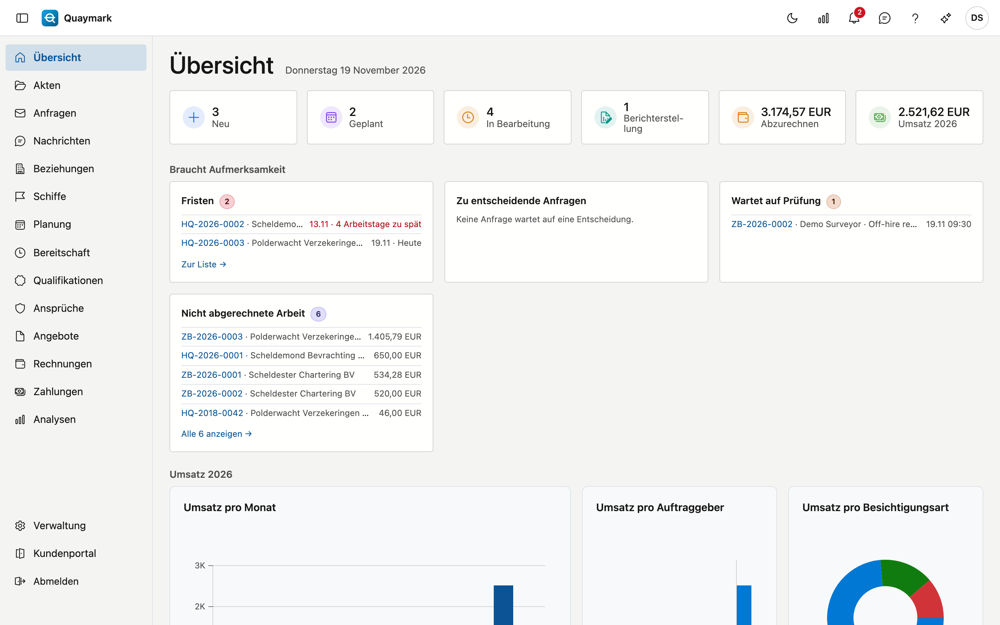

# Erste Schritte

Die Startseite Ihres Büros.

- **Akten nach Status** zählt die offenen Akten: neu, geplant, in Bearbeitung und in Berichterstellung. Ein Klick auf eine Kachel öffnet die Liste der Akten.
- **Rechnungsstellung** (wenn Sie Rechnungen ansehen dürfen): was noch **abzurechnen** ist, als Schätzung pro Akte aus den offenen Leistungen, den weiterzuberechnenden Kosten und der Pauschale abgeschlossener Akten, und der **Umsatz** dieses Jahres pro Auftraggeber und pro Besichtigungsart. Ein Klick auf eine Akte öffnet ihre Zeit und Kosten.
- **Wartet auf Prüfung** (wenn Sie Berichte herausgeben dürfen): die Berichte, für die ein Kollege eine Prüfung angefordert hat. Ein Klick auf die Akte öffnet sie.
- **Fristen** (wenn das Büro in einer Rahmenvereinbarung eine Frist vereinbart hat): die offenen Akten ohne Bericht, deren Frist heute oder am nächsten Arbeitstag abläuft oder schon abgelaufen ist, mit ihrem Besichtiger. → [Frist bis zum Bericht](dossiers.md#frist-bis-zum-bericht)
- Das **Menü links** zeigt die Bildschirme, auf die Sie Zugriff haben. Unten stehen **Verwaltung** (die Einstellungen des Büros) und **Kundenportal** (Ihre Rechnungen und Tickets bei ADM Concept).
- Oben rechts: die **Feedback-Schaltfläche**, diese **Hilfe** und Ihre Einstellungen (Sprache, Anzeige).
- Die **Versionsnummer** unten im Menü öffnet „Was ist neu“.

## Anmelden

Melden Sie sich mit Ihrem **Benutzernamen oder Ihrer E-Mail-Adresse** und Ihrem Passwort an.

- Passwort vergessen oder noch keines? Ihr Administrator gibt Ihnen einen **Link zum Zurücksetzen**.
- Hier wählen Sie auch die **Sprache** des Bildschirms.
- Ist die Zwei-Faktor-Authentifizierung aktiv, fragt der nächste Bildschirm nach einem Code aus Ihrer App.
- Haben Sie einen Passkey, wählen Sie **Mit einem Passkey anmelden**: Ihr Gerät fragt nach Fingerabdruck, Gesicht oder PIN, ohne Passwort und Code.

Nach mehreren fehlgeschlagenen Versuchen wird Ihr Konto vorübergehend gesperrt. Warten Sie kurz und versuchen Sie es erneut.

## Code eingeben

Ihr Konto verwendet die **Zwei-Faktor-Authentifizierung**: neben Ihrem Passwort ist ein Code nötig.

- Öffnen Sie die **Authenticator-App** auf Ihrem Telefon und geben Sie den sechsstelligen Code ein.
- Der Code wechselt alle dreißig Sekunden. Klappt es nicht, warten Sie auf den nächsten Code.
- Telefon verloren? Wenden Sie sich an Ihren **Administrator**.

## Zwei-Faktor-Authentifizierung

Mit der Zwei-Faktor-Authentifizierung fragt die Anwendung bei der Anmeldung neben Ihrem Passwort auch nach einem **Code aus einer App** auf Ihrem Telefon.

- Scannen Sie den **QR-Code** mit einer Authenticator-App.
- Geben Sie zur Bestätigung den **Code** ein, den die App anzeigt.
- Sie können sie hier später wieder ausschalten; dafür fragt der Bildschirm zuerst Ihr **Passwort**.

## Passkeys

Mit einem Passkey melden Sie sich mit dem **Fingerabdruck, dem Gesicht oder der PIN** Ihres Geräts an, statt mit Passwort und Code.

- Einen Passkey hinzufügen können Sie erst, wenn die **Zwei-Faktor-Authentifizierung** aktiv ist. Öffnen Sie oben rechts Ihre Einstellungen und wählen Sie die Zwei-Faktor-Authentifizierung; unter **Passkeys** steht **Passkey hinzufügen**.
- Geben Sie jedem Passkey einen Namen, zum Beispiel den Namen Ihres Laptops. Sie können sie später umbenennen oder entfernen.
- Passwort und Code funktionieren weiterhin, zum Beispiel auf einem anderen Gerät.
- Schalten Sie die Zwei-Faktor-Authentifizierung aus, verschwinden auch Ihre Passkeys.

## Verwaltung

Unten im Menü öffnet **Verwaltung** alle Einstellungen des Büros, als Kacheln in Gruppen: Büro, Besichtigungen und Berichte, Stammdaten, Zugang und Daten.

- Sie sehen nur die Kacheln, für die Sie das Recht haben.
- Fahren Sie mit der Maus über eine Kachel für eine kurze Erklärung; ein Klick öffnet den Bildschirm.

## Kundenportal

**Kundenportal**, direkt über Abmelden, öffnet in einem neuen Tab Ihr Portal bei ADM Concept: die Rechnungen Ihres Abonnements, Ihre Tickets und die Ankündigungen von Quaymark. Es ist etwas anderes als das **Auftraggeberportal**, in dem Ihre Auftraggeber ihre Akten verfolgen.

## Passwort ändern

Hier wählen Sie ein neues Passwort für Ihr Konto.

- Geben Sie zuerst Ihr **aktuelles Passwort** ein, dann zweimal das **neue**.
- Nach der Änderung bleiben Sie angemeldet; das neue Passwort gilt ab der nächsten Anmeldung.

## Passwort festlegen

Sie sind über den **Link zum Zurücksetzen** hierhergekommen, den Ihr Administrator für Sie erstellt hat.

- Wählen Sie ein **neues Passwort** und geben Sie es zur Bestätigung ein zweites Mal ein.
- Danach melden Sie sich mit diesem Passwort an.
- Der Link funktioniert nicht mehr? Er gilt nur eine begrenzte Zeit: bitten Sie Ihren Administrator um einen neuen.

## Testversion

Haben Sie auf quaymark.eu eine Testversion angefordert, erhalten Sie eine eigene Umgebung auf den Namen Ihres Büros, gefüllt mit erfundenen Beispieldaten: Beziehungen, Schiffe und Akten mit Feststellungen und Fotos.

- Sie melden sich mit den Daten aus der **Willkommens-E-Mail** an und wählen sofort ein eigenes Passwort.
- Bei Ihrer ersten Anmeldung werden Sie der **Surveyor** der Beispielakten: Sie sehen sie in Ihrer Planung, bei den Fristen und in der Außendienst-App.
- Oben steht, bis wann die Testversion läuft.
- In einer Testversion **geht nichts nach außen**: keine E-Mail, kein Peppol, keine Signatur und keine Einladung zum Auftraggeberportal. Vorbereiten und ansehen können Sie alles, auch die Berichte als PDF.
- Danach ist die Umgebung **schreibgeschützt**. Werden Sie Kunde, richtet ADM Concept Ihre Umgebung neu ein, ohne die Beispieldaten. Ihr Konto bleibt.

## Eine eingeschränkte Umgebung

ADM One kann Ihre Umgebung einschränken. Quaymark hält sich daran und sagt Ihnen beim Speichern oder Senden, warum.

- **Nur lesen**: Sie können alles ansehen, aber nichts speichern.
- **Keine neue Arbeit**: Laufende Akten schließen Sie ab (Feststellungen, Berichte, Leistungen), aber eine neue Beziehung, eine neue Akte, ein Angebot oder eine Rechnung ist vorerst nicht möglich.
- **Noch nicht freigegeben**: Alles funktioniert, aber es geht nichts nach außen, bis ADM Concept die Umgebung freigibt.

Fragen? Wenden Sie sich an ADM Concept.
