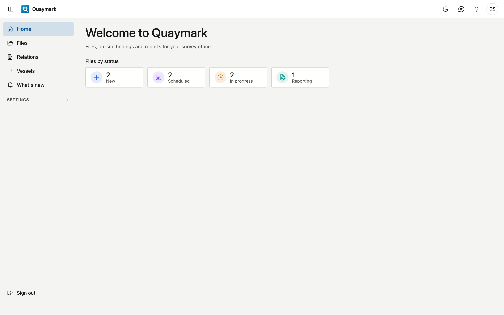

# Getting started

The home page of your office.

- **Files by status** counts the open files: new, scheduled, in progress and reporting. A click on a tile opens the list of files.
- The **menu on the left** shows the screens you have access to. Under **Settings** is what the office administrator sets up: survey types, offices, ports, standard folders, categories and locations.
- Top right: the **feedback button**, this **help** and your preferences (language, display).
- The **version number** at the bottom of the menu opens "What's new".

## Sign in

Sign in with your **user name or email address** and your password.

- Lost your password or do not have one yet? Your administrator gives you a **reset link**.
- You also choose the screen **language** here.
- If two-factor authentication is on, the next screen asks for a code from your app.

After a number of failed attempts your account is locked for a while. Wait a moment and try again.

## Enter the code

Your account uses **two-factor authentication**: a code is needed besides your password.

- Open the **authenticator app** on your phone and enter the six-digit code.
- The code changes every thirty seconds. If it fails, wait for the next code.
- Lost your phone? Contact your **administrator**.

## Two-factor authentication

With two-factor authentication the application asks, when you sign in, for a **code from an app** on your phone besides your password.

- Scan the **QR code** with an authenticator app.
- Enter the **code** the app shows to confirm.
- You can switch it off here later; the screen then first asks for your **password**.

## Change password

Here you choose a new password for your account.

- First enter your **current password**, then the **new** one twice.
- After the change you stay signed in; the new password applies from your next sign-in.

## Set your password

You arrived here through the **reset link** your administrator created for you.

- Choose a **new password** and enter it a second time to confirm.
- Then sign in with that password.
- The link no longer works? It is only valid for a limited time: ask your administrator for a new one.
