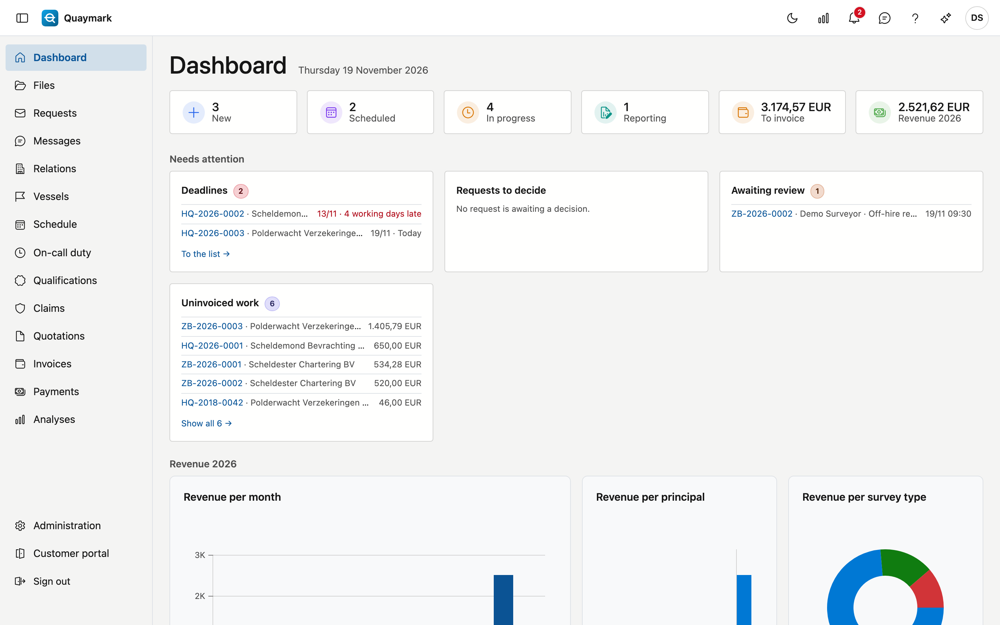

# Getting started

The home page of your office.

- **Files by status** counts the open files: new, scheduled, in progress and reporting. A click on a tile opens the list of files.
- **Invoicing** (for those who may view invoices): what is still **to invoice**, as an estimate per file from the open time entries, the rechargeable expenses and the fixed fee of completed files, and this year's **revenue** per principal and per survey type. A click on a file opens its time and expenses.
- **Awaiting review** (for those who may issue reports): the reports for which a colleague requested a review. A click on the file opens it.
- **Deadlines** (if the office agreed a deadline in a framework agreement): the open files without a report whose deadline is today or the next working day, or has already passed, with their surveyor. → [Report deadline](dossiers.md#report-deadline)
- The **menu on the left** shows the screens you have access to. Under **Settings** is what the office administrator sets up: survey types, offices, ports, standard folders, categories and locations.
- Top right: the **feedback button**, this **help** and your preferences (language, display).
- The **version number** at the bottom of the menu opens "What's new".

## Sign in

Sign in with your **user name or email address** and your password.

- Lost your password or do not have one yet? Your administrator gives you a **reset link**.
- You also choose the screen **language** here.
- If two-factor authentication is on, the next screen asks for a code from your app.

After a number of failed attempts your account is locked for a while. Wait a moment and try again.

## Enter the code

Your account uses **two-factor authentication**: a code is needed besides your password.

- Open the **authenticator app** on your phone and enter the six-digit code.
- The code changes every thirty seconds. If it fails, wait for the next code.
- Lost your phone? Contact your **administrator**.

## Two-factor authentication

With two-factor authentication the application asks, when you sign in, for a **code from an app** on your phone besides your password.

- Scan the **QR code** with an authenticator app.
- Enter the **code** the app shows to confirm.
- You can switch it off here later; the screen then first asks for your **password**.

## Change password

Here you choose a new password for your account.

- First enter your **current password**, then the **new** one twice.
- After the change you stay signed in; the new password applies from your next sign-in.

## Set your password

You arrived here through the **reset link** your administrator created for you.

- Choose a **new password** and enter it a second time to confirm.
- Then sign in with that password.
- The link no longer works? It is only valid for a limited time: ask your administrator for a new one.

## Trial version

If you requested a trial version on quaymark.eu, you get your own environment in the name of your office, filled with fictitious sample data: relations, ships and files with findings and photos.

- You sign in with the details from the **welcome email** and choose your own password straight away.
- At your first sign-in you become the **surveyor** of the sample files: you see them in your planning, in the deadlines and in the field app.
- The top of the screen shows until when the trial runs.
- In a trial version **nothing goes out**: no email, Peppol, signing or client portal invitation. You can prepare and view everything, including the reports as PDF.
- When it ends, the environment becomes **read-only**. If you become a customer, ADM Concept sets up your environment again, without the sample data. Your account stays.

## A restricted environment

ADM One can restrict your environment. Quaymark respects it and tells you why, when you save or send.

- **Read-only**: you can view everything, but save nothing.
- **No new work**: you finish ongoing files (findings, reports, time entries), but a new relation, a new file, a quote or an invoice is not possible for now.
- **Not yet released**: everything works, but nothing goes out until ADM Concept releases the environment.

Questions? Contact ADM Concept.
