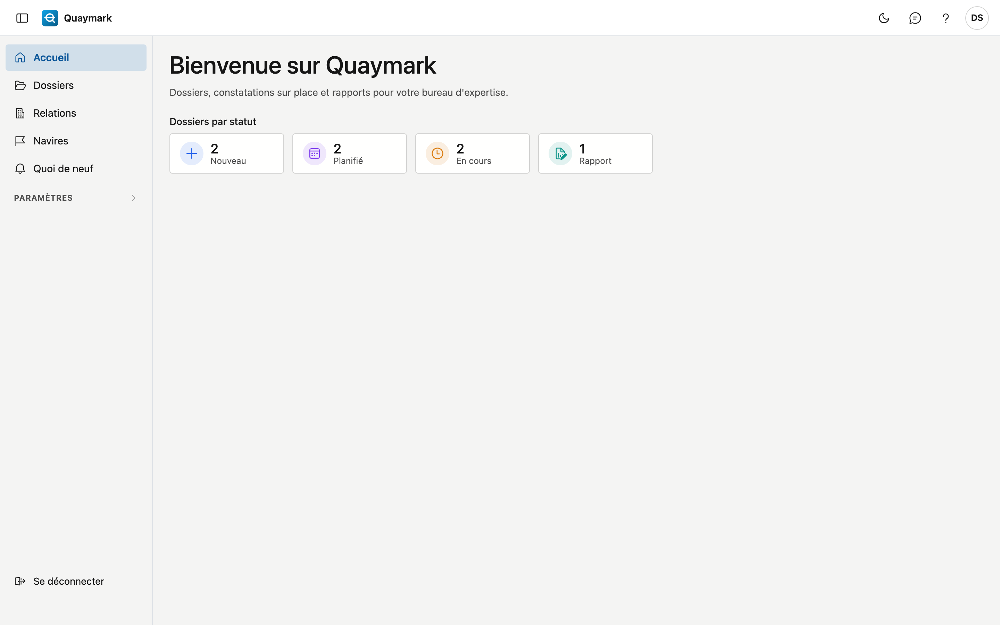

# Premiers pas

La page d'accueil de votre bureau.

- **Dossiers par statut** compte les dossiers ouverts : nouveaux, planifiés, en cours et en rapport. Un clic sur une tuile ouvre la liste des dossiers.
- Le **menu de gauche** affiche les écrans auxquels vous avez accès. Sous **Paramètres** se trouve ce que l'administrateur du bureau configure : types d'expertise, sites, ports, répertoires standard, catégories et emplacements.
- En haut à droite : le bouton de **retour d'information**, cette **aide** et vos préférences (langue, affichage).
- Le **numéro de version** en bas du menu ouvre « Quoi de neuf ».

## Connexion

Connectez-vous avec votre **nom d'utilisateur ou adresse e-mail** et votre mot de passe.

- Mot de passe perdu ou pas encore de mot de passe ? Votre administrateur vous fournit un **lien de réinitialisation**.
- Vous choisissez ici aussi la **langue** de l'écran.
- Si la double authentification est activée, l'écran suivant demande un code de votre application.

Après plusieurs tentatives échouées, votre compte est temporairement bloqué. Patientez un moment et réessayez.

## Saisir le code

Votre compte utilise la **double authentification** : un code est nécessaire en plus de votre mot de passe.

- Ouvrez l'**application d'authentification** sur votre téléphone et saisissez le code à six chiffres.
- Le code change toutes les trente secondes. Si cela échoue, attendez le code suivant.
- Téléphone perdu ? Contactez votre **administrateur**.

## Double authentification

Avec la double authentification, l'application demande à la connexion, en plus de votre mot de passe, un **code d'une application** sur votre téléphone.

- Scannez le **code QR** avec une application d'authentification.
- Saisissez, pour confirmer, le **code** affiché par l'application.
- Vous pouvez la désactiver ici plus tard ; l'écran demande alors d'abord votre **mot de passe**.

## Modifier le mot de passe

Ici, vous choisissez un nouveau mot de passe pour votre compte.

- Saisissez d'abord votre **mot de passe actuel**, puis deux fois le **nouveau**.
- Après la modification, vous restez connecté ; le nouveau mot de passe vaut dès la prochaine connexion.

## Définir le mot de passe

Vous êtes arrivé ici via le **lien de réinitialisation** que votre administrateur a créé pour vous.

- Choisissez un **nouveau mot de passe** et saisissez-le une seconde fois pour confirmer.
- Connectez-vous ensuite avec ce mot de passe.
- Le lien ne fonctionne plus ? Il n'est valable qu'un temps limité : demandez-en un nouveau à votre administrateur.
