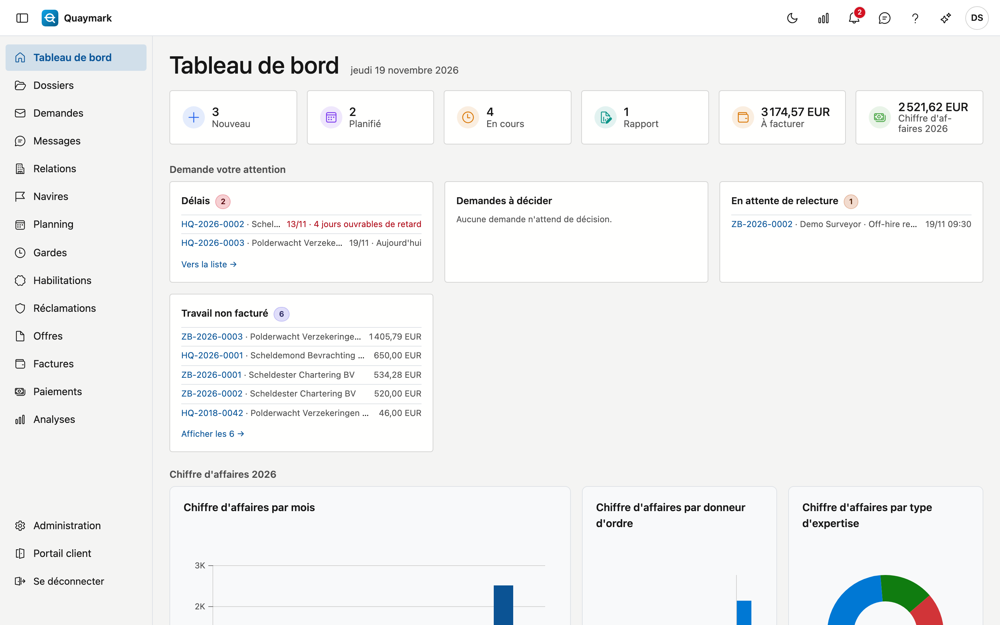

# Premiers pas

Le **Tableau de bord** est la page d'accueil de votre bureau : le premier élément du menu.

- **Dossiers par statut** compte les dossiers ouverts : nouveaux, planifiés, en cours et en rapport. Un clic sur une tuile ouvre la liste des dossiers.
- **Facturation** (pour qui peut voir les factures) : ce qui reste **à facturer**, en estimation par dossier à partir des prestations ouvertes, des frais à refacturer et du forfait des dossiers terminés, et le **chiffre d'affaires** de l'année par donneur d'ordre et par type d'expertise. Un clic sur un dossier ouvre ses temps et frais.
- **En attente de relecture** (pour qui peut émettre des rapports) : les rapports pour lesquels un collègue a demandé une relecture. Un clic sur le dossier l'ouvre.
- **Délais** (si le bureau a convenu un délai dans un accord-cadre) : les dossiers ouverts sans rapport dont le délai expire aujourd'hui ou le jour ouvrable suivant, ou est déjà dépassé, avec leur expert. → [Délai jusqu'au rapport](dossiers.md#delai-jusquau-rapport)
- Le **menu de gauche** affiche les écrans auxquels vous avez accès. En bas se trouvent **Administration** (les paramètres du bureau) et **Portail client** (vos factures et tickets chez ADM Concept).
- En haut à droite : le bouton de **retour d'information**, cette **aide** et vos préférences (langue, affichage).
- Le **numéro de version** en bas du menu ouvre « Quoi de neuf ».

## Connexion

Connectez-vous avec votre **nom d'utilisateur ou adresse e-mail** et votre mot de passe.

- Mot de passe perdu ou pas encore de mot de passe ? Votre administrateur vous fournit un **lien de réinitialisation**.
- Vous choisissez ici aussi la **langue** de l'écran.
- Si la double authentification est activée, l'écran suivant demande un code de votre application.
- Si vous avez une clé d'accès, choisissez **Se connecter avec une clé d'accès** : votre appareil demande votre empreinte digitale, votre visage ou votre code PIN, sans mot de passe ni code.

Après plusieurs tentatives échouées, votre compte est temporairement bloqué. Patientez un moment et réessayez.

## Saisir le code

Votre compte utilise la **double authentification** : un code est nécessaire en plus de votre mot de passe.

- Ouvrez l'**application d'authentification** sur votre téléphone et saisissez le code à six chiffres.
- Le code change toutes les trente secondes. Si cela échoue, attendez le code suivant.
- Téléphone perdu ? Contactez votre **administrateur**.

## Double authentification

Avec la double authentification, l'application demande à la connexion, en plus de votre mot de passe, un **code d'une application** sur votre téléphone.

- Scannez le **code QR** avec une application d'authentification.
- Saisissez, pour confirmer, le **code** affiché par l'application.
- Vous pouvez la désactiver ici plus tard ; l'écran demande alors d'abord votre **mot de passe**.

## Clés d'accès

Avec une clé d'accès, vous vous connectez avec **l'empreinte digitale, le visage ou le code PIN** de votre appareil, au lieu du mot de passe et du code.

- Vous ne pouvez ajouter une clé d'accès que si la **double authentification** est active. Ouvrez vos préférences en haut à droite et choisissez la double authentification ; sous **Clés d'accès** se trouve **Ajouter une clé d'accès**.
- Donnez un nom à chaque clé d'accès, par exemple le nom de votre ordinateur portable. Vous pouvez les renommer ou les supprimer plus tard.
- Le mot de passe et le code continuent de fonctionner, par exemple sur un autre appareil.
- Si vous désactivez la double authentification, vos clés d'accès disparaissent aussi.

## Administration

En bas du menu, **Administration** ouvre tous les paramètres du bureau, sous forme de tuiles par groupe : Bureau, Expertises et rapports, Données de base, Accès et Données.

- Vous ne voyez que les tuiles pour lesquelles vous avez le droit.
- Survolez une tuile pour une courte explication ; un clic ouvre l'écran.

## Portail client

**Portail client**, juste au-dessus de Déconnexion, ouvre dans un nouvel onglet votre portail chez ADM Concept : les factures de votre abonnement, vos tickets et les annonces de Quaymark. C'est autre chose que le **portail des donneurs d'ordre**, où vos donneurs d'ordre suivent leurs dossiers.

## Modifier le mot de passe

Ici, vous choisissez un nouveau mot de passe pour votre compte.

- Saisissez d'abord votre **mot de passe actuel**, puis deux fois le **nouveau**.
- Après la modification, vous restez connecté ; le nouveau mot de passe vaut dès la prochaine connexion.

## Définir le mot de passe

Vous êtes arrivé ici via le **lien de réinitialisation** que votre administrateur a créé pour vous.

- Choisissez un **nouveau mot de passe** et saisissez-le une seconde fois pour confirmer.
- Connectez-vous ensuite avec ce mot de passe.
- Le lien ne fonctionne plus ? Il n'est valable qu'un temps limité : demandez-en un nouveau à votre administrateur.

## Version d'essai

Si vous avez demandé une version d'essai sur quaymark.eu, vous recevez votre propre environnement au nom de votre bureau, rempli de données d'exemple fictives : relations, navires et dossiers avec constats et photos.

- Vous vous connectez avec les données de l'**e-mail de bienvenue** et choisissez aussitôt votre propre mot de passe.
- À votre première connexion, vous devenez le **surveyor** des dossiers d'exemple : vous les voyez dans votre planning, dans les délais et dans l'application de terrain.
- En haut figure la date de fin de l'essai.
- Dans une version d'essai, **rien ne part vers l'extérieur** : pas d'e-mail, de Peppol, de signature ni d'invitation au portail des donneurs d'ordre. Vous pouvez tout préparer et consulter, y compris les rapports en PDF.
- À la fin, l'environnement passe en **lecture seule**. Si vous devenez client, ADM Concept réinstalle votre environnement, sans les données d'exemple. Votre compte est conservé.

## Un environnement restreint

ADM One peut restreindre votre environnement. Quaymark le respecte et vous dit pourquoi, à l'enregistrement ou à l'envoi.

- **Lecture seule** : vous pouvez tout consulter, mais rien enregistrer.
- **Pas de nouveau travail** : vous terminez les dossiers en cours (constats, rapports, prestations), mais une nouvelle relation, un nouveau dossier, une offre ou une facture n'est pas possible pour l'instant.
- **Pas encore libéré** : tout fonctionne, mais rien ne part vers l'extérieur tant qu'ADM Concept n'a pas libéré l'environnement.

Des questions ? Contactez ADM Concept.
