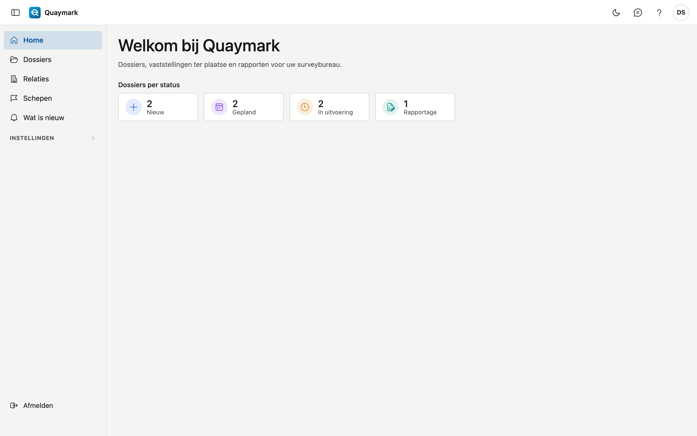

# Aan de slag

De startpagina van uw bureau.

- **Dossiers per status** telt de open dossiers: nieuw, gepland, in uitvoering en in rapportage. Een klik op een tegel opent de lijst van de dossiers.
- Het **menu links** toont de schermen waartoe u toegang hebt. Onder **Instellingen** staat wat de beheerder van het bureau instelt: soorten survey, vestigingen, havens, standaardmappen, categorieën en plaatsen.
- Rechtsboven: de **feedbackknop**, deze **hulp** en uw voorkeuren (taal, weergave).
- Het **versienummer** onderaan het menu opent "Wat is nieuw".

## Aanmelden

Meld u aan met uw **gebruikersnaam of e-mailadres** en uw wachtwoord.

- Wachtwoord kwijt of nog geen wachtwoord? Uw beheerder bezorgt u een **herstel-link**.
- U kiest hier ook de **taal** van het scherm.
- Staat tweestapsverificatie aan, dan vraagt het volgende scherm een code uit uw app.

Na een aantal mislukte pogingen wordt uw account tijdelijk geblokkeerd. Wacht even en probeer opnieuw.

## Code invullen

Uw account gebruikt **tweestapsverificatie**: naast uw wachtwoord is er een code nodig.

- Open de **authenticator-app** op uw telefoon en vul de code van zes cijfers in.
- De code wisselt elke dertig seconden. Lukt het niet, wacht dan op de volgende code.
- Telefoon kwijt? Neem contact op met uw **beheerder**.

## Tweestapsverificatie

Met tweestapsverificatie vraagt de toepassing bij het aanmelden naast uw wachtwoord ook een **code uit een app** op uw telefoon.

- Scan de **QR-code** met een authenticator-app.
- Vul ter bevestiging de **code** in die de app toont.
- U kunt het hier later weer uitschakelen; daarvoor vraagt het scherm eerst uw **wachtwoord**.

## Wachtwoord wijzigen

Hier kiest u een nieuw wachtwoord voor uw account.

- Vul eerst uw **huidige wachtwoord** in, daarna twee keer het **nieuwe**.
- Na het wijzigen blijft u aangemeld; het nieuwe wachtwoord geldt vanaf de volgende aanmelding.

## Wachtwoord instellen

U kwam hier via de **herstel-link** die uw beheerder voor u maakte.

- Kies een **nieuw wachtwoord** en vul het ter bevestiging een tweede keer in.
- Daarna meldt u zich aan met dat wachtwoord.
- Werkt de link niet meer? Hij is maar een beperkte tijd geldig: vraag uw beheerder een nieuwe.
