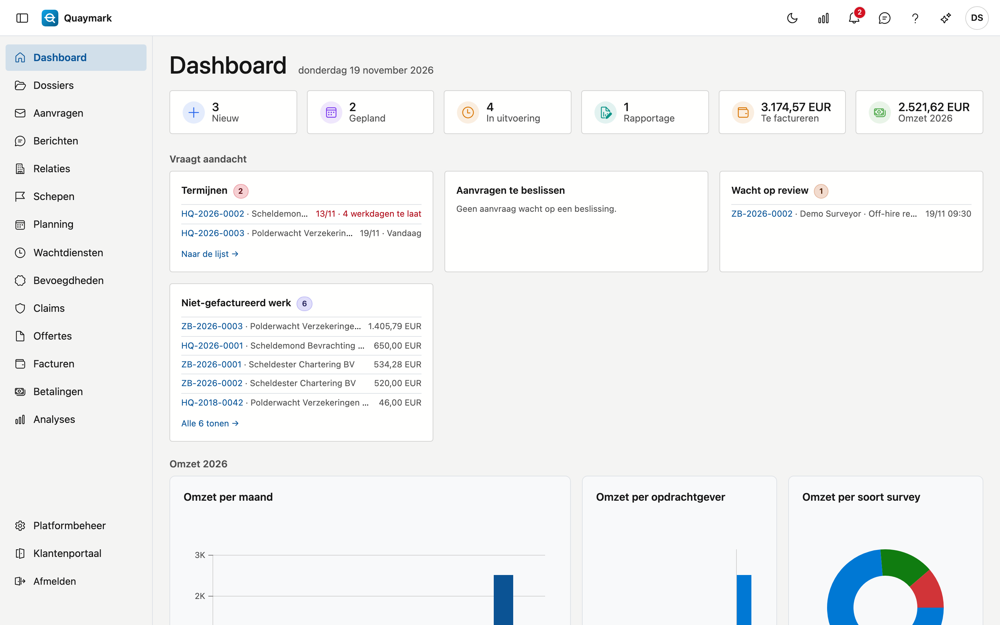

# Aan de slag

Het **Dashboard** is de startpagina van uw bureau: het eerste item in het menu.

- **Bovenaan** de open dossiers per status: nieuw, gepland, in uitvoering en in rapportage. Een klik op een tegel opent de lijst met die status. Wie facturen mag bekijken, ziet ook wat er nog **te factureren** is (een raming) en de **omzet** van dit jaar.
- **Vraagt aandacht**: kaarten met de eerste regels en onderaan een link naar de volledige lijst.
    - **Termijnen** (als het bureau in een raamafspraak een termijn afsprak): de open dossiers zonder rapport waarvan de termijn vandaag of de volgende werkdag vervalt, of al voorbij is. → [Termijn tot het rapport](dossiers.md#termijn-tot-het-rapport)
    - **Aanvragen te beslissen**: opdrachten uit het opdrachtgeversportaal of het webformulier. → [Aanvragen](aanvragen.md)
    - **Wacht op review** (wie rapporten mag uitgeven): de rapporten waarvoor een collega een review vroeg.
    - **Niet-gefactureerd werk** (wie facturen mag bekijken): de grootste ramingen eerst. → [Te factureren](facturen.md#te-factureren)
    - **Wachtdiensten**: wie nu van wacht staat per vestiging, met een rode teller als de rol de komende vier weken niet klopt. → [Wachtdiensten](wachtdiensten.md)
- **Omzet** (wie facturen mag bekijken): per maand, met vorig jaar als lijn ernaast, de grootste opdrachtgevers en het aandeel van elke soort survey. In EUR, zonder btw.
- Het **menu links** toont de schermen waartoe u toegang hebt. Onderaan staan **Platformbeheer** (de instellingen van het bureau) en **Klantenportaal** (uw facturen en tickets bij ADM Concept).
- Rechtsboven: de **feedbackknop**, deze **hulp** en uw voorkeuren (taal, weergave).
- Het **versienummer** onderaan het menu opent "Wat is nieuw".

## Aanmelden

Meld u aan met uw **gebruikersnaam of e-mailadres** en uw wachtwoord.

- Wachtwoord kwijt? Klik op **Wachtwoord vergeten?** en vul het e-mailadres van uw account in: u krijgt een mail met een link om een nieuw wachtwoord te kiezen. De link is 1 uur geldig. Nog geen wachtwoord? Uw beheerder bezorgt u een **herstel-link**.
- U kiest hier ook de **taal** van het scherm.
- Staat tweestapsverificatie aan, dan vraagt het volgende scherm een code uit uw app.
- Hebt u een passkey, kies dan **Aanmelden met een passkey**: uw toestel vraagt uw vingerafdruk, gezicht of pincode, zonder wachtwoord en code.

Na een aantal mislukte pogingen wordt uw account tijdelijk geblokkeerd. Wacht even en probeer opnieuw.

## Code invullen

Uw account gebruikt **tweestapsverificatie**: naast uw wachtwoord is er een code nodig.

- Open de **authenticator-app** op uw telefoon en vul de code van zes cijfers in.
- De code wisselt elke dertig seconden. Lukt het niet, wacht dan op de volgende code.
- Telefoon kwijt? Neem contact op met uw **beheerder**.

## Tweestapsverificatie

Met tweestapsverificatie vraagt de toepassing bij het aanmelden naast uw wachtwoord ook een **code uit een app** op uw telefoon.

- Scan de **QR-code** met een authenticator-app.
- Vul ter bevestiging de **code** in die de app toont.
- U kunt het hier later weer uitschakelen; daarvoor vraagt het scherm eerst uw **wachtwoord**.

## Passkeys

Met een passkey meldt u zich aan met de **vingerafdruk, het gezicht of de pincode** van uw toestel, in plaats van wachtwoord en code.

- Een passkey toevoegen kan pas als **tweestapsverificatie** aan staat. Open uw voorkeuren rechtsboven en kies tweestapsverificatie; onder **Passkeys** staat **Passkey toevoegen**.
- Geef elke passkey een naam, bijvoorbeeld de naam van uw laptop. U kunt ze later hernoemen of verwijderen.
- Wachtwoord en code blijven werken, bijvoorbeeld op een ander toestel.
- Schakelt u tweestapsverificatie uit, dan verdwijnen ook uw passkeys.

## Platformbeheer

Onderaan het menu opent **Platformbeheer** alle instellingen van het bureau, als tegels in groepen: Bureau, Surveys en rapporten, Basisgegevens, Toegang en Gegevens.

- U ziet enkel de tegels waarvoor u het recht hebt.
- Ga met de muis over een tegel voor een korte uitleg; een klik opent het scherm.

## Klantenportaal

**Klantenportaal**, pal boven Afmelden, opent in een nieuw tabblad uw portaal bij ADM Concept: de facturen van uw abonnement, uw tickets en de aankondigingen van Quaymark. Het is iets anders dan het **opdrachtgeversportaal**, waarin uw opdrachtgevers hun dossiers volgen.

## Wachtwoord wijzigen

Hier kiest u een nieuw wachtwoord voor uw account.

- Vul eerst uw **huidige wachtwoord** in, daarna twee keer het **nieuwe**.
- Na het wijzigen blijft u op dit toestel aangemeld; op uw andere toestellen wordt u afgemeld. Daar meldt u zich opnieuw aan met het nieuwe wachtwoord.

## Wachtwoord instellen

U kwam hier via de link uit de mail van **Wachtwoord vergeten?**, of via de **herstel-link** die uw beheerder voor u maakte.

- Kies een **nieuw wachtwoord** en vul het ter bevestiging een tweede keer in.
- Daarna meldt u zich aan met dat wachtwoord.
- Werkt de link niet meer? Hij is maar een beperkte tijd geldig: vraag een nieuwe aan met **Nieuwe link aanvragen**, of aan uw beheerder.

## Proefversie

Vroeg u een proefversie aan op quaymark.eu, dan krijgt u een eigen omgeving op naam van uw bureau, gevuld met verzonnen voorbeeldgegevens: relaties, schepen en dossiers met vaststellingen en foto's.

- U meldt zich aan met de gegevens uit de **welkomstmail** en kiest meteen een eigen wachtwoord.
- Bij uw eerste aanmelding wordt u de **surveyor** van de voorbeelddossiers: u ziet ze in uw planning, bij de termijnen en in de veldapp.
- Bovenaan staat tot wanneer de proef loopt.
- In een proefversie **vertrekt er niets naar buiten**: geen mail, Peppol, ondertekening of uitnodiging voor het opdrachtgeversportaal. Alles voorbereiden en bekijken kan wel, ook de rapporten als PDF.
- Na afloop staat de omgeving op **alleen lezen**. Wordt u klant, dan zet ADM Concept uw omgeving opnieuw op, zonder de voorbeeldgegevens. Uw account blijft.

## Een beperkte omgeving

ADM One kan uw omgeving beperken. Quaymark houdt zich daaraan en zegt waarom, bij het bewaren of het versturen.

- **Alleen lezen**: u kunt alles bekijken, maar niets bewaren.
- **Geen nieuw werk**: lopende dossiers werkt u af (vaststellingen, rapporten, prestaties), maar een nieuwe relatie, een nieuw dossier, een offerte of een factuur kan even niet.
- **Nog niet vrijgegeven**: alles werkt, maar er vertrekt niets naar buiten tot ADM Concept de omgeving vrijgeeft.

Vragen? Neem contact op met ADM Concept.
