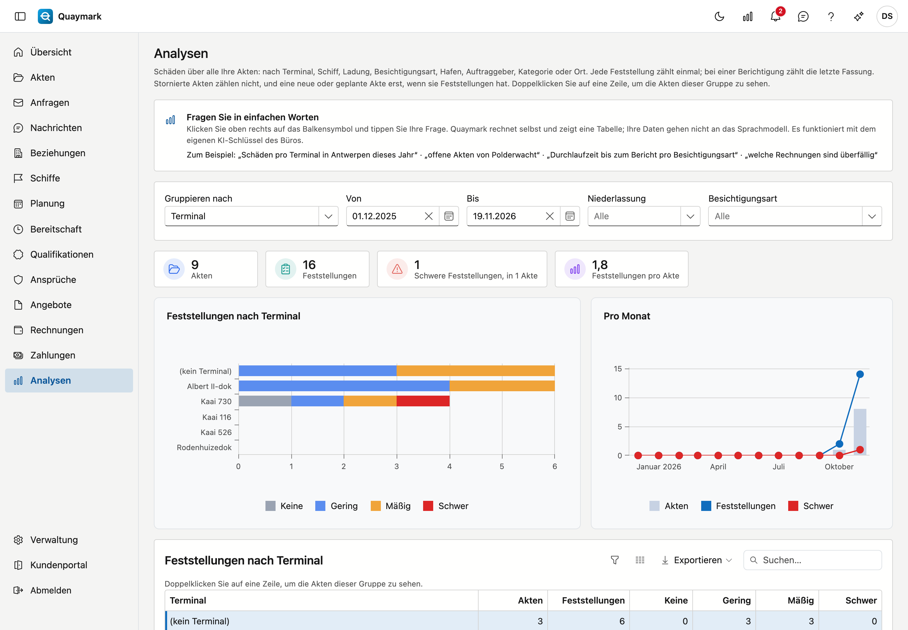

# Analysen

Diese Seite zeigt, wo sich Schäden häufen: an welchem Terminal, bei welchem Schiff oder welcher Ladung am häufigsten etwas festgestellt wird, und wie schwer.

## Die Seite öffnen

Klicken Sie im Menü auf **Analysen**. Dafür ist das Recht nötig, Analysen anzusehen; die Rollen Benutzer und Administrator haben es standardmäßig.

## Auswählen, was Sie sehen

- **Gruppieren nach**: Terminal, Schiff, Ladung, Besichtigungsart, Hafen, Auftraggeber, Kategorie oder Ort. Terminal und Ladung sind Freitext auf der Akte: Groß- und Kleinschreibung und Leerzeichen machen keinen Unterschied, und die Analyse zeigt die am häufigsten verwendete Schreibweise.
- **Von** und **Bis**: der Zeitraum folgt dem Datum der Akte. Das ist das geplante Datum, sonst das Datum des Auftrags, sonst der Tag, an dem die Akte angelegt wurde. Standardmäßig die letzten zwölf Monate.
- **Niederlassung** und **Besichtigungsart** begrenzen die Akten. Leer bedeutet alle.

## Was zählt

- Jede Feststellung zählt einmal. Wurde eine Feststellung berichtigt, zählt nur die letzte Fassung, mit ihrem Schweregrad.
- Abgeschlossene Akten zählen; Akten im Papierkorb nicht.
- Beim Gruppieren nach Kategorie oder Ort zählt eine Akte in jeder Gruppe, in der sie eine Feststellung hat. Bei den anderen Gruppierungen steht jede Akte in einer Gruppe, auch eine Akte ohne Feststellungen.

## Kennzahlen und Grafiken

Oben stehen **Akten**, **Feststellungen**, die Zahl der schweren Feststellungen (und in wie vielen Akten) und die durchschnittliche Zahl der Feststellungen pro Akte.

Die Grafik **Feststellungen nach …** zeigt pro Gruppe die Zahl der Feststellungen, gestapelt nach Schweregrad: von Grau (keine) bis Rot (schwer). Die fünfzehn größten Gruppen stehen einzeln, der Rest zusammen als **Andere**. Die Grafik **Pro Monat** zeigt die Zahl der Akten, Feststellungen und schweren Feststellungen pro Monat des Zeitraums, auch für einen Monat ohne Akten.

## Die Tabelle

Die Tabelle zeigt jede Gruppe mit der Zahl der Akten und Feststellungen pro Schweregrad. Klicken Sie auf eine Zeile: unter der Tabelle erscheinen die Akten dieser Gruppe, mit einem Link zu jeder Akte. Exportieren Sie die Tabelle mit der Schaltfläche über der Tabelle nach Excel.

## Fragen Sie in einfachen Worten

Oben rechts steht die Schaltfläche **Fragen Sie Ihre Daten** (ein Balkensymbol). Tippen Sie eine Frage ein, etwa *Schäden pro Terminal in Antwerpen dieses Jahr*, und Quaymark zeigt eine Tabelle. Auf dieser Seite steht eine Karte mit Beispielen.

Der Assistent beantwortet vier Arten von Fragen:

- **Schäden gruppiert**: Feststellungen pro Terminal, Schiff, Ladung, Besichtigungsart, Hafen, Auftraggeber, Kategorie oder Ort, pro Schweregrad. Dieselben Zahlen wie diese Seite.
- **Akten**: eine Liste oder eine Zählung, nach Status, Auftraggeber, Schiff, Hafen, Besichtiger, Besichtigungsart, Niederlassung und Zeitraum.
- **Durchlaufzeit bis zum Bericht**: die Tage vom Auftrag bis zum ersten herausgegebenen Bericht, als Durchschnitt, Median, kürzeste und längste.
- **Fakturierung**: fakturiert pro Auftraggeber oder pro Monat (netto, Gutschriften abgezogen) oder die offenen und überfälligen Rechnungen.

Gut zu wissen:

- Das Sprachmodell wählt nur die Frage und die Filter; Quaymark rechnet selbst. **Ihre Daten gehen nicht an das Sprachmodell**, nur Ihre Frage.
- Sie erhalten nur Fragen zu dem, was Sie sehen dürfen: die Fakturierung nur mit dem Recht, Rechnungen anzusehen.
- Findet ein Name nichts, sagt die Tabelle das. Passt ein Name zu mehr als einem Auftraggeber, Schiff oder Besichtiger, zeigt die Tabelle die Kandidaten: Fragen Sie dann genauer.
- Der Assistent funktioniert mit dem **eigenen KI-Schlüssel des Büros**. Fragen Sie ADM-Concept, wie Sie ihn einrichten.

## Im Kundenportal

Der Auftraggeber sieht im Kundenportal dieselben Analysen über seine eigenen Akten, unter **Analysen**, ohne Gruppieren nach Auftraggeber.

- Eine Akte zählt erst, wenn ihr Bericht für den Auftraggeber verfügbar ist. Steht in **Firmendaten**, dass der Bericht erst nach der Unterzeichnung ins Portal kommt, zählt nur eine unterschriebene Fassung. → [Firmendaten](bureaugegevens.md)
- Der Auftraggeber sieht die Feststellungen so, wie sie in diesem Bericht standen. Was das Büro danach hinzufügt oder berichtigt, zählt erst mit der nächsten Fassung des Berichts.
