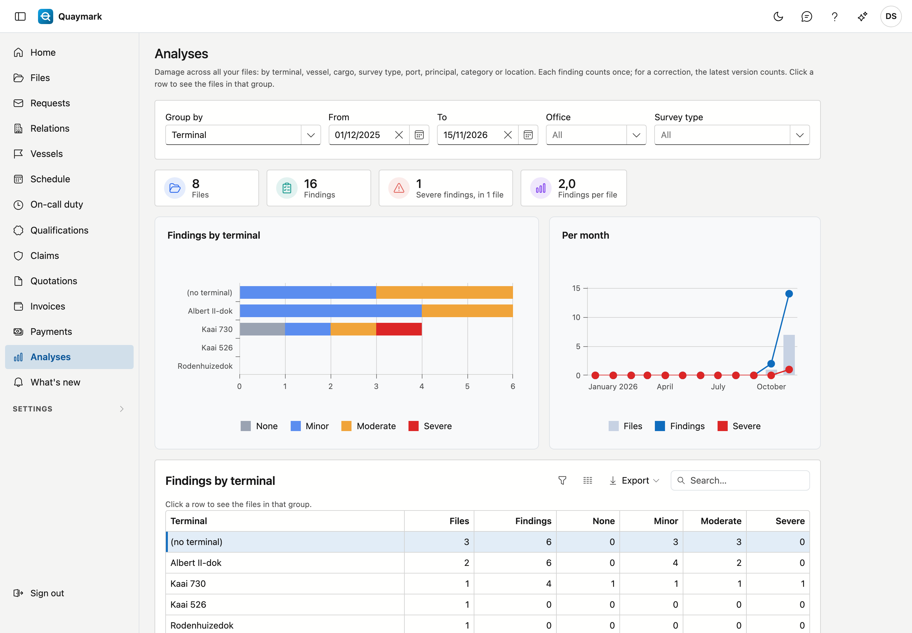

# Analyses

This screen shows where damage piles up: at which terminal, on which vessel or with which cargo a finding is recorded most often, and how severe it is.

## Opening the screen

Click **Analyses** in the menu. This needs the right to view analyses; the User and Administrator roles have it by default.

## Choosing what you see

- **Group by**: terminal, vessel, cargo, survey type, port, principal, category or location. Terminal and cargo are free text on the file: capitals and spaces make no difference, and the analysis shows the spelling used most often.
- **From** and **To**: the period follows the date of the file. That is the scheduled date, otherwise the date of the assignment, otherwise the day the file was created. By default the last twelve months.
- **Office** and **Survey type** limit the files. Empty means all.

## What counts

- Each finding counts once. If a finding was corrected, only the latest version counts, with its severity.
- Closed files count; files in the recycle bin do not.
- When grouping by category or location, a file counts in every group where it has a finding. For the other groupings, each file is in one group, even a file without findings.

## Key figures and charts

At the top are **Files**, **Findings**, the number of severe findings (and in how many files) and the average number of findings per file.

The **Findings by …** chart shows the number of findings per group, stacked by severity: from grey (none) to red (severe). The fifteen largest groups are shown separately, the rest together as **Other**. The **Per month** chart shows the number of files, findings and severe findings per month of the period, also for a month without files.

## The table

The table shows each group with the number of files and findings per severity. Click a row: the files in that group appear below the table, with a link to each file. Export the table to Excel with the button above the table.

## In the client portal

The principal sees the same analyses of their own files in the client portal, under **Analyses**, without grouping by principal.

- A file only counts once its report is available to the principal. If **Company details** says the report only reaches the portal after signing, only a signed version counts. → [Company details](bureaugegevens.md)
- The principal sees the findings as they stood in that report. What the office adds or corrects afterwards only counts with the next version of the report.
