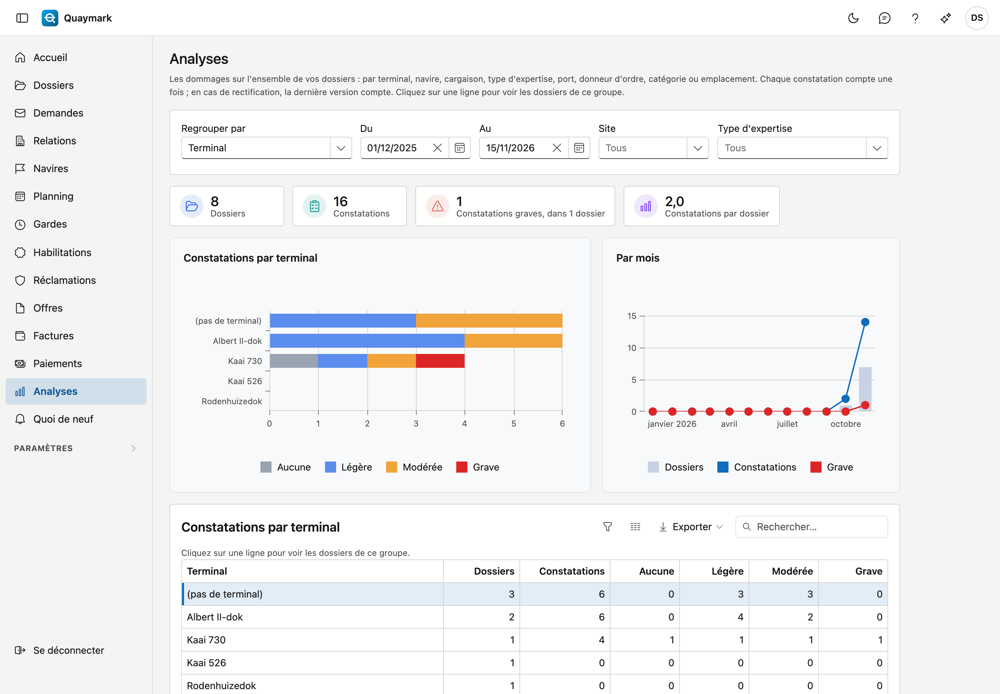

# Analyses

Cet écran montre où les dommages s'accumulent : à quel terminal, sur quel navire ou avec quelle cargaison une constatation revient le plus souvent, et avec quelle gravité.

## Ouvrir l'écran

Cliquez dans le menu sur **Analyses**. Il faut pour cela le droit de voir les analyses ; les rôles Utilisateur et Administrateur l'ont par défaut.

## Choisir ce que vous voyez

- **Regrouper par** : terminal, navire, cargaison, type d'expertise, port, donneur d'ordre, catégorie ou emplacement. Terminal et cargaison sont du texte libre sur le dossier : majuscules et espaces ne font pas de différence, et l'analyse montre l'écriture la plus utilisée.
- **Du** et **Au** : la période suit la date du dossier. C'est la date planifiée, sinon la date de la mission, sinon le jour de création du dossier. Par défaut les douze derniers mois.
- **Site** et **Type d'expertise** limitent les dossiers. Vide signifie tous.

## Ce qui compte

- Chaque constatation compte une fois. Si une constatation a été rectifiée, seule la dernière version compte, avec sa gravité.
- Les dossiers clôturés comptent ; les dossiers dans la corbeille non.
- En regroupant par catégorie ou emplacement, un dossier compte dans chaque groupe où il a une constatation. Pour les autres regroupements, chaque dossier figure dans un seul groupe, même un dossier sans constatation.

## Chiffres clés et graphiques

En haut figurent **Dossiers**, **Constatations**, le nombre de constatations graves (et dans combien de dossiers) et le nombre moyen de constatations par dossier.

Le graphique **Constatations par …** montre par groupe le nombre de constatations, empilées par gravité : du gris (aucune) au rouge (grave). Les quinze plus grands groupes figurent séparément, le reste réuni sous **Autres**. Le graphique **Par mois** montre le nombre de dossiers, de constatations et de constatations graves par mois de la période, même pour un mois sans dossier.

## Le tableau

Le tableau montre chaque groupe avec le nombre de dossiers et de constatations par gravité. Cliquez sur une ligne : les dossiers de ce groupe apparaissent sous le tableau, avec un lien vers chaque dossier. Exportez le tableau vers Excel avec le bouton au-dessus du tableau.

## Dans le portail client

Le donneur d'ordre voit dans le portail client les mêmes analyses sur ses propres dossiers, sous **Analyses**, sans regroupement par donneur d'ordre.

- Un dossier ne compte que lorsque son rapport est disponible pour le donneur d'ordre. Si **Données du bureau** indique que le rapport n'arrive dans le portail qu'après signature, seule une version signée compte. → [Données du bureau](bureaugegevens.md)
- Le donneur d'ordre voit les constatations telles qu'elles figuraient dans ce rapport. Ce que le bureau ajoute ou rectifie ensuite ne compte qu'avec la version suivante du rapport.
