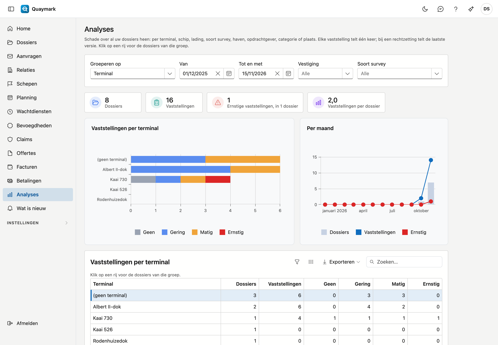

# Analyses

Op dit scherm ziet u waar de schade zich opstapelt: bij welke terminal, welk schip of welke lading het vaakst iets vastgesteld wordt, en hoe ernstig.

## Het scherm openen

Klik in het menu op **Analyses**. Daarvoor is het recht om analyses te bekijken nodig; de rollen Gebruiker en Beheerder hebben het standaard.

## Kiezen wat u ziet

- **Groeperen op**: terminal, schip, lading, soort survey, haven, opdrachtgever, categorie of plaats. Terminal en lading zijn vrije tekst op het dossier: hoofdletters en spaties maken geen verschil, en de analyse toont de schrijfwijze die het meest gebruikt wordt.
- **Van** en **Tot en met**: de periode volgt de datum van het dossier. Dat is de geplande datum, anders de datum van de opdracht, anders de dag waarop het dossier aangemaakt werd. Standaard de laatste twaalf maanden.
- **Vestiging** en **Soort survey** beperken de dossiers. Leeg betekent alle.

## Wat telt

- Elke vaststelling telt één keer. Is een vaststelling rechtgezet, dan telt enkel de laatste versie, met haar ernst.
- Afgesloten dossiers tellen mee; dossiers in de prullenbak niet.
- Bij groeperen op categorie of plaats telt een dossier in elke groep waarin het een vaststelling heeft. Bij de andere groeperingen staat elk dossier in één groep, ook een dossier zonder vaststellingen.

## Kerncijfers en grafieken

Bovenaan staan **Dossiers**, **Vaststellingen**, het aantal ernstige vaststellingen (met in hoeveel dossiers) en het gemiddelde aantal vaststellingen per dossier.

De grafiek **Vaststellingen per …** toont per groep het aantal vaststellingen, gestapeld per ernst: van grijs (geen) tot rood (ernstig). De vijftien grootste groepen staan er apart, de rest samen als **Andere**. De grafiek **Per maand** toont het aantal dossiers, vaststellingen en ernstige vaststellingen per maand van de periode, ook voor een maand zonder dossiers.

## De tabel

De tabel toont elke groep met het aantal dossiers en vaststellingen per ernst. Klik op een rij: onder de tabel verschijnen de dossiers van die groep, met een link naar elk dossier. Exporteer de tabel naar Excel met de knop boven de tabel.

## Vraag het in gewone taal

Rechtsboven staat de knop **Vraag het aan uw gegevens** (een staafjespictogram). Typ er een vraag in, zoals *schade per terminal in Antwerpen dit jaar*, en Quaymark toont een tabel. Op dit scherm staat een kaartje met voorbeelden.

De assistent beantwoordt vier soorten vragen:

- **Schade gegroepeerd**: vaststellingen per terminal, schip, lading, soort survey, haven, opdrachtgever, categorie of plaats, per ernst. Dezelfde getallen als dit scherm.
- **Dossiers**: een lijst of een telling, op status, opdrachtgever, schip, haven, surveyor, soort survey, vestiging en periode.
- **Doorlooptijd tot het rapport**: de dagen van opdracht tot het eerste uitgegeven rapport, gemiddeld, mediaan, kortst en langst.
- **Facturatie**: gefactureerd per opdrachtgever of per maand (zonder btw, creditnota's in mindering), of de openstaande en vervallen facturen.

Goed om te weten:

- Het taalmodel kiest enkel de vraag en de filters; Quaymark rekent zelf. **Uw gegevens gaan niet naar het taalmodel**, enkel uw vraag.
- U krijgt enkel vragen over wat u mag zien: facturatie enkel met het recht om facturen te bekijken.
- Vindt een naam niets, dan zegt de tabel dat. Past een naam bij meer dan één opdrachtgever, schip of surveyor, dan toont de tabel de kandidaten: vraag dan preciezer.
- De assistent werkt met de **eigen AI-sleutel van het bureau**. Vraag ADM-Concept hoe u die instelt.

## Termijnen

Zijn er raamafspraken met een termijn, dan staan onder de analyse twee tabellen: **per opdrachtgever** en **per soort survey**. Ze tellen de dossiers met een vervaldag in de gekozen periode, voor de gekozen vestiging en soort survey.

- **Met rapport** en **Op tijd**, met het percentage. Enkel dossiers met een rapport tellen in het percentage.
- **Gemiddeld te laat**: hoeveel werkdagen de te late rapporten gemiddeld te laat waren.
- **Nu te laat, zonder rapport**: wat de termijn al voorbij is zonder rapport. Dat telt nog niet in het percentage, maar verdwijnt niet.

Met de exportknop haalt u een tabel op als bestand. → [Termijn tot het rapport](dossiers.md#termijn-tot-het-rapport)

## In het klantenportaal

De opdrachtgever ziet in het klantenportaal dezelfde analyses over zijn eigen dossiers, onder **Analyses**, zonder groeperen op opdrachtgever.

- Een dossier telt pas mee als zijn rapport voor de opdrachtgever beschikbaar is. Staat in **Bureaugegevens** dat het rapport pas na ondertekening in het portaal komt, dan telt enkel een ondertekende versie. → [Bureaugegevens](bureaugegevens.md)
- De opdrachtgever ziet de vaststellingen zoals ze in dat rapport stonden. Wat het bureau daarna toevoegt of rechtzet, telt pas mee met de volgende versie van het rapport.
- Onder de analyse ziet de opdrachtgever per soort survey hoeveel van zijn rapporten **op tijd** kwamen volgens de raamafspraak, over dezelfde dossiers.
