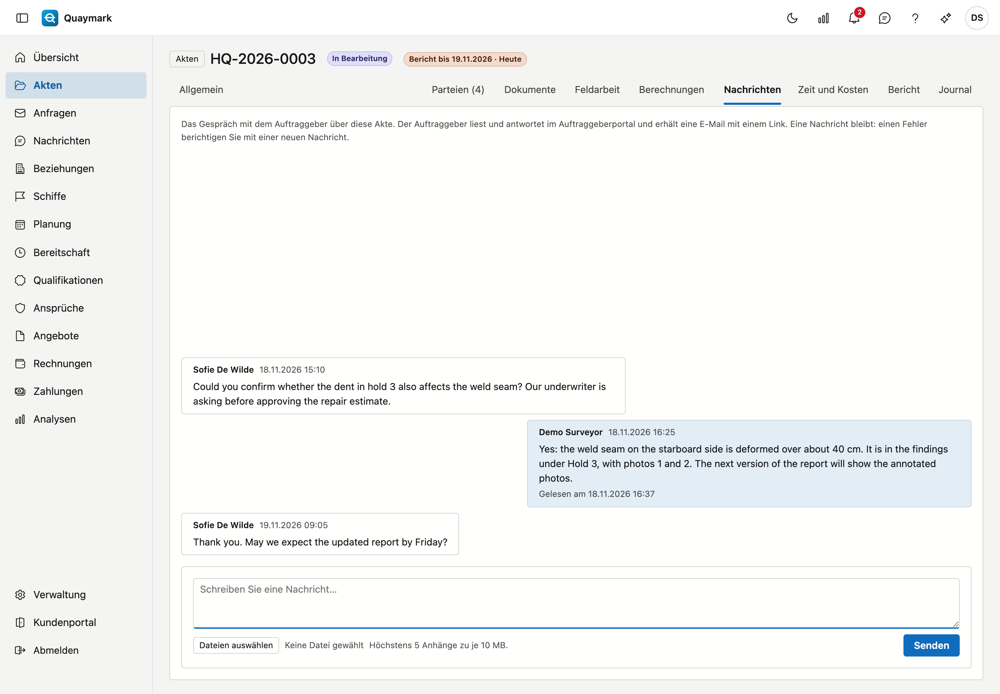
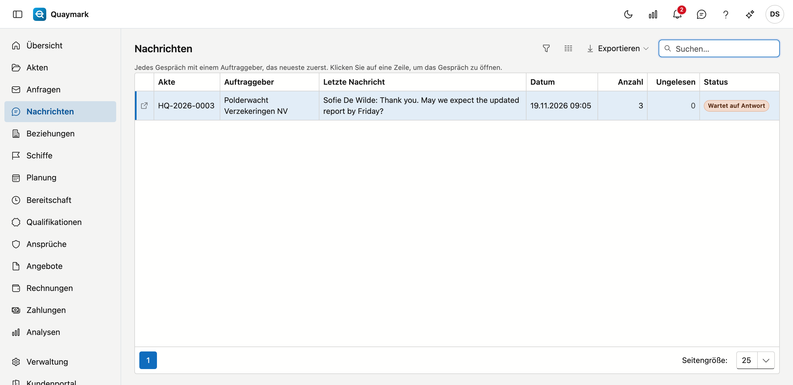

# Nachrichten

Ein Auftraggeber stellt seine Frage zu einer Akte im Auftraggeberportal, und das Büro antwortet auf der Akte selbst. So bleibt das ganze Gespräch bei der Akte, mit den Anhängen, und nicht in einem Postfach.

## Die Registerkarte Nachrichten

Jede Akte mit einem Auftraggeber hat die Registerkarte **Nachrichten**. Lesen erfordert das Recht, Akten anzusehen; Schreiben das Recht, Akten zu bearbeiten.

- Schreiben Sie Ihre Nachricht und klicken Sie auf **Senden**. Fügen Sie bei Bedarf Anhänge hinzu: höchstens 5, je höchstens 10 MB (PDF, Fotos, Word, Excel oder eine E-Mail).
- Die Nachrichten des Auftraggebers stehen links, die des Büros rechts. Unter Ihren eigenen Nachrichten steht **Gelesen am** mit dem Datum, oder **Noch nicht gelesen**.
- Eine Nachricht, die Sie noch nicht gelesen hatten, trägt das Etikett **Neu**. Das Öffnen der Registerkarte liest das Gespräch.
- Eine Nachricht wird nie geändert oder gelöscht. Einen Fehler berichtigen Sie mit einer neuen Nachricht.

Hat die Akte keinen Auftraggeber, gibt es niemanden zum Austausch. Wählen Sie zuerst einen Auftraggeber auf der Registerkarte **Allgemein**.

## Die Seite Nachrichten

Klicken Sie im Menü auf **Nachrichten** für jedes Gespräch mit einem Auftraggeber, das neueste zuerst, mit der letzten Nachricht und wie viele für Sie noch **Ungelesen** sind. Ein Klick auf eine Zeile öffnet die Registerkarte Nachrichten der Akte.

## Die Glocke

Die Glocke oben rechts zeigt eine neue Nachricht eines Auftraggebers dem Besichtiger der Akte und wer auf der Seite des Büros bereits in diesem Gespräch geschrieben hat. Hat die Akte keinen Besichtiger und hat noch niemand geschrieben, sehen sie alle, die Akten bearbeiten dürfen. Ein Klick auf die Benachrichtigung öffnet das Gespräch.

## Was der Auftraggeber sieht

Im Auftraggeberportal steht das Gespräch unten auf der Seite der Akte, unter **Nachrichten**. Das Büro erscheint dort mit dem Namen des Mitarbeiters und dem Namen des Büros.

- Zu jeder Nachricht des Büros erhält der Auftraggeber eine E-Mail mit einem Link zum Portal. Der Text selbst steht nicht in der E-Mail: er bleibt hinter der Anmeldung mit Zwei-Schritt-Verifizierung.
- Solange der Auftraggeber Ihre vorige Nachricht nicht gelesen hat, erhält er für eine neue Nachricht keine zweite E-Mail.
- Die E-Mail folgt der Benachrichtigungseinstellung des Auftraggebers. → [Beziehungen](relaties.md#auftraggeberportal)

## Im Beweispaket

Das Gespräch gehört zum Beweispaket der Akte, im Ordner `berichten/`: `gesprek.json` und `gesprek.csv` mit Absender, Zeit, Text und wann die andere Seite es gelesen hat, und die Anhänge. Jeder Anhang wird gegen seinen Fingerabdruck (SHA-256) nachgerechnet; stimmt einer nicht, erstellt Quaymark kein Paket. → [Akten](dossiers.md)
