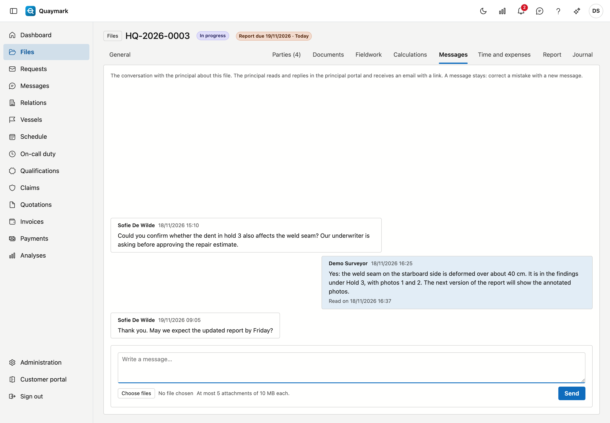
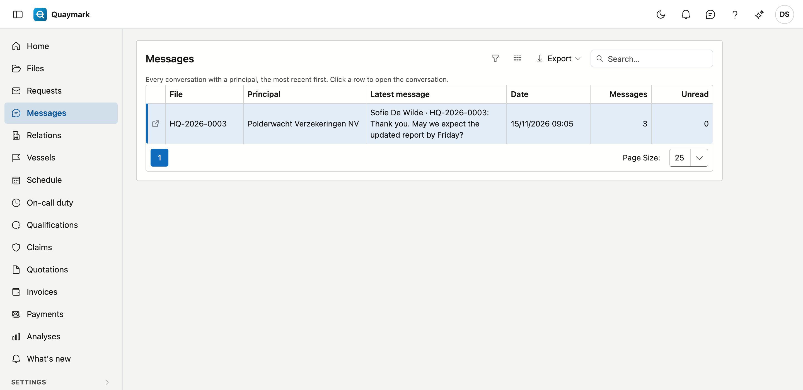

# Messages

A principal asks their question about a file in the principal portal, and the office replies on the file itself. The whole conversation stays with the file, with the attachments, and not in a mailbox.

## The Messages tab

Every file with a principal has the **Messages** tab. Reading needs the right to view files; writing, the right to edit files.

- Write your message and click **Send**. Add attachments if that helps: at most 5, each at most 10 MB (pdf, photos, Word, Excel or an email).
- The principal's messages are on the left, the office's on the right. Under your own messages is **Read on** with the date, or **Not read yet**.
- A message you had not read yet carries the label **New**. Opening the tab reads the conversation.
- A message is never changed or deleted. Correct a mistake with a new message.

If the file has no principal, there is nobody to talk to. First choose a principal on the **General** tab.

## The Messages screen

Click **Messages** in the menu for every conversation with a principal, the most recent first, with the latest message and how many are still **Unread** for you. A click on a row opens the Messages tab of the file.

## The bell

The bell at the top right shows a new message from a principal to the surveyor of the file and to whoever on the office side already wrote in that conversation. If the file has no surveyor and nobody has written yet, everyone who may edit files sees it. A click on the notification opens the conversation.

## What the principal sees

In the principal portal the conversation is at the bottom of the file page, under **Messages**. The office appears with the name of the staff member and the name of the office.

- For each message from the office, the principal receives an email with a link to the portal. The text itself is not in the email: it stays behind the sign-in with two-step verification.
- As long as the principal has not read your previous message, they receive no second email for a new message.
- The email follows the principal's notification preference. → [Relations](relaties.md#principal-portal)

## In the evidence package

The conversation is part of the evidence package of the file, in the folder `berichten/`: `gesprek.json` and `gesprek.csv` with sender, time, text and when the other side read it, and the attachments. Each attachment is verified against its fingerprint (SHA-256); if one does not match, Quaymark does not create a package. → [Files](dossiers.md)
