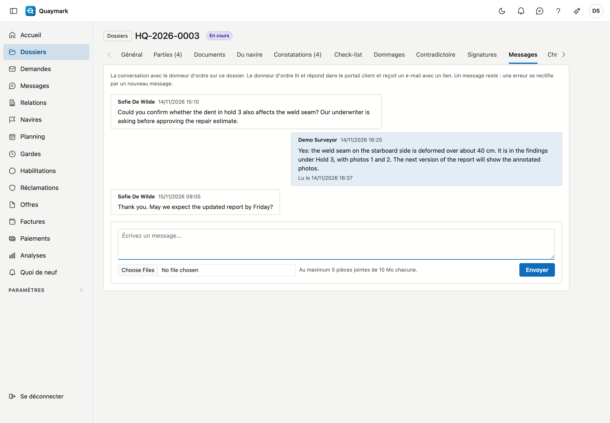
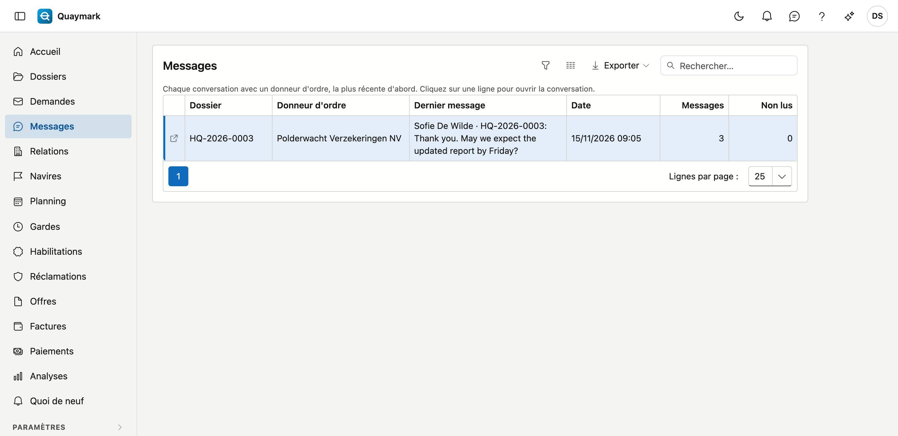

# Messages

Un donneur d'ordre pose sa question sur un dossier dans le portail client, et le bureau répond sur le dossier lui-même. Toute la conversation reste ainsi avec le dossier, avec les pièces jointes, et non dans une boîte mail.

## L'onglet Messages

Chaque dossier avec un donneur d'ordre a l'onglet **Messages**. Lire demande le droit de voir les dossiers ; écrire, le droit de modifier les dossiers.

- Écrivez votre message et cliquez sur **Envoyer**. Ajoutez des pièces jointes si utile : 5 au maximum, de 10 Mo chacune au maximum (pdf, photos, Word, Excel ou un e-mail).
- Les messages du donneur d'ordre sont à gauche, ceux du bureau à droite. Sous vos propres messages figure **Lu le** avec la date, ou **Pas encore lu**.
- Un message que vous n'aviez pas encore lu porte le libellé **Nouveau**. Ouvrir l'onglet lit la conversation.
- Un message n'est jamais modifié ni supprimé. Une erreur se rectifie par un nouveau message.

Si le dossier n'a pas de donneur d'ordre, il n'y a personne avec qui échanger. Choisissez d'abord un donneur d'ordre dans l'onglet **Général**.

## L'écran Messages

Cliquez dans le menu sur **Messages** pour chaque conversation avec un donneur d'ordre, la plus récente d'abord, avec le dernier message et le nombre encore **Non lus** pour vous. Un clic sur une ligne ouvre l'onglet Messages du dossier.

## La cloche

La cloche en haut à droite montre un nouveau message d'un donneur d'ordre à l'expert du dossier et à qui, côté bureau, a déjà écrit dans cette conversation. Si le dossier n'a pas d'expert et que personne n'a encore écrit, tous ceux qui peuvent modifier les dossiers le voient. Un clic sur la notification ouvre la conversation.

## Ce que voit le donneur d'ordre

Dans le portail client, la conversation figure en bas de la page du dossier, sous **Messages**. Le bureau y apparaît avec le nom du collaborateur et le nom du bureau.

- À chaque message du bureau, le donneur d'ordre reçoit un e-mail avec un lien vers le portail. Le texte lui-même n'est pas dans l'e-mail : il reste derrière la connexion avec vérification en deux étapes.
- Tant que le donneur d'ordre n'a pas lu votre message précédent, il ne reçoit pas de second e-mail pour un nouveau message.
- L'e-mail suit la préférence de notification du donneur d'ordre. → [Relations](relaties.md#portail-client)

## Dans le dossier de preuves

La conversation fait partie du dossier de preuves du dossier, dans le répertoire `berichten/` : `gesprek.json` et `gesprek.csv` avec expéditeur, heure, texte et date de lecture par l'autre partie, et les pièces jointes. Chaque pièce jointe est vérifiée par rapport à son empreinte (SHA-256) ; si l'une ne correspond pas, Quaymark ne crée pas de dossier de preuves. → [Dossiers](dossiers.md)
