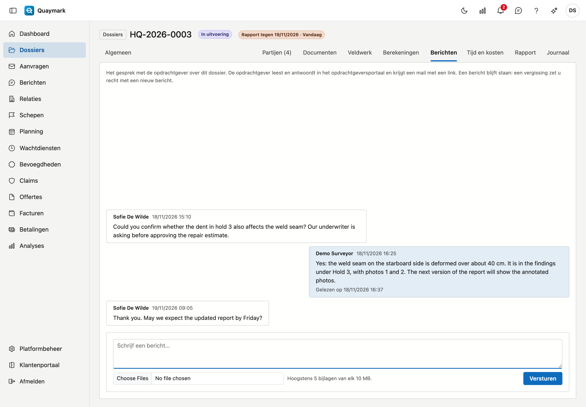
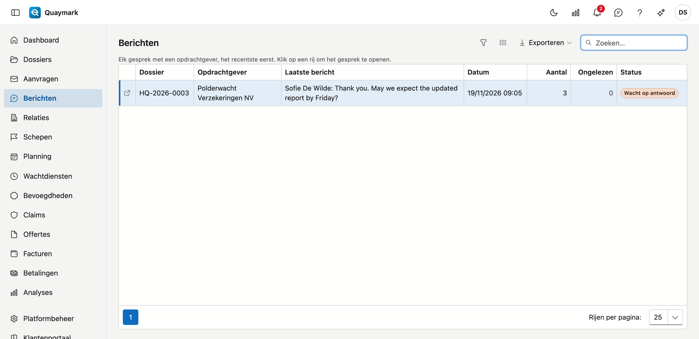

# Berichten

Een opdrachtgever stelt zijn vraag over een dossier in het opdrachtgeversportaal, en het bureau antwoordt op het dossier zelf. Zo staat het hele gesprek bij het dossier, met de bijlagen, en niet in een mailbox.

## Het tabblad Berichten

Op elk dossier met een opdrachtgever staat het tabblad **Berichten**. Lezen kan met het recht om dossiers te bekijken; schrijven met het recht om dossiers te bewerken.

- Schrijf uw bericht en klik op **Versturen**. Voeg bijlagen toe als dat helpt: hoogstens 5, elk hoogstens 10 MB (pdf, foto's, Word, Excel of een mail).
- De berichten van de opdrachtgever staan links, die van het bureau rechts. Onder uw eigen berichten staat **Gelezen op** met de datum, of **Nog niet gelezen**.
- Een bericht dat u nog niet had gelezen, krijgt het label **Nieuw**. Het tabblad openen leest het gesprek.
- Een bericht wordt nooit gewijzigd of verwijderd. Een vergissing zet u recht met een nieuw bericht.

Heeft het dossier geen opdrachtgever, dan is er niemand om mee te praten. Kies eerst een opdrachtgever op het tabblad **Algemeen**.

Heeft de opdrachtgever geen toegang tot het opdrachtgeversportaal, of koos hij na zijn uitnodiging nog geen wachtwoord, dan zegt het tabblad dat bovenaan: niemand ziet uw bericht en er vertrekt geen mail. Staan zijn portaalmeldingen uit, dan zegt het tabblad dat hij geen mail krijgt. De link brengt u naar de fiche van de opdrachtgever, waar u de toegang regelt (tabblad **Opdrachtgeversportaal**).

## Het scherm Berichten

Klik in het menu op **Berichten** voor elk gesprek met een opdrachtgever, het recentste eerst, met het laatste bericht en hoeveel er voor u nog **Ongelezen** zijn. De kolom **Status** zegt **Wacht op antwoord** zolang het laatste bericht van de opdrachtgever komt, ook als iemand het al las; na uw antwoord staat er **Beantwoord**. Een klik op een rij opent het tabblad Berichten van het dossier.

## Het belletje

Het belletje rechtsboven toont een nieuw bericht van een opdrachtgever aan de surveyor van het dossier en aan wie aan de kant van het bureau al in dat gesprek schreef. Heeft het dossier geen surveyor en schreef nog niemand, dan ziet iedereen die dossiers mag bewerken het. Een klik op de melding opent het gesprek.

## Wat de opdrachtgever ziet

In het opdrachtgeversportaal staat het gesprek onderaan de pagina van het dossier, onder **Berichten**. Het bureau verschijnt er met de naam van de medewerker en de naam van het bureau.

- Bij een bericht van het bureau krijgt de opdrachtgever een mail met een link naar het portaal. De tekst zelf staat niet in de mail: die blijft achter de aanmelding met tweestapsverificatie.
- Zolang de opdrachtgever uw vorige bericht niet las, krijgt hij voor een nieuw bericht geen tweede mail.
- De mail volgt de meldingsvoorkeur van de opdrachtgever. → [Relaties](relaties.md#opdrachtgeversportaal)

## In het bewijspakket

Het gesprek gaat mee in het bewijspakket van het dossier, in de map `berichten/`: `gesprek.json` en `gesprek.csv` met afzender, tijd, tekst en wanneer de andere kant het las, en de bijlagen. Elke bijlage wordt nagerekend tegen haar vingerafdruk (SHA-256); klopt er één niet, dan maakt Quaymark geen pakket. → [Dossiers](dossiers.md)
