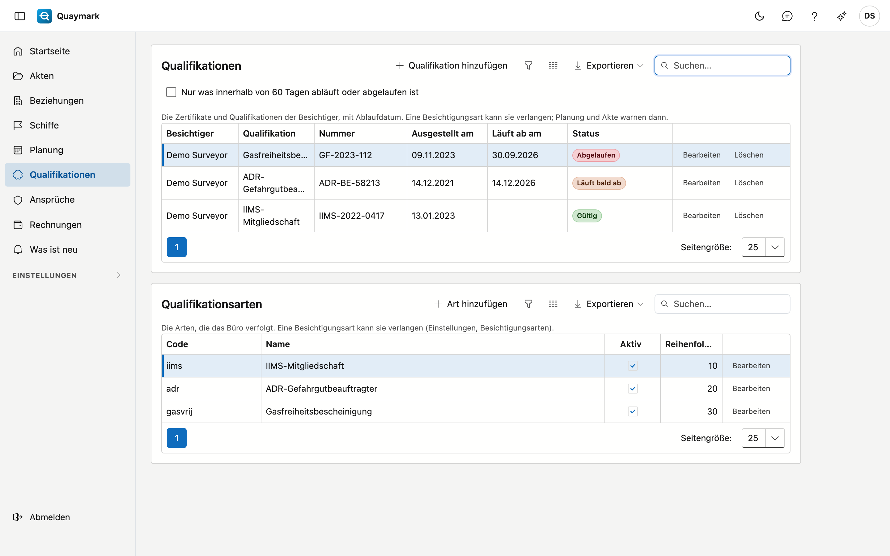

# Qualifikationen

Die Zertifikate und Qualifikationen der Besichtiger des Büros (zum Beispiel IIMS, ADR oder Gasfreiheitsbescheinigung), mit Ablaufdatum. Eine Besichtigungsart kann sie verlangen: Planung und Akte warnen dann, wenn der Besichtiger keine gültige hat.

## Bildschirm öffnen

Klicken Sie im Menü links auf **Qualifikationen**.

## Die Liste

- Jede Zeile ist eine Qualifikation eines Besichtigers: die Art, die Nummer, das Ausstellungs- und das Ablaufdatum.
- Der **Status** sagt, ob sie **gültig** ist, **bald abläuft** (innerhalb von 60 Tagen), **abgelaufen** oder **noch nicht gültig** ist (in der Zukunft ausgestellt). Ohne Ablaufdatum bleibt eine Qualifikation gültig.
- Haken Sie **Nur was innerhalb von 60 Tagen abläuft oder abgelaufen ist** an, um nur zu sehen, was Aufmerksamkeit braucht.
- Die Export-Schaltfläche lädt die Liste als Datei herunter.

## Hinzufügen und bearbeiten

Nur der Administrator des Büros fügt Qualifikationen hinzu, bearbeitet oder löscht sie. **Qualifikation hinzufügen** fragt nach dem Besichtiger, der Art, der Nummer, dem Ausstellungsdatum, dem Ablaufdatum und einer Bemerkung. Eine gelöschte Qualifikation geht in den Papierkorb; der Verlauf hält fest, wer was geändert hat.

## Qualifikationsarten

Unter der Liste verwaltet der Administrator die **Arten** des Büros: einen Code (Kleinbuchstaben, Ziffern und _), den Namen in vier Sprachen, aktiv und die Reihenfolge. Der Code steht fest, sobald eine Qualifikation dieser Art existiert.

## Verlangt pro Besichtigungsart

Auf dem Formular einer Besichtigungsart (siehe [Besichtigungsarten](soorten-survey.md)) wählen Sie die **erforderlichen Qualifikationen**. Hat der Besichtiger einer Akte am geplanten Tag (sonst heute) keine gültige, dann:

- zeigt das Formular der Akte eine Warnung unter dem Besichtiger;
- wird der Block in der [Planung](planning.md) rot, mit dem Grund.

Quaymark verweigert nichts: Es warnt, wie bei einer Abwesenheit.

## Siehe auch

- [Planung](planning.md)
- [Besichtigungsarten](soorten-survey.md)
