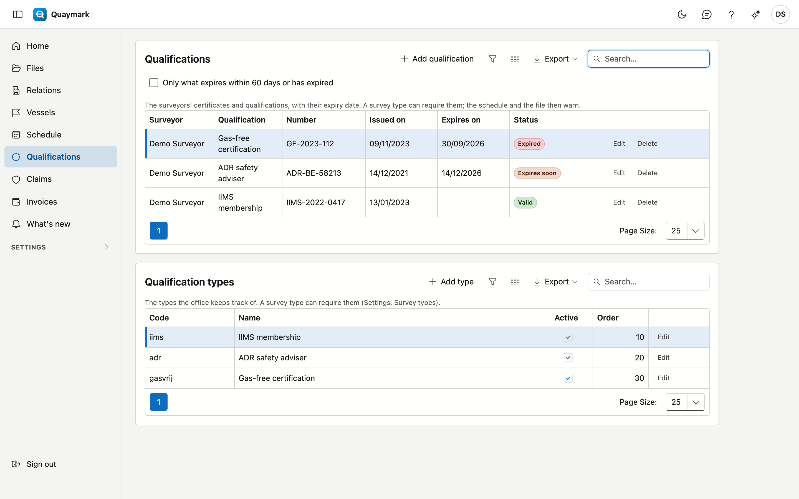

# Qualifications

The certificates and qualifications of the office's surveyors (for example IIMS, ADR or gas-free certification), with their expiry date. A survey type can require them: the schedule and the file then warn if the surveyor holds no valid one.

## Opening the screen

Click **Qualifications** in the menu on the left.

## The list

- Each row is a qualification of a surveyor: the type, the number, the issue date and the expiry date.
- The **status** says whether it is **valid**, **expires soon** (within 60 days), has **expired** or is **not yet valid** (issued in the future). Without an expiry date, a qualification stays valid.
- Tick **Only what expires within 60 days or has expired** to see only what needs attention.
- The export button downloads the list as a file.

## Adding and editing

Only the office administrator adds, edits or deletes qualifications. **Add qualification** asks for the surveyor, the type, the number, the issue date, the expiry date and a note. A deleted qualification goes to the recycle bin; the history keeps track of who changed what.

## Qualification types

Below the list, the administrator manages the office's **types**: a code (lower-case letters, digits and _), the name in four languages, active and the order. The code is fixed once a qualification of that type exists.

## Required per survey type

On the form of a survey type (see [Survey types](soorten-survey.md)) you choose the **required qualifications**. If the surveyor of a file holds no valid one on the planned day (otherwise today):

- the file form shows a warning below the surveyor;
- the block on the [schedule](planning.md) turns red, with the reason.

Quaymark refuses nothing: it warns, as with an absence.

## See also

- [Schedule](planning.md)
- [Survey types](soorten-survey.md)
