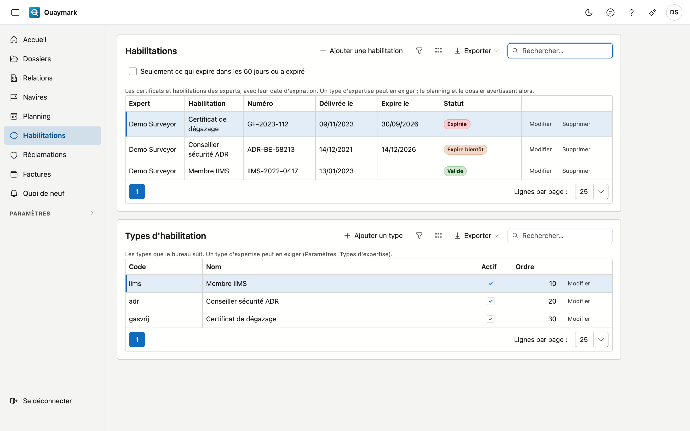

# Habilitations

Les certificats et habilitations des experts du bureau (par exemple IIMS, ADR ou certificat de dégazage), avec leur date d'expiration. Un type d'expertise peut en exiger : le planning et le dossier avertissent alors si l'expert n'en a pas de valide.

## Ouvrir l'écran

Cliquez dans le menu de gauche sur **Habilitations**.

## La liste

- Chaque ligne est une habilitation d'un expert : le type, le numéro, la date de délivrance et la date d'expiration.
- Le **statut** indique si elle est **valide**, **expire bientôt** (dans les 60 jours), est **expirée** ou **pas encore valide** (délivrée dans le futur). Sans date d'expiration, une habilitation reste valide.
- Cochez **Seulement ce qui expire dans les 60 jours ou a expiré** pour ne voir que ce qui demande de l'attention.
- Le bouton d'export télécharge la liste sous forme de fichier.

## Ajouter et modifier

Seul l'administrateur du bureau ajoute, modifie ou supprime des habilitations. **Ajouter une habilitation** demande l'expert, le type, le numéro, la date de délivrance, la date d'expiration et une remarque. Une habilitation supprimée va dans la corbeille ; l'historique garde qui a modifié quoi.

## Types d'habilitation

Sous la liste, l'administrateur gère les **types** du bureau : un code (minuscules, chiffres et _), le nom dans les quatre langues, actif et l'ordre. Le code est fixé dès qu'une habilitation de ce type existe.

## Exigées par type d'expertise

Sur la fiche d'un type d'expertise (voir [Types d'expertise](soorten-survey.md)), vous choisissez les **habilitations requises**. Si l'expert d'un dossier n'en a pas de valide le jour prévu (sinon aujourd'hui) :

- la fiche du dossier affiche un avertissement sous l'expert ;
- le bloc du [planning](planning.md) devient rouge, avec la raison.

Quaymark ne refuse rien : il avertit, comme pour une absence.

## Voir aussi

- [Planning](planning.md)
- [Types d'expertise](soorten-survey.md)
