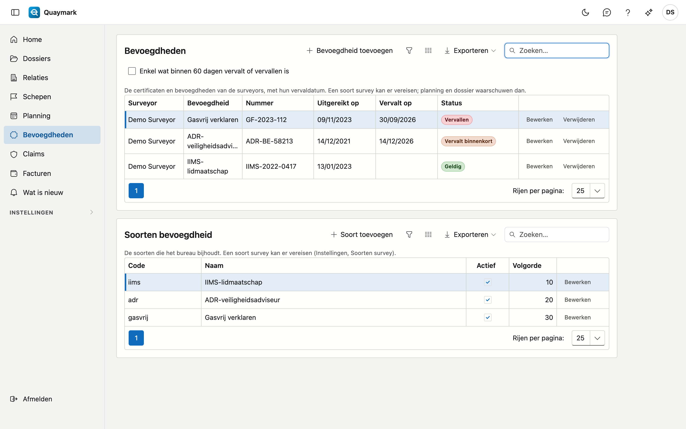

# Bevoegdheden

De certificaten en bevoegdheden van de surveyors van het bureau (bijvoorbeeld IIMS, ADR of gasvrij verklaren), met hun vervaldatum. Een soort survey kan er vereisen: planning en dossier waarschuwen dan als de surveyor er geen geldige heeft.

## Het scherm openen

Klik in het menu links op **Bevoegdheden**.

## De lijst

- Elke rij is een bevoegdheid van een surveyor: de soort, het nummer, de datum van uitreiking en de vervaldatum.
- De **status** zegt of ze **geldig** is, binnen 60 dagen **vervalt**, **vervallen** is of **nog niet geldig** (uitgereikt in de toekomst). Zonder vervaldatum blijft een bevoegdheid geldig.
- Vink **Enkel wat binnen 60 dagen vervalt of vervallen is** aan om enkel te zien wat aandacht vraagt.
- Met de exportknop haalt u de lijst op als bestand.

## Toevoegen en bewerken

Enkel de beheerder van het bureau voegt bevoegdheden toe, bewerkt of verwijdert ze. **Bevoegdheid toevoegen** vraagt de surveyor, de soort, het nummer, de datum van uitreiking, de vervaldatum en een opmerking. Een verwijderde bevoegdheid gaat naar de prullenbak; de historiek houdt bij wie wat wijzigde.

## Soorten bevoegdheid

Onder de lijst beheert de beheerder de **soorten** van het bureau: een code (kleine letters, cijfers en _), de naam in vier talen, actief en de volgorde. De code ligt vast zodra er een bevoegdheid van die soort bestaat.

## Vereist per soort survey

Op de fiche van een soort survey (zie [Soorten survey](soorten-survey.md)) kiest u de **vereiste bevoegdheden**. Heeft de surveyor van een dossier er op de geplande dag (anders vandaag) geen geldige, dan:

- toont de fiche van het dossier een waarschuwing onder de surveyor;
- kleurt het blok op de [planning](planning.md) rood, met de reden.

Quaymark weigert niets: het waarschuwt, zoals bij een afwezigheid.

## Zie ook

- [Planning](planning.md)
- [Soorten survey](soorten-survey.md)
