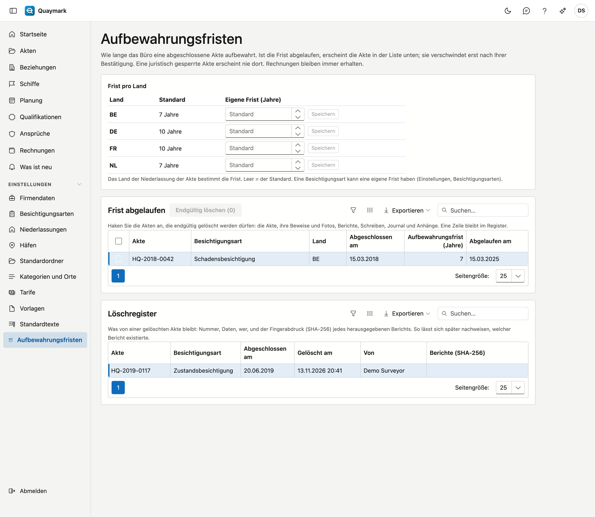

# Aufbewahrungsfristen

Wie lange das Büro eine abgeschlossene Akte aufbewahrt, und was nach Ablauf dieser Frist geschieht. Nur der Administrator des Büros sieht diesen Bildschirm.

## Bildschirm öffnen

Klicken Sie im Menü links auf **Einstellungen** und dann auf **Aufbewahrungsfristen**.

## Frist pro Land

Die Frist läuft ab dem Tag, an dem die Akte **abgeschlossen** wurde. Das Land der Niederlassung der Akte bestimmt, wie lange. Standard sind 7 Jahre für Belgien und die Niederlande und 10 Jahre für Frankreich und Deutschland; ein anderes Land erhält 10 Jahre. Geben Sie eine **eigene Frist** ein und wählen Sie **Speichern**, um sie anzupassen; ein leeres Feld stellt den Standard wieder her.

Eine Besichtigungsart kann eine eigene Frist haben, die dann Vorrang hat (siehe [Besichtigungsarten](soorten-survey.md)). Wird eine Akte wieder geöffnet, entfällt ihr Abschlussdatum; beim erneuten Abschließen beginnt die Frist von vorn.

## Frist abgelaufen

Die Liste zeigt die abgeschlossenen Akten, deren Frist vorbei ist, die ältesten zuerst. Eine Akte unter **juristischer Sperre** erscheint nie dort (siehe [Akten](dossiers.md)).

Nichts verschwindet von selbst. Haken Sie die Akten an, die gelöscht werden dürfen, und wählen Sie **Endgültig löschen**. Quaymark bittet um Bestätigung und prüft in diesem Moment erneut, ob die Frist wirklich abgelaufen ist.

Endgültig löschen entfernt die Akte mit allem, was dazugehört: Feststellungen, Beweise und Fotos, Berichte, Schreiben und Bescheinigungen, das Journal mit Notizen, Aufgaben, Mails und Anhängen, den Zeitablauf, Ansprüche und die Schadenschätzung. Auch ihr Verlauf wird gelöscht. Das lässt sich nicht rückgängig machen.

Was bleibt:

- **Rechnungen** und Gutschriften, mit den Leistungen und Kosten: Sie folgen ihrer eigenen gesetzlichen Aufbewahrungspflicht;
- ein Anhang, der **Beleg einer Kostenposition** ist.

## Löschregister

Für jede gelöschte Akte hält das Register fest: die Nummer, die Besichtigungsart, das Abschlussdatum, die Frist, wann und von wem sie gelöscht wurde, und den **Fingerabdruck (SHA-256)** jedes herausgegebenen Berichts. So lässt sich später nachweisen, welcher Bericht existierte, auch wenn die Akte nicht mehr besteht. Das Register selbst wird nie gelöscht.

## Siehe auch

- [Akten](dossiers.md)
- [Besichtigungsarten](soorten-survey.md)
