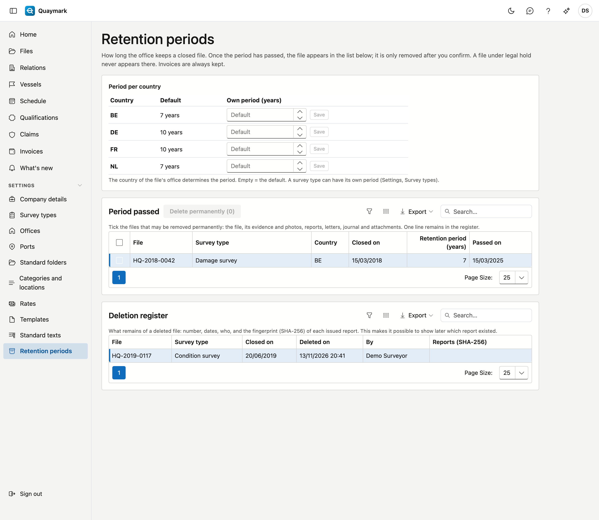

# Retention periods

How long the office keeps a closed file, and what happens once that period has passed. Only the office administrator sees this screen.

## Opening the screen

Click **Settings** in the menu on the left, then **Retention periods**.

## Period per country

The period runs from the day the file was **closed**. The country of the file's office determines how long. The default is 7 years for Belgium and the Netherlands and 10 years for France and Germany; any other country gets 10 years. Enter an **own period** and choose **Save** to change it; clearing it restores the default.

A survey type can have its own period, which then takes precedence (see [Survey types](soorten-survey.md)). If a file is reopened, its closing date lapses; when it is closed again, the period starts again.

## Period passed

The list shows the closed files whose period has passed, oldest first. A file under **legal hold** never appears there (see [Files](dossiers.md)).

Nothing disappears by itself. Tick the files that may go and choose **Delete permanently**. Quaymark asks for confirmation and checks again at that moment that the period has really passed.

Deleting permanently removes the file with everything that belongs to it: findings, evidence and photos, reports, letters and certificates, the journal with notes, tasks, mails and attachments, the timeline, claims and the damage estimate. Their history goes too. This cannot be undone.

What remains:

- **invoices** and credit notes, with the time entries and expenses: they follow their own legal retention obligation;
- an attachment that is the **receipt of an expense**.

## Deletion register

For each deleted file the register keeps: the number, the survey type, the closing date, the period, when and by whom it was deleted, and the **fingerprint (SHA-256)** of each issued report. This makes it possible to show later which report existed, even though the file is gone. The register itself is never deleted.

## See also

- [Files](dossiers.md)
- [Survey types](soorten-survey.md)
