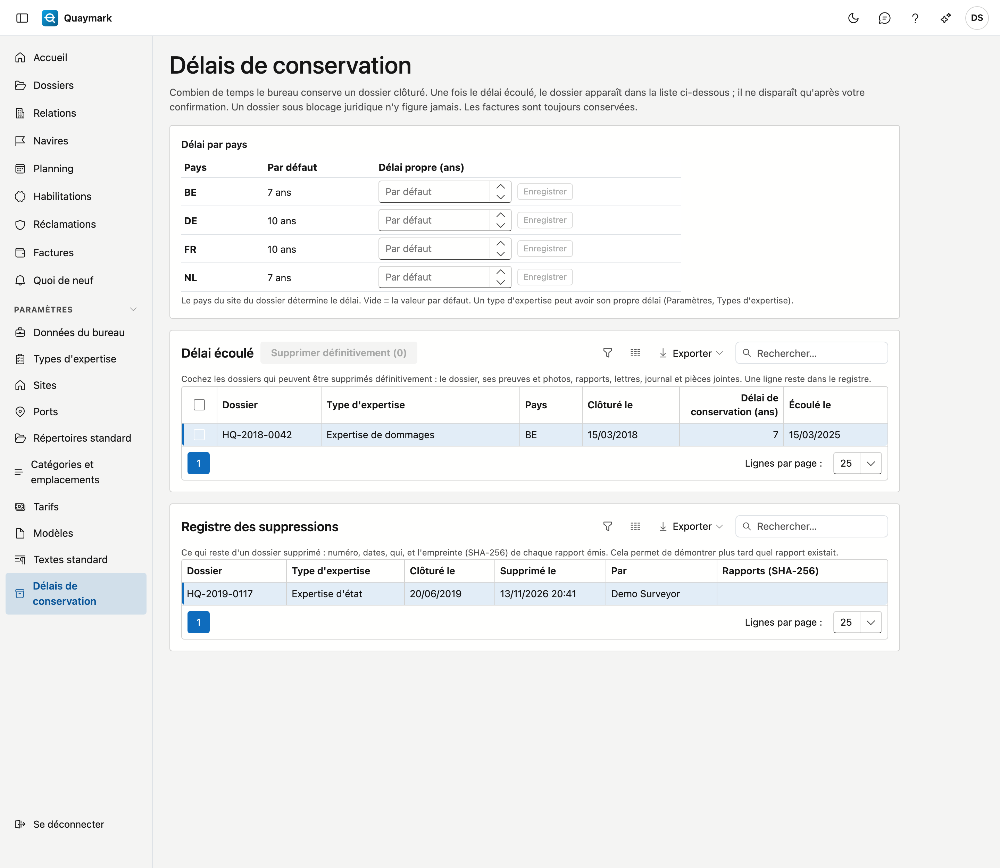

# Délais de conservation

Combien de temps le bureau conserve un dossier clôturé, et ce qui se passe une fois ce délai écoulé. Seul l'administrateur du bureau voit cet écran.

## Ouvrir l'écran

Cliquez dans le menu de gauche sur **Paramètres**, puis sur **Délais de conservation**.

## Délai par pays

Le délai court à partir du jour où le dossier a été **clôturé**. Le pays du site du dossier détermine sa durée. Par défaut : 7 ans pour la Belgique et les Pays-Bas, 10 ans pour la France et l'Allemagne ; un autre pays reçoit 10 ans. Saisissez un **délai propre** et choisissez **Enregistrer** pour l'adapter ; vider le champ remet la valeur par défaut.

Un type d'expertise peut avoir son propre délai, qui prime alors (voir [Types d'expertise](soorten-survey.md)). Si un dossier est rouvert, sa date de clôture tombe ; à la nouvelle clôture, le délai recommence.

## Délai écoulé

La liste affiche les dossiers clôturés dont le délai est passé, les plus anciens en premier. Un dossier sous **blocage juridique** n'y figure jamais (voir [Dossiers](dossiers.md)).

Rien ne disparaît tout seul. Cochez les dossiers qui peuvent partir et choisissez **Supprimer définitivement**. Quaymark demande une confirmation et vérifie à ce moment que le délai est vraiment écoulé.

La suppression définitive efface le dossier et tout ce qui s'y rattache : constatations, preuves et photos, rapports, lettres et certificats, le journal avec notes, tâches, mails et pièces jointes, la chronologie, les réclamations et l'estimation des dommages. Leur historique part aussi. C'est irréversible.

Ce qui reste :

- les **factures** et notes de crédit, avec les prestations et frais : elles suivent leur propre obligation légale de conservation ;
- une pièce jointe qui sert de **justificatif d'un frais**.

## Registre des suppressions

Pour chaque dossier supprimé, le registre garde : le numéro, le type d'expertise, la date de clôture, le délai, quand et par qui il a été supprimé, et l'**empreinte (SHA-256)** de chaque rapport émis. On peut ainsi démontrer plus tard quel rapport existait, même si le dossier n'existe plus. Le registre lui-même n'est jamais effacé.

## Voir aussi

- [Dossiers](dossiers.md)
- [Types d'expertise](soorten-survey.md)
