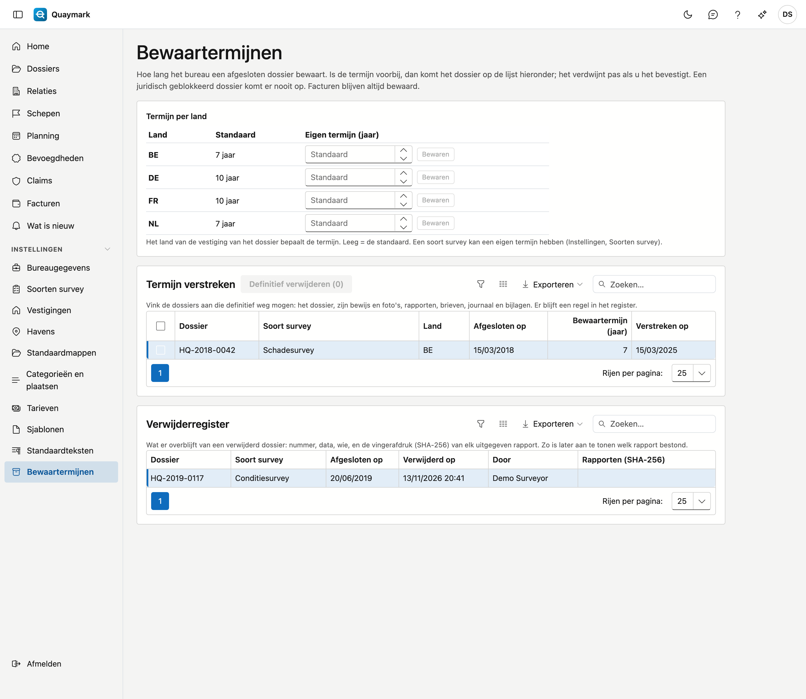

# Bewaartermijnen

Hoe lang het bureau een afgesloten dossier bewaart, en wat er gebeurt als die termijn voorbij is. Enkel de beheerder van het bureau ziet dit scherm.

## Het scherm openen

Klik in het menu links op **Instellingen** en dan op **Bewaartermijnen**.

## Termijn per land

De termijn loopt vanaf de dag waarop het dossier **afgesloten** werd. Het land van de vestiging van het dossier bepaalt hoe lang. De standaard is 7 jaar voor België en Nederland en 10 jaar voor Frankrijk en Duitsland; een ander land krijgt 10 jaar. Vul een **eigen termijn** in en kies **Bewaren** om ze aan te passen; leeg maken zet de standaard terug.

Een soort survey kan een eigen termijn hebben, die dan voorgaat (zie [Soorten survey](soorten-survey.md)). Wordt een dossier heropend, dan vervalt zijn afsluitdatum; bij het opnieuw afsluiten begint de termijn opnieuw.

## Termijn verstreken

De lijst toont de afgesloten dossiers waarvan de termijn voorbij is, de oudste eerst. Een dossier onder **juridische blokkering** staat er nooit tussen (zie [Dossiers](dossiers.md)).

Niets verdwijnt vanzelf. Vink de dossiers aan die weg mogen en kies **Definitief verwijderen**. Quaymark vraagt een bevestiging en kijkt op dat moment opnieuw na of de termijn echt voorbij is.

Definitief verwijderen wist het dossier met alles wat erbij hoort: vaststellingen, bewijs en foto's, rapporten, brieven en certificaten, het journaal met notities, taken, mails en bijlagen, de tijdlijn, claims en de schadebegroting. Ook de historiek ervan gaat mee. Dit kan niet ongedaan gemaakt worden.

Wat blijft:

- **facturen** en creditnota's, met de prestaties en kosten: die volgen hun eigen wettelijke bewaarplicht;
- een bijlage die **bewijsstuk van een kost** is.

## Verwijderregister

Van elk verwijderd dossier houdt het register bij: het nummer, de soort survey, de afsluitdatum, de termijn, wanneer en door wie het verwijderd werd, en de **vingerafdruk (SHA-256)** van elk uitgegeven rapport. Zo is later nog aan te tonen welk rapport bestond, ook al is het dossier weg. Het register zelf wordt nooit gewist.

## Zie ook

- [Dossiers](dossiers.md)
- [Soorten survey](soorten-survey.md)
