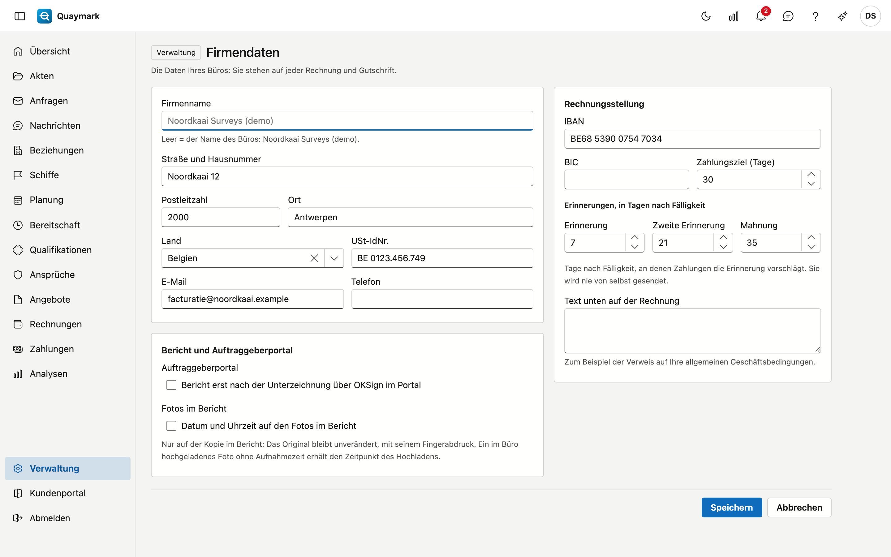

# Firmendaten

Die Daten Ihres Büros. Sie stehen auf jeder Rechnung und Gutschrift; Name und Adresse auch in den Berichten.

## Bildschirm öffnen

Klicken Sie unten im Menü auf **Verwaltung** und dann auf die Kachel **Firmendaten**. Nur der Administrator des Büros sieht diesen Bildschirm.

## Was Sie eintragen

- **Firmenname**: der Name auf der Rechnung. Leer bedeutet: der Name, unter dem das Büro in Quaymark geführt wird.
- **Adresse**, **Land**, **E-Mail** und **Telefon**.
- **USt-IdNr.** Quaymark prüft die Prüfziffer einer belgischen Nummer.
- **IBAN** und **BIC**: das Konto auf der Rechnung und im Zahlungs-QR-Code.
- **Zahlungsziel**: die Anzahl Tage zwischen Rechnungsdatum und Fälligkeit.
- Unter **Erinnerungen, in Tagen nach Fälligkeit**: **Erinnerung**, **Zweite Erinnerung** und **Mahnung**, wie viele Tage nach Fälligkeit die Seite Zahlungen diese Erinnerung vorschlägt (standardmäßig 7, 21 und 35). Sie werden nie von selbst gesendet. → [Zahlungen](betalingen.md)
- **Text unten auf der Rechnung**, zum Beispiel der Verweis auf Ihre allgemeinen Geschäftsbedingungen.
- Im Feld **Bericht und Auftraggeberportal**: **Auftraggeberportal**, mit **Bericht erst nach der Unterzeichnung über OKSign im Portal** sieht der Auftraggeber einen herausgegebenen Bericht erst, wenn er unterschrieben ist. → [Bericht unterschreiben lassen](dossiers.md#bericht-unterschreiben-lassen)
- Im selben Feld: **Fotos im Bericht**, mit **Datum und Uhrzeit auf den Fotos im Bericht** erhält jedes Foto im Fotoanhang Datum und Uhrzeit im Bild. Nur auf der Kopie im Bericht: Das Original bleibt unverändert. → [Fotos aus dem Büro](dossiers.md#fotos-aus-dem-buro)

Das **Land** bestimmt den MwSt.-Satz und die Regel für ausländische Kunden (siehe [Rechnungen](facturen.md)).

Ohne Name, Straße und USt-IdNr. kann keine Rechnung ausgestellt werden; ohne IBAN auch nicht. Fehlt etwas, sagt eine Meldung oben auf der Seite, was. **Abbrechen** und der Link **Verwaltung** bringen Sie zurück zu den Kacheln.

## Siehe auch

- [Rechnungen](facturen.md)
