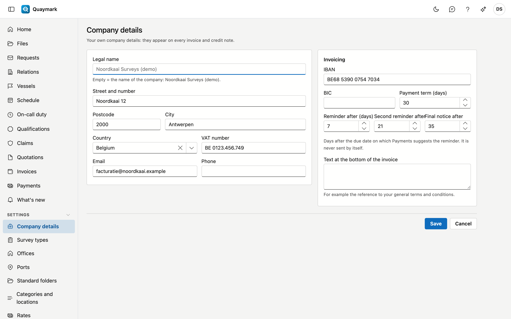

# Company details

Your own company details. They appear on every invoice and credit note; the name and address also in the reports.

## Opening the screen

Click **Company details** under **Settings** in the menu on the left. Only the office's administrator sees this screen.

## What you fill in

- **Legal name**: the name on the invoice. Empty means: the name under which the office is registered in Quaymark.
- **Address**, **Country**, **E-mail** and **Phone**.
- **VAT number**. Quaymark checks the check digits of a Belgian number.
- **IBAN** and **BIC**: the account on the invoice and in the payment QR code.
- **Payment term**: the number of days between the invoice date and the due date.
- **Reminder after**, **Second reminder after** and **Final notice after**: how many days after the due date the Payments screen suggests that reminder (by default 7, 21 and 35). They are never sent by themselves. → [Payments](betalingen.md)
- **Text at the bottom of the invoice**, for example the reference to your general terms and conditions.

The **country** determines the VAT rate and the rule for foreign customers (see [Invoices](facturen.md)).

Without a name, address and VAT number no invoice can be issued; without an IBAN neither.

## See also

- [Invoices](facturen.md)
