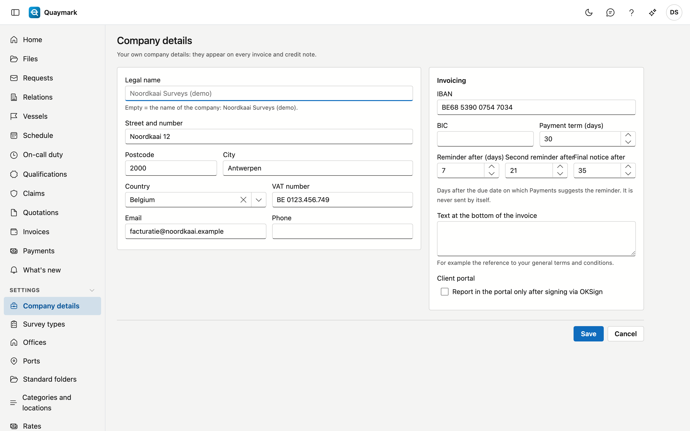

# Company details

Your own company details. They appear on every invoice and credit note; the name and address also in the reports.

## Opening the screen

At the bottom of the menu, click **Administration**, then the **Company details** tile. Only the office's administrator sees this screen.

## What you fill in

- **Legal name**: the name on the invoice. Empty means: the name under which the office is registered in Quaymark.
- **Address**, **Country**, **E-mail** and **Phone**.
- **VAT number**. Quaymark checks the check digits of a Belgian number.
- **IBAN** and **BIC**: the account on the invoice and in the payment QR code.
- **Payment term**: the number of days between the invoice date and the due date.
- Under **Reminders, in days after the due date**: **Reminder**, **Second reminder** and **Final notice**, how many days after the due date the Payments screen suggests that reminder (by default 7, 21 and 35). They are never sent by themselves. → [Payments](betalingen.md)
- **Text at the bottom of the invoice**, for example the reference to your general terms and conditions.
- In the **Report and principal portal** box: **Principal portal**, with **Report in the portal only after signing via OKSign**, the principal only sees an issued report once it has been signed. → [Signing the report](dossiers.md#signing-the-report)
- In the same box: **Photos in the report**, with **Date and time on the photos in the report**, every photo in the photo appendix gets the date and time in the image. Only on the copy in the report: the original stays untouched. → [Photos added at the office](dossiers.md#photos-added-at-the-office)

The **country** determines the VAT rate and the rule for foreign customers (see [Invoices](facturen.md)).

Without a name, street and VAT number no invoice can be issued; without an IBAN neither. If something is missing, a message at the top of the screen says what. **Cancel** and the **Administration** link take you back to the tiles.

## See also

- [Invoices](facturen.md)
