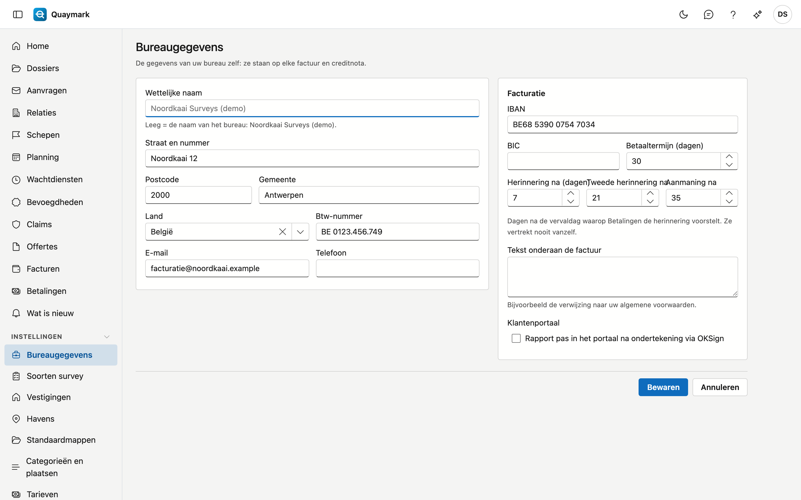

# Bureaugegevens

De gegevens van uw bureau zelf. Ze staan op elke factuur en creditnota; de naam en het adres ook in de rapporten.

## Het scherm openen

Klik onderaan het menu op **Platformbeheer** en dan op de tegel **Bureaugegevens**. Enkel de beheerder van het bureau ziet dit scherm.

## Wat u invult

- **Wettelijke naam**: de naam op de factuur. Leeg betekent: de naam waaronder het bureau in Quaymark staat.
- **Adres**, **Land**, **E-mail** en **Telefoon**.
- **Btw-nummer**. Quaymark kijkt een Belgisch nummer na op zijn controlegetal.
- **IBAN** en **BIC**: de rekening op de factuur en in de betaal-QR.
- **Betaaltermijn**: het aantal dagen tussen de factuurdatum en de vervaldatum.
- **Herinnering na**, **Tweede herinnering na** en **Aanmaning na**: na hoeveel dagen na de vervaldatum het scherm Betalingen die herinnering voorstelt (standaard 7, 21 en 35). Ze vertrekken nooit vanzelf. → [Betalingen](betalingen.md)
- **Tekst onderaan de factuur**, bijvoorbeeld de verwijzing naar uw algemene voorwaarden.
- **Klantenportaal**: met **Rapport pas in het portaal na ondertekening via OKSign** ziet de opdrachtgever een uitgegeven rapport pas als het ondertekend is. → [Rapport ondertekenen](dossiers.md#rapport-ondertekenen)
- **Foto's in het rapport**: met **Datum en uur op de foto's in het rapport** krijgt elke foto in de fotobijlage datum en uur in het beeld. Enkel op de kopie in het rapport: het origineel blijft onaangeroerd. → [Foto's van kantoor](dossiers.md#fotos-van-kantoor)

Het **land** bepaalt het btw-tarief en de regel voor buitenlandse klanten (zie [Facturen](facturen.md)).

Zonder naam, adres en btw-nummer kan geen factuur uitgegeven worden; zonder IBAN ook niet.

## Zie ook

- [Facturen](facturen.md)
