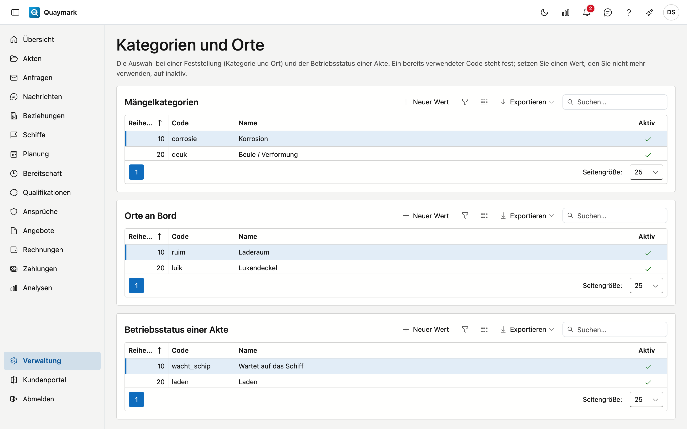

# Kategorien und Orte

Die Auswahl bei einer Feststellung und der Betriebsstatus einer Akte, für Ihr Büro.

## Bildschirm öffnen

Klicken Sie unten im Menü auf **Verwaltung** und dann auf die Kachel **Kategorien und Orte**.

## Felder und Funktionen

- **Mängelkategorien**: welche Art von Mangel es ist, zum Beispiel Korrosion oder eine Delle.
- **Orte an Bord**: wo er sich befindet, zum Beispiel ein Laderaum oder das Deck.
- **Betriebsstatus einer Akte**: wo ein Auftrag neben dem Arbeitsschritt steht, zum Beispiel Laden, Löschen oder angehalten. → [Akten](dossiers.md#arbeitsanweisung-und-betriebsstatus)
- Jeder Wert hat einen **Code**, eine Reihenfolge, einen Namen in den vier Sprachen und ob er aktiv ist. Ein bereits verwendeter Code steht fest: in einer Feststellung (Kategorie und Ort) oder in einer Akte (Betriebsstatus). Das Feld **Code** ist dann deaktiviert, mit dem Grund darunter; Name, Reihenfolge und Aktiv können Sie jederzeit ändern. Setzen Sie einen nicht mehr verwendeten Wert auf **inaktiv**.
- Doppelklicken Sie auf eine Zeile, um sie zu bearbeiten; **Neuer Wert** fügt einen hinzu.

## Siehe auch

- [Akten](dossiers.md)
