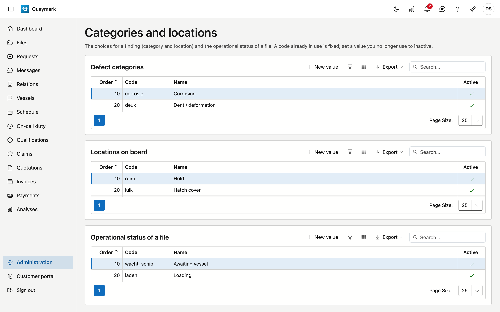

# Categories and locations

The choices for a finding and the operational status of a file, for your office.

## Opening the screen

At the bottom of the menu, click **Administration**, then the **Categories and locations** tile.

## Fields and functions

- **Defect categories**: what kind of defect it is, for example corrosion or a dent.
- **Locations on board**: where it is, for example a hold or the deck.
- **Operational status of a file**: where an assignment stands next to the work step, for example loading, discharging or on hold. → [Files](dossiers.md#work-instructions-and-operational-status)
- Each value has a **code**, an order, a name in the four languages and whether it is active. A code already in use is fixed: in a finding (category and location) or on a file (operational status). The **Code** field is then switched off, with the reason below it; the name, the order and Active can always be changed. Set a value you no longer use to **inactive**.
- Double-click a row to edit it; **New value** adds one.

## See also

- [Files](dossiers.md)
