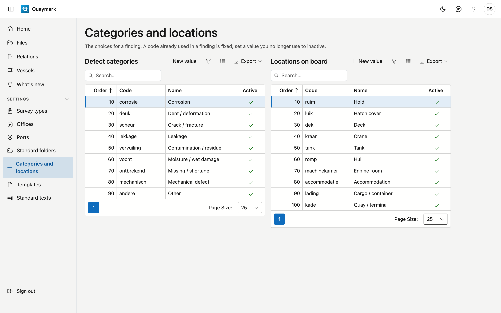

# Categories and locations

The choices for a finding, for your office.

## Opening the screen

In the menu on the left, click **Settings**, then **Categories and locations**.

## Fields and functions

- **Defect categories**: what kind of defect it is, for example corrosion or a dent.
- **Locations on board**: where it is, for example a hold or the deck.
- Each value has a **code**, an order, a name in the four languages and whether it is active. A code already used in a finding is fixed. Set a value you no longer use to **inactive**.
- Double-click a row to edit it; **New value** adds one.

## See also

- [Files](dossiers.md)
