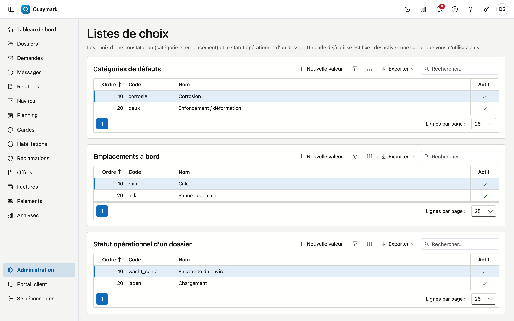

# Catégories et emplacements

Les choix d'une constatation et le statut opérationnel d'un dossier, pour votre bureau.

## Ouvrir l'écran

En bas du menu, cliquez sur **Administration**, puis sur la tuile **Catégories et emplacements**.

## Champs et fonctions

- **Catégories de défauts** : la nature du défaut, par exemple de la corrosion ou une bosse.
- **Emplacements à bord** : où il se trouve, par exemple une cale ou le pont.
- **Statut opérationnel d'un dossier** : où en est une mission à côté de l'étape du travail, par exemple chargement, déchargement ou en suspens. → [Dossiers](dossiers.md#instructions-de-travail-et-statut-operationnel)
- Chaque valeur a un **code**, un ordre, un nom dans les quatre langues et un statut actif ou non. Un code déjà utilisé est fixé : dans une constatation (catégorie et emplacement) ou sur un dossier (statut opérationnel). Le champ **Code** est alors désactivé, avec la raison en dessous ; le nom, l'ordre et Actif restent toujours modifiables. Passez une valeur que vous n'utilisez plus en **non active**.
- Double-cliquez sur une ligne pour la modifier ; **Nouvelle valeur** en ajoute une.

## Voir aussi

- [Dossiers](dossiers.md)
