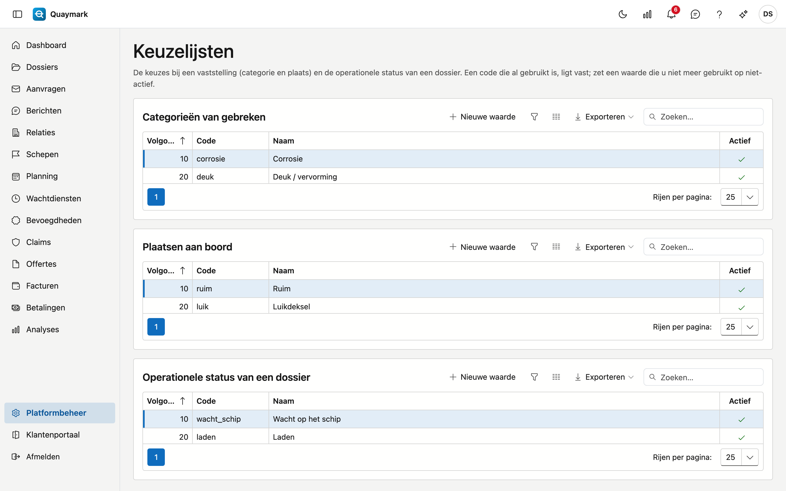

# Keuzelijsten

De keuzes bij een vaststelling en de operationele status van een dossier, voor uw bureau.

## Het scherm openen

Klik onderaan het menu op **Platformbeheer** en dan op de tegel **Keuzelijsten**.

## Velden en functies

- **Categorieën van gebreken**: wat voor gebrek het is, bijvoorbeeld corrosie of een deuk.
- **Plaatsen aan boord**: waar het zich bevindt, bijvoorbeeld een ruim of het dek.
- **Operationele status van een dossier**: waar een opdracht staat naast de stap van het werk, bijvoorbeeld laden, lossen of on hold. → [Dossiers](dossiers.md#werkinstructie-en-operationele-status)
- Elke waarde heeft een **code**, een volgorde, een naam in de vier talen en of ze actief is. Een code die al gebruikt is, ligt vast: in een vaststelling (categorie en plaats) of op een dossier (operationele status). Het veld **Code** staat dan uit, met de reden eronder; de naam, de volgorde en Actief kunt u altijd aanpassen. Zet een waarde die u niet meer gebruikt op **niet actief**.
- Dubbelklik op een rij om ze te bewerken; **Nieuwe waarde** voegt er een toe.

## Zie ook

- [Dossiers](dossiers.md)
