# Akten

Die Arbeitsliste des Büros: eine Zeile pro Auftrag.

## Bildschirm öffnen

Klicken Sie im Menü links auf **Akten**.

## Die Liste

- Die Auswahl **Status** über der Liste zeigt standardmäßig die **offenen** Akten. Wählen Sie **Alle**, um auch abgeschlossene und stornierte Akten zu sehen, oder einen einzelnen Status.
- Das **Suchfeld** sucht in allen Spalten: Nummer, Besichtigungsart, Schiff, Auftraggeber, Hafen, Planung und Status.
- Doppelklicken Sie auf eine Zeile, um die **Akte** zu öffnen; der Pfeil am Zeilenanfang öffnet sie in einem neuen Tab. **Neue Akte** legt eine an.
- Die Export-Schaltfläche lädt die Liste als Datei herunter.

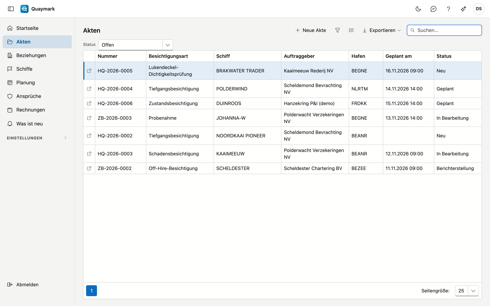

## Akte

Ein Auftrag: was verlangt wird, wo und wann, und was der Besichtiger vor Ort feststellt.

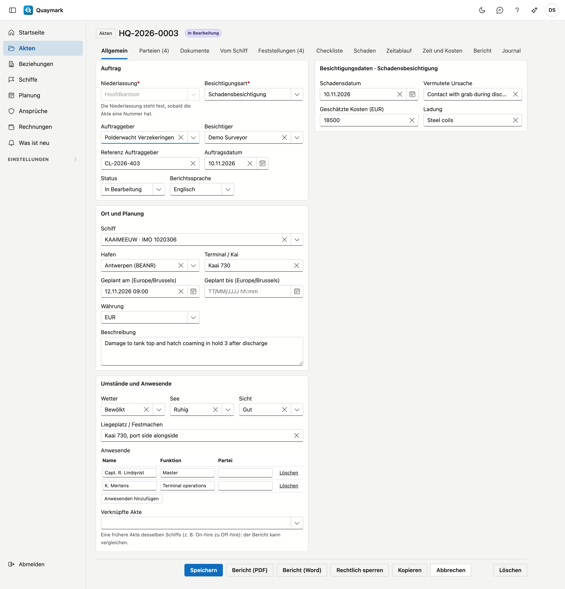

- **Auftrag**: Niederlassung, Besichtigungsart, Auftraggeber, Besichtiger, Referenz, Datum, Status und Berichtssprache. Die **Aktennummer** (Niederlassungscode, Jahr, laufende Nummer) wird beim ersten Speichern vergeben; danach steht die Niederlassung fest.
- **Ort und Planung**: Schiff, Hafen, Terminal oder Kai, der geplante Zeitpunkt (in der Zeitzone der Niederlassung), Währung und Beschreibung.
- **Umstände und Anwesende**: Wetter, See, Sicht, Liegeplatz und wer bei der Besichtigung anwesend war. **Verknüpfte Akte** verweist auf eine frühere Akte desselben Schiffs, zum Beispiel On-hire zu Off-hire.
- **Besichtigungsdaten**: die Felder der gewählten Besichtigungsart. Ein Pflichtfeld muss ab dem Status Berichterstellung ausgefüllt sein. Wählen Sie eine andere Art, gehen beim Speichern die Werte von Feldern verloren, die die neue Art nicht kennt.

Eine gespeicherte Akte hat Registerkarten: **Parteien** (Beziehungen mit Rolle und Referenz), **Dokumente** (in Ordnern), **Vom Schiff** (die Dokumente des Schiffs, nur lesen), **Feststellungen**, **Checkliste** und das Journal mit Notizen, Aufgaben, Anlagen und Verlauf.

### Feststellungen

Eine **Feststellung** wird hinzugefügt, nie geändert oder gelöscht. Einen Fehler berichtigen Sie mit **Berichtigen** und einem Grund: die alte Fassung bleibt durchgestrichen sichtbar. Beim Zeigen auf ein Foto erscheinen Zeitpunkt, GPS-Position und Fingerabdruck (SHA-256), die das Gerät bei der Aufnahme festgehalten hat.

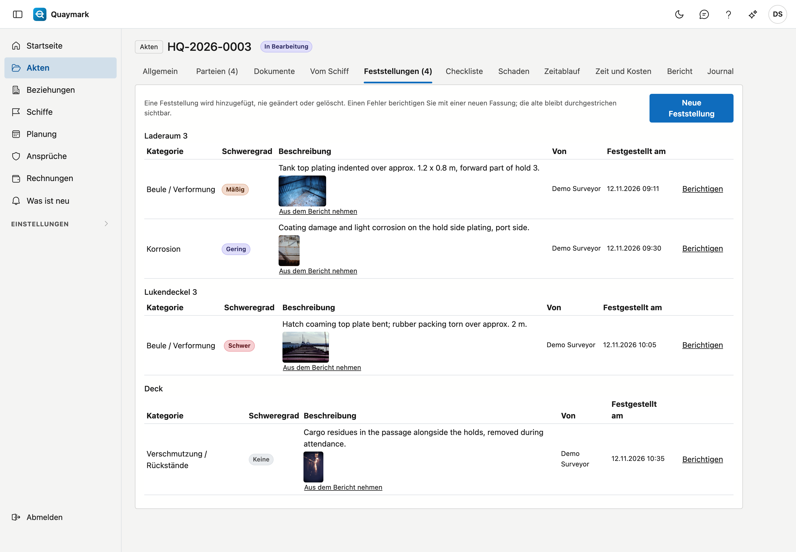

### Fotos im Bericht

**Aus dem Bericht nehmen** unter einem Foto lässt es im Fotoanhang des Berichts weg, mit einer Begründung. Das Foto bleibt als Beweis gespeichert; **Wieder in den Bericht** setzt es zurück. Die Fotos erhalten im Bericht eine fortlaufende Nummer, und die Tabelle der Feststellungen nennt diese Nummern.

### Checkliste

Die **Checkliste** zeigt pro Punkt die letzte Antwort (in Ordnung, nicht in Ordnung, entfällt), von wem und wann. Jede Antwort bleibt unter **Frühere Antworten** erhalten. **Nicht in Ordnung** schlägt eine Feststellung vor. Vor Ort antwortet der Besichtiger in der Feld-App.

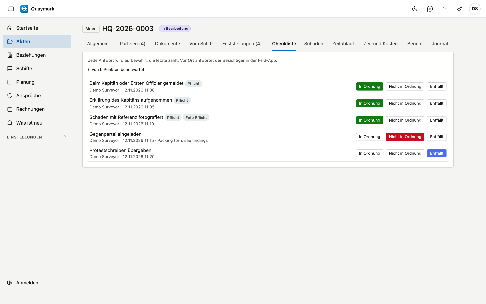

### Bericht

In der Registerkarte **Bericht** schreiben Sie den Text des Berichts je Abschnitt, mit einfacher Formatierung, und fügen Standardtexte des Büros ein. **Abschnitte speichern** speichert sie. Zeigt die Berichtsvorlage einen Abschnitt nicht, sagt die Registerkarte das.

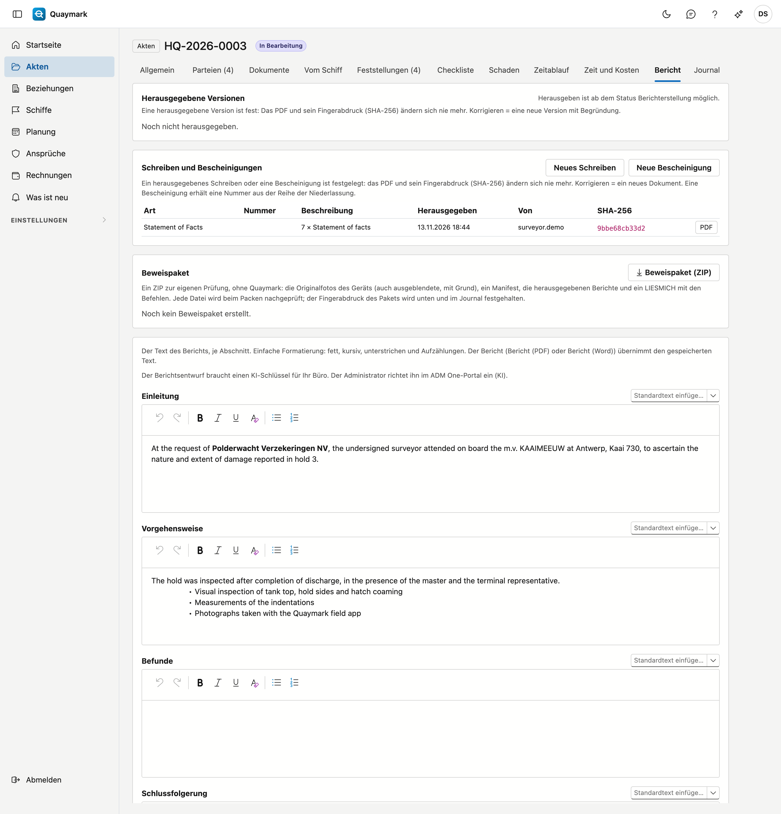

### Bericht herausgeben und senden

**Bericht herausgeben** (Registerkarte Bericht, ab dem Status Berichterstellung) legt den Bericht als Version 1 fest, mit seinem Fingerabdruck (SHA-256): Er ändert sich danach nie mehr. Korrigieren = **Neue Version herausgeben**, mit Begründung. **Senden** schickt eine herausgegebene Version als PDF an den Auftraggeber; die Mail wird im Journal gespeichert. Speichern Sie zuerst die Abschnitte: Eine Version übernimmt nur gespeicherten Text.

### Entwurf vorschlagen

**Entwurf vorschlagen** (Registerkarte Bericht) lässt die KI je Abschnitt einen Vorschlag aus den Daten der Akte schreiben: Feststellungen, Checkliste, Felder und Umstände. Fotos und Ihr eigener Text werden nicht übermittelt. Jeder Vorschlag steht unter seinem Abschnitt; Sie wählen **Übernehmen**, **Am Ende hinzufügen** oder **Ignorieren** und speichern dann wie gewohnt. Es läuft über den KI-Schlüssel Ihres Büros und nur, wenn der Administrator es im ADM One-Portal erlaubt.

### Vergleich mit einer vorigen Akte

Ist die Akte mit einer vorigen Akte **verknüpft** (z. B. die On-Hire zu einer Off-Hire), zeigt die Registerkarte Feststellungen je Ort, was jene Akte dort festgestellt hat. Geben Sie je Feststellung Ihre Beurteilung: **Bestand bereits** oder **Neu**. Der Bericht zeigt den Vergleich je Ort an Bord, mit den Fotonummern und Ihrer Beurteilung; ohne Beurteilung steht nichts dabei.

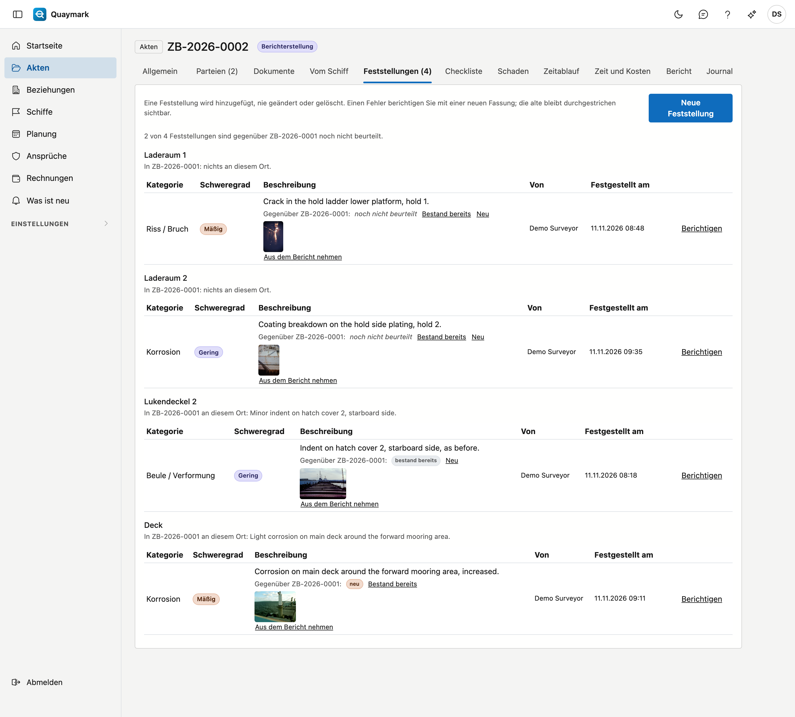

### Schreiben und Bescheinigungen

**Neues Schreiben** und **Neue Bescheinigung** (Registerkarte Bericht) erstellen ein Standardschreiben oder eine Bescheinigung in der Sprache der Akte. **Vorschau (PDF)** zeigt es zuerst; **Herausgeben** legt es mit seinem Fingerabdruck fest. Eine Bescheinigung erhält dann eine Nummer aus der Reihe der Niederlassung (C-HQ-2026-0001). Ersetzen Sie in einem Schreiben jedes Feld in [eckigen Klammern]: sonst ist Herausgeben nicht möglich.

Es gibt drei Schreiben und fünf Bescheinigungen. Jede Bescheinigung hat ihre eigenen Zeilen:

- **Mengenbescheinigung**, **Gewichtsbescheinigung** und **On-Hire-/Off-Hire-Bescheinigung**: eine Beschreibung, eine Menge und eine Einheit. Ein ausgefülltes Zahlenfeld der Akte übernehmen Sie mit **Aus einem Feld der Akte übernehmen**.
- **Bescheinigung über die Laderaumbesichtigung**: je Laderaum eine **Feststellung** und das **Urteil**: geeignet oder nicht geeignet für die Übernahme der angegebenen Ladung. Das Urteil ist nie vorausgefüllt. Auf dieser Bescheinigung wird die Notice of Readiness (NOR) des Kapitäns angenommen oder abgelehnt.
- **Qualitätsbescheinigung**: die Ergebnisse einer Analyse, mit je Zeile **Parameter**, **Methode**, **Ergebnis**, **Einheit** und **Spezifikation** (der Grenzwert). Darüber tragen Sie die **Probenahme** (wo und wann), das **Labor** und den **Laborbericht** ein.

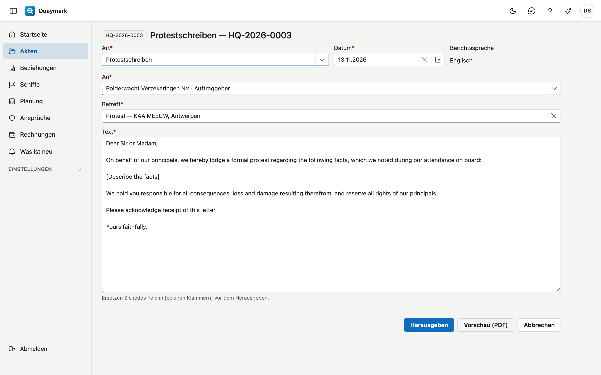

Steht eine Menge in einer anderen Einheit, als der Kunde verlangt, zum Beispiel in metrischen Tonnen, während die Charterpartie Long Tons verwendet, rechnet **Umrechnen** sie um (Tonne, Kilogramm, Long Ton, Short Ton, Kubikmeter, Liter, Barrel). Von Volumen in Gewicht fragt Quaymark nach der Dichte. Die umgerechnete Menge kommt als neue Zeile unter die ursprüngliche.

### Schaden

Die Registerkarte **Schaden** begleitet eine Schadensakte: die **Ansprüche** und die **Schadenschätzung**.

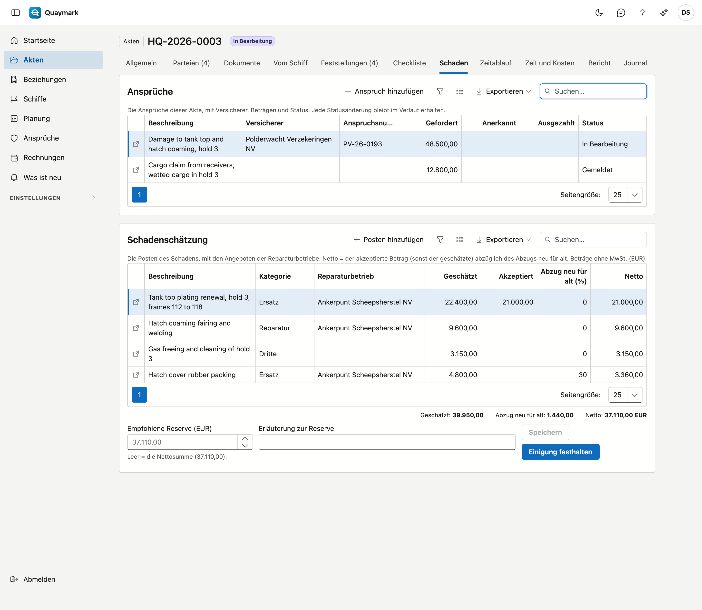

- Eine Akte kann **mehrere Ansprüche** haben, zum Beispiel einen beim Kaskoversicherer und einen beim P&I-Club. **Anspruch hinzufügen** öffnet eine eigene Seite mit dem Versicherer oder P&I-Club, der Policen- und Anspruchsnummer, dem Meldedatum und dem geforderten, anerkannten und ausgezahlten Betrag. Anerkannt darf nicht höher sein als gefordert, ausgezahlt nicht höher als anerkannt.
- **Status ändern** beim Anspruch fügt dem **Verlauf** einen Schritt hinzu: gemeldet, in Bearbeitung, anerkannt, bestritten, erledigt oder abgelehnt, mit Datum und Bemerkung. Ein Schritt bleibt erhalten; erledigt oder abgelehnt setzt auch das Erledigungsdatum. Ein Anspruch mit Verlauf lässt sich nicht mehr löschen.
- Die **Schadenschätzung** besteht aus Posten: Beschreibung, Kategorie (Reparatur, Ersatz, Arbeit, Dritte, Andere), Reparaturbetrieb, Angebotsnummer und das Angebot als Anhang der Akte. Pro Posten der **geschätzte** und der **akzeptierte** Betrag und der **Abzug neu für alt** in Prozent. Netto = der akzeptierte Betrag (sonst der geschätzte) abzüglich des Abzugs. Beträge ohne MwSt., in der Währung der Akte.
- **Empfohlene Reserve**: Lassen Sie sie leer, gilt die Nettosumme.
- **Einigung festhalten** legt die Schätzung so fest, wie sie ist, mit wem die Einigung erzielt wurde (zum Beispiel Versicherer und Gegengutachter). Danach lässt sich kein Posten mehr hinzufügen oder ändern. **Einigung zurückziehen** erlaubt das wieder und fragt nach einem Grund; Einigung und Rücknahme bleiben beide erhalten.
- Im Bericht steht die Schätzung mit der Markierung `{{schadebegroting}}` (siehe [Vorlagen](sjablonen.md)).

### Zeitablauf

Die Registerkarte **Zeitablauf** ist das Statement of Facts der Akte: die Ereignisse des Hafenaufenthalts, in der Zeit der Niederlassung. Mit **Ereignis hinzufügen** wählen Sie den Zeitpunkt, das Ereignis (Ankunft auf Reede, NOR übergeben, NOR angenommen, festgemacht, Luken geöffnet, Beginn und Ende der Beladung oder Löschung, Unterbrechung, Wiederaufnahme, Luken geschlossen, Dokumente an Bord, Abfahrt oder andere) und eine Bemerkung. Ein Ereignis lässt sich nachträglich ändern; der Verlauf hält fest, wer was geändert hat.

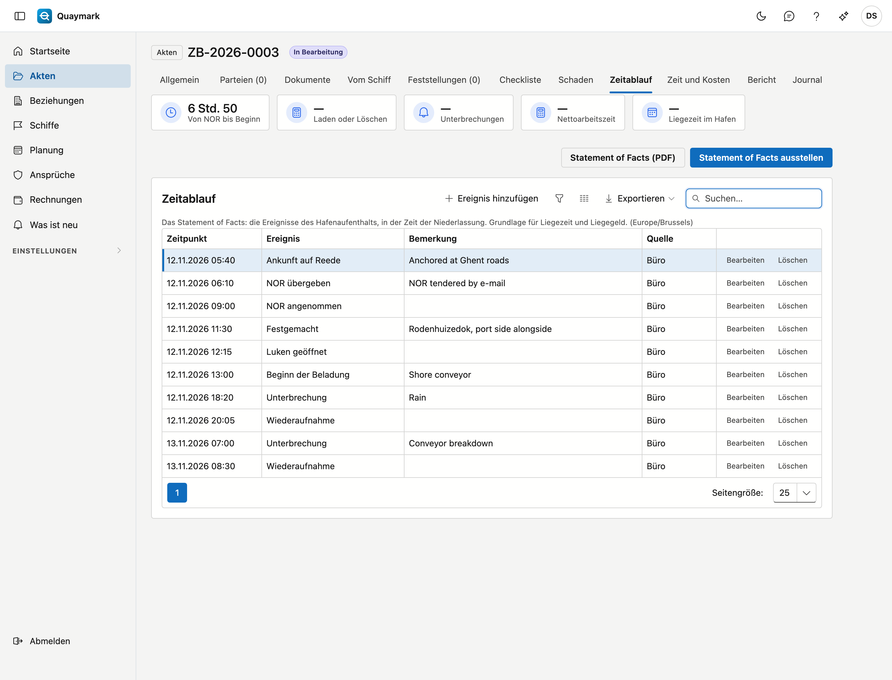

Oben berechnen die Kacheln der Zusammenfassung: die Zeit von der NOR bis zum Beginn, die Dauer der Beladung oder Löschung, die Unterbrechungen (von einer Unterbrechung bis zu ihrer Wiederaufnahme), die Nettoarbeitszeit und die Liegezeit im Hafen. Fehlt ein Ereignis für eine Dauer, steht dort ein Strich, nicht null.

**Statement of Facts (PDF)** zeigt das Dokument; **Statement of Facts ausstellen** legt es mit seinem Fingerabdruck fest, bei den Schreiben und Bescheinigungen der Akte, und im Beweispaket. Das Dokument hat Platz für die Unterschrift des Kapitäns. Im Bericht steht der Zeitablauf mit der Markierung `{{tijdlijn}}` (siehe [Vorlagen](sjablonen.md)).

### Zeit und Kosten

In der Registerkarte **Zeit und Kosten** erfassen Sie die **Leistungen** (wer, von wann bis wann, in der Zeit der Niederlassung) und die **Kosten** (Reise, Unterkunft, Labor, Dritte) der Akte, mit dem Beleg aus den Anhängen. Kosten auf **Weiterberechnen** kommen auf die Rechnung. **Rechnung vorschlagen** macht daraus einen Rechnungsentwurf; siehe [Rechnungen](facturen.md). Was auf einer Rechnung steht, steht fest.

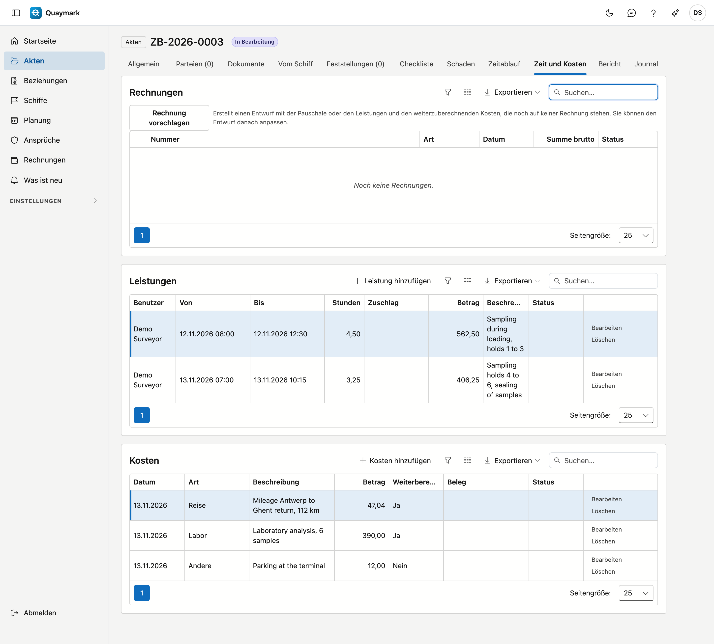

### Beweispaket

**Beweispaket (ZIP)** liefert ein ZIP zur Prüfung ohne Quaymark: die Originalfotos des Geräts (auch ausgeblendete, mit Grund), ein Manifest, die herausgegebenen Berichte und ein LIESMICH mit den Befehlen (`shasum`, `certutil`). Jede Datei wird beim Packen nachgeprüft; stimmt eine nicht mehr, entsteht kein Paket. Der Fingerabdruck des Pakets steht danach in der Registerkarte und im Journal.

### Berichtsvorschau

**Bericht (PDF)** und **Bericht (Word)** erstellen den Bericht aus den gespeicherten Daten, mit der Berichtsvorlage dieser Besichtigungsart (sonst der allgemeinen) und in der Berichtssprache. Es ist eine Vorschau: Nichts wird gespeichert oder versendet. Speichern Sie zuerst, sonst fehlen Ihre letzten Änderungen.

### Kopieren

**Kopieren** legt eine neue Akte mit demselben Auftrag an (Schiff, Auftraggeber, Art, Hafen), ohne Feststellungen, Antworten und Besichtigungsdaten, und verknüpft sie mit dieser Akte.

### Rechtlich sperren

**Rechtlich sperren** (nur der Administrator) hält eine Akte für einen Streitfall oder eine Forderung fest. Geben Sie eine Begründung an. Solange die Akte gesperrt ist, kann sie nicht in den Papierkorb, und ihre Dokumente, Anhänge, Notizen und Aufgaben werden nicht gelöscht. Bearbeiten bleibt möglich. **Sperre aufheben** verlangt ebenfalls eine Begründung; das Fenster zeigt, wer wann gesperrt oder aufgehoben hat.

### Löschen

**Löschen** verschiebt die Akte in den Papierkorb.

## Ansprüche

Der Bildschirm **Ansprüche** im Menü zeigt die Ansprüche aller Akten, mit Akte, Versicherer, Beträgen und Status.

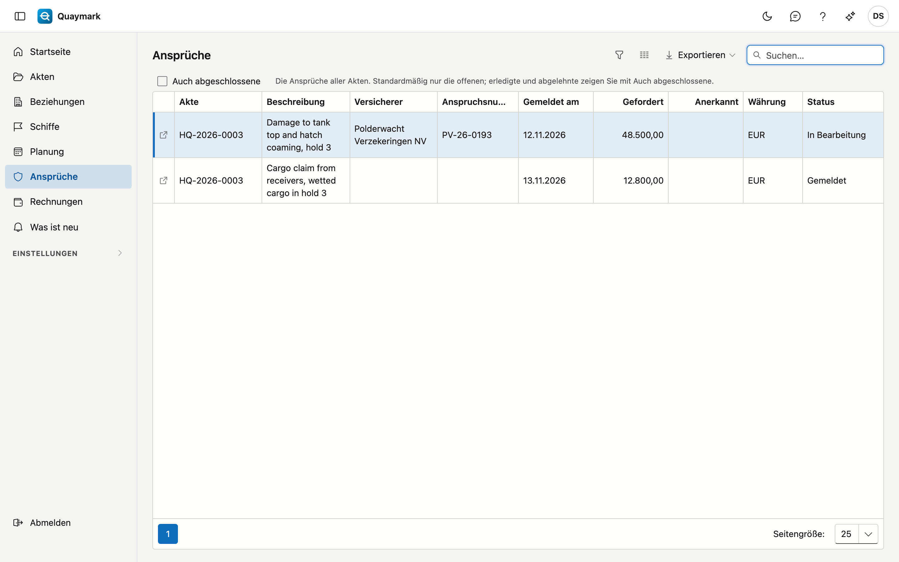

- Standardmäßig sehen Sie nur die **offenen** Ansprüche. Haken Sie **Auch abgeschlossene** an für erledigte und abgelehnte Ansprüche.
- Doppelklicken Sie auf eine Zeile, um den Anspruch zu öffnen. Einen neuen Anspruch legen Sie in der Akte an, auf der Registerkarte **Schaden**.

## Siehe auch

- [Schiffe](schepen.md)
- [Beziehungen](relaties.md)
- [Vorlagen](sjablonen.md)
