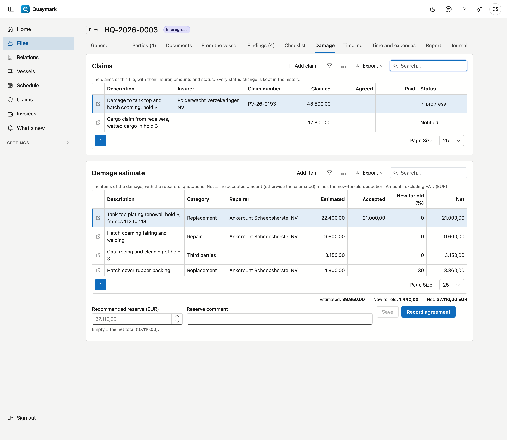
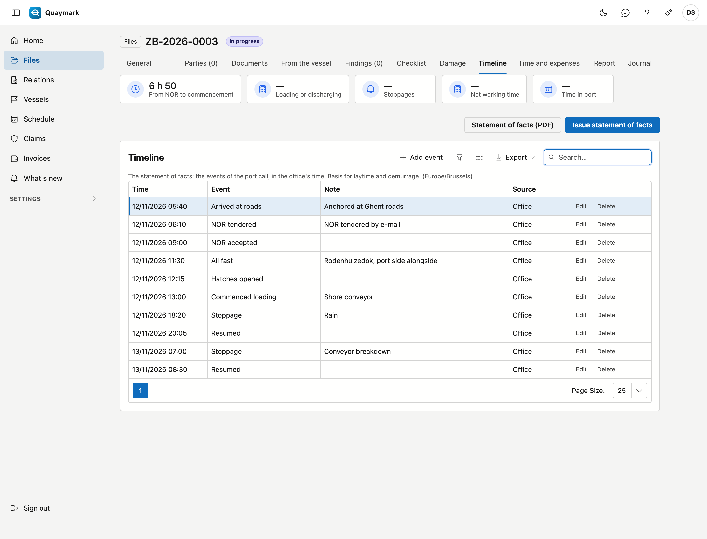
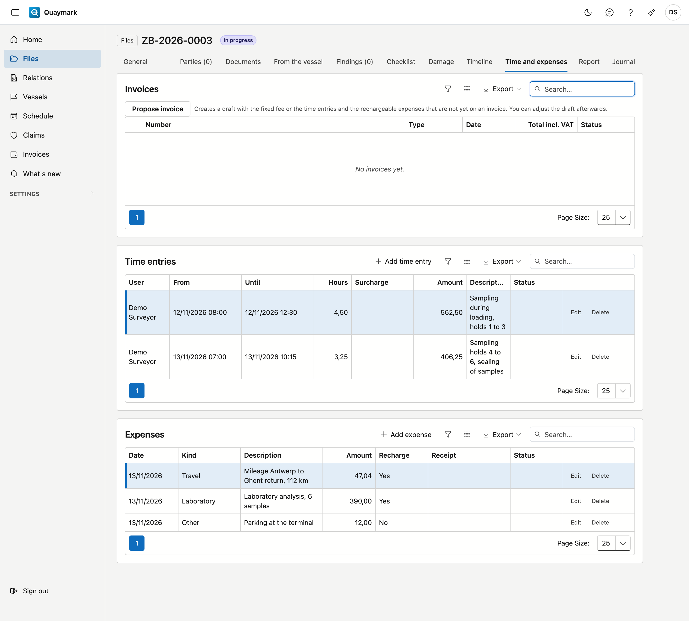
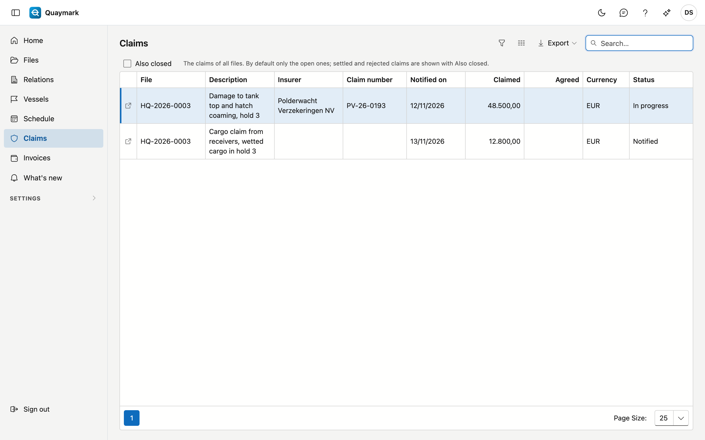

# Files

The office's work list: one row per instruction.

## Opening the screen

In the menu on the left, click **Files**.

## The list

- The **Status** choice above the list shows the **open** files by default. Choose **All** to include closed and cancelled files as well, or pick one status.
- The **search box** searches all columns: number, survey type, vessel, principal, port, planning and status.
- Double-click a row to open the **file**; the arrow at the start of the row opens it in a new tab. **New file** creates one.
- The export button downloads the list as a file.

## File

One instruction: what was asked, where and when, and what the surveyor finds on site.

- **Instruction**: office, survey type, principal, surveyor, reference, date, status and report language. The **file number** (office code, year, sequence number) is assigned the first time you save; after that the office is fixed.
- **Place and planning**: vessel, port, terminal or berth, the scheduled moment (in the office's time zone), currency and description.
- **Conditions and attendance**: weather, sea, visibility, berth and who attended the survey. **Linked file** refers to an earlier file of the same vessel, for example the on-hire for an off-hire.
- **Survey particulars**: the fields that belong to the chosen survey type. A required field must be filled in from the status Reporting onwards. If you choose another survey type, the values of fields the new type does not know are lost when you save.

A saved file has tabs: **Parties** (relations with their role and reference), **Documents** (in folders), **From the vessel** (the vessel's documents, read only), **Findings**, **Checklist** and the journal with notes, tasks, attachments and history.

### Findings

A **finding** is added, never changed or deleted. You correct a mistake with **Correct** and a reason: the old version stays visible, struck through. Pointing at a photo shows the time, GPS position and fingerprint (SHA-256) the device recorded when the photo was taken.

### Photos in the report

**Leave out of report** under a photo removes it from the report's photo appendix, with a reason. The photo stays stored as evidence; **Show in report again** puts it back. Photos get a running number in the report, and the findings table lists those numbers.

### Checklist

The **checklist** shows the latest answer per item (OK, not OK, n/a), by whom and when. Every answer is kept under **Previous answers**. **Not OK** proposes a finding. On site, the surveyor answers in the field app.

### Report

On the **Report** tab you write the text of the report per section, with simple formatting, and insert the office's standard texts. **Save sections** saves them. If the report template does not show a section, the tab says so.

### Issuing and sending the report

**Issue report** (Report tab, from the status Reporting onwards) fixes the report as version 1, with its fingerprint (SHA-256): it never changes again. Correcting = **Issue new version**, with a reason. **Send** sends an issued version as a PDF to the principal; the mail is kept in the journal. Save the sections first: a version only takes saved text.

### Propose a draft

**Propose a draft** (Report tab) has the AI write a proposal per section from the file data: findings, checklist, fields and conditions. Photos and your own text are not sent. Each proposal appears under its section; you choose **Take over**, **Add at the end** or **Ignore**, then save as usual. It runs on your office's AI key and only if the administrator allows it in the ADM One portal.

### Comparison with a previous file

If the file is **linked** to a previous file (e.g. the on-hire of an off-hire), the Findings tab shows per location what that file found there. Give your judgement per finding: **Already existed** or **New**. The report shows the comparison per location on board, with the photo numbers and your judgement; without a judgement, nothing is added.

### Letters and certificates

**New letter** and **New certificate** (Report tab) create a standard letter or certificate in the language of the file. **Preview (PDF)** shows it first; **Issue** fixes it with its fingerprint. A certificate then gets a number from the branch's series (C-HQ-2026-0001). In a letter, replace every field in [square brackets]: otherwise issuing is not possible.

There are three letters and five certificates. Each certificate has its own lines:

- **Certificate of quantity**, **Certificate of weight** and **On-hire/off-hire certificate**: a description, a quantity and a unit. A filled-in number field of the file can be taken over with **Take from a field of the file**.
- **Hold inspection certificate**: a **Finding** per hold, and the **Conclusion**: fit or not fit to load the cargo stated. The conclusion is never filled in beforehand. This is the certificate on which the master's notice of readiness (NOR) is accepted or rejected.
- **Certificate of quality**: the results of an analysis, with per line the **Parameter**, the **Method**, the **Result**, the **Unit** and the **Specification** (the limit). Above them you fill in the **Sampling** (where and when), the **Laboratory** and the **Laboratory report**.

If a quantity is in another unit than the customer asks for, for example metric tonnes while the charter party uses long tons, **Convert** converts it (tonne, kilogram, long ton, short ton, cubic metre, litre, barrel). From volume to weight, Quaymark asks for the density. The converted quantity is added as a new line below the original.

### Damage

The **Damage** tab follows up a damage file: the **claims** and the **damage estimate**.

- A file can have **several claims**, for example one with the hull insurer and one with the P&I club. **Add claim** opens a page of its own with the insurer or P&I club, the policy and claim number, the notification date and the claimed, agreed and paid amount. Agreed may not exceed claimed, paid may not exceed agreed.
- **Change status** on the claim adds a step to the **history**: notified, in progress, agreed, disputed, settled or rejected, with a date and a comment. A step is kept; settled or rejected also sets the settlement date. A claim with a history can no longer be deleted.
- The **damage estimate** consists of items: description, category (repair, replacement, labour, third parties, other), repairer, quotation number and the quotation as an attachment of the file. Per item the **estimated** and **accepted** amount and the **new for old** deduction in percent. Net = the accepted amount (otherwise the estimated) minus the deduction. Amounts excluding VAT, in the currency of the file.
- **Recommended reserve**: if you leave it empty, the net total applies.
- **Record agreement** fixes the estimate as it is, with whom the agreement was made (for example the insurer and the counter-expert). After that, no item can be added or changed. **Withdraw agreement** allows it again and asks for a reason; both the agreement and the withdrawal are kept.
- In the report the estimate comes with the marker `{{schadebegroting}}` (see [Templates](sjablonen.md)).

### Timeline

The **Timeline** tab is the statement of facts of the file: the events of the port call, in the office's time. With **Add event** you choose the time, the event (arrived at roads, NOR tendered, NOR accepted, all fast, hatches opened, commenced and completed loading or discharging, stoppage, resumed, hatches closed, documents on board, sailed or other) and a note. An event can be changed afterwards; the history keeps who changed what.

At the top, the summary tiles calculate: the time from NOR to commencement, the duration of loading or discharging, the stoppages (from a stoppage to its resumption), the net working time and the time in port. If an event for a duration is missing, a dash is shown, not zero.

**Statement of facts (PDF)** shows the document; **Issue statement of facts** records it with its fingerprint, with the letters and certificates of the file, and in the evidence package. The document has room for the master's signature. In the report the timeline comes with the marker `{{tijdlijn}}` (see [Templates](sjablonen.md)).

### Time and expenses

On the **Time and expenses** tab you record the **time entries** (who, from when to when, in the office's time) and the **expenses** (travel, accommodation, laboratory, third parties) of the file, with the receipt from the attachments. An expense marked **Recharge** goes on the invoice. **Propose invoice** turns them into a draft invoice; see [Invoices](facturen.md). Anything on an invoice is fixed.

### Evidence package

**Evidence package (ZIP)** gives one ZIP to verify without Quaymark: the original photos from the device (hidden photos too, with the reason), a manifest, the issued reports and a README with the commands (`shasum`, `certutil`). Every file is re-checked while packing; if one no longer matches, no package is made. The fingerprint of the package then appears on the tab and in the journal.

### Report preview

**Report (PDF)** and **Report (Word)** create the report from the saved data, with the report template of this survey type (otherwise the general one) and in the report language. It is a preview: nothing is saved or sent. Save first, otherwise your latest changes are not in it.

### Copy

**Copy** creates a new file with the same instruction (vessel, principal, survey type, port), without findings, answers or survey particulars, and links it to this file.

### Legal hold

**Place on legal hold** (administrator only) keeps a file for a dispute or a claim. Give a reason. While the file is on hold, it cannot go to the recycle bin, and its documents, attachments, notes and tasks are not deleted. Editing remains possible. **Lift legal hold** also asks for a reason; the window shows who placed or lifted the hold, and when.

### Delete

**Delete** moves the file to the recycle bin.

## Claims

The **Claims** screen in the menu shows the claims of all files, with their file, insurer, amounts and status.

- By default you only see the **open** claims. Tick **Also closed** for settled and rejected claims.
- Double-click a row to open the claim. A new claim is made in the file, on the **Damage** tab.

## See also

- [Vessels](schepen.md)
- [Relations](relaties.md)
- [Templates](sjablonen.md)
