# Files

The office's work list: one row per instruction.

## Opening the screen

In the menu on the left, click **Files**.

## The list

- The **Status** filter in the toolbar shows the **open** files by default; a status tile on the dashboard opens the list with that status. Choose **All** to include closed and cancelled files as well, or pick one status.
- The **search box** searches all columns: number, survey type, vessel, principal, port, surveyor, planning, status and the scanned codes (not shown as a column) (a container number is also found with spaces).
- Double-click a row to open the **file**; the arrow at the start of the row opens it in a new tab. **New file** creates one.
- The export button downloads the list as a file.
- The **Report due** column shows the date by which the report is due under the framework agreement, with its status. → [Report deadline](#report-deadline)

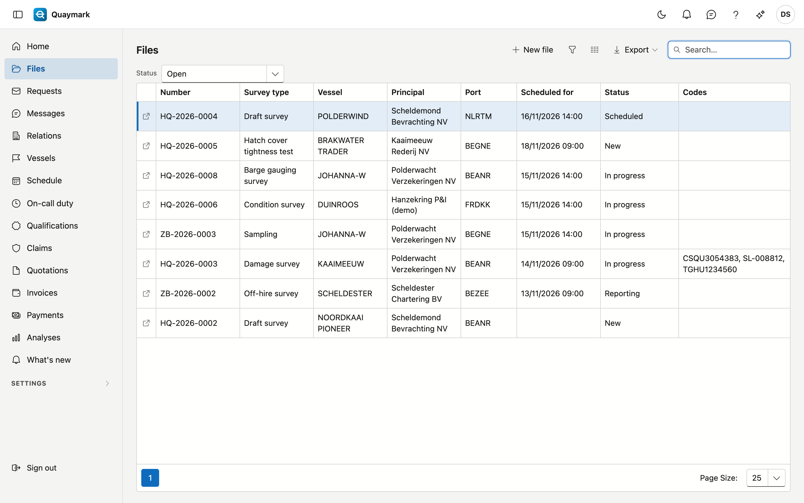

## File

One instruction: what was asked, where and when, and what the surveyor finds on site.

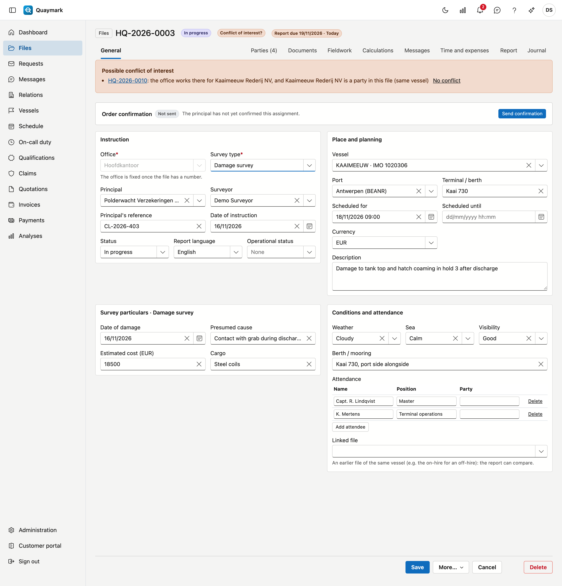

- **Instruction**: office, survey type, principal, surveyor, reference, date, report language and, after the first save, the status. A new file starts at New; with a surveyor and a scheduled moment it becomes Scheduled by itself, and without them New again, as on the schedule. The **file number** (office code, year, sequence number) is assigned the first time you save; after that the office is fixed.
- **Place and planning**: vessel, port, terminal or berth, the scheduled moment (in the office's time zone), currency and description.
- **Conditions and attendance**: weather, sea, visibility, berth and who attended the survey. **Linked file** refers to an earlier file of the same vessel, for example the on-hire for an off-hire. This block appears after the first save.
- **Survey particulars**: the fields that belong to the chosen survey type; the block only appears if that type has its own fields. A required field must be filled in from the status Reporting onwards. If you choose another survey type, the values of fields the new type does not know are lost when you save.

A saved file has these tabs: **Parties**, **Documents** (in folders, those of the vessel and the documents from on board), **Fieldwork** (findings, checklist, damage, joint survey, signatures and codes), **Calculations** (draft survey, gauging, bunkers, timeline and laytime: only what the survey type has), **Messages**, **Time and expenses**, **Report** and the **Journal** (notes, tasks, attachments and history). A group shows its parts as small tabs below it. The office chooses per survey type which tabs a file shows. → [Survey types](soorten-survey.md#survey-type)

**Parties**: the relations with their role (owner, P&I club, opposing expert …) and their reference. **Add party** adds one; with **⋯** at the end of a row you edit the role and reference, or delete the party.

### Work instructions and operational status

- If the survey type has **work instructions**, they appear at the top of the file, with the file's data filled in (ship, port, terminal …). What the file does not know appears between square brackets. → [Survey types](soorten-survey.md#survey-type)
- **Operational status**: where the assignment stands now, next to the work step: for example awaiting vessel, loading, discharging or on hold. It appears as a badge at the top, after the status in the list ("Reporting · Loading") and in the planning. You manage the list under [Categories and locations](categorieen-en-plaatsen.md).

### Report deadline

If the [framework agreement](relaties.md#framework-agreements) with the principal has a deadline, the top of the file shows **Report due** with the date and the status:

- **2 working days left**, **Today** or **1 working day late**, as long as there is no report. Orange from the last working day before, red when the deadline has passed.
- **On time** or **… late** as soon as the first report is issued.

The deadline runs from the end of the planned inspection, in working days without weekends and public holidays of the office's country. If you replan the file, the date moves with it. A closed or cancelled file without a report no longer has a deadline.

The file's **surveyor** gets a notification on the bell on the last working day before and when the deadline has passed. If Quaymark cannot fetch the public holidays, it counts without them and says so: the date then falls earlier, never later.

### Findings

A **finding** is added, never changed or deleted. You correct a mistake with **Correct** under **⋯** at the end of the row, with a reason: the old version stays visible, struck through. Its photos move to the new version, on screen and in the report. Pointing at a photo shows the time, GPS position and fingerprint (SHA-256) the device recorded when the photo was taken.

A **closed** or **cancelled** file receives no more field work: no findings, checklist answers, photos or signatures, not even from the field app. What is already there stays visible. The calculations (draft survey, gauging on draught scales, bunker survey, timeline and laytime) can then only be viewed.

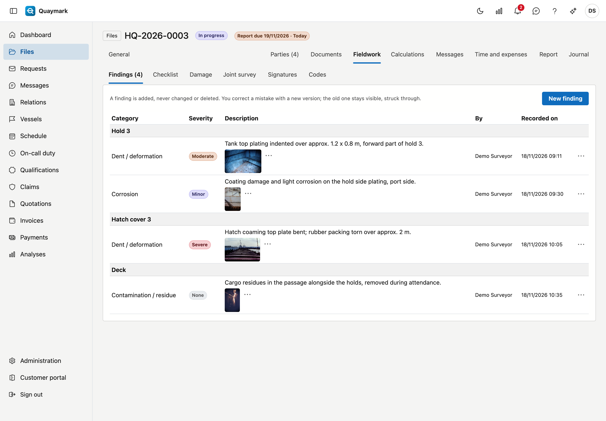

### Photos in the report

**Leave out of report** under **⋯** next to a photo removes it from the report's photo appendix, with a reason. The photo stays stored as evidence; **Show in report again** puts it back. This is still possible in a closed file. Photos get a running number in the report, and the findings table lists those numbers.

### Photos added at the office

Working without the field app, you add the photos at the office to a finding: **Add photos** under **⋯** at the end of the row, or straight after **New finding**. JPEG or PNG, up to 40 at a time.

- The **time taken** and the **GPS** come from the photo itself. The caption in the report then says "according to the camera".
- Without a time taken, the report says **uploaded on** with the moment of upload.
- These photos also get a fingerprint and are only ever added. They are weaker evidence than a photo from the field app, though: the time comes from the camera's clock.

### Annotating photos

**Annotate** under **⋯** next to a photo opens it large, with tools: **Arrow**, **Oval**, **Rectangle**, **Freehand**, **Text** and **Dimension** (a line with a label, for example 1,2 m), in red, yellow, white or black. For text and dimensions, first type the text in **Text or dimension**, then click or drag on the photo. **Undo** removes the last shape, **Clear all** all shapes.

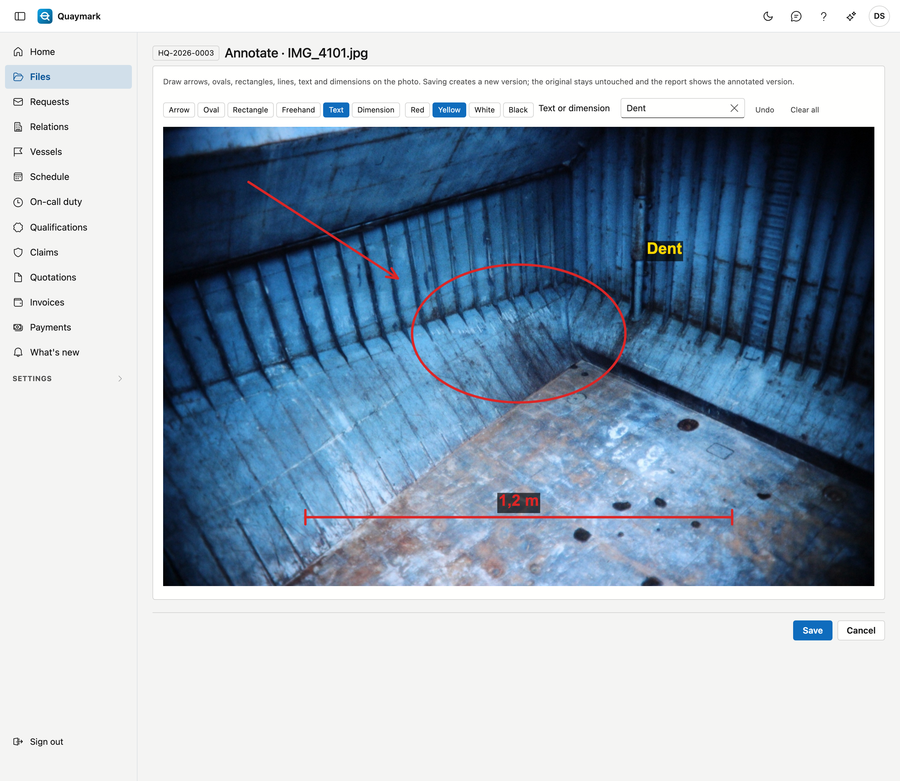

**Save** creates a new version; the photo gets the label **annotated**. The original stays untouched: Quaymark keeps the shapes and draws its own image from them, with its own fingerprint. The report shows the annotated version; the caption says it is annotated and keeps the fingerprint of the original. **Back to original** puts the original photo back in the report; the annotation is kept as an earlier version. The evidence package contains the original and every version of the annotation, as an image and as shapes. If nothing changed, Save creates no version. If you leave with shapes that are not saved yet, Quaymark asks first. You then return to the tab you came from (Findings or Checklist).

### Checklist

The **checklist** shows the latest answer per item, by whom and when. The survey type sets the scale: **OK**, **Not OK** and **N/a** for an inspection, or a condition in four steps (**Good**, **Fair**, **Poor**, **Bad**, and **N/a**) for a condition survey. At the top you see how many items have a deficiency, per priority. You choose the answer with the buttons to the left of the item. A required item carries the label **Required**; if all items are required, this is shown once at the top.

A good answer is saved with one click. For a deficiency (**Not OK**, **Poor** or **Bad**) you fill in the **Finding**, the **Recommendation** and the **Priority**: **Immediate, before departure**, **Within 3 months**, **At the next maintenance** or **For information**. **Insert a standard finding** fills the three fields with a standard text of the survey type, in the language of the file; adjust them afterwards. **New finding** turns it into a finding.

Every answer is kept under **Previous answers**. On site, the surveyor answers in the field app, with the same scale and the same standard findings. The deficiencies appear in the report with the marker `{{aanbevelingen}}` (see [Templates](sjablonen.md)).

A second click on a good answer that is already there saves nothing; on a deficiency, it opens the finding so you can adjust it. If a finding already exists for the item, the deficiency shows it instead of **New finding**. The latest answer is the one given last, even if an answer from the field app arrives later.

The photos of an item appear below it, including those of a previous answer, and that is how they go into the report. With **⋯** next to a photo you leave it out of the report or annotate it, as for a finding. **Photo required** turns red while the photo is missing. At the office you add photos with **Add photos** under **⋯** at the end of the row.

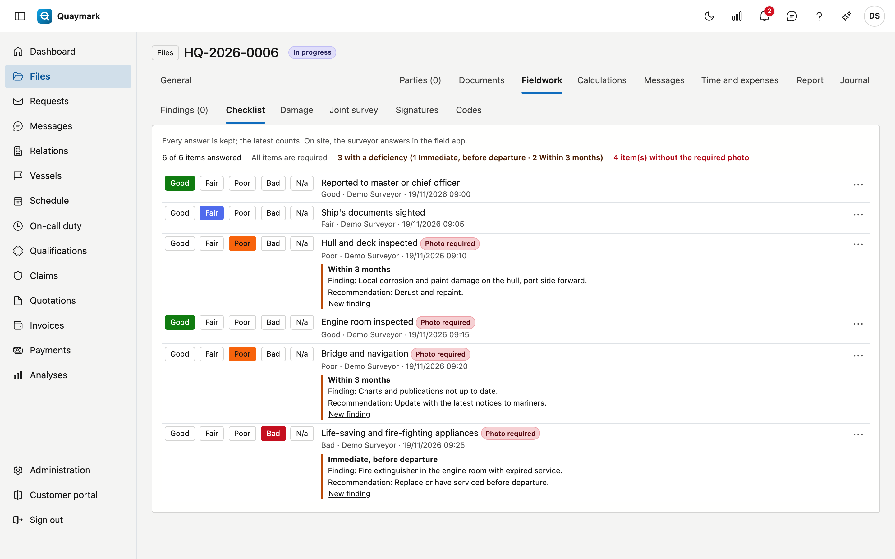

### Report

The **Report** tab has four sub-tabs: **Text** (the sections), **Issue** (check, four eyes, versions and signing), **Letters and certificates** and **Evidence package**. On the **Text** sub-tab you write the text of the report per section, with simple formatting, and insert the office's standard texts. **Save sections** saves them. Next to it, **Preview (PDF)** shows the report in a window and **Report (Word)** downloads it as a Word file, each time with the saved text. If the report template does not show a section, the tab says so.

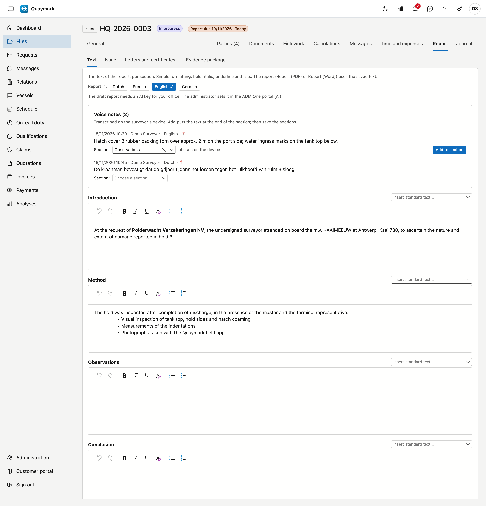

### Standard sentences and blanks

- A standard text with **Fill in automatically** is ready in an empty section when you open the tab, with the file's data filled in. It is not saved yet: fill in the blanks and choose **Save sections**. → [Standard texts](standaardteksten.md)
- Text between square brackets, like **[location]**, is a **blank**. While one remains in the report, it is not issued: the screen says in which section. A reference such as [1] does not count.

### Joint survey

On the **Joint survey** tab you record a joint survey: who attended on behalf of which party, and which findings you share.

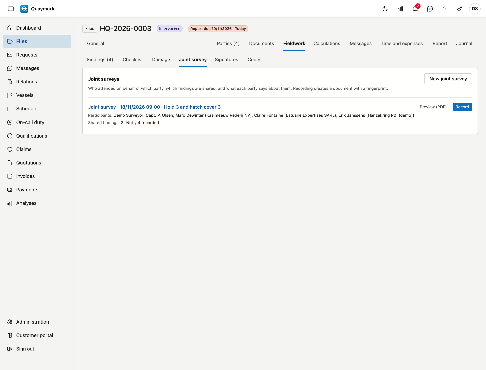

1. Click **New joint survey**. Fill in the date and time (in the office's time), the place and a note.
2. Add the participants. **One per party** prepares a row for each party of the file; you fill in the name and position. Leave those who represented no one (the master, the office) without a party. If someone did not attend after all, untick **Present**.
3. Choose the **shared findings**. The number is the one in the report. Save.
4. Back on the tab: **Record** creates the document *Joint survey statement*, with its fingerprint (SHA-256). It is listed with the documents of the file and goes into the evidence package. **Preview (PDF)** shows it first, without saving anything.

Clicking the title of a survey opens it for editing. Then each party of a participant who attended gives its position: **agreed**, **agreed with reservation** (with comments) or **not agreed**.

- **Send link** (under **⋯** next to the party) sends the party a link (via ADM One). It reads the joint survey statement, chooses its position and confirms with its name and a tick box. The answer appears on the tab and in the log by itself.
- **Record answer** (also under **⋯**) records an answer the office received otherwise, for example on the signed paper version. Add it as an attachment.

If you change the survey after recording it, record a new version. An answer belongs to the version the party saw: for a new version it answers again. The tab says so while the survey differs from the last recorded version, and the positions follow the parties of that version. If a shared finding was corrected, **Record** refuses until you save the new version under **Edit**; it is already ticked there. A closed or cancelled file gets no new joint survey and none is changed; recording, sending links and registering positions remain possible.

### Signatures

On site, the surveyor has the master, the chief officer or the terminal sign a statement: in the field app with **Sign** on the **Signatures** card ([Getting a signature](veldapp/laten-tekenen.md)), or at the office on the **Signatures** tab with **Get signature** (for example on a tablet at the counter).

1. Fill in the **Name of the signatory**, choose the **Position** and, if needed, the party on whose behalf they sign.
2. Choose the **Clause**: **For receipt only, without admission of liability** (default), **Agreed** or **Sighted**. The statement is shown in the language of the file, with the findings at that moment.
3. Have them sign under **Sign below** (**Clear** wipes the area) and click **Save signature**. If they refuse, tick **Refuses to sign**, fill in the **Reason for refusal** and click **Save refusal**.

If you leave after something has been signed or filled in, Quaymark asks first. A closed file can no longer be signed: the page says so at the top.

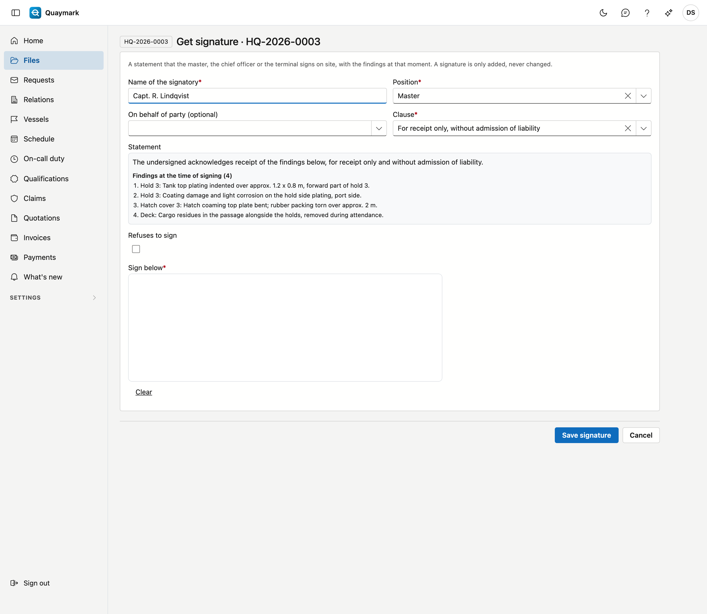

A signature is only added, never changed. Quaymark keeps what was signed: the statement and the list of findings at that moment (the **snapshot**, with its fingerprint), the image of the signature with the time and, on the device, the position. A finding added or corrected later does not change a signature already given. In the field app it works without a connection: the signature is sent once there is one.

The **Signatures** tab shows them all, with the image or the refusal. Under **Findings at the time of signing** you find the snapshot, also as a file. A finding corrected since then is struck through, and **Since signing** counts the corrected and the new ones: you may then ask for a new signature. Quaymark recalculates the fingerprint of the image and of the snapshot; if one no longer matches, a red message says so. Point at the image for the time, GPS position and fingerprint. In the report they appear with the marker `{{handtekeningen}}` (see [Templates](sjablonen.md)), and they are part of the evidence package.

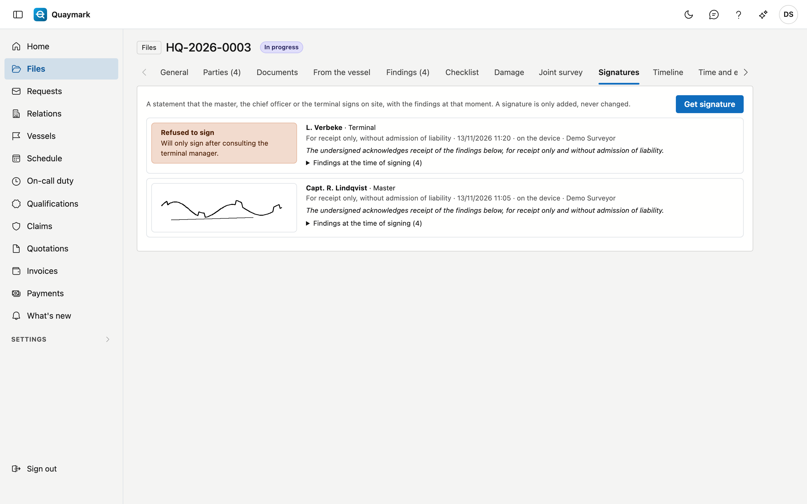

### Board documents

On board, the surveyor records the stowage plan, the cargo manifest, the logbook, a delivery note or a certificate in the field app, with **Add** on the **Board documents** card ([Recording on board](veldapp/aan-boord.md#board-documents)). They choose the type, photograph the pages, pick a pdf or file from the device, or record a short video (a photo or pdf at most 50 MB, a video at most 200 MB). Each file becomes evidence like a photo: with the time, place and fingerprint (SHA-256) of the moment it was added, and it joins the queue even without network.

At the office they are on the **Board documents** tab, with the type, who and when. A photo shows a thumbnail, a pdf opens, a video plays in the browser. They are never changed or deleted. They do not go into the photo appendix of the report, but they are part of the evidence package, with their type in the manifest.

If a document came by e-mail, add it at the office with **Add document**: choose the type, optionally a description, and the files (photos of the pages, a pdf or a video). Up to 50 MB per file, a video up to 200 MB. This is evidence with a fingerprint too; the tab, the evidence package and the evidence data say **at the office**. Point at a file for the time, GPS position and fingerprint.

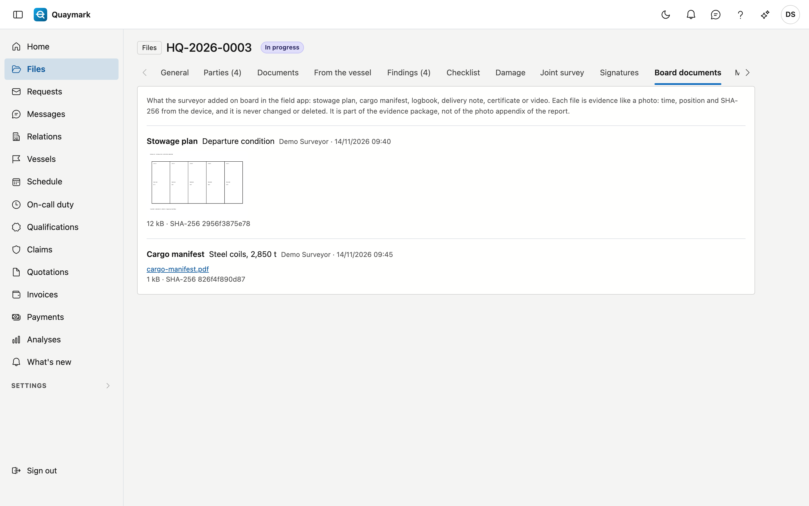

### Codes

The surveyor scans barcodes and QR codes in the field app: **Scan** on the **Codes** card ([Recording on board](veldapp/aan-boord.md#codes)). They choose the type (container, seal, sample or other code) and scan with the camera, have the code read from a photo or type it. They can link the code to a finding or leave it on the file. Without network it waits on the device.

- A **container number** (ISO 6346) is 4 letters, the last U, J or Z, and 7 digits; the app writes it in capitals without spaces. If the check digit is wrong, the app warns and the surveyor may save anyway: the code gets the mark **Incorrect**.
- Correcting a scanned code makes it a typed code: the **Source** column says honestly how it came in.
- At the office you type a code with **Add code** (for example a container number from a document): type, code and optionally the finding. A container number is checked at once; a wrong check digit warns, saving is allowed. The source then reads **Typed · at the office**.
- A code at a corrected finding appears under the new version, on the tab and in the report.

At the office, the **Codes** tab shows each code with its type, check digit, finding, time, source and who recorded it. A code is never changed or deleted.

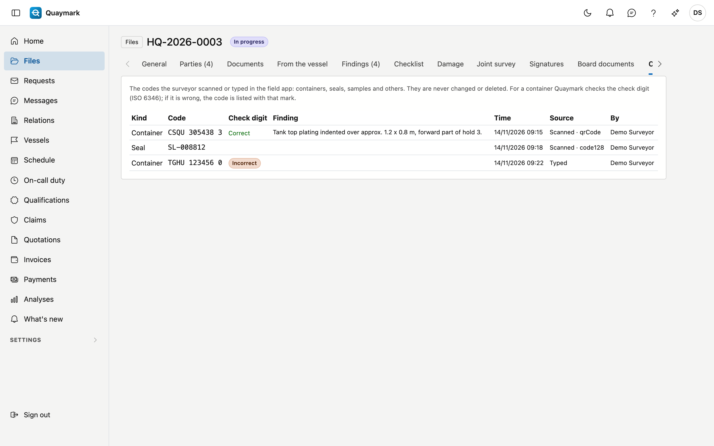

In the report the codes of a finding appear in brackets after its description; `{{codes}}` puts the full table in the report (see [Templates](sjablonen.md)). In the evidence package they are in `codes/codes.csv` and `codes/codes.json`, each with the fingerprint of its line.

### Report in another language

The texts of the report exist **per language**. At the top of the Report tab you choose the language of the report: clicking a language changes the language of the file and saves it. A tick shows which languages already have text. If you have unsaved text, save the sections first.

If another language already has text, **Translate from …** suggests a translation per section, next to the source text. The formatting is kept, and the terms in the office's [glossary](woordenlijst.md) are used as fixed translations. Choose **Take over**, **Add at the end** or **Ignore** per section, then **Save sections**. Nothing goes into the report by itself.

Translating uses the office's AI key and asks for its permission, like the draft report. Only the section texts are translated: findings and checklist remarks stay in their original language.

### Report check

At the top of the Report tab, the **Report check** block compares the report with the file:

- **Times**: findings or photos outside the survey days (the day before or after is allowed), a date of damage after the survey, and in the timeline an end before its start or a moment in the future.
- **Vessel**: an invalid IMO number, or another vessel name (m.v., MV, MT …) or another IMO number in the text of a section.
- **Weights**: a weight in the fields or in the text that differs by more than 0.5 % from the cargo in the draft survey.
- **Completeness**: sections the template shows that are empty (also when they have text in another language), required fields and checklist items without an answer, a missing required photo, and for a linked file findings without a verdict.

The check refuses nothing. If you issue with findings, Quaymark asks **Issue anyway?**, and the findings are recorded with the version. **Check again** runs the check again, for example after a correction.

### Issuing and sending the report

**Issue report** (Report tab, from the status Reporting onwards) fixes the report as version 1, with its fingerprint (SHA-256): it never changes again. Correcting = **Issue new version**, with a reason. **Send** sends an issued version as a PDF to the principal; the mail is kept in the journal. If the version is signed, the signed PDF is attached, as in the principal portal; the window says which PDF goes, and warns if you send a version that a newer one superseded. Save the sections first: a version only takes saved text.

### Signing the report

If your office has an OKSign contract in ADM One, you have an issued version signed with a qualified signature, by eID or itsme. This happens in the **Signing (OKSign)** part of the **Report** tab.

1. Click **Have signed** next to the version. The surveyor of the file signs; for a survey type with four-eyes review, whoever approved the report signs too.
2. Fill in the mobile number of each signatory (OKSign requires it; Quaymark remembers it for next time) and click **Send to OKSign**.
3. Each signatory sees their own **Sign now** button next to the version. It opens the OKSign signing page.
4. Once everyone has signed, the signed version comes in by itself (every quarter of an hour, or right away with **Refresh**). The version then shows **Signed**, with **Signed PDF**.

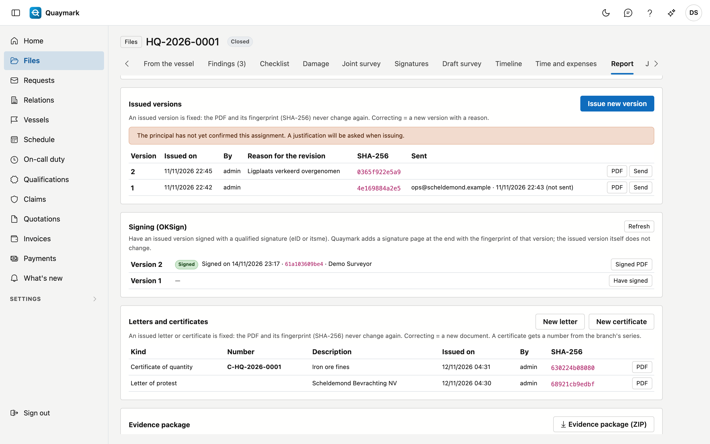

The issued version itself does not change. Quaymark adds a signature page at the end with the file number, the version and the fingerprint (SHA-256) of that version, and has the whole signed. The signed PDF gets its own fingerprint and is part of the evidence package. As long as not everyone has signed, you can **Withdraw** the request; you can then have it signed again.

What the principal sees in the principal portal depends on the setting **Report in the portal only after signing via OKSign** in the [office details](bureaugegevens.md): off, they see every issued version right away, and the signed one once it exists. On, only once signed, and only then do they get the notification.

### Four-eyes review

For a survey type with **Four-eyes review** ticked (see [Survey types](soorten-survey.md)), a report can only be issued after a second surveyor has approved it. The Report tab then shows the **Four-eyes review** block.

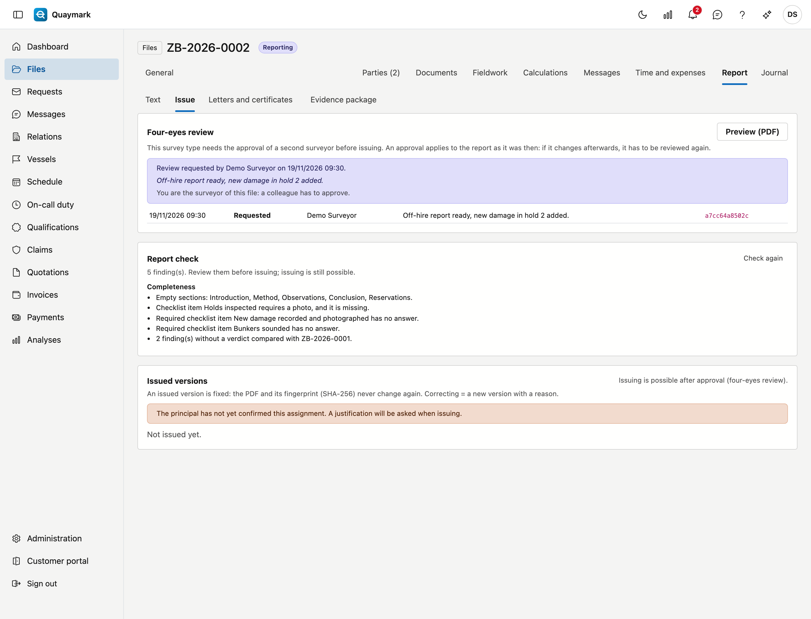

- **Request review** puts the report forward to a colleague, with a note if you like. On the home screen it then appears under **Awaiting review**.
- A colleague with the right to issue reports may approve, but not the surveyor of the file and not the one who requested the review. They look at the **Preview (PDF)** and choose **Approve**, or **Send back** with what needs to change.
- An approval applies to the report as it was at that moment. If anything that goes into the report changes afterwards (a section text, a field, a hidden photo, the template), it lapses and you request a new review. The block says so, and **Issue report** only reappears after a new approval.
- Every step is kept, with who, when and the fingerprint of the content that was approved or sent back.

### Propose a draft

**Propose a draft** (Report tab) has the AI write a proposal per section from the file data: findings, checklist, fields, conditions and voice notes. Each proposal appears under its section; you choose **Take over**, **Add at the end** or **Ignore**, then save as usual. It runs on your office's AI key and only if the administrator allows it in the ADM One portal.

Two things are sent to make the proposal more accurate:

- **The photos of the photo appendix**, with their number (40 at most). The AI only describes what is clearly visible and may refer to a photo, for example "(photo 3)". Hidden photos and board documents are not sent. For this, the administrator must also allow **Scans, photos and PDFs** in ADM One; otherwise the proposal is made without photos and the Report tab says so.
- **Your earlier reports** of the same survey type: the sections of the last three issued reports, only as an example of style and structure. The AI takes no facts from them.

Below the button you see what the proposal was based on. Your own text in the sections is not sent.

### Voice notes

On board, you dictate a note instead of typing it. In the field app, tap **Dictate** on the **Notes** card ([Recording on board](veldapp/aan-boord.md#voice-notes)): the device transcribes the speech straight away. Choose the language you speak in and, if you want, the report section. Then correct the text and save. Without a connection, the note waits on the device, like a finding. Only the text goes to Quaymark, with the time and place of the recording; the sound is not kept. The **Notes** card in the field app also shows what has already been sent.

At the office, the notes are on the **Report** tab, above the sections.

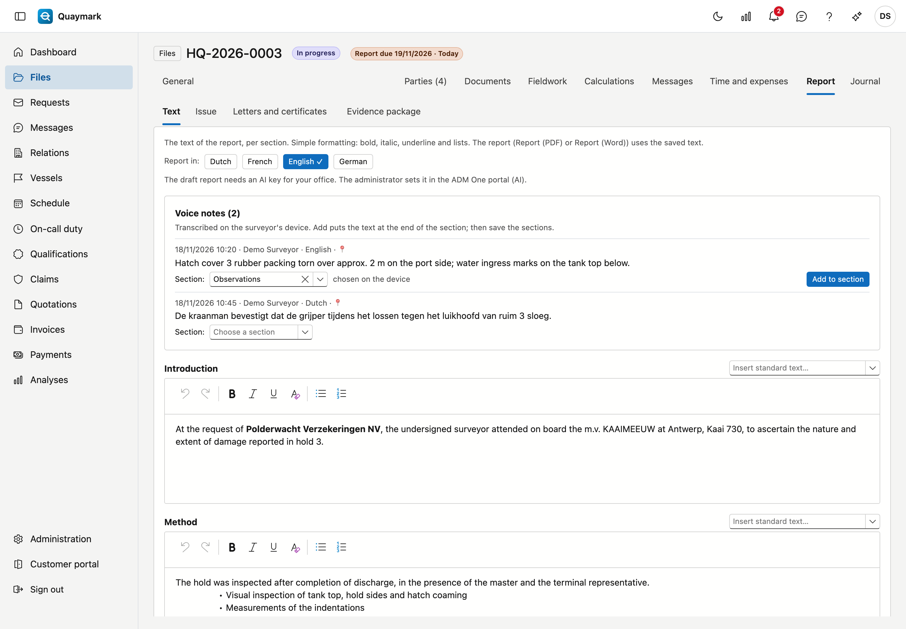

- **Section**: the surveyor's choice, a suggestion from the AI or your own choice. You can always change it.
- **Add to section** puts the text at the end of that section. It is only in the report after **Save sections**, and the note is then marked *Added*.
- **Prepare notes (AI)** suggests a section for notes without one, and translates into the report language what is in another language. The translation is shown under the original; **Add to section** then takes the translation. Without AI, you can **Add the original**.

The notes are also used by **Propose a draft** and go into the evidence package, with the fingerprint of the text.

### Comparison with a previous file

If the file is **linked** to a previous file (e.g. the on-hire of an off-hire), the Findings tab shows per location what that file found there. Give your judgement per finding: **Already existed** or **New**. The report shows the comparison per location on board, with the photo numbers and your judgement; without a judgement, nothing is added.

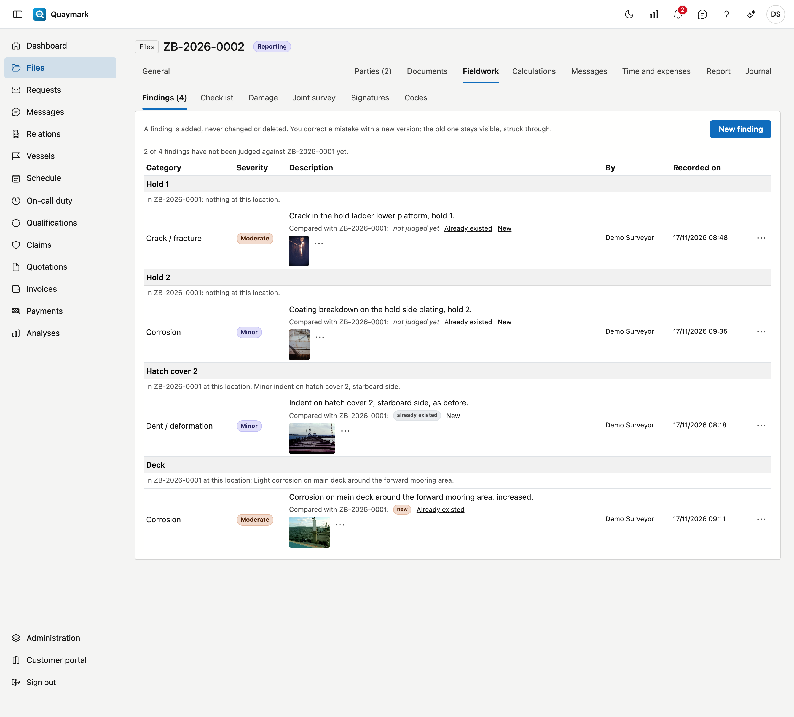

### Letters and certificates

**New letter** and **New certificate** (Report tab) create a standard letter or certificate in the language of the file. **Preview (PDF)** shows it first; **Issue** fixes it with its fingerprint. A certificate then gets a number from the branch's series (C-HQ-2026-0001). In a letter, replace every field in [square brackets]: otherwise issuing is not possible.

If you choose another type at the top, Quaymark fills in the subject, text and cargo again; the date and the addressee stay. If you wrote or changed something yourself, Quaymark first asks whether it may be lost. A certificate is only possible from the status In progress: if the file is still New or Scheduled, the screen says so at the top, and the preview is already possible. A typed quantity takes the notation of the file (12,500 in English, 12.500 in Dutch).

There are three letters and five certificates. Each certificate has its own lines:

- **Certificate of quantity**, **Certificate of weight** and **On-hire/off-hire certificate**: a description, a quantity and a unit. A filled-in number field of the file can be taken over with **Take from a field of the file**. For a bunker survey, **From the bunker survey** takes over the delivered quantity per product.
- **Hold inspection certificate**: a **Finding** per hold, and the **Conclusion**: fit or not fit to load the cargo stated. The conclusion is never filled in beforehand. This is the certificate on which the master's notice of readiness (NOR) is accepted or rejected.
- **Certificate of quality**: the results of an analysis, with per line the **Parameter**, the **Method**, the **Result**, the **Unit** and the **Specification** (the limit). Above them you fill in the **Sampling** (where and when), the **Laboratory** and the **Laboratory report**.

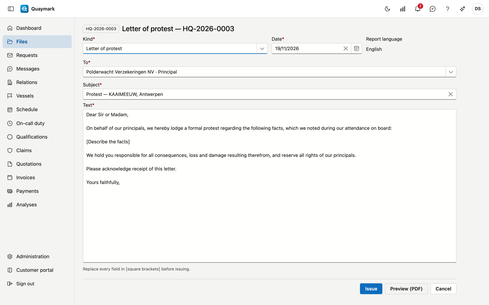

If a quantity is in another unit than the customer asks for, for example metric tonnes while the charter party uses long tons, **Convert** (under **⋯** next to the row) converts it (tonne, kilogram, long ton, short ton, cubic metre, litre, barrel). From volume to weight, Quaymark asks for the density. The converted quantity is added as a new line below the original.

### Damage

The **Damage** tab follows up a damage file: the **claims** and the **damage estimate**.

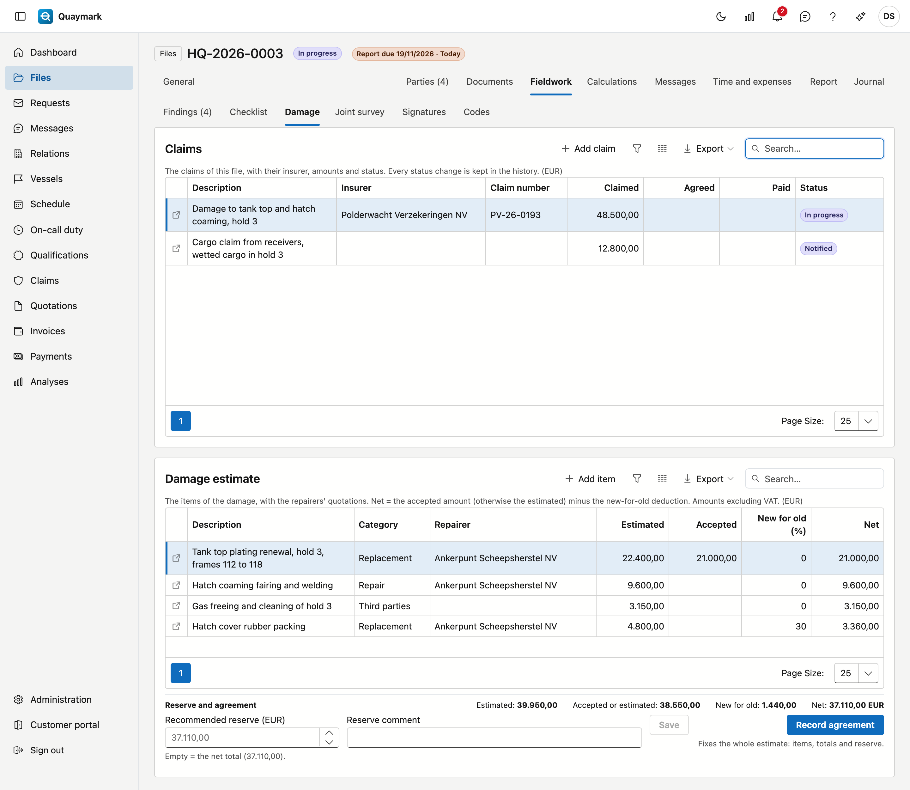

- A file can have **several claims**, for example one with the hull insurer and one with the P&I club. **Add claim** opens a page of its own with the insurer or P&I club, the policy and claim number, the notification date and the claimed, agreed and paid amount. Agreed may not exceed claimed, paid may not exceed agreed. For a new claim, the insurer and the P&I club are already filled in if the file has a party with that role, or a principal with that role.
- **Change status** (top right of the history) adds a step to the **history**: notified, in progress, agreed, disputed, settled or rejected, with a date and a comment. A step is kept; settled or rejected also sets the settlement date. The current status is not in the choice. A claim with a history can no longer be deleted: the **Delete** button then disappears (set the claim to rejected).
- The **damage estimate** consists of items: description, category (repair, replacement, labour, third parties, other), repairer, quotation number and the quotation as an attachment of the file (add it to the documents first; **View** opens it). Per item the **estimated** and **accepted** amount and the **new for old** deduction in percent. Net = the accepted amount (otherwise the estimated) minus the deduction. Amounts excluding VAT, in the currency of the file. Below the estimate are the totals: estimated, accepted or estimated, new for old and net.
- **Recommended reserve**: if you leave it empty, the net total applies.
- **Record agreement** fixes the estimate as it is, with whom the agreement was made (for example the insurer and the counter-expert). After that, no item can be added or changed. **Withdraw agreement** allows it again and asks for a reason; both the agreement and the withdrawal are kept.
- In the report the estimate comes with the marker `{{schadebegroting}}` (see [Templates](sjablonen.md)).

### Draft survey

For a survey type with **Draft survey** ticked (see [Survey types](soorten-survey.md)), the file gets the **Draft survey** tab: the initial survey (before loading or discharging) and the final survey (after), side by side, and the weight of the cargo.

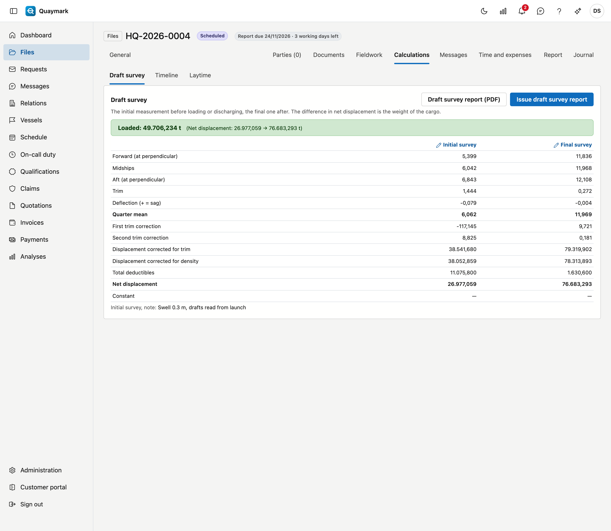

Clicking **Initial survey** or **Final survey** in the table header opens the page of that measurement. Enter:

- the six **drafts**: forward, midships and aft, port and starboard;
- the **vessel**: the LBP and the distances of the draft marks from the perpendiculars (forward and midships positive when the mark is aft of the perpendicular or midships, aft positive when the mark is forward of the aft perpendicular);
- the **water**: the density of the dock water (hydrometer) and the density the tables are made for (usually 1.025);
- the **hydrostatic values**: once the drafts are entered, Quaymark shows the mean draft (quarter mean) at which you read from the vessel's tables the displacement, TPC, LCF (from midships, positive aft) and the MTC half a metre above and below;
- the **deductibles**: ballast, fresh water, bunkers, lube oil and other, in tonnes; optionally the lightship, for the constant.

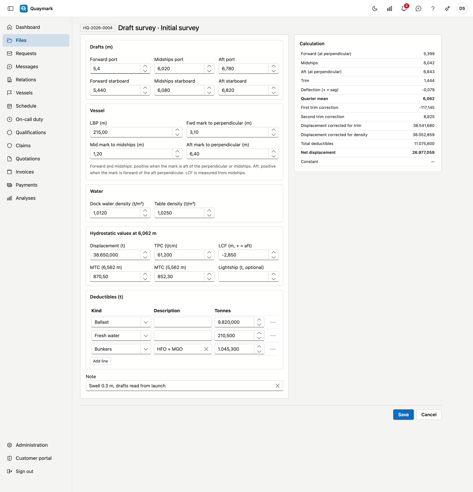

The **calculation** beside it follows every change: the drafts at the perpendiculars, the trim, the deflection, the quarter mean, the first and second trim correction, the density correction, the deductibles and the net displacement. A final survey takes over the vessel and the water from the initial survey. The difference in net displacement between initial and final is the weight of the cargo: loaded if it increased, discharged if it decreased.

**Draft survey report (PDF)** shows the document; **Issue draft survey report** (once both measurements are complete) records it with its fingerprint, with the letters and certificates of the file, and in the evidence package. The document has room for the master's signature. If you then open a survey, it says at the top that the report has already been issued: after a change, issue a new version. In the report the draft survey comes with the marker `{{draftsurvey}}` (see [Templates](sjablonen.md)).

Below the measurement is the **Measuring instruments** block: choose the hydrometer you measured the density with and click **Choose instrument**. Quaymark saves the instrument with the calibration that applied on the day of measurement (the planned day of the file). If it had expired, or the instrument had none, a warning appears; Quaymark refuses nothing. The instrument appears in the report under the draft survey. → [Measuring instruments](meetapparatuur.md#during-a-measurement)

Each intermediate step is rounded to three decimals, and the next step calculates with that rounded value, as on paper: each line follows from the previous one, and the cargo is exactly the difference of the two net displacements. The notes of the measurements appear below the table. After issuing, the tab shows **Issued on** with the date, who, the PDF and the fingerprint; if you change a measurement afterwards, it warns that the issued report has different figures.

### Barge gauging

For a survey type with the **Barge gauging** box ticked (see [Survey types](soorten-survey.md)), the file gets the **Gauging** tab: determining the cargo of an inland vessel with the gauge scales and the vessel's gauging certificate.

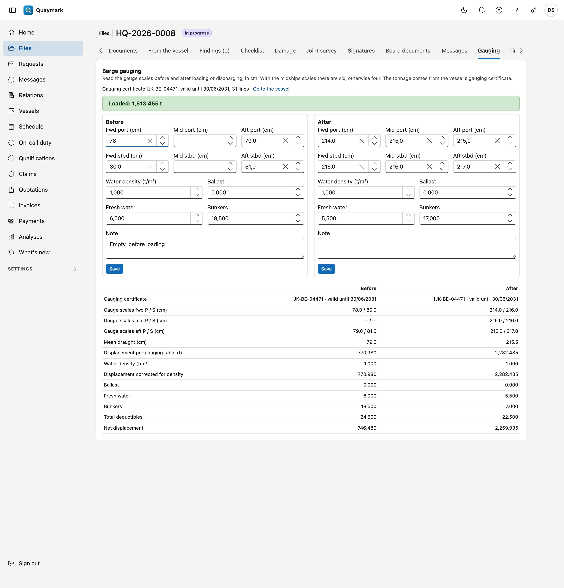

- Before and after loading or discharging, enter the **gauge scales** in cm: fore and aft, port and starboard. With midships there are six; midships is entered as a pair, or not at all.
- Enter the **density** of the water (the gauging certificate applies to fresh water, 1.000) and the **deductibles**: ballast, fresh water and bunkers, in tonnes.
- **Save** saves that gauging. The table below shows the mean draught, the displacement per gauging table (calculated proportionally between two lines), after density, the deductibles and the net weight, each weight in tonnes; the remarks of the gaugings are below it. Each gauging has its own button. If what you typed differs from what is saved, the gauging shows **Not saved**; next to it you see when and by whom it was saved. The mean draught is rounded to the millimetre and each tonnage to the kilogram, and the next step calculates with that rounded value, as on paper.
- The difference between before and after is the weight of the cargo: loaded if it increased, discharged if it decreased.

At the top you see the vessel's gauging certificate, with a link to the vessel. If the vessel has no gauging certificate yet, or the mean draught falls outside the gauging table, Quaymark does not calculate and says why. When saved, a gauging takes the vessel's certificate along and from then on calculates with it. If the vessel later gets a different certificate, the gauging stays the same and says so; in an open file it calculates with the new one as soon as you save it again. A gauging without a certificate (saved when the vessel had none yet) has no weight until you save it again. If the certificate had already expired on the day of the gauging, the gauging says so. In the report the gauging comes with the placeholder `{{ijkmeting}}` (see [Templates](sjablonen.md)).

### Bunker survey

For a survey type with the **Bunker survey** box ticked (see [Survey types](soorten-survey.md)), the file gets the **Bunkers** tab. You sound every fuel tank of the vessel before and after bunkering; Quaymark calculates the weight and compares the delivery with the delivery note (BDN).

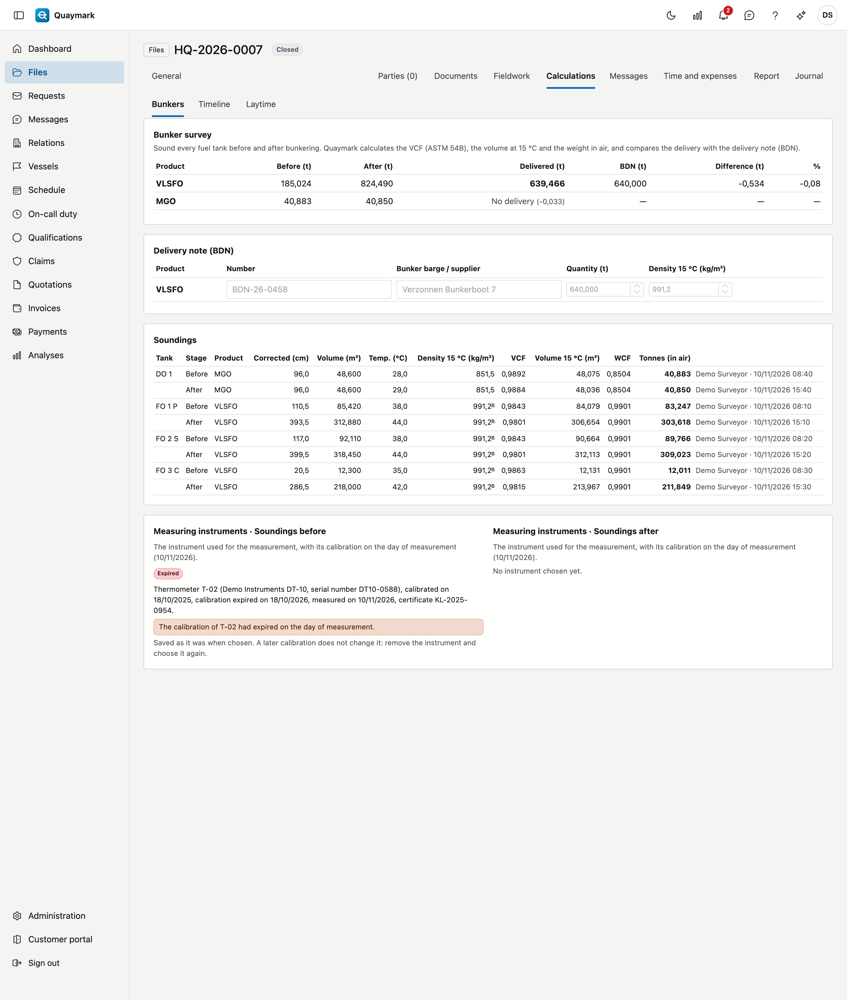

- **Soundings before** and **Soundings after** (for an open file, if you may edit it) open a page with a row per fuel tank: product, method (sounding or ullage), the measured value, the trim and list correction from the table, the **volume** you read from the sounding table at the corrected sounding, and the temperature. The tanks come from the vessel (Holds and tanks tab); add a missing tank there.
- The **density at 15 °C** comes from the delivery note of that product. If a tank differs (for example your own lab value), fill it in on that tank.
- Quaymark calculates per tank the **VCF** per ASTM D1250 table 54B, the volume at 15 °C and the weight in air (volume at 15 °C × (density − 0.0011)). If you use a VCF from your own table, fill it in with a reason; it gets an asterisk in the report.
- **Save** adds a new sounding per changed tank. The previous one is kept, with who and when. If Quaymark refuses one tank, the tanks already saved stay saved; a second **Save** only adds the refused one.
- Per product the tab shows before, after and the **delivered** quantity, and against the delivery note the difference in tonnes and percent. If a tank was sounded at one stage only, the tab says so: delivered is then not correct for that product. If nothing was added and there is no delivery note for the product, the tab shows **No delivery**, with the small difference next to it: it comes from temperature or consumption. Below the delivery note, the soundings that count are in one table, per tank first before and then after.

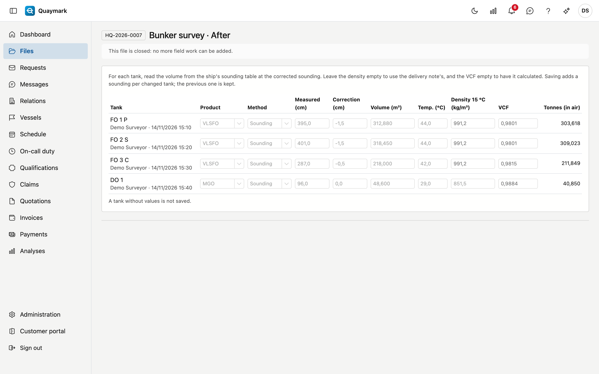

On site, the surveyor sounds in the field app: the **Bunker survey** card of the file shows the tanks per stage ([Recording on board](veldapp/aan-boord.md#bunker-survey)), with an estimate in tonnes. A tank the vessel did not have yet can be added there. Without a connection, the soundings wait on the device.

Below the soundings is the **Measuring instruments** block, for **Soundings before** and **Soundings after**: choose the thermometer and the sounding tape you used. Quaymark saves them with their calibration on the day of those soundings; an expired calibration gives a warning. They appear in the report under the bunker survey, and their certificates go into the evidence package. → [Measuring instruments](meetapparatuur.md#during-a-measurement)

In the report, `{{bunker}}` places the result and the table per tank (see [Templates](sjablonen.md)). On the **certificate of quantity**, **From the bunker survey** takes over the delivered quantity per product.

### Timeline

The **Timeline** tab is the statement of facts of the file: the events of the port call, in the office's time. With **Add event** you choose the time, the event (arrived at roads, NOR tendered, NOR accepted, all fast, hatches opened, commenced and completed loading or discharging, stoppage, resumed, hatches closed, documents on board, sailed or other) and a note. An event can be changed or deleted afterwards with **Edit** or **Delete** under **⋯** next to the row; the history keeps who changed what.

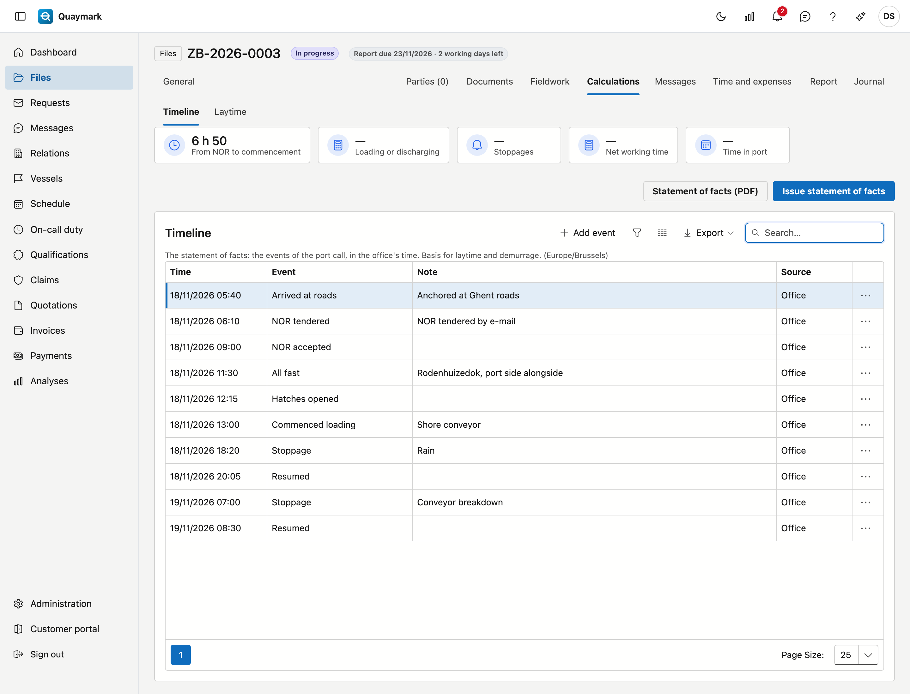

At the top, the summary tiles calculate: the time from NOR to commencement, the duration of loading or discharging, the stoppages (from a stoppage to its resumption), the net working time and the time in port. If an event for a duration is missing, a dash is shown, not zero.

**Statement of facts (PDF)** shows the document in a window; **Issue statement of facts** records it with its fingerprint, with the letters and certificates of the file, and in the evidence package. The document has room for the master's signature. After issue, the tab shows **Issued on** with the date, who, the PDF and the fingerprint; if you then change an event, it warns that the issued statement of facts has different times. In the report the timeline comes with the marker `{{tijdlijn}}` (see [Templates](sjablonen.md)).

### Laytime

The **Laytime** tab calculates laytime and demurrage from the timeline, under the terms of the charter party:

- **Allowed time**: a fixed number of hours, or a quantity divided by a rate per day. If the file has a draft survey, Quaymark proposes the quantity.
- **Counting**: SHINC (every day counts), SHEX (Sundays and holidays excepted) or SSHEX (Saturdays excepted too). The holidays are those of the port's country. An excepted day does not count, even if work was done.
- **Commencement**: the NOR (tendered or accepted) plus the notice time in hours, or a time you enter yourself. The end is the last end of loading or discharging in the timeline.
- **Interruptions** from the timeline do not count; tick those that count after all.
- **Once on demurrage, always on demurrage**: after laytime, every excepted day counts as demurrage. You can untick it.
- **Demurrage per day** and **despatch per day** (empty = half the demurrage), in the currency you choose.

The result recalculates as you type: allowed, used, demurrage or despatch with the amount, and a table per period with the reason it counts or not. **Save** records the terms. The report calculates with the saved terms: if what you typed differs, **Not saved** appears next to the button, and on the right when and by whom they were saved. If the NOR or the end is missing from the timeline, Quaymark says so and does not calculate. In the report, laytime appears with the placeholder `{{laytime}}` (see [Templates](sjablonen.md)).

### Time and expenses

On the **Time and expenses** tab you record the **time entries** (who, from when to when, in the office's time) and the **expenses** (travel, accommodation, laboratory, third parties) of the file, with the receipt from the attachments. An expense marked **Recharge** goes on the invoice. **Edit** and **Delete** are under **⋯** next to a row that is not yet on an invoice or statement. **Propose invoice** turns them into a draft invoice; see [Invoices](facturen.md). Anything on an invoice is fixed. The **Estimated (EUR)** column is an estimate: hours × hourly rate × surcharge (weekend, night or a public holiday of the office's country), as the invoice calculates it; the rates are in EUR and the invoice converts to the currency of the file. The totals are at the bottom; each invoice shows its own currency.

In the field app, the surveyor records their time on the **Time** card of the file ([Recording time](veldapp/tijd.md)): **Start timer** with a type of work (**On board**, **Travel time**, **Waiting time**, **Reporting**), and **Stop timer** opens the window to check start and end, with a remark. **Record time** does the same by hand. One timer runs at a time; it keeps running if the app closes. After saving, the entry appears here, with the type in the language of the file as description. If the timer ran for more than 12 hours, the app first asks to check.

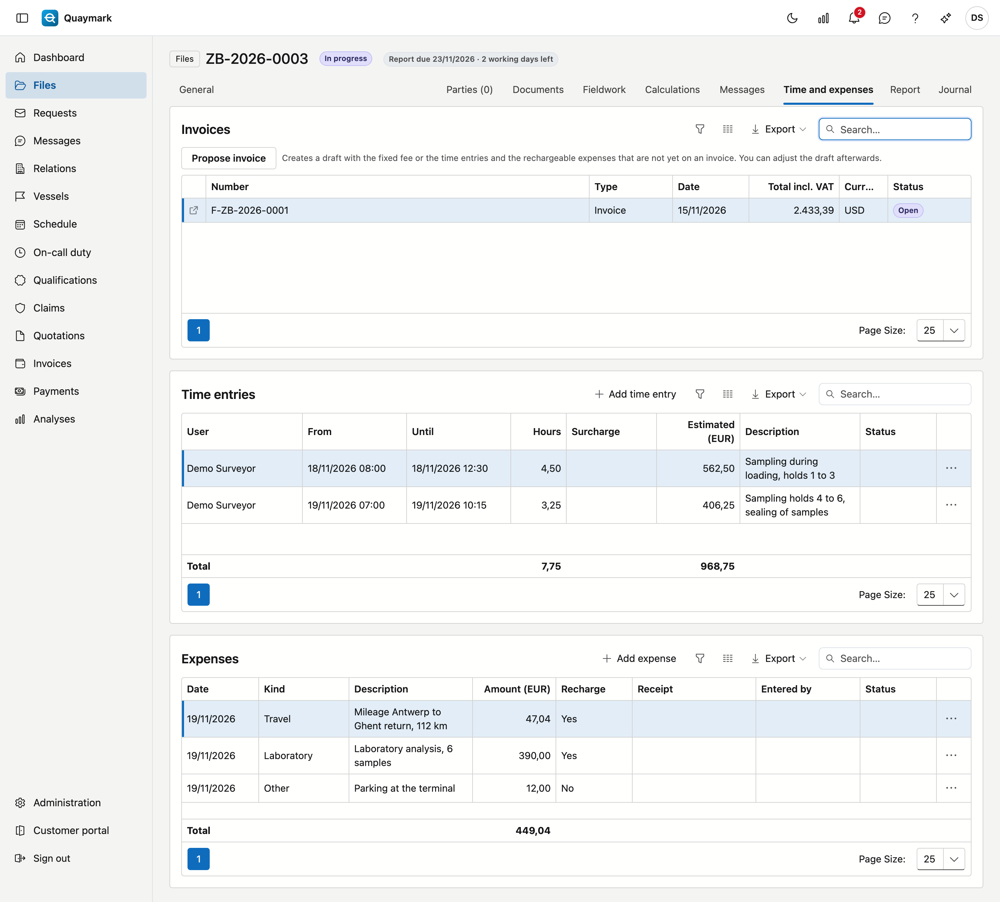

### Journal and history

The **Journal** of a file has the tabs **Notes**, **Tasks**, **Attachments** and **History**. The history shows who changed what and when, with the old and the new value. The parts of the file are in it too: parties, timeline, barge gauging, draft survey, laytime, delivery notes, time entries and expenses. For such a change, the first line, **Part**, says what it is about, for example *Barge gauging · After*. Of a gauging or of the terms of a laytime, you only see what changed. A deleted part stays visible, with *(deleted)*. Dates and times are in your own time.

### Evidence package

**Evidence package (ZIP)** gives one ZIP to verify without Quaymark: the original photos from the device (hidden photos too, with the reason), a manifest, the issued reports and a README with the commands (`shasum`, `certutil`). Every file is re-checked while packing; if one no longer matches, no package is made. The fingerprint of the package then appears on the tab and in the journal.

### Report preview

**Report (PDF)** and **Report (Word)** create the report from the saved data, with the report template of this survey type (otherwise the general one) and in the report language. It is a preview: nothing is saved or sent. Save first, otherwise your latest changes are not in it.

### Copy

**Copy** creates a new file with the same instruction (vessel, principal, survey type, port), without findings, answers or survey particulars, and links it to this file.

### Legal hold

**Place on legal hold** (administrator only) keeps a file for a dispute or a claim. Give a reason. While the file is on hold, it cannot go to the recycle bin, and its documents, attachments, notes and tasks are not deleted. Editing remains possible. **Lift legal hold** also asks for a reason; the window shows who placed or lifted the hold, and when. A file on hold is not deleted after its [retention period](bewaartermijnen.md) either.

### Delete

**Delete** moves the file to the recycle bin.

## From a document

If the assignment arrives by email or as a pdf, Quaymark pre-fills a new file. This works if the office has enabled document analysis in the ADM One portal (AI, Document analysis); it runs on the office's AI key.

1. Click **New file**. At the top is the **Fill in from a document** box.
2. Click **Read document**. Choose a file (pdf, JPEG, PNG or WebP, at most 20 MB), or paste the text of the email.
3. Click **Read document**. After a few seconds the proposal is in the form: survey type, principal, reference, vessel, port, terminal, scheduled moment (only if the assignment gives a day and a time), description and report language. Every filled-in field gets a ✦ before its name.
4. Check everything and click **Save**. Only then does the file exist. The document is attached to the file.

What Quaymark could not link is shown in the box:

- a principal who is not among your relations: Quaymark does not create them. Choose the principal or create the relation first. → [Relations](relaties.md)
- a vessel that does not exist yet: it is created when saving, with the name and the IMO or ENI number that were read. **Do not create** leaves it out; if you choose a vessel yourself, that one applies;
- a port that is not among your ports, or a requested day without a time.

As soon as principal and vessel are chosen, the form shows, before saving, the possible conflicts of interest and which rate applies (the framework agreement with the principal, otherwise the office's rates). This applies to every new file.

## Conflicts of interest

A surveyor may not act for both parties. Quaymark warns at the top of the file if the office works, in another file with **the same vessel** or **the same claim or policy number**, for another principal, and that principal is a party in this file (or your principal is a party in the other one). Open files count, and files closed in the last twelve months; cancelled files do not.

- The header then shows **Conflict of interest?**, and the top of the file lists the other files with their principal.
- If it is not a conflict, click **No conflict** and explain why (for example: different damage, both parties informed). This is kept with your name and the time, and cannot be changed. It is the proof of independence a principal or an accreditation may ask for.
- The work is not blocked: the warning stays until it is justified.
- On a request from the principal portal too, Quaymark warns before you accept it. → [Requests](aanvragen.md#request)

## Claims

The **Claims** screen in the menu shows the claims of all files, with their file, vessel, insurer, amounts and status.

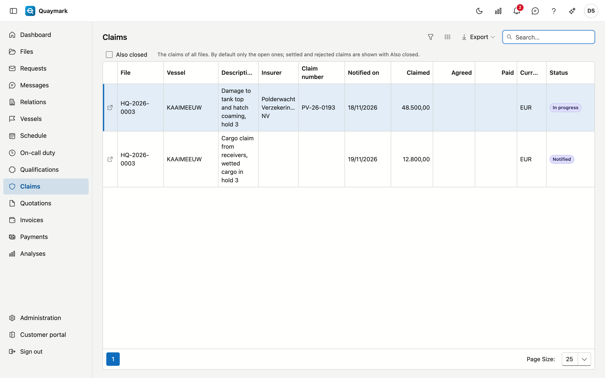

- By default you only see the **open** claims. Tick **Also closed** for settled and rejected claims.
- Double-click a row to open the claim. The link at the top and **Cancel** take you back to this list. A new claim is made in the file, on the **Damage** tab.

## See also

- [Vessels](schepen.md)
- [Relations](relaties.md)
- [Templates](sjablonen.md)
