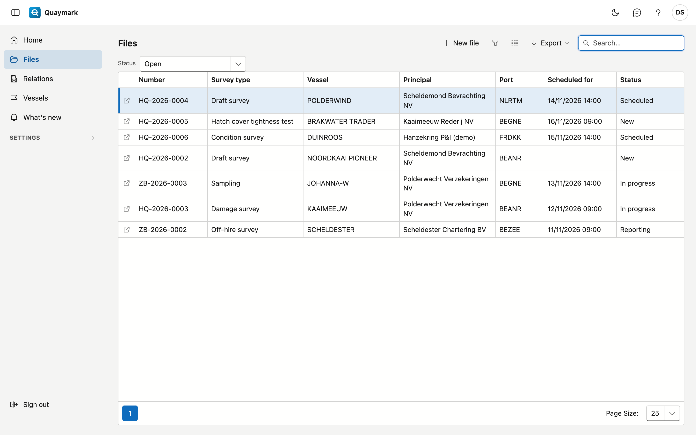
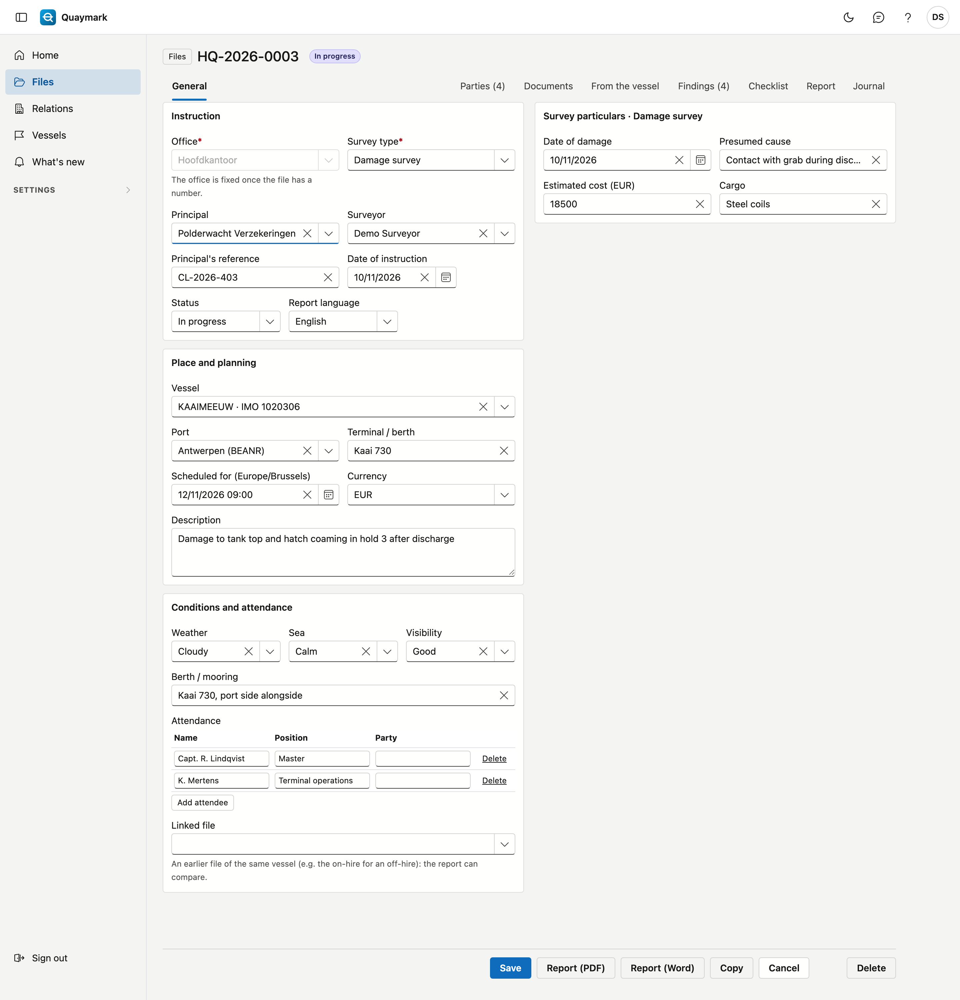
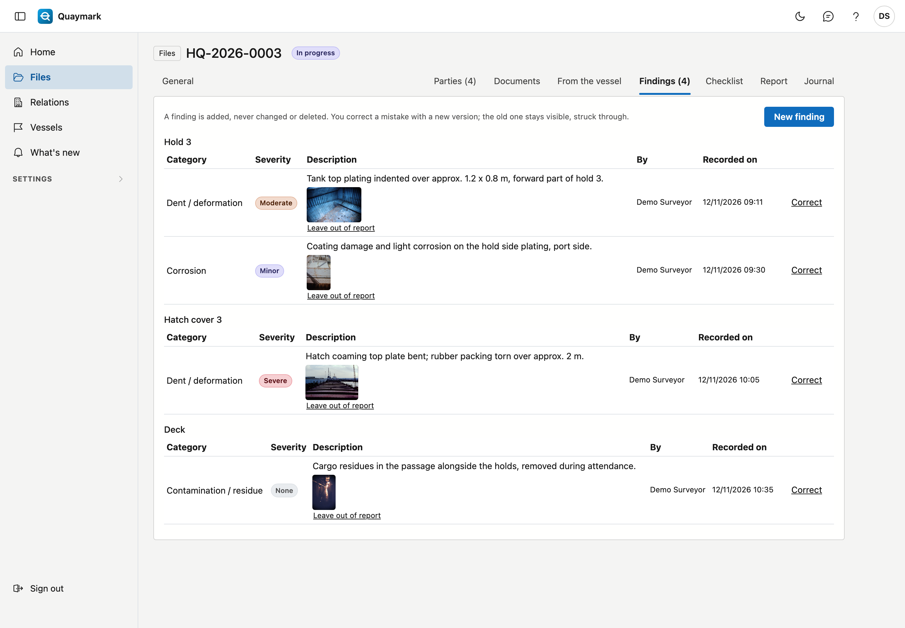
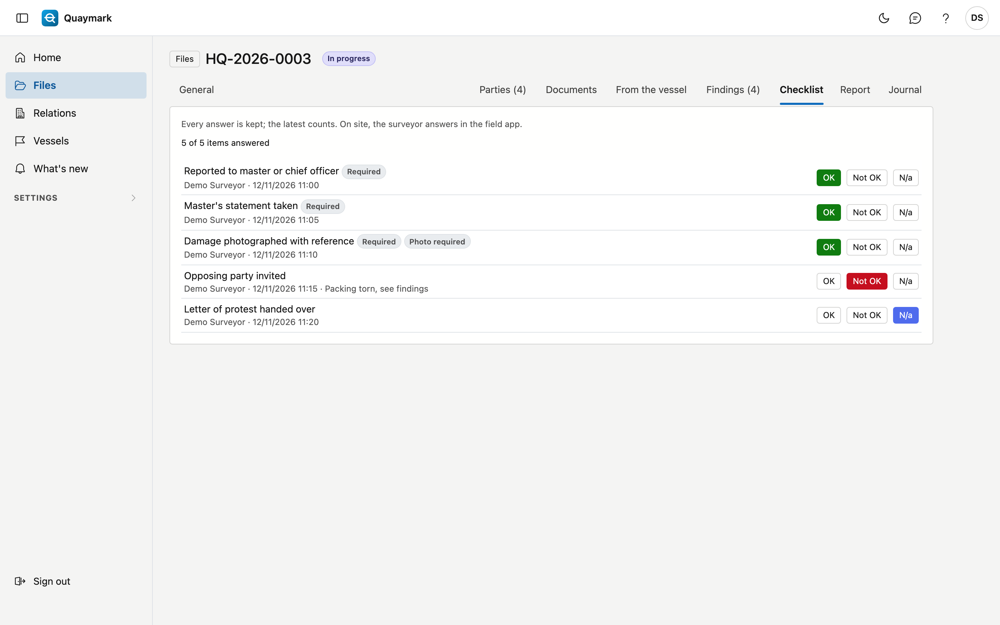
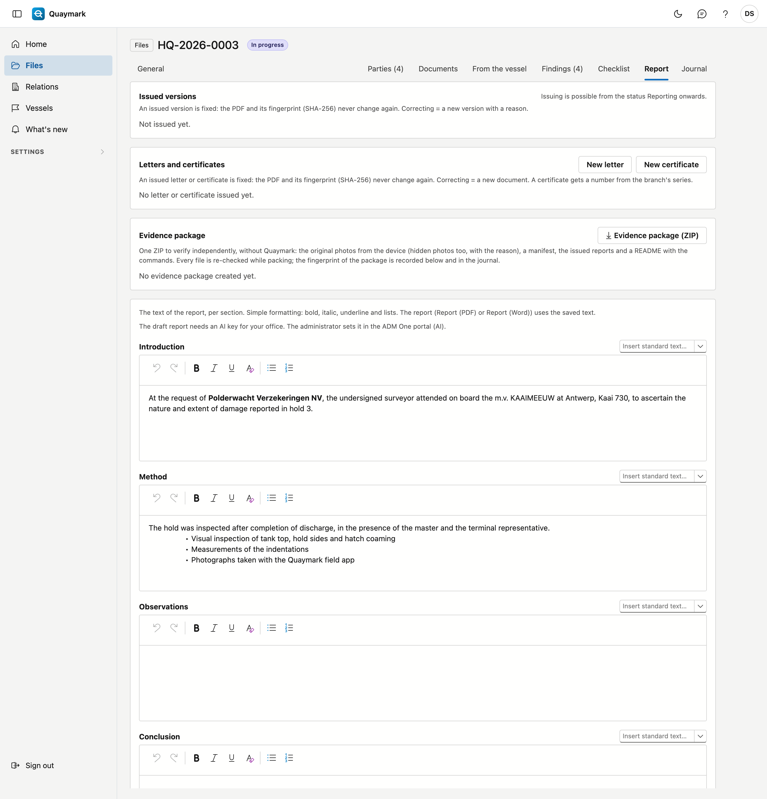
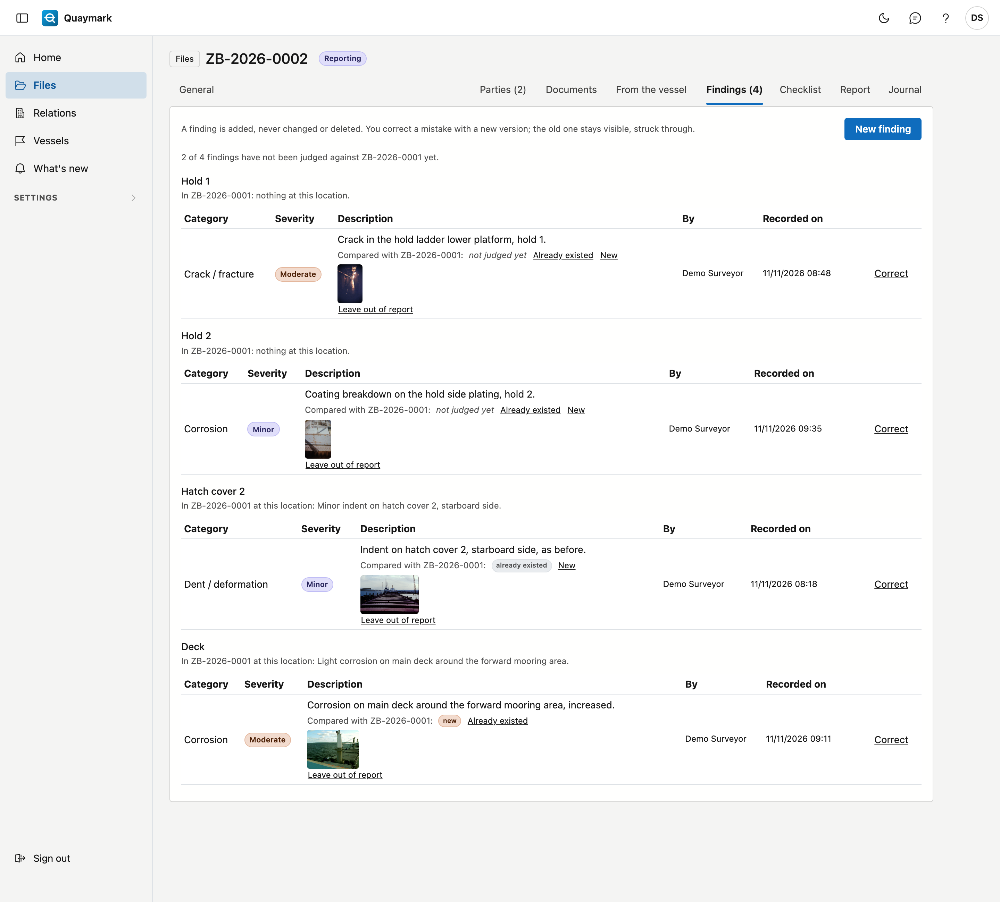
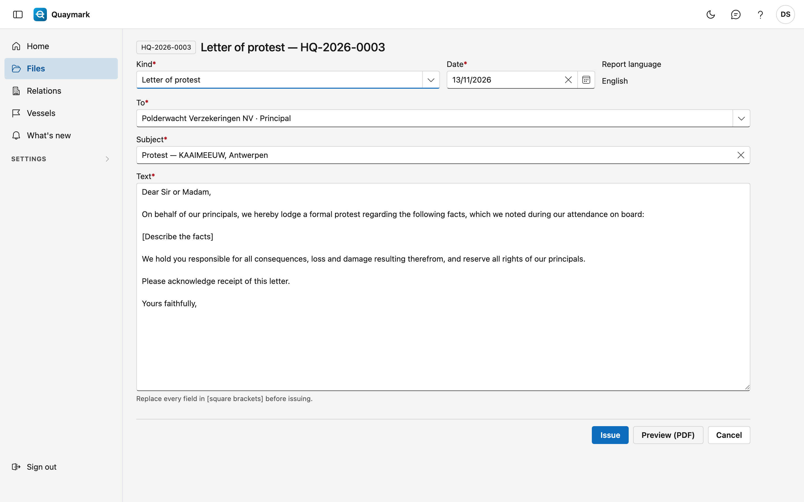

# Files

The office's work list: one row per instruction.

## Opening the screen

In the menu on the left, click **Files**.

## The list

- The **Status** choice above the list shows the **open** files by default. Choose **All** to include closed and cancelled files as well, or pick one status.
- The **search box** searches all columns: number, survey type, vessel, principal, port, planning and status.
- Double-click a row to open the **file**; the arrow at the start of the row opens it in a new tab. **New file** creates one.
- The export button downloads the list as a file.

## File

One instruction: what was asked, where and when, and what the surveyor finds on site.

- **Instruction**: office, survey type, principal, surveyor, reference, date, status and report language. The **file number** (office code, year, sequence number) is assigned the first time you save; after that the office is fixed.
- **Place and planning**: vessel, port, terminal or berth, the scheduled moment (in the office's time zone), currency and description.
- **Conditions and attendance**: weather, sea, visibility, berth and who attended the survey. **Linked file** refers to an earlier file of the same vessel, for example the on-hire for an off-hire.
- **Survey particulars**: the fields that belong to the chosen survey type. A required field must be filled in from the status Reporting onwards. If you choose another survey type, the values of fields the new type does not know are lost when you save.

A saved file has tabs: **Parties** (relations with their role and reference), **Documents** (in folders), **From the vessel** (the vessel's documents, read only), **Findings**, **Checklist** and the journal with notes, tasks, attachments and history.

### Findings

A **finding** is added, never changed or deleted. You correct a mistake with **Correct** and a reason: the old version stays visible, struck through. Pointing at a photo shows the time, GPS position and fingerprint (SHA-256) the device recorded when the photo was taken.

### Photos in the report

**Leave out of report** under a photo removes it from the report's photo appendix, with a reason. The photo stays stored as evidence; **Show in report again** puts it back. Photos get a running number in the report, and the findings table lists those numbers.

### Checklist

The **checklist** shows the latest answer per item (OK, not OK, n/a), by whom and when. Every answer is kept under **Previous answers**. **Not OK** proposes a finding. On site, the surveyor answers in the field app.

### Report

On the **Report** tab you write the text of the report per section, with simple formatting, and insert the office's standard texts. **Save sections** saves them. If the report template does not show a section, the tab says so.

### Issuing and sending the report

**Issue report** (Report tab, from the status Reporting onwards) fixes the report as version 1, with its fingerprint (SHA-256): it never changes again. Correcting = **Issue new version**, with a reason. **Send** sends an issued version as a PDF to the principal; the mail is kept in the journal. Save the sections first: a version only takes saved text.

### Propose a draft

**Propose a draft** (Report tab) has the AI write a proposal per section from the file data: findings, checklist, fields and conditions. Photos and your own text are not sent. Each proposal appears under its section; you choose **Take over**, **Add at the end** or **Ignore**, then save as usual. It runs on your office's AI key and only if the administrator allows it in the ADM One portal.

### Comparison with a previous file

If the file is **linked** to a previous file (e.g. the on-hire of an off-hire), the Findings tab shows per location what that file found there. Give your judgement per finding: **Already existed** or **New**. The report shows the comparison per location on board, with the photo numbers and your judgement; without a judgement, nothing is added.

### Letters and certificates

**New letter** and **New certificate** (Report tab) create a standard letter or certificate in the language of the file. **Preview (PDF)** shows it first; **Issue** fixes it with its fingerprint. A certificate then gets a number from the branch's series (C-HQ-2026-0001). In a letter, replace every field in [square brackets]: otherwise issuing is not possible.

### Evidence package

**Evidence package (ZIP)** gives one ZIP to verify without Quaymark: the original photos from the device (hidden photos too, with the reason), a manifest, the issued reports and a README with the commands (`shasum`, `certutil`). Every file is re-checked while packing; if one no longer matches, no package is made. The fingerprint of the package then appears on the tab and in the journal.

### Report preview

**Report (PDF)** and **Report (Word)** create the report from the saved data, with the report template of this survey type (otherwise the general one) and in the report language. It is a preview: nothing is saved or sent. Save first, otherwise your latest changes are not in it.

### Copy

**Copy** creates a new file with the same instruction (vessel, principal, survey type, port), without findings, answers or survey particulars, and links it to this file.

### Delete

**Delete** moves the file to the recycle bin.

## See also

- [Vessels](schepen.md)
- [Relations](relaties.md)
- [Templates](sjablonen.md)
