# Dossiers

La liste de travail du bureau : une ligne par mission.

## Ouvrir l'écran

Dans le menu de gauche, cliquez sur **Dossiers**.

## La liste

- Le choix **Statut** au-dessus de la liste affiche par défaut les dossiers **ouverts**. Choisissez **Tous** pour voir aussi les dossiers clôturés et annulés, ou un seul statut.
- Le **champ de recherche** cherche dans toutes les colonnes : numéro, type d'expertise, navire, donneur d'ordre, port, planning et statut.
- Double-cliquez sur une ligne pour ouvrir le **dossier** ; la flèche en début de ligne l'ouvre dans un nouvel onglet. **Nouveau dossier** en crée un.
- Le bouton d'export télécharge la liste sous forme de fichier.

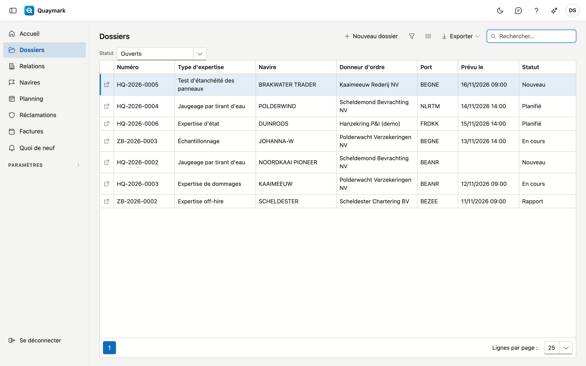

## Dossier

Une mission : ce qui est demandé, où et quand, et ce que l'expert constate sur place.

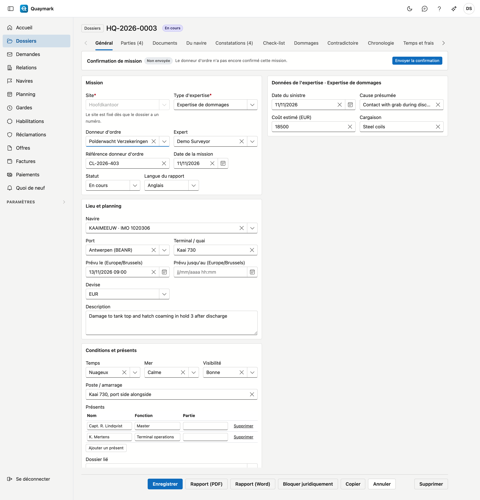

- **Mission** : site, type d'expertise, donneur d'ordre, expert, référence, date, statut et langue du rapport. Le **numéro de dossier** (code du site, année, numéro d'ordre) est attribué au premier enregistrement ; le site est ensuite fixé.
- **Lieu et planning** : navire, port, terminal ou quai, le moment prévu (dans le fuseau horaire du site), devise et description.
- **Conditions et présents** : temps, mer, visibilité, poste d'amarrage et les personnes présentes lors de l'expertise. **Dossier lié** renvoie à un dossier antérieur du même navire, par exemple l'on-hire d'un off-hire.
- **Données de l'expertise** : les champs propres au type d'expertise choisi. Un champ obligatoire doit être rempli à partir du statut Rapport. Si vous choisissez un autre type, les valeurs des champs inconnus du nouveau type sont perdues à l'enregistrement.

Un dossier enregistré a des onglets : **Parties** (relations avec leur rôle et leur référence), **Documents** (en répertoires), **Du navire** (les documents du navire, en lecture seule), **Constatations**, **Check-list** et le journal avec notes, tâches, pièces jointes et historique.

### Constatations

Une **constatation** est ajoutée, jamais modifiée ni supprimée. Une erreur se corrige avec **Rectifier** et un motif : l'ancienne version reste visible, barrée. Au survol, une photo affiche l'heure, la position GPS et l'empreinte (SHA-256) enregistrées par l'appareil lors de la prise de vue.

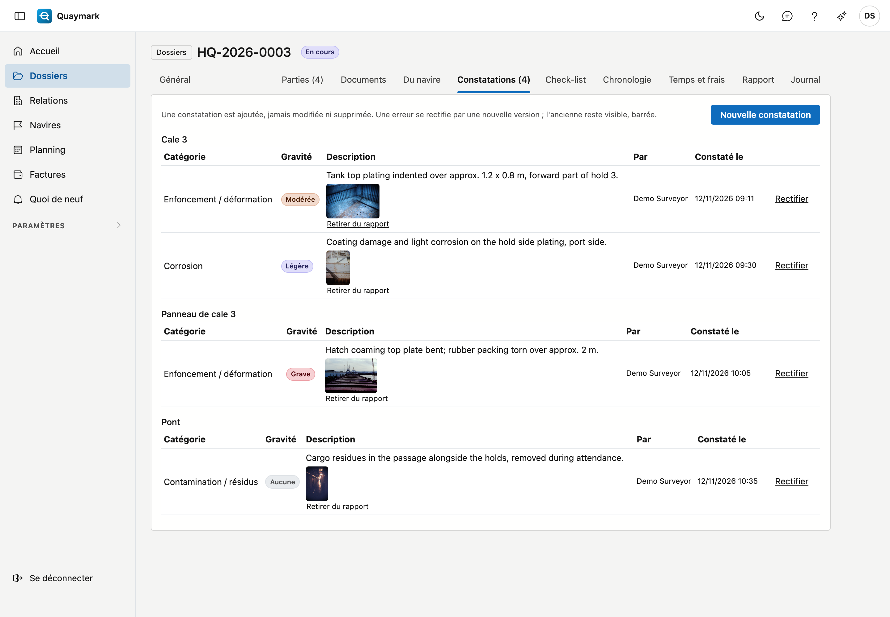

### Photos dans le rapport

**Retirer du rapport** sous une photo l'écarte de l'annexe photographique du rapport, avec un motif. La photo reste conservée comme preuve ; **Remettre dans le rapport** la rétablit. Les photos reçoivent un numéro continu dans le rapport, et le tableau des constatations cite ces numéros.

### Check-list

La **check-list** affiche pour chaque point la dernière réponse, par qui et quand. Le type d'expertise détermine l'échelle : **Conforme**, **Non conforme** et **S.o.** pour un contrôle, ou un état en quatre niveaux (**Bon**, **Correct**, **Médiocre**, **Mauvais**, et **S.o.**) pour une expertise d'état. En haut figure le nombre de points présentant un défaut, par priorité.

Une bonne réponse s'enregistre d'un clic. En cas de défaut (**Non conforme**, **Médiocre** ou **Mauvais**), vous complétez la **Constatation**, la **Recommandation** et la **Priorité** : **Immédiat, avant le départ**, **Dans les 3 mois**, **Au prochain entretien** ou **Pour information**. **Insérer un constat standard** remplit les trois champs avec un texte standard du type d'expertise, dans la langue du dossier ; adaptez-les ensuite. **Nouvelle constatation** en fait une constatation.

Chaque réponse reste conservée sous **Réponses précédentes**. Sur place, l'expert répond dans l'application mobile, avec la même échelle et les mêmes constats standard. Les défauts apparaissent dans le rapport avec le marqueur `{{aanbevelingen}}` (voir [Modèles](sjablonen.md)).

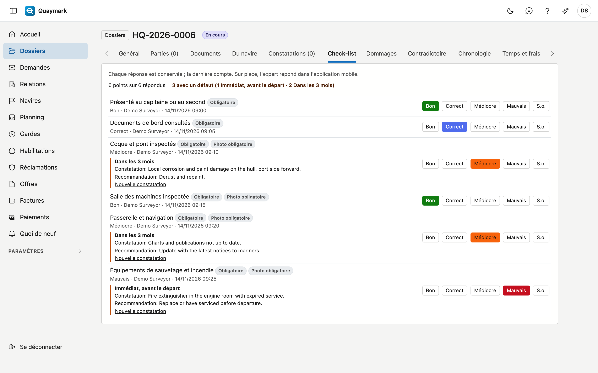

### Rapport

Dans l'onglet **Rapport**, vous rédigez le texte du rapport par rubrique, avec une mise en forme simple, et insérez les textes standard du bureau. **Enregistrer les rubriques** les enregistre. Si le modèle de rapport n'affiche pas une rubrique, l'onglet le signale.

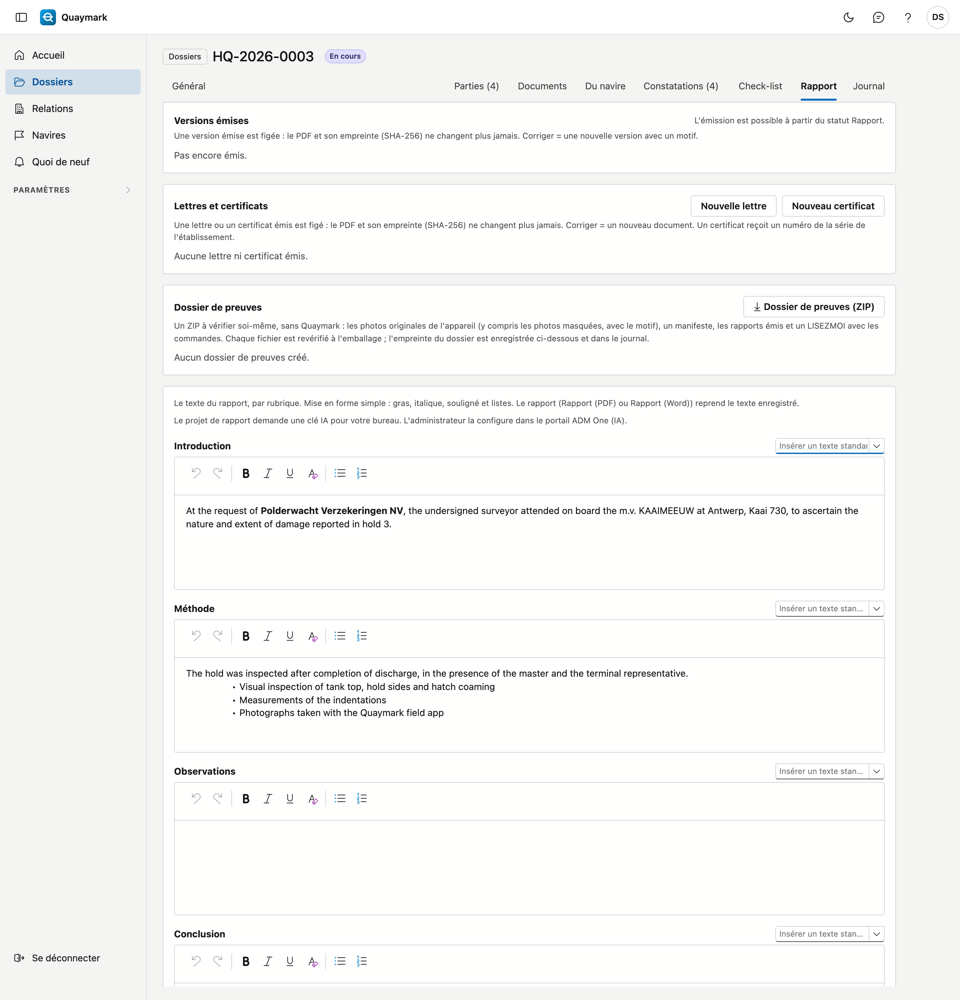

### Expertise contradictoire

Dans l'onglet **Contradictoire**, vous enregistrez une expertise contradictoire : qui était présent pour quelle partie, et quelles constatations vous partagez.

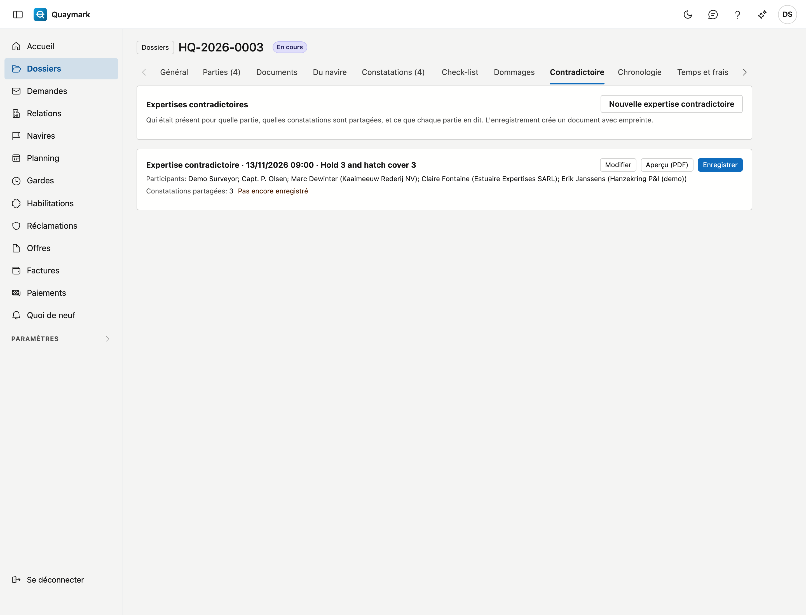

1. Cliquez sur **Nouvelle expertise contradictoire**. Indiquez la date et l'heure (dans l'heure de l'implantation), le lieu et une remarque.
2. Ajoutez les participants. **Un par partie** prépare une ligne pour chaque partie du dossier ; vous indiquez le nom et la fonction. Laissez sans partie ceux qui ne représentaient personne (le capitaine, le bureau). Si quelqu'un n'était finalement pas là, décochez **Présent**.
3. Choisissez les **constatations partagées**. Le numéro est celui du rapport. Enregistrez.
4. De retour dans l'onglet : **Enregistrer** crée le document *Constat contradictoire*, avec son empreinte (SHA-256). Il figure parmi les documents du dossier et accompagne le dossier de preuves. **Aperçu (PDF)** le montre d'abord, sans rien enregistrer.

Ensuite, chaque partie d'un participant présent se prononce : **d'accord**, **d'accord sous réserve** (avec un commentaire) ou **pas d'accord**.

- **Envoyer le lien** envoie un lien à la partie (via ADM One). Elle lit le constat contradictoire, choisit sa position et confirme avec son nom et une case à cocher. La réponse apparaît d'elle-même dans l'onglet et dans le journal.
- **Enregistrer la réponse** consigne une réponse que le bureau a reçue autrement, par exemple sur la version papier signée. Ajoutez-la en pièce jointe.

Si vous modifiez l'expertise après l'enregistrement, enregistrez une nouvelle version. Une réponse appartient à la version que la partie a vue : sur une nouvelle version, elle répond à nouveau.

### Rapport dans une autre langue

Les textes du rapport existent **par langue**. En haut de l'onglet Rapport, vous choisissez la langue du rapport : un clic sur une langue change la langue du dossier et l'enregistre. Une coche indique les langues qui ont déjà du texte. Si vous avez du texte non enregistré, enregistrez d'abord les rubriques.

S'il existe déjà du texte dans une autre langue, **Traduire depuis …** propose une traduction par rubrique, à côté du texte source. La mise en forme est conservée, et les termes du [glossaire](woordenlijst.md) du bureau servent de traduction imposée. Choisissez par rubrique **Reprendre**, **Ajouter à la fin** ou **Ignorer**, puis **Enregistrer les rubriques**. Rien n'entre automatiquement dans le rapport.

La traduction utilise la clé IA du bureau et demande son autorisation, comme le projet de rapport. Seuls les textes des rubriques sont traduits : les constatations et les remarques de la check-list restent dans leur langue d'origine.

### Contrôle du rapport

En haut de l'onglet Rapport, le bloc **Contrôle du rapport** compare le rapport au dossier :

- **Heures** : des constatations ou photos en dehors des jours d'expertise (la veille ou le lendemain sont admis), une date du sinistre postérieure à l'expertise, et dans la chronologie une fin avant son début ou un moment dans le futur.
- **Navire** : un numéro IMO non valable, ou un autre nom de navire (m.v., MV, MT …) ou un autre numéro IMO dans le texte d'une rubrique.
- **Poids** : un poids dans les champs ou dans le texte qui s'écarte de plus de 0,5 % de la cargaison du draft survey.
- **Exhaustivité** : des rubriques que le modèle affiche mais qui sont vides (même si elles contiennent du texte dans une autre langue), des champs et points de check-list obligatoires sans réponse, une photo obligatoire manquante, et pour un dossier lié des constatations sans appréciation.

Le contrôle ne refuse rien. Si vous émettez avec des remarques, Quaymark demande **Émettre quand même ?**, et les remarques sont enregistrées avec la version. **Contrôler à nouveau** relance le contrôle, par exemple après une correction.

### Émettre et envoyer le rapport

**Émettre le rapport** (onglet Rapport, à partir du statut Rapport) fige le rapport comme version 1, avec son empreinte (SHA-256) : il ne change plus jamais. Corriger = **Émettre une nouvelle version**, avec un motif. **Envoyer** envoie une version émise en PDF au donneur d'ordre ; le mail est conservé dans le journal. Enregistrez d'abord les rubriques : une version ne reprend que le texte enregistré.

### Double contrôle

Pour un type d'expertise avec la case **Double contrôle** cochée (voir [Types d'expertise](soorten-survey.md)), un rapport ne peut être émis qu'après l'approbation d'un second expert. L'onglet Rapport affiche alors le bloc **Double contrôle**.

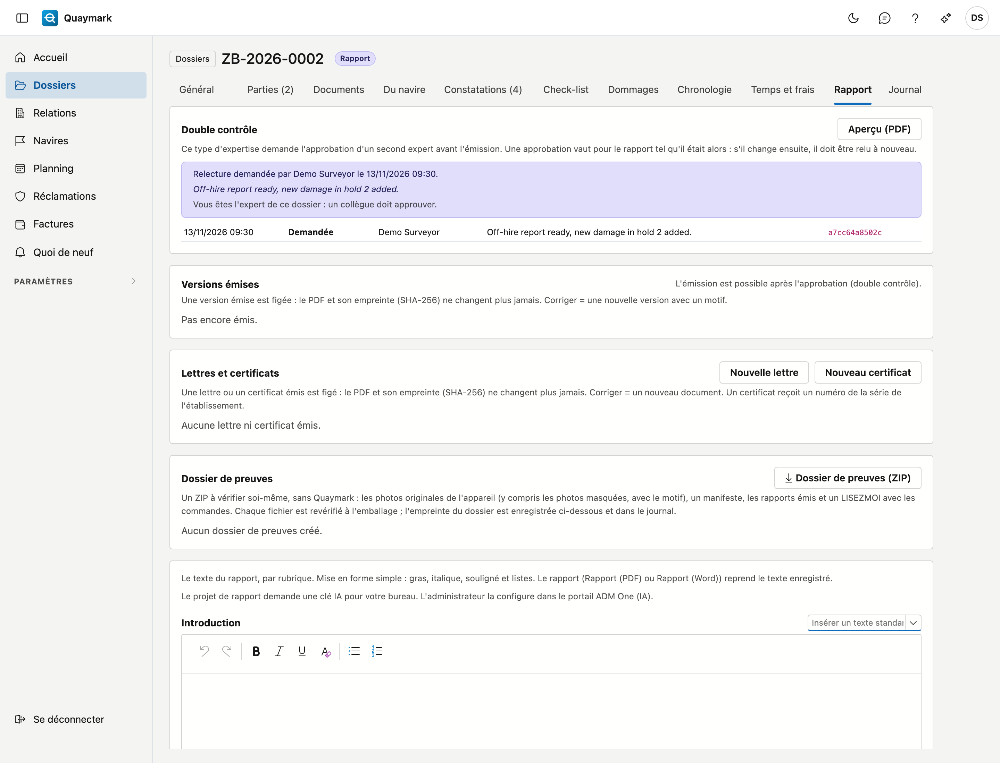

- **Demander une relecture** soumet le rapport à un collègue, avec une remarque si vous le souhaitez. Sur l'écran d'accueil, il apparaît alors sous **En attente de relecture**.
- Peut approuver un collègue ayant le droit d'émettre des rapports, mais pas l'expert du dossier ni celui qui a demandé la relecture. Il consulte l'**Aperçu (PDF)** et choisit **Approuver**, ou **Renvoyer** avec ce qu'il faut adapter.
- Une approbation vaut pour le rapport tel qu'il était à ce moment. Si quelque chose qui figure dans le rapport change ensuite (un texte de rubrique, un champ, une photo masquée, le modèle), elle tombe et vous demandez une nouvelle relecture. Le bloc l'indique, et **Émettre le rapport** ne réapparaît qu'après une nouvelle approbation.
- Chaque étape est conservée, avec qui, quand et l'empreinte du contenu approuvé ou renvoyé.

### Proposer un projet

**Proposer un projet** (onglet Rapport) fait rédiger par l'IA une proposition par rubrique à partir des données du dossier : constatations, check-list, champs, circonstances et notes vocales. Les photos et votre propre texte ne sont pas transmis. Chaque proposition figure sous sa rubrique ; vous choisissez **Reprendre**, **Ajouter à la fin** ou **Ignorer**, puis vous enregistrez comme d'habitude. Cela utilise la clé IA de votre bureau et seulement si l'administrateur l'autorise dans le portail ADM One.

### Notes vocales

À bord, vous dictez une note au lieu de la taper. Dans l'application de terrain, touchez le **micro** en haut du dossier : l'appareil transcrit la parole aussitôt. Choisissez la langue dans laquelle vous parlez et, si vous le souhaitez, la rubrique du rapport. Corrigez ensuite le texte et enregistrez. Sans réseau, la note attend sur l'appareil, comme une constatation. Seul le texte est envoyé à Quaymark, avec l'heure et le lieu de l'enregistrement ; le son n'est pas conservé. L'onglet **Notes** du dossier montre ce qui est déjà envoyé.

Au bureau, les notes figurent dans l'onglet **Rapport**, au-dessus des rubriques.

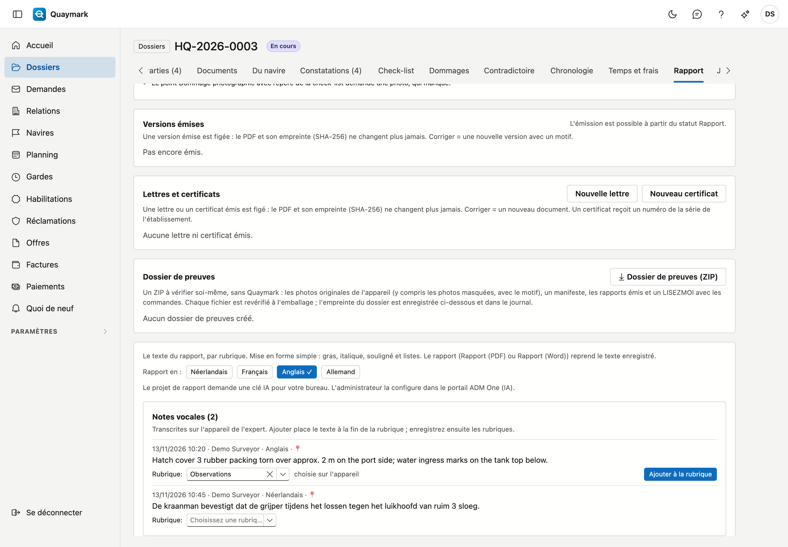

- **Rubrique** : le choix de l'expert, une proposition de l'IA ou votre propre choix. Vous pouvez toujours la modifier.
- **Ajouter à la rubrique** place le texte à la fin de cette rubrique. Il n'entre dans le rapport qu'après **Enregistrer les rubriques**, et la note reçoit alors la mention *Ajoutée*.
- **Préparer les notes (IA)** propose une rubrique pour les notes qui n'en ont pas, et traduit dans la langue du rapport ce qui est dans une autre langue. La traduction figure sous l'original ; **Ajouter à la rubrique** prend alors la traduction. Sans IA, vous pouvez **Ajouter l'original**.

Les notes servent aussi à **Proposer un projet** et figurent dans le dossier de preuves, avec l'empreinte du texte.

### Comparaison avec un dossier précédent

Si le dossier est **lié** à un dossier précédent (p. ex. l'on-hire d'un off-hire), l'onglet Constatations montre par emplacement ce que ce dossier y a constaté. Donnez votre appréciation par constatation : **Existait déjà** ou **Nouveau**. Le rapport montre la comparaison par emplacement à bord, avec les numéros de photo et votre appréciation ; sans appréciation, rien n'est ajouté.

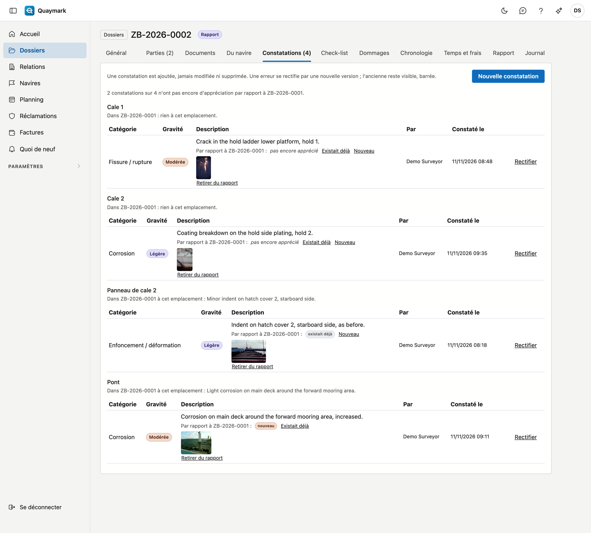

### Lettres et certificats

**Nouvelle lettre** et **Nouveau certificat** (onglet Rapport) créent une lettre type ou un certificat dans la langue du dossier. **Aperçu (PDF)** le montre d'abord ; **Émettre** le fige avec son empreinte. Un certificat reçoit alors un numéro de la série de l'établissement (C-HQ-2026-0001). Remplacez dans une lettre chaque champ entre [crochets] : sinon l'émission est impossible.

Il y a trois lettres et cinq certificats. Chaque certificat a ses propres lignes :

- **Certificat de quantité**, **Certificat de poids** et **Certificat on-hire/off-hire** : une description, une quantité et une unité. Un champ numérique rempli du dossier se reprend avec **Reprendre d'un champ du dossier**. Pour une expertise de soutes, **De l'expertise de soutes** reprend la quantité livrée par produit.
- **Certificat d'inspection des cales** : une **Constatation** par cale, et l'**Avis** : aptes ou non aptes au chargement de la cargaison mentionnée. L'avis n'est jamais prérempli. C'est sur ce certificat que la notice of readiness (NOR) du capitaine est acceptée ou refusée.
- **Certificat de qualité** : les résultats d'une analyse, avec par ligne le **Paramètre**, la **Méthode**, le **Résultat**, l'**Unité** et la **Spécification** (la valeur limite). Au-dessus, vous indiquez l'**Échantillonnage** (où et quand), le **Laboratoire** et le **Rapport du laboratoire**.

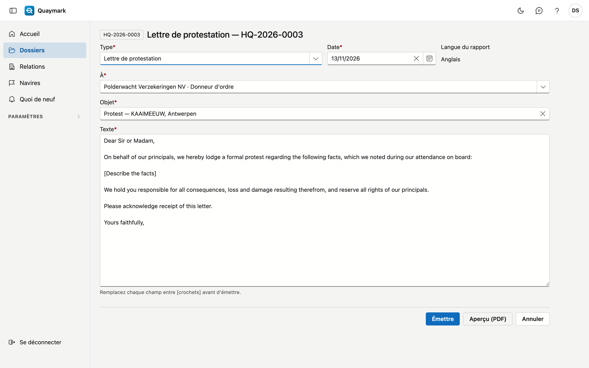

Si une quantité est exprimée dans une autre unité que celle demandée par le client, par exemple en tonnes métriques alors que la charte-partie utilise la long ton, **Convertir** la convertit (tonne, kilogramme, long ton, short ton, mètre cube, litre, baril). D'un volume vers un poids, Quaymark demande la densité. La quantité convertie s'ajoute comme nouvelle ligne sous l'originale.

### Dommages

L'onglet **Dommages** assure le suivi d'un dossier de sinistre : les **réclamations** et l'**estimation des dommages**.

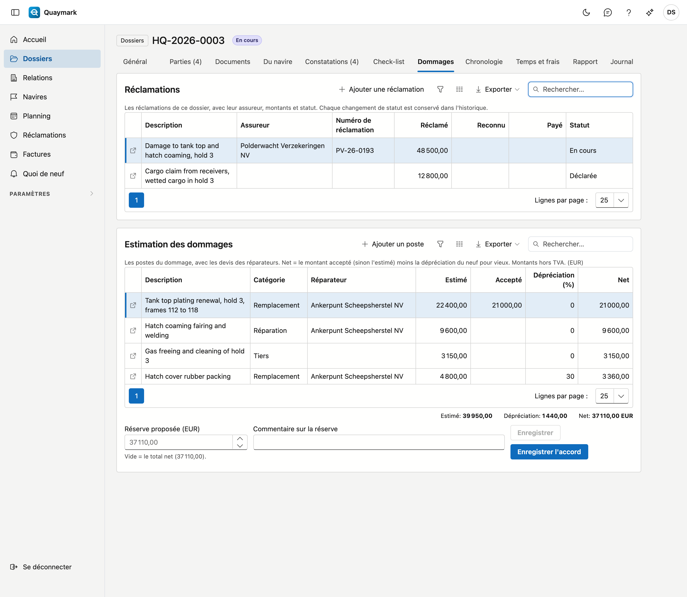

- Un dossier peut avoir **plusieurs réclamations**, par exemple une auprès de l'assureur corps et une auprès du P&I club. **Ajouter une réclamation** ouvre une page propre avec l'assureur ou le P&I club, le numéro de police et de réclamation, la date de déclaration et les montants réclamé, reconnu et payé. Le reconnu ne peut dépasser le réclamé, le payé ne peut dépasser le reconnu.
- **Changer le statut** sur la réclamation ajoute une étape à l'**historique** : déclarée, en cours, reconnue, contestée, réglée ou rejetée, avec une date et un commentaire. Une étape reste conservée ; réglée ou rejetée fixe aussi la date de règlement. Une réclamation avec un historique ne peut plus être supprimée.
- L'**estimation des dommages** se compose de postes : description, catégorie (réparation, remplacement, main-d'œuvre, tiers, autre), réparateur, numéro de devis et le devis en pièce jointe du dossier. Par poste, le montant **estimé** et **accepté** et la **dépréciation** du neuf pour vieux en pour cent. Net = le montant accepté (sinon l'estimé) moins la dépréciation. Montants hors TVA, dans la devise du dossier.
- **Réserve proposée** : si vous la laissez vide, le total net s'applique.
- **Enregistrer l'accord** fige l'estimation telle qu'elle est, avec la partie avec qui l'accord a été conclu (par exemple l'assureur et le contre-expert). Ensuite, plus aucun poste ne peut être ajouté ou modifié. **Retirer l'accord** le permet à nouveau et demande un motif ; l'accord et le retrait restent tous deux conservés.
- Dans le rapport, l'estimation vient avec le marqueur `{{schadebegroting}}` (voir [Modèles](sjablonen.md)).

### Draft survey

Pour un type d'expertise avec la case **Draft survey** cochée (voir [Types d'expertise](soorten-survey.md)), le dossier reçoit l'onglet **Draft survey** : la mesure initiale (avant le chargement ou le déchargement) et la mesure finale (après), côte à côte, et le poids de la cargaison.

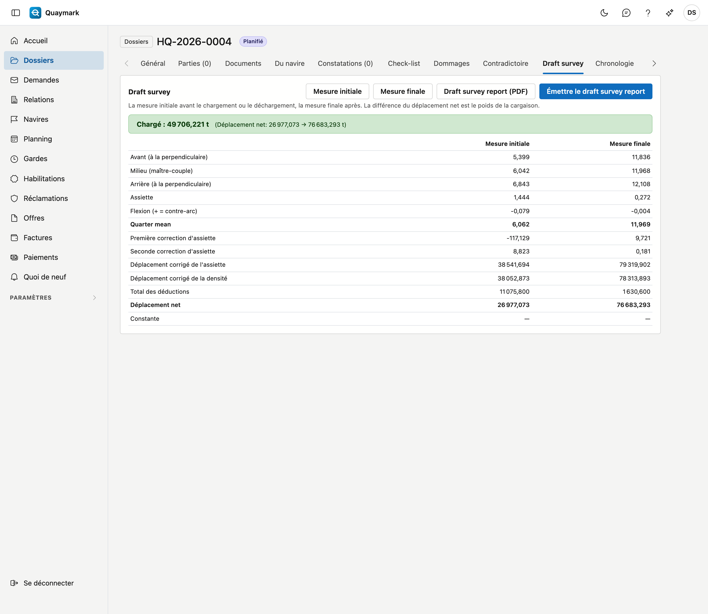

**Mesure initiale** et **Mesure finale** ouvrent chacune une page propre. Saisissez :

- les six **tirants d'eau** : avant, milieu et arrière, à bâbord et à tribord ;
- le **navire** : la LBP et les distances des marques de tirant d'eau aux perpendiculaires (avant et milieu positifs si la marque est en arrière de la perpendiculaire ou du maître-couple, arrière positif si la marque est en avant de la perpendiculaire arrière) ;
- l'**eau** : la densité de l'eau du bassin (hydromètre) et la densité des tables (généralement 1,025) ;
- les **valeurs hydrostatiques** : dès que les tirants d'eau sont saisis, Quaymark affiche le tirant moyen (quarter mean) auquel vous relevez dans les tables du navire le déplacement, le TPC, le LCF (depuis le maître-couple, positif vers l'arrière) et le MTC un demi-mètre au-dessus et en dessous ;
- les **déductions** : ballast, eau douce, combustible, huile de graissage et autres, en tonnes ; facultativement le navire lège, pour la constante.

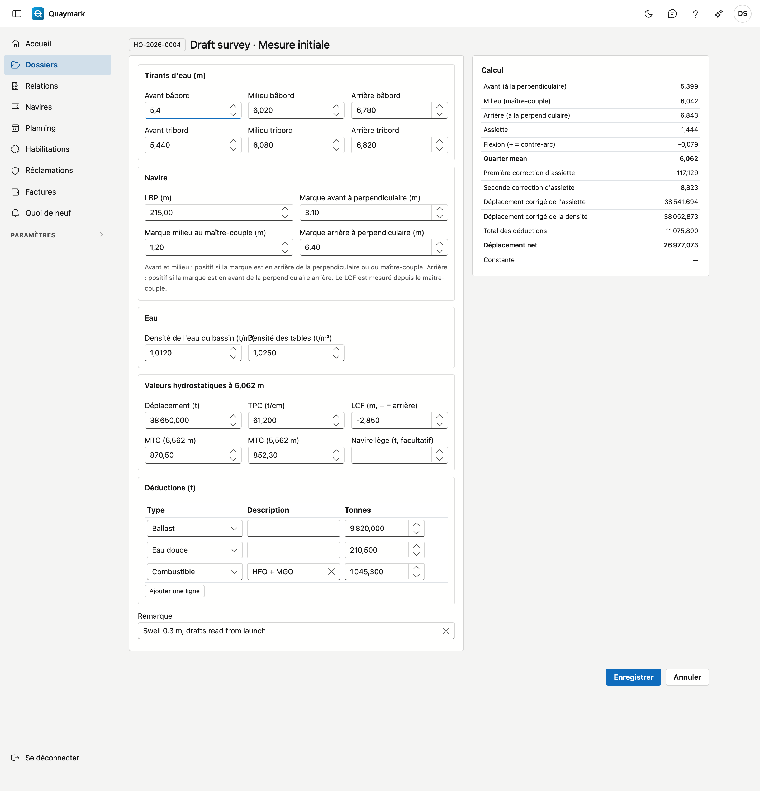

Le **calcul** à côté suit chaque modification : les tirants d'eau aux perpendiculaires, l'assiette, la flexion, le quarter mean, la première et la seconde correction d'assiette, la correction de densité, les déductions et le déplacement net. Une mesure finale reprend le navire et l'eau de la mesure initiale. La différence du déplacement net entre le début et la fin est le poids de la cargaison : chargée s'il a augmenté, déchargée s'il a diminué.

**Draft survey report (PDF)** affiche le document ; **Émettre le draft survey report** (lorsque les deux mesures sont complètes) le fige avec son empreinte, avec les lettres et certificats du dossier, et dans le dossier de preuves. Le document prévoit la signature du capitaine. Dans le rapport, la draft survey vient avec le marqueur `{{draftsurvey}}` (voir [Modèles](sjablonen.md)).

### Expertise de soutes

Pour un type d'expertise avec la case **Expertise de soutes** (voir [Types d'expertise](soorten-survey.md)), le dossier reçoit l'onglet **Soutes**. Vous sondez chaque soute du navire avant et après le soutage ; Quaymark calcule le poids et compare la livraison au bon de livraison (BDN).

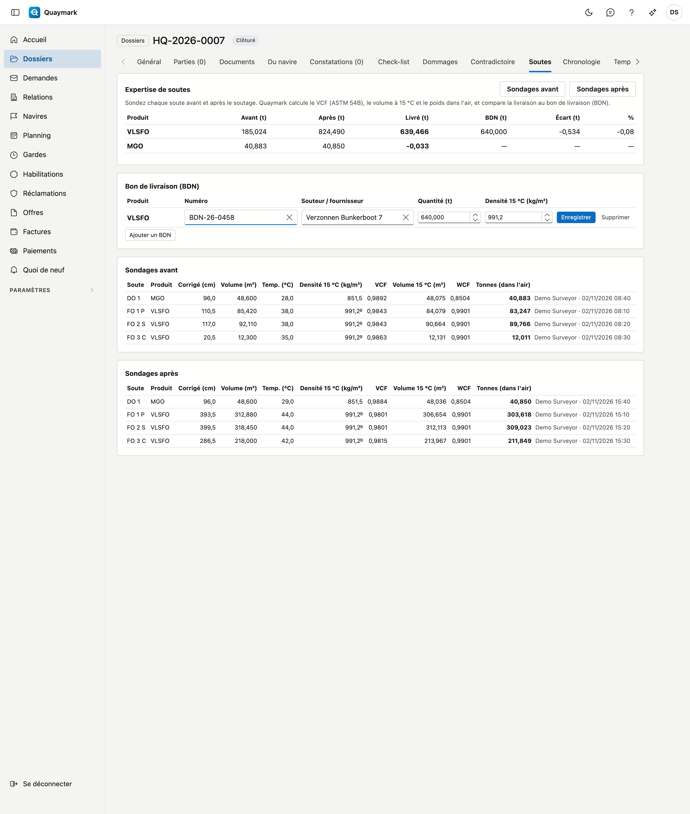

- **Sondages avant** et **Sondages après** ouvrent une page avec une ligne par soute : produit, méthode (sondage ou creux), la valeur mesurée, la correction d'assiette et de gîte de la table, le **volume** que vous relevez dans la table de jaugeage au sondage corrigé, et la température. Les soutes viennent du navire (onglet Cales et citernes) ; ajoutez-y une soute manquante.
- La **densité à 15 °C** vient du bon de livraison du produit. Si une soute diffère (par exemple une valeur de labo propre), indiquez-la sur cette soute.
- Quaymark calcule par soute le **VCF** selon ASTM D1250 table 54B, le volume à 15 °C et le poids dans l'air (volume à 15 °C × (densité − 0,0011)). Si vous utilisez un VCF de votre propre table, indiquez-le avec un motif ; il reçoit un astérisque dans le rapport.
- **Enregistrer** ajoute un nouveau sondage par soute modifiée. Le précédent est conservé, avec qui et quand.
- Par produit, l'onglet montre avant, après et la quantité **livrée**, et face au bon de livraison l'écart en tonnes et en pourcentage. Si une soute n'est sondée qu'à un seul moment, l'onglet le dit : le livré n'est alors pas correct pour ce produit.

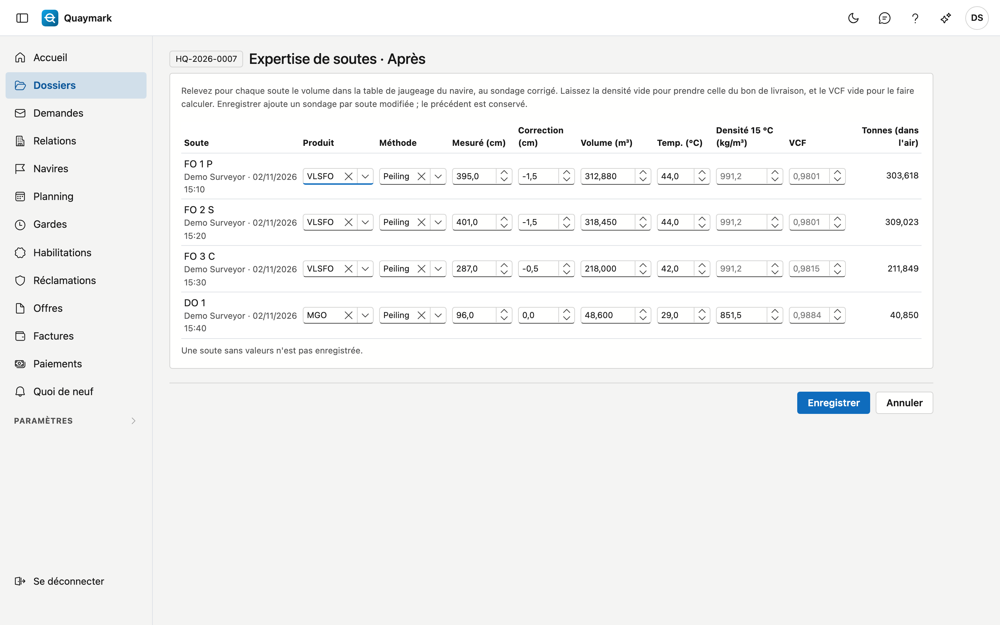

Sur place, l'expert sonde dans l'application de terrain : l'icône carburant en haut du dossier montre les soutes par moment, avec une estimation en tonnes. Il y ajoute une soute que le navire n'avait pas encore. Sans réseau, les sondages attendent sur l'appareil.

Dans le rapport, `{{bunker}}` place le résultat et le tableau par soute (voir [Modèles](sjablonen.md)). Sur le **certificat de quantité**, **De l'expertise de soutes** reprend la quantité livrée par produit.

### Chronologie

L'onglet **Chronologie** est le statement of facts du dossier : les événements de l'escale, à l'heure du site. Avec **Ajouter un événement**, vous choisissez le moment, l'événement (arrivée en rade, NOR remise, NOR acceptée, amarré, panneaux ouverts, début et fin du chargement ou déchargement, interruption, reprise, panneaux fermés, documents à bord, départ ou autre) et une remarque. Un événement peut être modifié par la suite ; l'historique garde qui a modifié quoi.

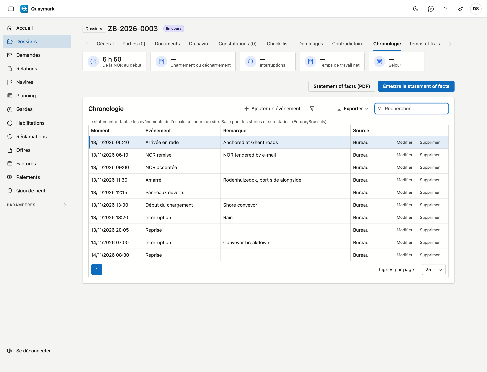

En haut, les tuiles du résumé calculent : le temps de la NOR au début, la durée du chargement ou déchargement, les interruptions (d'une interruption à sa reprise), le temps de travail net et le séjour au port. S'il manque un événement pour une durée, un tiret s'affiche, pas zéro.

**Statement of facts (PDF)** montre le document ; **Émettre le statement of facts** le fige avec son empreinte, parmi les lettres et certificats du dossier, et dans le dossier de preuves. Le document prévoit la signature du capitaine. Dans le rapport, la chronologie vient avec le marqueur `{{tijdlijn}}` (voir [Modèles](sjablonen.md)).

### Temps et frais

Dans l'onglet **Temps et frais**, vous encodez les **prestations** (qui, de quand à quand, à l'heure du site) et les **frais** (déplacement, séjour, laboratoire, tiers) du dossier, avec le justificatif tiré des pièces jointes. Un frais marqué **Refacturer** figure sur la facture. **Proposer une facture** en fait un brouillon de facture ; voir [Factures](facturen.md). Ce qui figure sur une facture est figé.

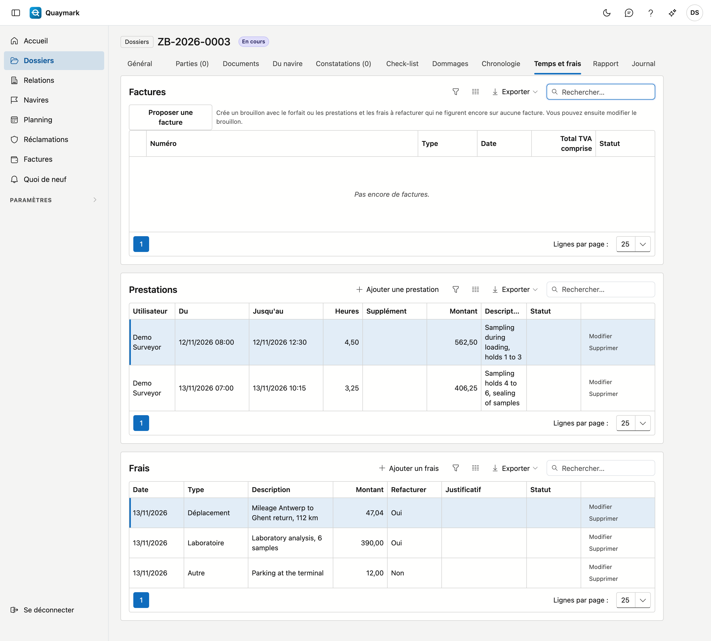

### Dossier de preuves

**Dossier de preuves (ZIP)** fournit un ZIP à vérifier sans Quaymark : les photos originales de l'appareil (y compris les photos masquées, avec le motif), un manifeste, les rapports émis et un LISEZMOI avec les commandes (`shasum`, `certutil`). Chaque fichier est revérifié à l'emballage ; si l'un ne correspond plus, aucun dossier n'est créé. L'empreinte du dossier figure ensuite dans l'onglet et dans le journal.

### Aperçu du rapport

**Rapport (PDF)** et **Rapport (Word)** créent le rapport à partir des données enregistrées, avec le modèle de rapport de ce type d'expertise (sinon le modèle général) et dans la langue du rapport. C'est un aperçu : rien n'est enregistré ni envoyé. Enregistrez d'abord, sinon vos dernières modifications n'y figurent pas.

### Copier

**Copier** crée un nouveau dossier avec la même mission (navire, donneur d'ordre, type, port), sans constatations, réponses ni données d'expertise, et le lie à ce dossier.

### Bloquer juridiquement

**Bloquer juridiquement** (administrateur seulement) conserve un dossier pour un litige ou une réclamation. Indiquez un motif. Tant que le dossier est bloqué, il ne peut pas aller à la corbeille, et ses documents, pièces jointes, notes et tâches ne sont pas supprimés. La modification reste possible. **Lever le blocage** demande aussi un motif ; la fenêtre montre qui a bloqué ou levé, et quand. Un dossier bloqué n'est pas non plus supprimé après son [délai de conservation](bewaartermijnen.md).

### Supprimer

**Supprimer** déplace le dossier vers la corbeille.

## À partir d'un document

Si la mission arrive par e-mail ou en pdf, Quaymark pré-remplit un nouveau dossier. C'est possible si le bureau a activé l'analyse de documents dans le portail ADM One (IA, Analyse de documents) ; cela utilise la clé IA du bureau.

1. Cliquez sur **Nouveau dossier**. En haut se trouve le cadre **Remplir à partir d'un document**.
2. Cliquez sur **Lire le document**. Choisissez un fichier (pdf, JPEG, PNG ou WebP, 20 Mo maximum), ou collez le texte de l'e-mail.
3. Cliquez sur **Lire le document**. Après quelques secondes, la proposition est dans le formulaire : type d'expertise, donneur d'ordre, référence, navire, port, terminal, moment prévu (uniquement si la mission indique un jour et une heure), description et langue du rapport. Chaque champ rempli reçoit un ✦ devant son nom.
4. Vérifiez tout et cliquez sur **Enregistrer**. Le dossier n'existe qu'à ce moment. Le document est joint au dossier.

Ce que Quaymark n'a pas pu relier figure dans le cadre :

- un donneur d'ordre absent de vos relations : Quaymark ne le crée pas lui-même. Choisissez le donneur d'ordre ou créez d'abord la relation. → [Relations](relaties.md)
- un navire qui n'existe pas encore : il est créé à l'enregistrement, avec le nom lu et le numéro IMO ou ENI. **Ne pas créer** l'écarte ; si vous choisissez vous-même un navire, c'est celui-là qui compte ;
- un port absent de vos ports, ou un jour souhaité sans heure.

Dès que le donneur d'ordre et le navire sont choisis, le formulaire affiche déjà avant l'enregistrement les conflits d'intérêts possibles et le tarif applicable (l'accord-cadre avec le donneur d'ordre, sinon les tarifs du bureau). Cela vaut pour chaque nouveau dossier.

## Conflits d'intérêts

Un expert ne peut pas intervenir pour les deux parties. Quaymark avertit en haut du dossier si le bureau travaille, dans un autre dossier avec **le même navire** ou **le même numéro de réclamation ou de police**, pour un autre donneur d'ordre, et que ce donneur d'ordre est partie dans ce dossier (ou que votre donneur d'ordre est partie dans l'autre). Les dossiers ouverts comptent, ainsi que ceux clôturés au cours des douze derniers mois ; les dossiers annulés non.

- L'en-tête affiche alors **Conflit d'intérêts ?**, et le haut du dossier les autres dossiers avec leur donneur d'ordre.
- S'il n'y a pas de conflit, cliquez sur **Pas de conflit** et expliquez pourquoi (par exemple : autre dommage, les deux parties informées). C'est conservé avec votre nom et l'heure, et ne peut pas être modifié. C'est la preuve d'indépendance qu'un donneur d'ordre ou une accréditation peut demander.
- Le travail n'est pas bloqué : l'avertissement reste affiché jusqu'à sa justification.
- Sur une demande du portail client aussi, Quaymark avertit dès avant l'acceptation. → [Demandes](aanvragen.md#demande)

## Réclamations

L'écran **Réclamations** du menu affiche les réclamations de tous les dossiers, avec leur dossier, assureur, montants et statut.

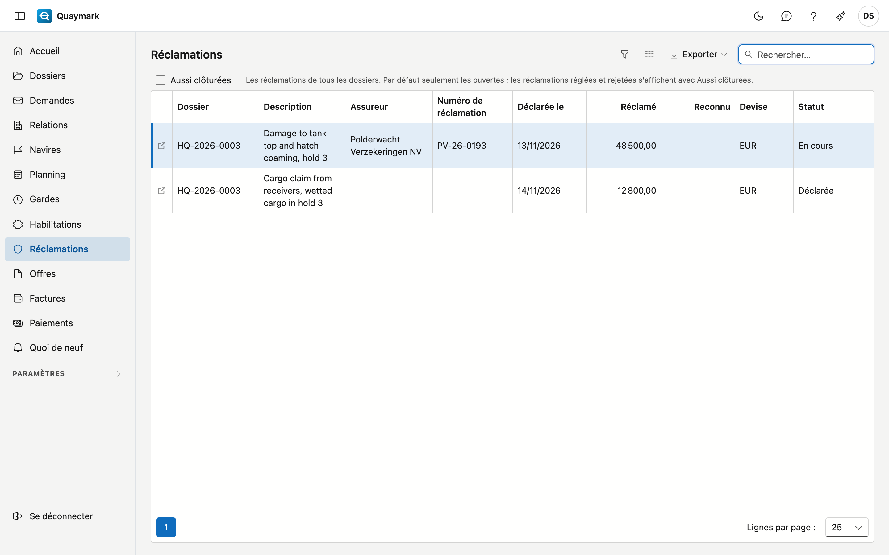

- Par défaut, seules les réclamations **ouvertes** s'affichent. Cochez **Aussi clôturées** pour les réclamations réglées et rejetées.
- Double-cliquez sur une ligne pour ouvrir la réclamation. Une nouvelle réclamation se crée dans le dossier, onglet **Dommages**.

## Voir aussi

- [Navires](schepen.md)
- [Relations](relaties.md)
- [Modèles](sjablonen.md)
