# Dossiers

De werklijst van het bureau: één rij per opdracht.

## Het scherm openen

Klik in het menu links op **Dossiers**.

## De lijst

- De keuze **Status** boven de lijst toont standaard de **open** dossiers. Kies **Alle** om ook afgesloten en geannuleerde dossiers te zien, of één status.
- Het **zoekvak** zoekt in alle kolommen: nummer, soort survey, schip, opdrachtgever, haven, planning en status.
- Dubbelklik op een rij om het **dossier** te openen; met het pijltje vooraan de rij opent het in een nieuw tabblad. **Nieuw dossier** maakt er een aan.
- Met de exportknop haalt u de lijst op als bestand.

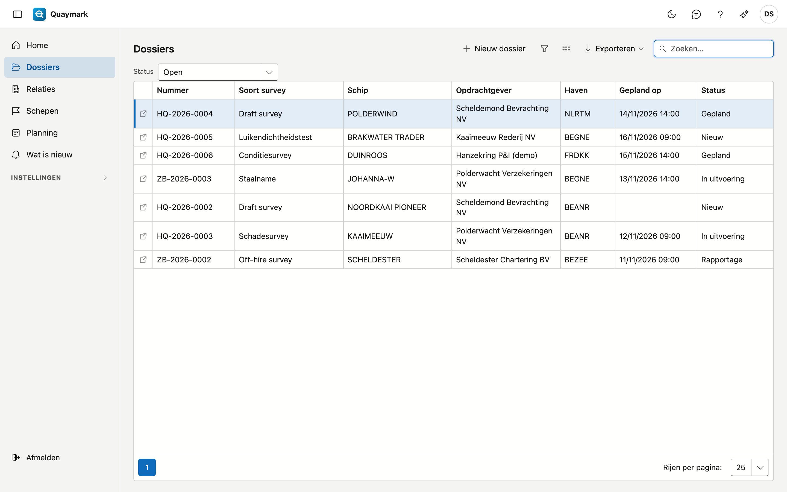

## Dossier

Eén opdracht: wat er gevraagd is, waar en wanneer, en wat de surveyor ter plaatse vaststelt.

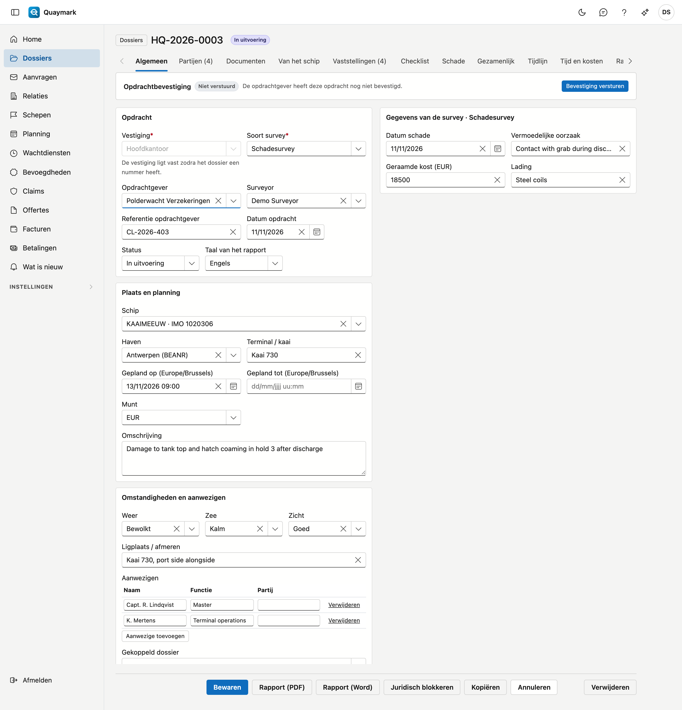

- **Opdracht**: vestiging, soort survey, opdrachtgever, surveyor, referentie, datum, status en de taal van het rapport. Het **dossiernummer** (vestigingscode, jaar, volgnummer) wordt toegekend bij het eerste bewaren; daarna ligt de vestiging vast.
- **Plaats en planning**: schip, haven, terminal of kaai, het geplande moment (in de tijdzone van de vestiging), munt en omschrijving.
- **Omstandigheden en aanwezigen**: weer, zee, zicht, ligplaats en wie er bij de survey aanwezig was. **Gekoppeld dossier** verwijst naar een eerder dossier van hetzelfde schip, bijvoorbeeld de on-hire bij een off-hire.
- **Gegevens van de survey**: de velden die bij het gekozen soort survey horen. Een verplicht veld moet ingevuld zijn vanaf de status Rapportage. Kiest u een ander soort survey, dan gaan bij het bewaren de waarden verloren van velden die het nieuwe soort niet kent.

Een bewaard dossier heeft tabbladen: **Partijen** (relaties met hun rol en referentie), **Documenten** (in mappen), **Van het schip** (de documenten van het schip, alleen lezen), **Vaststellingen**, **Checklist** en het journaal met notities, taken, bijlagen en historiek.

### Vaststellingen

Een **vaststelling** wordt toegevoegd, nooit gewijzigd of verwijderd. Een fout zet u recht met **Rechtzetten** en een reden: de oude versie blijft doorgestreept staan. Een foto toont bij aanwijzen het tijdstip, de GPS-positie en de vingerafdruk (SHA-256) die het toestel bij de opname vastlegde.

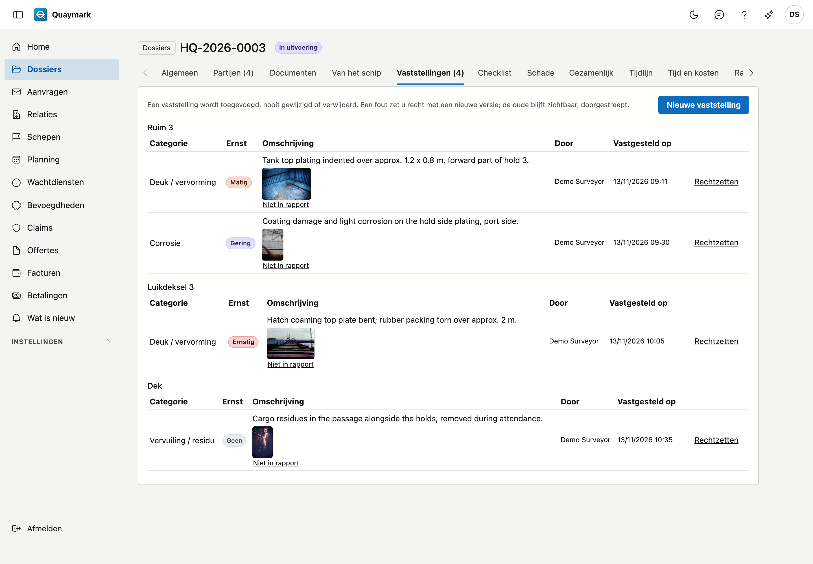

### Foto's in het rapport

**Niet in rapport** onder een foto laat die foto weg uit de fotobijlage van het rapport, met een reden. De foto blijft bewaard als bewijs; **Weer in rapport** zet ze terug. De foto's krijgen in het rapport een doorlopend nummer, en de tabel met vaststellingen noemt die nummers.

### Checklist

De **checklist** toont per punt het laatste antwoord (in orde, niet in orde, n.v.t.), van wie en wanneer. Elk antwoord blijft bewaard onder **Vorige antwoorden**. **Niet in orde** stelt een vaststelling voor. Ter plaatse antwoordt de surveyor in de veldapp.

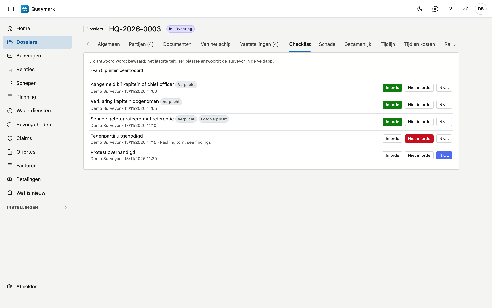

### Rapport

Op het tabblad **Rapport** schrijft u de tekst van het rapport per rubriek, met eenvoudige opmaak, en voegt u standaardteksten van het bureau in. **Rubrieken bewaren** bewaart ze. Toont het rapportsjabloon een rubriek niet, dan zegt het tabblad dat.

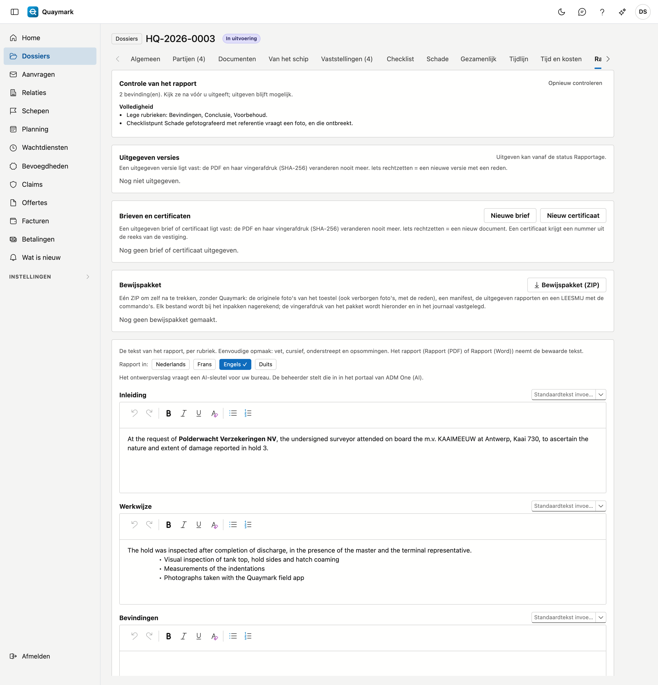

### Gezamenlijke survey

Op het tabblad **Gezamenlijk** legt u een gezamenlijke survey vast: wie er namens welke partij bij was, en welke vaststellingen u samen deelt.

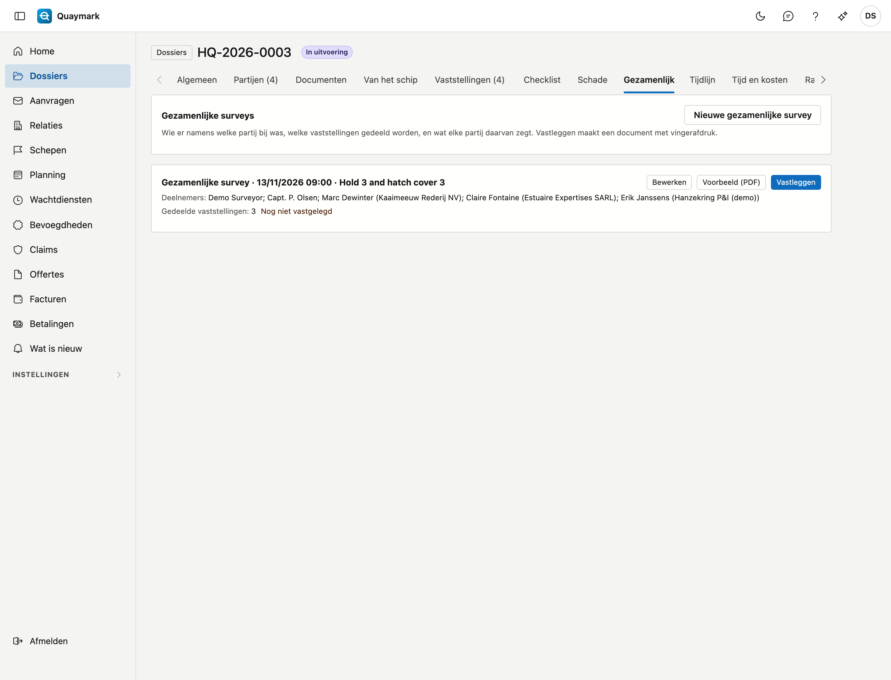

1. Klik op **Nieuwe gezamenlijke survey**. Vul de datum en het uur in (in de tijd van de vestiging), de plaats en een opmerking.
2. Voeg de deelnemers toe. **Eén per partij** zet een rij klaar voor elke partij van het dossier; u vult de naam en de functie in. Wie er namens niemand was (de kapitein, het bureau), laat u zonder partij. Was iemand er toch niet, vink dan **Aanwezig** uit.
3. Kies de **gedeelde vaststellingen**. Het nummer is dat van het rapport. Bewaar.
4. Terug op het tabblad: **Vastleggen** maakt het document *Gezamenlijke vaststelling*, met zijn vingerafdruk (SHA-256). Het staat bij de documenten van het dossier en gaat mee in het bewijspakket. **Voorbeeld (PDF)** toont het eerst, zonder iets te bewaren.

Daarna spreekt elke partij van een aanwezige deelnemer zich uit: **akkoord**, **akkoord met voorbehoud** (met een toelichting) of **niet akkoord**.

- **Link versturen** stuurt de partij een link (via ADM One). Ze leest de gezamenlijke vaststelling, kiest haar standpunt en bevestigt met haar naam en een vinkje. Het antwoord komt vanzelf op het tabblad en in het journaal.
- **Antwoord registreren** legt een antwoord vast dat het bureau anders ontving, bijvoorbeeld op de getekende papieren versie. Voeg die toe als bijlage.

Wijzigt u de survey na het vastleggen, leg dan een nieuwe versie vast. Een antwoord hoort bij de versie die de partij zag: op een nieuwe versie antwoordt ze opnieuw.

### Rapport in een andere taal

De teksten van het rapport staan **per taal**. Bovenaan het tabblad Rapport kiest u de taal van het rapport: een klik op een taal wisselt de taal van het dossier en bewaart het. Een vinkje toont welke talen al tekst hebben. Heeft u nog onbewaarde tekst, dan bewaart u eerst de rubrieken.

Staat er in een andere taal al tekst, dan stelt **Vertalen uit …** per rubriek een vertaling voor, naast de brontekst. De opmaak blijft, en de vaktermen uit de [woordenlijst](woordenlijst.md) van het bureau gaan mee als vaste vertaling. Kies per rubriek **Overnemen**, **Achteraan toevoegen** of **Negeren**, en dan **Rubrieken bewaren**. Niets komt vanzelf in het rapport.

Vertalen gebruikt de AI-sleutel van het bureau en vraagt zijn toestemming, zoals het ontwerpverslag. Enkel de rubriekteksten worden vertaald: vaststellingen en opmerkingen bij de checklist blijven in hun oorspronkelijke taal.

### Controle van het rapport

Bovenaan het tabblad Rapport legt het blok **Controle van het rapport** het rapport naast het dossier:

- **Tijden**: vaststellingen of foto's van buiten de surveydagen (een dag ervoor of erna mag), een datum van schade na de survey, en in de tijdlijn een einde vóór zijn start of een moment in de toekomst.
- **Schip**: een ongeldig IMO-nummer, of een andere scheepsnaam (m.v., MV, MT …) of een ander IMO-nummer in de tekst van een rubriek.
- **Gewichten**: een gewicht in de velden of in de tekst dat meer dan 0,5 % afwijkt van de lading uit de draft survey.
- **Volledigheid**: rubrieken die het sjabloon toont maar leeg zijn (ook als ze in een andere taal wel tekst hebben), verplichte velden en checklistpunten zonder antwoord, een ontbrekende verplichte foto, en bij een gekoppeld dossier vaststellingen zonder oordeel.

De controle weigert niets. Geeft u uit met bevindingen, dan vraagt Quaymark **Toch uitgeven?**, en de bevindingen worden met de versie vastgelegd. **Opnieuw controleren** voert de controle opnieuw uit, bijvoorbeeld nadat u iets rechtzette.

### Rapport uitgeven en verzenden

**Rapport uitgeven** (tabblad Rapport, vanaf de status Rapportage) legt het rapport vast als versie 1, met zijn vingerafdruk (SHA-256): het verandert daarna nooit meer. Iets rechtzetten = **Nieuwe versie uitgeven**, met een reden. **Verzenden** stuurt een uitgegeven versie als PDF naar de opdrachtgever; de mail komt in het journaal. Bewaar eerst de rubrieken: een versie neemt enkel bewaarde tekst.

### Vier-ogen

Bij een soort survey met het vinkje **Vier-ogen** (zie [Soorten survey](soorten-survey.md)) kan een rapport pas uitgegeven worden nadat een tweede surveyor het goedkeurde. Het tabblad Rapport toont dan het blok **Vier-ogen**.

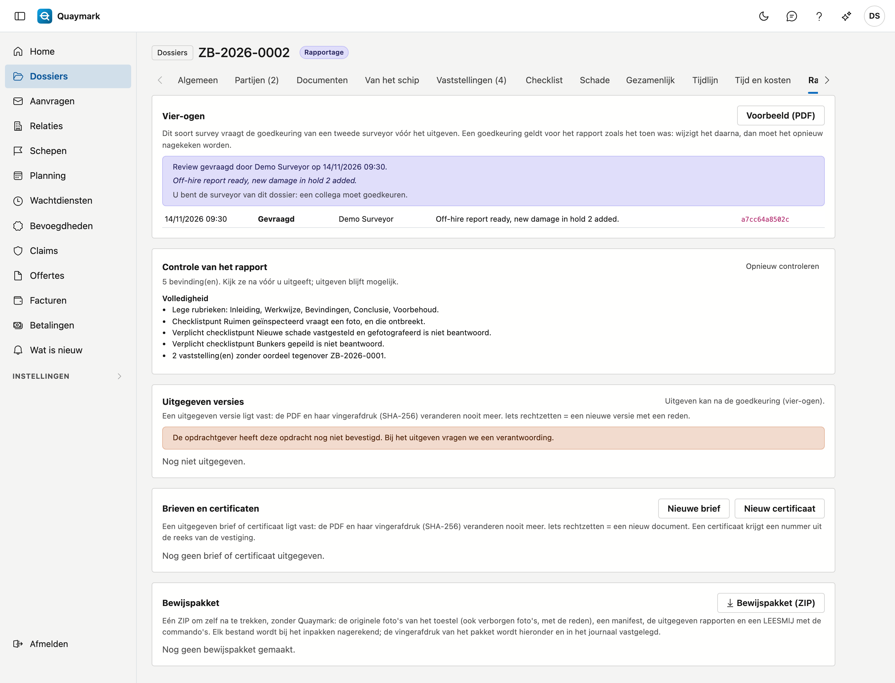

- **Review vragen** zet het rapport klaar voor een collega, met een opmerking als u wil. Op het startscherm staat het dan onder **Wacht op review**.
- Goedkeuren mag een collega met het recht om rapporten uit te geven, maar niet de surveyor van het dossier en niet wie de review vroeg. Hij bekijkt het **Voorbeeld (PDF)** en kiest **Goedkeuren**, of **Terugsturen** met wat er aangepast moet worden.
- Een goedkeuring geldt voor het rapport zoals het op dat moment was. Wijzigt er daarna iets dat in het rapport komt (een rubriektekst, een veld, een verborgen foto, het sjabloon), dan vervalt ze en vraagt u opnieuw een review. Het blok zegt het, en **Rapport uitgeven** verschijnt pas weer na een nieuwe goedkeuring.
- Elke stap blijft bewaard, met wie, wanneer en de vingerafdruk van de inhoud die goedgekeurd of teruggestuurd werd.

### Ontwerp voorstellen

**Ontwerp voorstellen** (tabblad Rapport) laat de AI per rubriek een voorstel schrijven uit de gegevens van het dossier: vaststellingen, checklist, velden en omstandigheden. Foto's en uw eigen tekst gaan niet mee. Elk voorstel staat onder zijn rubriek; u kiest **Overnemen**, **Achteraan toevoegen** of **Negeren**, en bewaart daarna zoals altijd. Het loopt op de AI-sleutel van uw bureau en enkel als de beheerder het in het portaal van ADM One toestaat.

### Vergelijking met een vorig dossier

Is het dossier **gekoppeld** aan een vorig dossier (bv. de on-hire bij een off-hire), dan toont het tabblad Vaststellingen per plaats wat dat dossier er vaststelde. Geef per vaststelling uw oordeel: **Bestond al** of **Nieuw**. Het rapport toont de vergelijking per plaats aan boord, met de fotonummers en uw oordeel; zonder oordeel staat er geen woord bij.

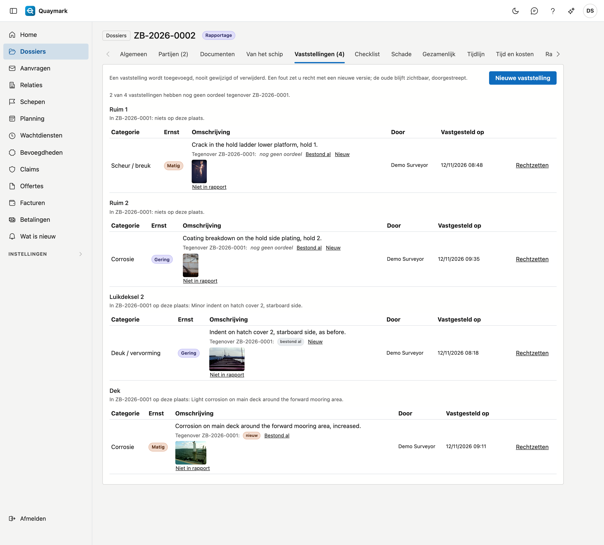

### Brieven en certificaten

**Nieuwe brief** en **Nieuw certificaat** (tabblad Rapport) maken een standaardbrief of certificaat in de taal van het dossier. **Voorbeeld (PDF)** toont het eerst; **Uitgeven** legt het vast met zijn vingerafdruk. Een certificaat krijgt dan een nummer uit de reeks van de vestiging (C-HQ-2026-0001). Vervang in een brief elk invulvak tussen [rechte haken]: anders kan uitgeven niet.

Er zijn drie brieven en vijf certificaten. Elk certificaat heeft zijn eigen regels:

- **Certificaat van hoeveelheid**, **Certificaat van gewicht** en het **On-hire/off-hire-certificaat**: een omschrijving, een hoeveelheid en een eenheid. Een ingevuld getalveld van het dossier neemt u over met **Overnemen uit een veld van het dossier**.
- **Certificaat van ruimkeuring**: per ruim een **Bevinding**, en het **Oordeel**: geschikt of niet geschikt om de vermelde lading te laden. Het oordeel staat nooit vooraf ingevuld. Op dit certificaat wordt de notice of readiness (NOR) van de kapitein aanvaard of geweigerd.
- **Certificaat van kwaliteit**: de resultaten van een analyse, met per regel de **Parameter**, de **Methode**, het **Resultaat**, de **Eenheid** en de **Specificatie** (de grenswaarde). Daarboven vult u de **Staalname** (waar en wanneer), het **Labo** en het **Verslag van het labo** in.

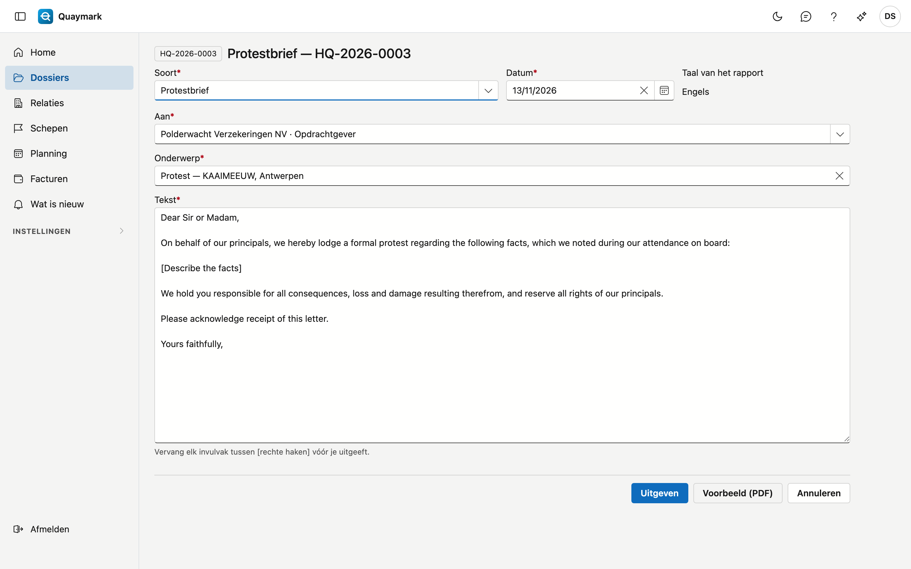

Staat een hoeveelheid in een andere eenheid dan de klant vraagt, bijvoorbeeld in metrische ton terwijl de charterpartij long ton gebruikt, dan rekent **Omrekenen** ze om (ton, kilogram, long ton, short ton, kubieke meter, liter, vat). Van een volume naar een gewicht vraagt Quaymark de dichtheid. De omgerekende hoeveelheid komt als nieuwe regel onder de oorspronkelijke.

### Schade

Het tabblad **Schade** volgt een schadedossier op: de **claims** en de **schadebegroting**.

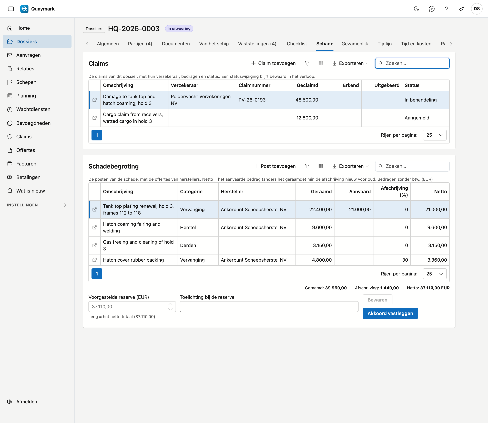

- Een dossier kan **meerdere claims** hebben, bijvoorbeeld een bij de rompverzekeraar en een bij de P&I-club. **Claim toevoegen** opent een eigen pagina met de verzekeraar of P&I-club, het polis- en claimnummer, de datum van aanmelding en het geclaimde, erkende en uitgekeerde bedrag. Erkend mag niet hoger zijn dan geclaimd, uitgekeerd niet hoger dan erkend.
- **Status wijzigen** op de claim zet een nieuwe stap in het **verloop**: aangemeld, in behandeling, erkend, betwist, afgewikkeld of afgewezen, met een datum en een opmerking. Een stap blijft bewaard; afgewikkeld of afgewezen zet ook de datum van afwikkeling. Een claim met verloop kunt u niet meer verwijderen.
- De **schadebegroting** bestaat uit posten: omschrijving, categorie (herstel, vervanging, arbeid, derden, andere), hersteller, offertenummer en de offerte als bijlage van het dossier. Per post het **geraamde** en het **aanvaarde** bedrag en de **afschrijving** nieuw voor oud in procent. Netto = het aanvaarde bedrag (anders het geraamde) min de afschrijving. Bedragen zonder btw, in de munt van het dossier.
- **Voorgestelde reserve**: laat u ze leeg, dan geldt het netto totaal.
- **Akkoord vastleggen** legt de begroting vast zoals ze is, met wie het akkoord gesloten werd (bijvoorbeeld de verzekeraar en de tegenexpert). Daarna kunt u geen post meer toevoegen of wijzigen. **Akkoord intrekken** maakt dat weer mogelijk en vraagt een reden; akkoord en intrekking blijven allebei bewaard.
- In het rapport komt de begroting met de markering `{{schadebegroting}}` (zie [Sjablonen](sjablonen.md)).

### Draft survey

Bij een soort survey met het vinkje **Draft survey** (zie [Soorten survey](soorten-survey.md)) krijgt het dossier het tabblad **Draft survey**: de beginmeting (vóór het laden of lossen) en de eindmeting (erna), naast elkaar, en het gewicht van de lading.

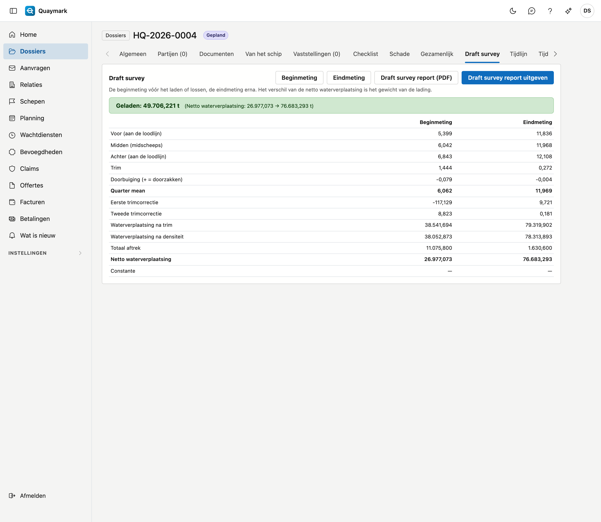

**Beginmeting** en **Eindmeting** openen elk een eigen pagina. Vul in:

- de zes **diepgangen**: voor, midden en achter, aan bakboord en stuurboord;
- het **schip**: de LBP en de afstanden van de diepgangmerken tot de loodlijnen (voor en midden positief als het merk achter de loodlijn of midscheeps staat, achter positief als het merk voor de achterloodlijn staat);
- het **water**: de densiteit van het dokwater (hydrometer) en de densiteit waarvoor de tabellen gelden (meestal 1,025);
- de **hydrostatische waarden**: zodra de diepgangen ingevuld zijn, toont Quaymark de gemiddelde diepgang (quarter mean) waarbij u uit de tabellen van het schip de waterverplaatsing, TPC, LCF (vanaf midscheeps, positief achter) en de MTC een halve meter erboven en eronder afleest;
- de **aftrek**: ballast, zoetwater, brandstof, smeerolie en andere, in ton; optioneel het lichtschip, voor de constante.

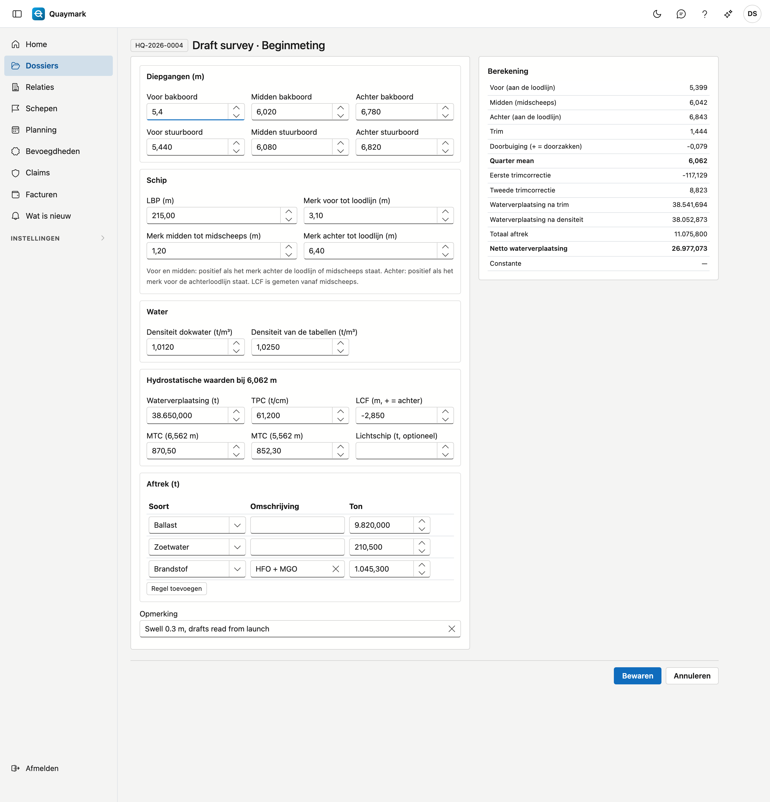

De **berekening** ernaast volgt elke wijziging: de diepgangen aan de loodlijnen, de trim, de doorbuiging, de quarter mean, de eerste en tweede trimcorrectie, de correctie voor de densiteit, de aftrek en de netto waterverplaatsing. Een eindmeting neemt het schip en het water van de beginmeting over. Het verschil van de netto waterverplaatsing tussen begin en eind is het gewicht van de lading: geladen als het meer werd, gelost als het minder werd.

**Draft survey report (PDF)** toont het document; **Draft survey report uitgeven** (als beide metingen volledig zijn) legt het vast met zijn vingerafdruk, bij de brieven en certificaten van het dossier, en mee in het bewijspakket. Het document heeft plaats voor de handtekening van de kapitein. In het rapport komt de draft survey met de markering `{{draftsurvey}}` (zie [Sjablonen](sjablonen.md)).

### Tijdlijn

Het tabblad **Tijdlijn** is de statement of facts van het dossier: de gebeurtenissen van de aanloop, in de tijd van de vestiging. Met **Gebeurtenis toevoegen** kiest u het tijdstip, de gebeurtenis (aankomst op de rede, NOR ingediend, NOR aanvaard, aangemeerd, luiken open, start en einde laden of lossen, onderbreking, hervatting, luiken dicht, documenten aan boord, vertrek of andere) en een opmerking. Een gebeurtenis kunt u achteraf wijzigen; de historiek houdt bij wie wat wijzigde.

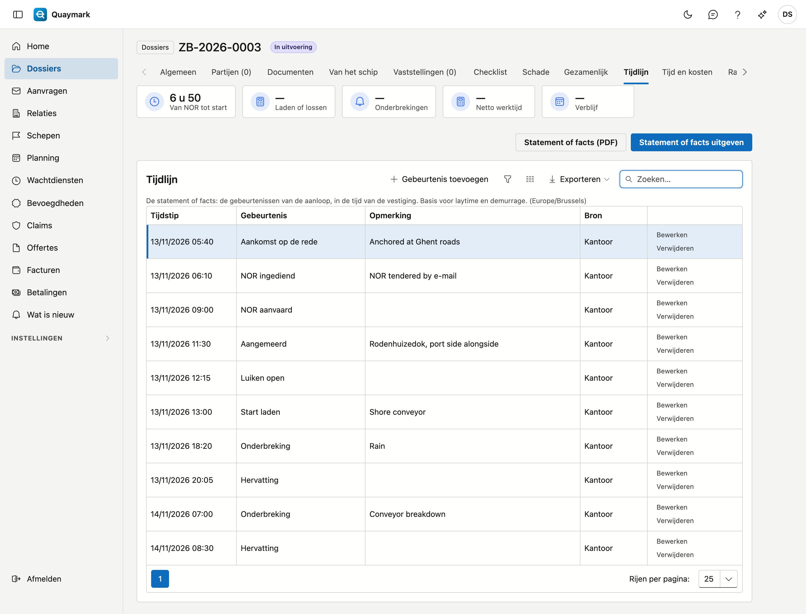

Bovenaan rekenen de tegels van de samenvatting: de tijd van de NOR tot de start, de duur van het laden of lossen, de onderbrekingen (van een onderbreking tot haar hervatting), de netto werktijd en het verblijf in de haven. Ontbreekt er een gebeurtenis voor een duur, dan staat er een streepje, geen nul.

**Statement of facts (PDF)** toont het document; **Statement of facts uitgeven** legt het vast met zijn vingerafdruk, bij de brieven en certificaten van het dossier, en mee in het bewijspakket. Het document heeft plaats voor de handtekening van de kapitein. In het rapport komt de tijdlijn met de markering `{{tijdlijn}}` (zie [Sjablonen](sjablonen.md)).

### Tijd en kosten

Op het tabblad **Tijd en kosten** boekt u de **prestaties** (wie, van wanneer tot wanneer, in de tijd van de vestiging) en de **kosten** (reis, verblijf, labo, derden) van het dossier, met het bewijsstuk uit de bijlagen. Een kost op **Doorrekenen** komt op de factuur. **Factuur voorstellen** maakt er een klad-factuur van; zie [Facturen](facturen.md). Wat op een factuur staat, ligt vast.

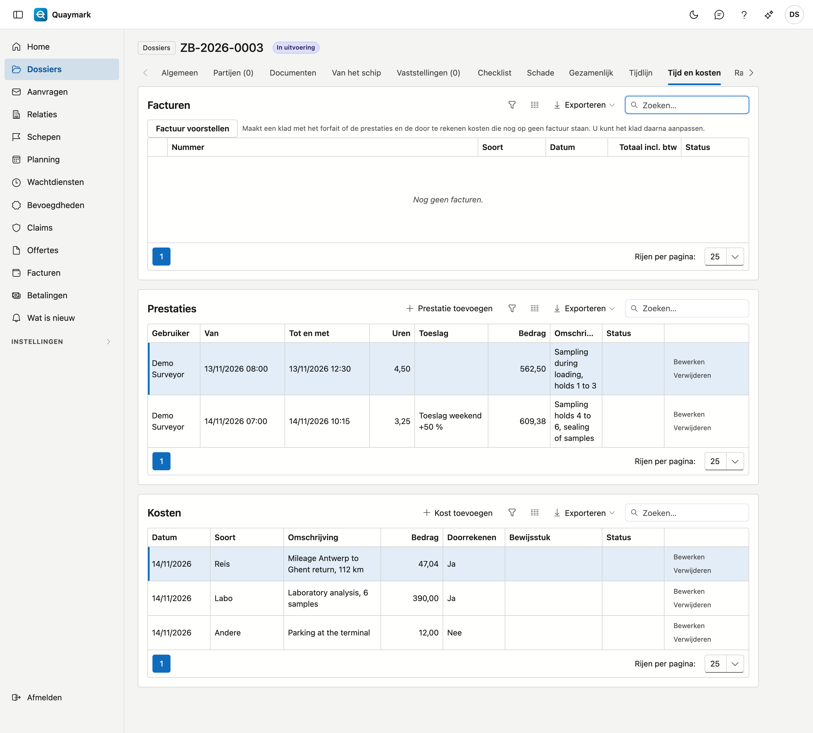

### Bewijspakket

**Bewijspakket (ZIP)** geeft één ZIP om zonder Quaymark na te trekken: de originele foto's van het toestel (ook verborgen foto's, met de reden), een manifest, de uitgegeven rapporten en een LEESMIJ met de commando's (`shasum`, `certutil`). Elk bestand wordt bij het inpakken nagerekend; klopt er één niet meer, dan komt er geen pakket. De vingerafdruk van het pakket staat daarna op het tabblad en in het journaal.

### Rapport als voorbeeld

**Rapport (PDF)** en **Rapport (Word)** maken het rapport uit de bewaarde gegevens, met het rapportsjabloon van deze soort survey (anders het algemene) en in de taal van het rapport. Het is een voorbeeld: er wordt niets bewaard of verzonden. Bewaar eerst, anders staan uw laatste wijzigingen er niet in.

### Kopiëren

**Kopiëren** maakt een nieuw dossier met dezelfde opdracht (schip, opdrachtgever, soort, haven), zonder vaststellingen, antwoorden en gegevens van de survey, en koppelt het aan dit dossier.

### Juridisch blokkeren

**Juridisch blokkeren** (enkel de beheerder) houdt een dossier vast voor een geschil of een vordering. Geef een reden. Zolang het dossier geblokkeerd is, kan het niet naar de prullenbak, en worden zijn documenten, bijlagen, notities en taken niet verwijderd. Bewerken blijft mogen. **Blokkering opheffen** vraagt ook een reden; het venster toont wie wanneer blokkeerde of ophief. Een geblokkeerd dossier wordt ook na zijn [bewaartermijn](bewaartermijnen.md) niet verwijderd.

### Verwijderen

**Verwijderen** verplaatst het dossier naar de prullenbak.

## Uit een document

Komt de opdracht per mail of als pdf binnen, dan vult Quaymark een nieuw dossier voor. Dit kan als het bureau de documentanalyse heeft aangezet in het portaal van ADM One (AI, Documentanalyse); het loopt op de AI-sleutel van het bureau.

1. Klik op **Nieuw dossier**. Bovenaan staat het kader **Uit een document invullen**.
2. Klik op **Document lezen**. Kies een bestand (pdf, JPEG, PNG of WebP, hoogstens 20 MB), of plak de tekst van de mail.
3. Klik op **Document lezen**. Na enkele seconden staat het voorstel in het formulier: soort survey, opdrachtgever, referentie, schip, haven, terminal, gepland moment (enkel als de opdracht een dag én een uur noemt), omschrijving en taal van het rapport. Elk ingevuld veld krijgt een ✦ vóór zijn naam.
4. Kijk alles na en klik op **Bewaren**. Pas dan bestaat het dossier. Het document komt als bijlage bij het dossier.

Wat Quaymark niet kon koppelen, staat in het kader:

- een opdrachtgever die niet bij uw relaties staat: Quaymark maakt hem niet zelf aan. Kies de opdrachtgever of maak de relatie eerst aan. → [Relaties](relaties.md)
- een schip dat nog niet bestaat: dat wordt aangemaakt bij het bewaren, met de gelezen naam en het IMO- of ENI-nummer. **Niet aanmaken** laat het weg; kiest u zelf een schip, dan geldt dat;
- een haven die niet bij uw havens staat, of een gewenste dag zonder uur.

Zodra opdrachtgever en schip gekozen zijn, toont het formulier al vóór het bewaren de mogelijke belangenconflicten en welk tarief geldt (de raamafspraak met de opdrachtgever, anders de tarieven van het bureau). Dat geldt voor elk nieuw dossier.

## Belangenconflicten

Een surveyor mag niet voor beide partijen optreden. Quaymark waarschuwt bovenaan het dossier als het bureau in een ander dossier met **hetzelfde schip** of **hetzelfde claim- of polisnummer** werkt voor een andere opdrachtgever, én die opdrachtgever partij is in dit dossier (of uw opdrachtgever partij is in het andere). Open dossiers tellen mee, en dossiers die in de laatste twaalf maanden afgesloten werden; geannuleerde niet.

- In de kop staat dan **Belangenconflict?**, en bovenaan het dossier de andere dossiers met hun opdrachtgever.
- Is het geen conflict, klik dan op **Geen conflict** en leg uit waarom (bijvoorbeeld: andere schade, beide partijen op de hoogte). Dat wordt bewaard met uw naam en het tijdstip, en kan niet gewijzigd worden. Het is het bewijs van onafhankelijkheid dat een opdrachtgever of een accreditatie kan vragen.
- Het werk wordt niet tegengehouden: de waarschuwing blijft staan tot ze verantwoord is.
- Ook op een aanvraag uit het klantenportaal waarschuwt Quaymark al vóór het aanvaarden. → [Aanvragen](aanvragen.md#aanvraag)

## Claims

Het scherm **Claims** in het menu toont de claims van alle dossiers, met hun dossier, verzekeraar, bedragen en status.

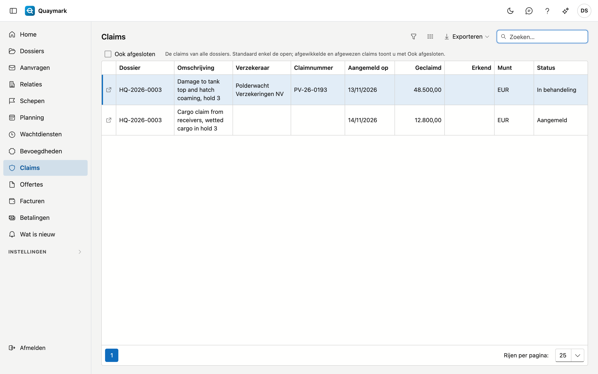

- Standaard ziet u enkel de **open** claims. Vink **Ook afgesloten** aan voor de afgewikkelde en afgewezen claims.
- Dubbelklik op een rij om de claim te openen. Een nieuwe claim maakt u in het dossier, op het tabblad **Schade**.

## Zie ook

- [Schepen](schepen.md)
- [Relaties](relaties.md)
- [Sjablonen](sjablonen.md)
