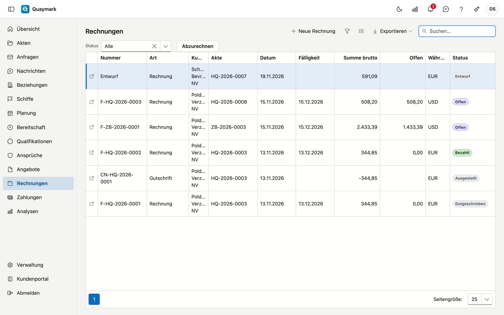
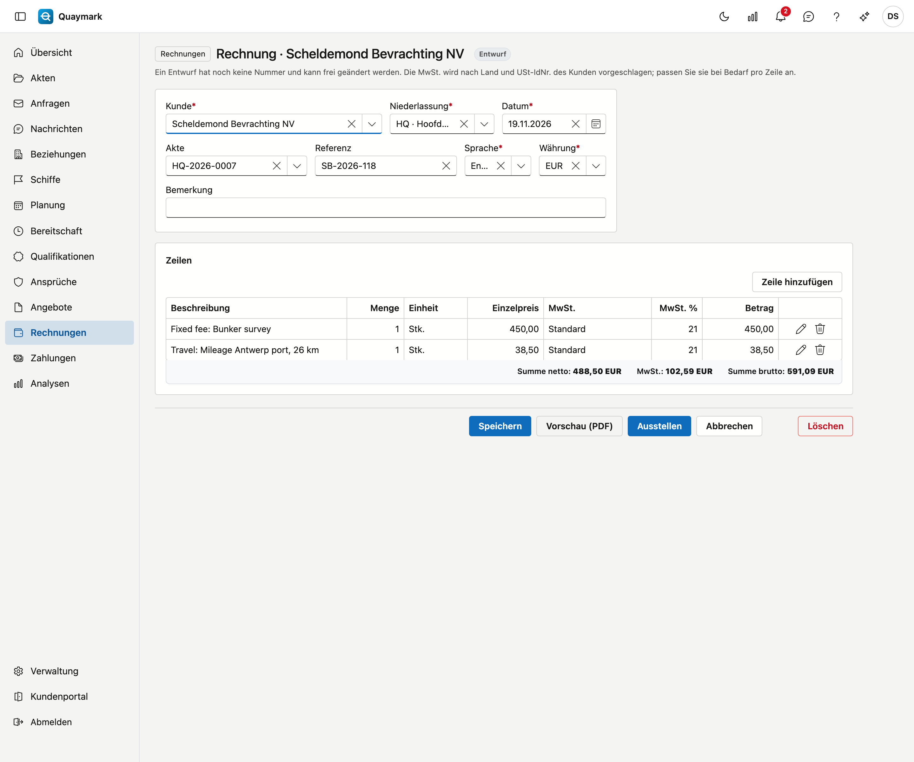

# Rechnungen

Alle Rechnungen und Gutschriften des Büros. Eine Rechnung erstellen Sie meist aus der Akte, aus der Zeit und den Kosten, die darauf erfasst sind.

## Bildschirm öffnen

Klicken Sie im Menü links auf **Rechnungen**. Die Liste zeigt die neuesten oben. Der Status steht als farbiges Etikett:

- **Entwurf**: noch keine Nummer, frei änderbar;
- **Offen**: ausgestellt und noch nicht vollständig bezahlt;
- **Überfällig**: das Fälligkeitsdatum ist vorbei und es ist noch etwas offen;
- **Bezahlt**: vollständig bezahlt (siehe [Zahlungen](betalingen.md));
- **Gutgeschrieben**: mit einer Gutschrift berichtigt.

Eine Gutschrift selbst steht auf **Ausgestellt**, mit einem Minuszeichen vor dem Betrag: So kommt ein Export auf den tatsächlich berechneten Betrag. Die Spalte **Offen** zeigt, was von einer Rechnung noch zu zahlen ist. Wählen Sie bei **Status** die Option **Unbezahlt**, um nur die offenen und überfälligen Rechnungen zu sehen. Derselbe Status steht auf der Rechnung selbst und auf dem Reiter **Zeit und Kosten** der Akte.

Jeder Benutzer des Büros sieht die Rechnungen; Erstellen und Ausstellen erfordert ein eigenes Recht.

## Eine Rechnung aus einer Akte vorschlagen

1. Öffnen Sie die Akte und wählen Sie die Registerkarte **Zeit und Kosten**.
2. Klicken Sie auf **Rechnung vorschlagen**.

Quaymark erstellt einen Entwurf für den Auftraggeber der Akte:

- hat die Besichtigungsart eine **Pauschale**, eine Zeile mit diesem Betrag;
- sonst pro Sachverständigen eine Zeile mit seinen Stunden mal seinem Stundensatz, und eine eigene Zeile für den Zuschlag (Wochenende, Feiertag oder Nacht), wo er gilt;
- danach die Kosten, die auf **Weiterberechnen** stehen.

Was bereits auf einer anderen Rechnung steht, zählt nicht mit. Die Tarife kommen aus [Tarife](tarieven.md). Fehlt ein Stundensatz, steht die Zeile auf 0,00 und Quaymark weist darauf hin.

## Den Entwurf anpassen

Ein Entwurf hat noch keine Nummer und lässt sich frei ändern: Kunde, Niederlassung, Datum, Sprache, Referenz und Zeilen. **Zeile hinzufügen** fügt eine Zeile hinzu. Die **Währung** wählen Sie aus derselben Liste wie in der Akte. Einen Entwurf, den Sie nicht brauchen, verwerfen Sie mit **Löschen**, rechts in Rot.

Die **MwSt.** wird nach dem Kunden vorgeschlagen:

- dasselbe Land wie das Büro: der Normalsatz;
- ein anderes EU-Land, mit USt-IdNr.: **Umkehr der Steuerschuld** (der Kunde zahlt die MwSt.);
- ein anderes EU-Land, ohne USt-IdNr.: der Normalsatz;
- ein Land außerhalb der EU: **nicht steuerbar**.

Passen Sie sie bei Bedarf pro Zeile an. Der gesetzliche Hinweis zur Umkehr der Steuerschuld oder zur Nichtsteuerbarkeit steht auf der Rechnung.

**Vorschau (PDF)** zeigt die Rechnung so, wie sie verschickt wird, mit VORSCHAU darauf. Es wird nichts gespeichert.

## Ausstellen

Klicken Sie auf **Ausstellen** und bestätigen Sie. Die Rechnung erhält dann:

- ihre **Nummer**, pro Niederlassung und Jahr (F-HQ-2026-0001);
- ihr **Fälligkeitsdatum** nach dem Zahlungsziel des Auftraggebers (in seinem Datensatz), sonst dem des Büros;
- einen **strukturierten Verwendungszweck** und einen **Zahlungs-QR-Code**, den eine Banking-App scannen kann.

Die PDF wird mit ihrem Fingerabdruck (SHA-256) festgelegt. Danach kann die Rechnung nicht mehr geändert oder gelöscht werden. Eine Rechnung darf nicht in der Zukunft liegen und nicht vor der zuletzt ausgestellten Rechnung derselben Niederlassung.

## Per E-Mail senden

Eine ausgestellte Rechnung oder Gutschrift senden Sie mit **Per E-Mail senden** im Block **Per E-Mail**. Die Adresse ist schon ausgefüllt: die des Kunden auf der Rechnung; Sie können sie ändern. Das PDF wird angehängt, mit einem kurzen Text in der Sprache der Rechnung: Nummer und Datum, bei einer Rechnung auch Betrag, Fälligkeit und Verwendungszweck. Jede E-Mail bleibt im Block stehen, mit der Adresse und ihrem Stand.

Eine Testversion mailt nicht nach außen; das Fenster sagt es dann.

## Über Peppol senden

Eine ausgestellte Rechnung oder Gutschrift können Sie mit **Über Peppol senden** elektronisch an die Buchhaltung des Kunden schicken. Quaymark prüft zuerst, ob der Kunde im Peppol-Netzwerk ist. Dafür ist seine USt-IdNr. nötig: Tragen Sie sie in seiner [Beziehungskarte](relaties.md) ein.

Jeder Versuch steht im Block **Peppol** der Rechnung:

- **Angenommen**: Die Rechnung ist verschickt. **Status abfragen** zeigt, ob sie zugestellt wurde.
- **Abgelehnt**: Der Grund steht dabei. Beheben Sie ihn und senden Sie erneut.
- **Unbekannt**: Es kam keine klare Antwort. Die Rechnung ist vielleicht verschickt. Fragen Sie den Status ab oder senden Sie einfach erneut: Dieselbe Rechnung geht nie zweimal raus.

Ist der Kunde nicht bei Peppol, senden Sie die Rechnung [per E-Mail](#per-e-mail-senden).

## Fremdwährungen

Eine Rechnung erhält die Währung der [Akte](dossiers.md). Ist das nicht der Euro, dann:

- rechnet der **Vorschlag** die [Tarife](tarieven.md), die in Euro geführt werden, zum Referenzkurs der Europäischen Zentralbank (EZB) in die Währung der Akte um. Quaymark nennt den verwendeten Kurs. Kosten erfassen Sie in der Währung der Akte: Sie werden nicht umgerechnet;
- legt Quaymark beim **Ausstellen** den Kurs des Rechnungsdatums fest: den letzten, den die EZB an diesem Tag oder davor veröffentlicht hat. Auf der Rechnung steht der **Gegenwert in Euro**: netto, die USt. und brutto, mit dem Kurs und seinem Datum. Kurs und Gegenwert stehen auch auf der Rechnung in Quaymark;
- zählt der **Umsatz** auf der Startseite in Euro, zum Kurs jeder Rechnung;
- kann **Peppol** die Rechnung noch nicht senden: Der Block **Peppol** sagt das sofort, ohne Schaltfläche. Senden Sie die Rechnung dann [per E-Mail](#per-e-mail-senden).

Ohne Kurs (der EZB-Kurs ist vorübergehend nicht verfügbar) stellt Quaymark die Rechnung nicht aus und sagt es. Versuchen Sie es später erneut: Quaymark rechnet nie mit einem geschätzten oder alten Kurs. Eine Rechnung in Euro ist nicht betroffen.

## Mit einer Gutschrift korrigieren

Einen Fehler auf einer ausgestellten Rechnung korrigieren Sie mit **Gutschrift erstellen**. Es entsteht ein Gutschriftentwurf über den vollen Betrag. Erst nach dessen Ausstellung ist die Rechnung gutgeschrieben, und ihre Leistungen und Kosten werden für eine neue Rechnung wieder frei.

## Eine separate Rechnung

**Neue Rechnung** in der Liste erstellt eine Rechnung ohne Zeit oder Kosten, zum Beispiel für eine Anzahlung.

## Abzurechnen

Die Arbeit jeder Akte, die noch auf keiner Rechnung steht: die offenen Leistungen, die weiterzuberechnenden Kosten und die Pauschale abgeschlossener Akten, als Schätzung ohne MwSt., in der Währung der Akte. Die Schätzung rechnet wie der Rechnungsvorschlag, mit den Zuschlägen für Wochenende, Nacht und die Feiertage des Landes der Niederlassung. Öffnen Sie die Liste mit **Abzurechnen** auf dieser Seite oder mit der Karte **Nicht abgerechnete Arbeit** auf der Übersicht.

- Die größte Schätzung steht oben.
- Ein Klick auf eine Zeile öffnet die Registerkarte **Zeit und Kosten** der Akte: Dort schlagen Sie die Rechnung vor. → [Eine Rechnung aus einer Akte vorschlagen](#eine-rechnung-aus-einer-akte-vorschlagen)

## Siehe auch

- [Firmendaten](bureaugegevens.md)
- [Tarife](tarieven.md)
- [Vorlagen](sjablonen.md)
