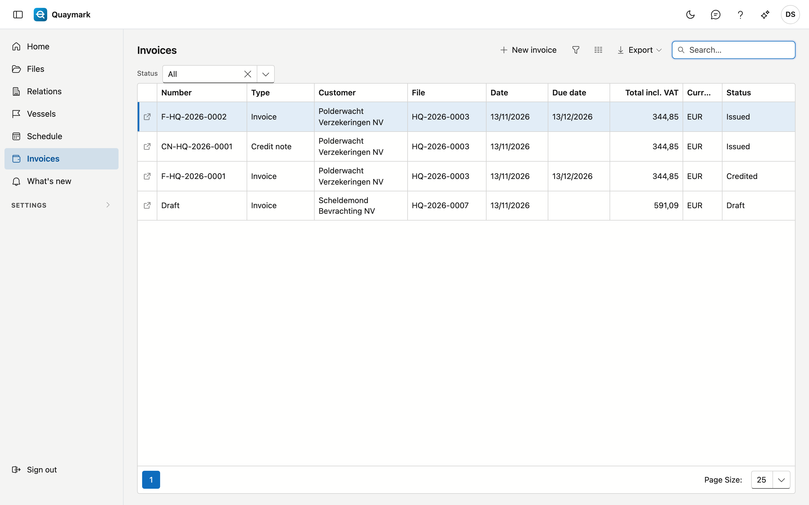
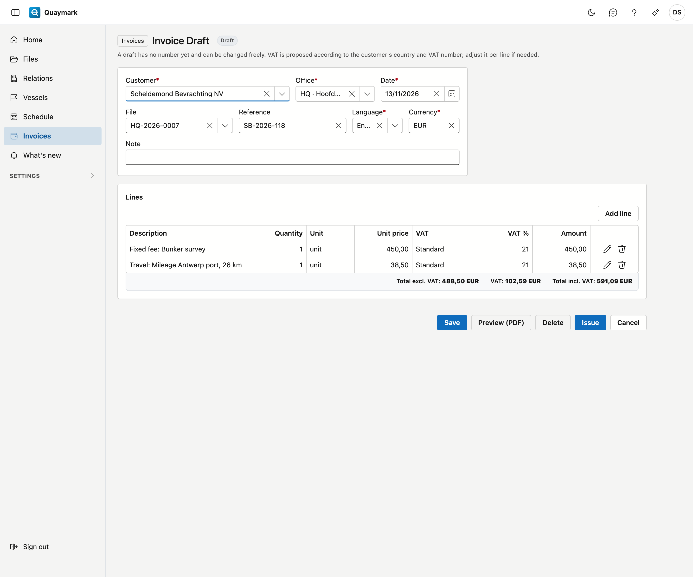

# Invoices

All invoices and credit notes of the office. An invoice is usually made from the file, from the time and expenses recorded on it.

## Opening the screen

Click **Invoices** in the menu on the left. The list shows the newest first, with the status: **Draft**, **Issued** or **Credited**. Every user of the office sees the invoices; drafting and issuing them requires a separate permission.

## Proposing an invoice from a file

1. Open the file and choose the **Time and expenses** tab.
2. Click **Propose invoice**.

Quaymark creates a draft for the principal of the file:

- if the survey type has a **fixed fee**, one line with that amount;
- otherwise one line per surveyor with their hours times their hourly rate, and a separate line for the surcharge (weekend, public holiday or night) where it applies;
- then the expenses marked **Recharge**.

Anything already on another invoice is left out. The rates come from [Rates](tarieven.md). If an hourly rate is missing, the line is at 0.00 and Quaymark says so.

## Adjusting the draft

A draft has no number yet and can be changed freely: customer, office, date, language, reference and lines. **Add line** adds a line.

**VAT** is proposed according to the customer:

- the same country as the office: the normal rate;
- another EU country, with a VAT number: **reverse charge** (the customer pays the VAT);
- another EU country, without a VAT number: the normal rate;
- a country outside the EU: **outside scope**.

If needed, adjust it per line. The legal statement for reverse charge or outside scope appears on the invoice.

**Preview (PDF)** shows the invoice as it will be sent, marked PREVIEW. Nothing is saved.

## Issuing

Click **Issue** and confirm. The invoice then gets:

- its **number**, per office and per year (F-HQ-2026-0001);
- its **due date** according to the office's payment term;
- a **structured payment reference** and a **payment QR code** a banking app can scan.

The PDF is recorded with its fingerprint (SHA-256). After that the invoice can no longer be changed or deleted. An invoice cannot be dated in the future, nor earlier than the last issued invoice of the same office.

## Sending via Peppol

An issued invoice or credit note can be sent electronically to the customer's accounting with **Send via Peppol**. Quaymark first checks that the customer is on the Peppol network. Their VAT number is needed for that: fill it in on their [relation record](relaties.md).

Every attempt is listed in the **Peppol** block of the invoice:

- **Accepted**: the invoice has been sent. **Check status** shows whether it was delivered.
- **Refused**: the reason is shown. Correct it and send again.
- **Unknown**: no clear answer came back. The invoice may have been sent. Check the status, or simply send again: the same invoice is never sent twice.

If the customer is not on Peppol, deliver the PDF another way.

## Correcting with a credit note

An error on an issued invoice is corrected with **Create credit note**. A draft credit note is created for the full amount. Only once it is issued is the invoice credited, and are its time entries and expenses released for a new invoice.

## A separate invoice

**New invoice** in the list creates an invoice without time or expenses, for example for an advance.

## See also

- [Company details](bureaugegevens.md)
- [Rates](tarieven.md)
- [Templates](sjablonen.md)
