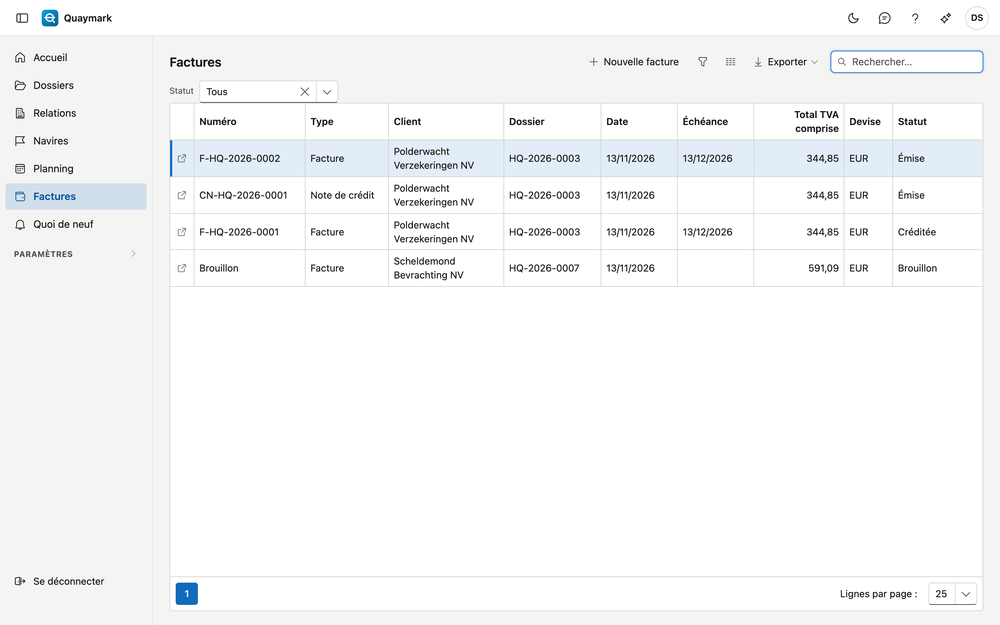
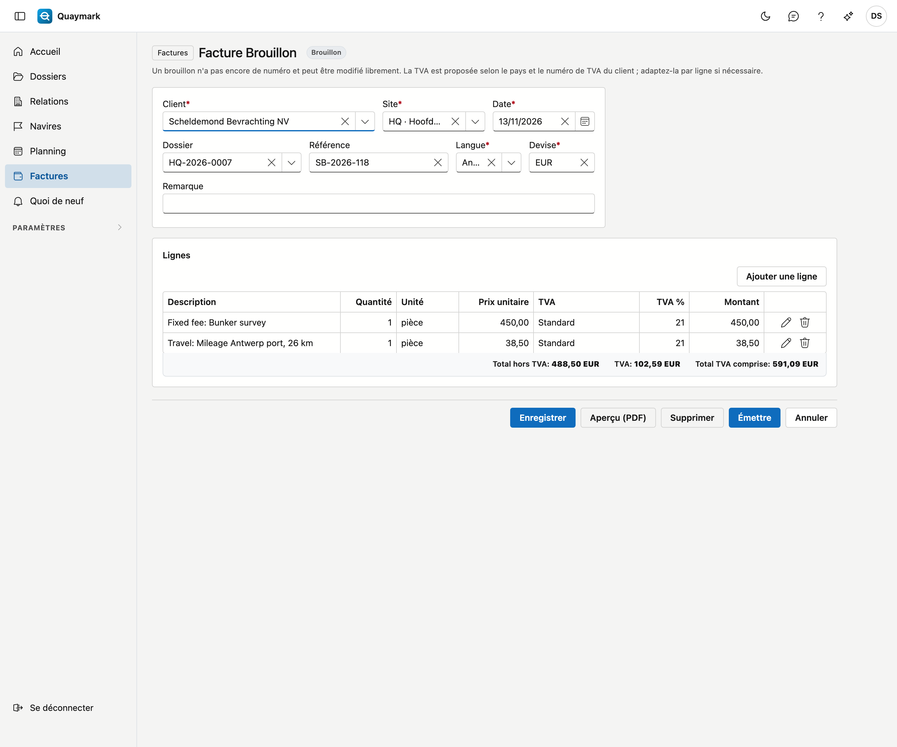

# Factures

Toutes les factures et notes de crédit du bureau. Une facture se crée en général depuis le dossier, à partir du temps et des frais qui y sont encodés.

## Ouvrir l'écran

Cliquez sur **Factures** dans le menu de gauche. La liste montre les plus récentes en haut, avec le statut : **Brouillon**, **Émise** ou **Créditée**. Chaque utilisateur du bureau voit les factures ; les établir et les émettre demande un droit distinct.

## Proposer une facture depuis un dossier

1. Ouvrez le dossier et choisissez l'onglet **Temps et frais**.
2. Cliquez sur **Proposer une facture**.

Quaymark crée un brouillon pour le donneur d'ordre du dossier :

- si le type d'expertise a un **forfait**, une ligne avec ce montant ;
- sinon une ligne par expert avec ses heures multipliées par son tarif horaire, et une ligne distincte pour le supplément (week-end, jour férié ou nuit) lorsqu'il s'applique ;
- ensuite les frais marqués **Refacturer**.

Ce qui figure déjà sur une autre facture n'est pas repris. Les tarifs viennent de [Tarifs](tarieven.md). S'il manque un tarif horaire, la ligne est à 0,00 et Quaymark le signale.

## Adapter le brouillon

Un brouillon n'a pas encore de numéro et se modifie librement : client, site, date, langue, référence et lignes. **Ajouter une ligne** ajoute une ligne.

La **TVA** est proposée selon le client :

- le même pays que le bureau : le taux normal ;
- un autre pays de l'UE, avec numéro de TVA : **autoliquidation** (le client paie la TVA) ;
- un autre pays de l'UE, sans numéro de TVA : le taux normal ;
- un pays hors UE : **hors champ**.

Si nécessaire, adaptez-la par ligne. La mention légale qui accompagne l'autoliquidation ou le hors champ figure sur la facture.

**Aperçu (PDF)** montre la facture telle qu'elle partira, avec APERÇU dessus. Rien n'est enregistré.

## Émettre

Cliquez sur **Émettre** et confirmez. La facture reçoit alors :

- son **numéro**, par site et par année (F-HQ-2026-0001) ;
- son **échéance** selon le délai de paiement du bureau ;
- une **communication structurée** et un **QR de paiement** qu'une application bancaire peut scanner.

Le PDF est figé avec son empreinte (SHA-256). La facture ne peut ensuite plus être modifiée ni supprimée. Une facture ne peut pas être datée dans le futur, ni avant la dernière facture émise du même site.

## Envoyer via Peppol

Une facture ou une note de crédit émise peut être envoyée par voie électronique à la comptabilité du client avec **Envoyer via Peppol**. Quaymark vérifie d'abord que le client est sur le réseau Peppol. Son numéro de TVA est nécessaire : complétez-le sur sa [fiche relation](relaties.md).

Chaque tentative figure dans le bloc **Peppol** de la facture :

- **Acceptée** : la facture est partie. **Demander le statut** indique si elle a été livrée.
- **Refusée** : la raison est indiquée. Corrigez-la et renvoyez.
- **Inconnu** : pas de réponse claire. La facture est peut-être partie. Demandez le statut, ou renvoyez sans crainte : la même facture ne part pas deux fois.

Si le client n'est pas sur Peppol, transmettez le PDF autrement.

## Corriger par une note de crédit

Une erreur sur une facture émise se corrige avec **Créer une note de crédit**. Un brouillon de note de crédit est créé pour le montant total. Ce n'est qu'après son émission que la facture est créditée et que ses prestations et frais sont libérés pour une nouvelle facture.

## Une facture indépendante

**Nouvelle facture** dans la liste crée une facture sans temps ni frais, par exemple pour un acompte.

## Voir aussi

- [Données du bureau](bureaugegevens.md)
- [Tarifs](tarieven.md)
- [Modèles](sjablonen.md)
