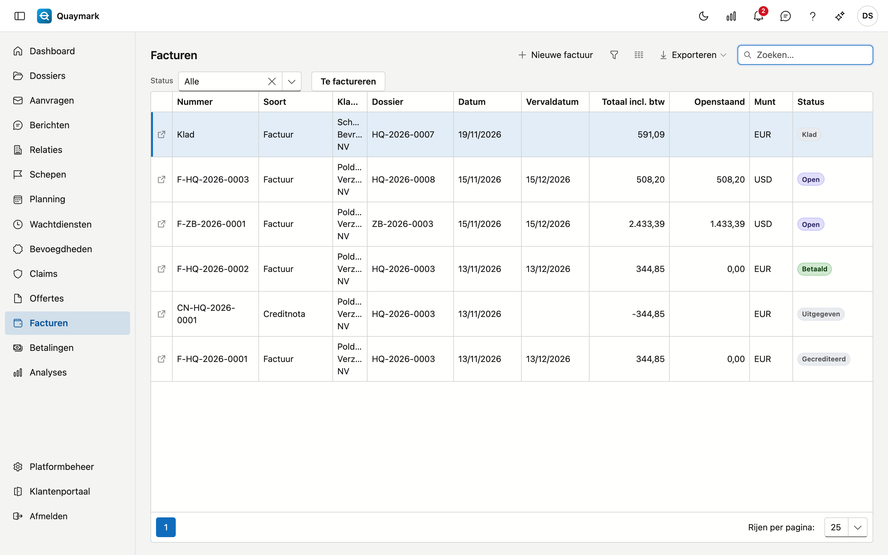
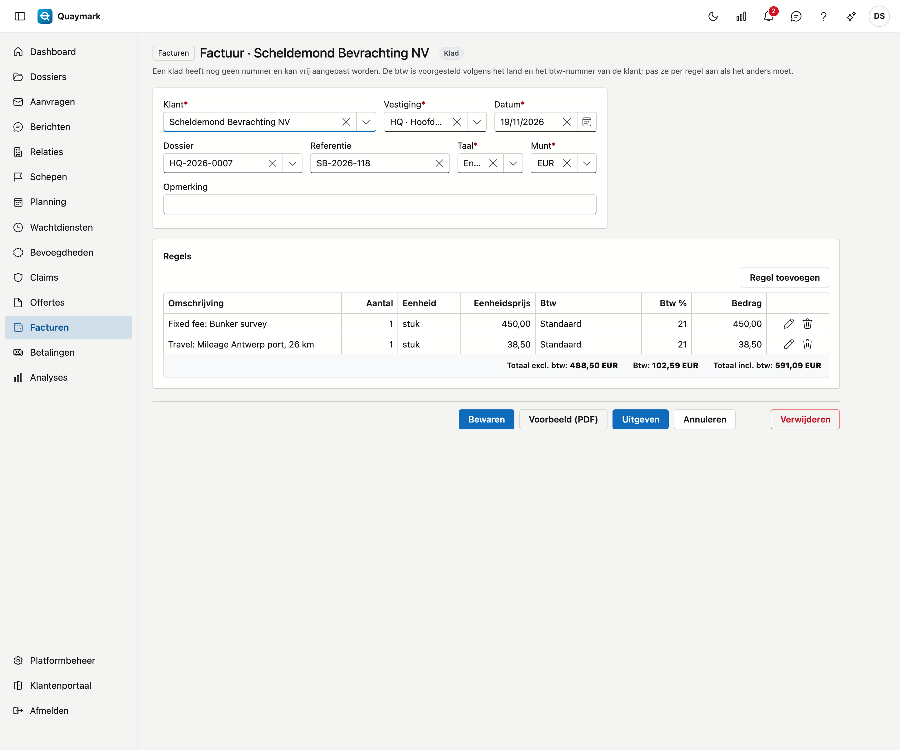

# Facturen

Alle facturen en creditnota's van het bureau. Een factuur maakt u meestal vanuit het dossier, uit de tijd en de kosten die erop geboekt zijn.

## Het scherm openen

Klik in het menu links op **Facturen**. De lijst toont de nieuwste bovenaan. De status staat als gekleurd label:

- **Klad**: nog geen nummer, vrij aan te passen;
- **Open**: uitgegeven en nog niet volledig betaald;
- **Vervallen**: de vervaldatum is voorbij en er staat nog iets open;
- **Betaald**: volledig betaald (zie [Betalingen](betalingen.md));
- **Gecrediteerd**: rechtgezet met een creditnota.

Een creditnota zelf staat op **Uitgegeven**, met een minteken voor het bedrag: zo telt een export op tot wat er werkelijk gefactureerd is. De kolom **Openstaand** toont wat er van een factuur nog betaald moet worden. Kies bij **Status** voor **Nog te betalen** om enkel de open en vervallen facturen te zien. Dezelfde status staat op de factuur zelf en op het tabblad **Tijd en kosten** van het dossier.

Elke gebruiker van het bureau ziet de facturen; opmaken en uitgeven vraagt een apart recht.

## Een factuur voorstellen uit een dossier

1. Open het dossier en kies het tabblad **Tijd en kosten**.
2. Klik op **Factuur voorstellen**.

Quaymark maakt een klad voor de opdrachtgever van het dossier:

- heeft de soort survey een **forfait**, dan komt er één regel met dat bedrag;
- anders komt er per surveyor een regel met zijn uren maal zijn uurtarief, en een aparte regel voor de toeslag (weekend, feestdag of nacht) waar die geldt;
- daarna de kosten die u op **Doorrekenen** zette.

Wat al op een andere factuur staat, telt niet mee. De tarieven komen uit [Tarieven](tarieven.md). Ontbreekt er een uurtarief, dan staat de regel op 0,00 en zegt Quaymark het.

## Het klad aanpassen

Een klad heeft nog geen nummer en kunt u vrij aanpassen: klant, vestiging, datum, taal, referentie en de regels. Met **Regel toevoegen** zet u er een regel bij. De **munt** kiest u uit dezelfde lijst als op het dossier. Een klad dat u niet nodig hebt, gooit u weg met **Verwijderen**, rechts in het rood.

De **btw** is voorgesteld volgens de klant:

- hetzelfde land als het bureau: het gewone tarief;
- een ander land van de EU, met btw-nummer: **verlegd** (de klant betaalt de btw);
- een ander land van de EU, zonder btw-nummer: het gewone tarief;
- een land buiten de EU: **buiten toepassingsgebied**.

Moet het anders, pas het dan per regel aan. Op de factuur komt de wettelijke vermelding die bij verlegd of buiten toepassingsgebied hoort.

**Voorbeeld (PDF)** toont de factuur zoals ze zal vertrekken, met VOORBEELD erop. Er wordt niets bewaard.

## Uitgeven

Klik op **Uitgeven** en bevestig. De factuur krijgt dan:

- haar **nummer**, per vestiging en per jaar (F-HQ-2026-0001);
- de **vervaldatum** volgens de betaaltermijn van het bureau;
- een **gestructureerde mededeling** en een **betaal-QR** die een bankapp kan scannen.

De PDF wordt vastgelegd met haar vingerafdruk (SHA-256). Daarna kan de factuur niet meer gewijzigd of verwijderd worden. Een factuur mag niet in de toekomst liggen, en niet vroeger dan de laatst uitgegeven factuur van dezelfde vestiging.

## Versturen via Peppol

Een uitgegeven factuur of creditnota kunt u elektronisch naar de boekhouding van de klant sturen met **Via Peppol versturen**. Quaymark kijkt eerst na of de klant op het Peppol-netwerk staat. Daarvoor is zijn btw-nummer nodig: vul het in op zijn [relatiefiche](relaties.md).

Elke poging staat in het blok **Peppol** van de factuur:

- **Aanvaard**: de factuur is vertrokken. Met **Status opvragen** ziet u of ze afgeleverd is.
- **Geweigerd**: de reden staat erbij. Zet ze recht en verstuur opnieuw.
- **Onbekend**: er kwam geen duidelijk antwoord. De factuur kan vertrokken zijn. Vraag de status op, of verstuur gerust opnieuw: dezelfde factuur vertrekt geen twee keer.

Staat de klant niet op Peppol, dan bezorgt u de PDF op een andere manier.

## Vreemde munten

Een factuur krijgt de munt van het [dossier](dossiers.md). Is dat geen euro, dan:

- rekent het **voorstel** de [tarieven](tarieven.md), die in euro staan, om naar de munt van het dossier, met de referentiekoers van de Europese Centrale Bank (ECB). Quaymark meldt welke koers het gebruikte. Kosten tikt u in de munt van het dossier: die worden niet omgerekend;
- legt Quaymark bij het **uitgeven** de koers van de factuurdatum vast: de laatste die de ECB op of vóór die dag publiceerde. Op de factuur staat de **tegenwaarde in euro**: zonder btw, de btw en met btw, met de koers en haar datum. Koers en tegenwaarde staan ook op de factuur in Quaymark;
- telt de **omzet** op de startpagina in euro, met de koers van elke factuur;
- kan **Peppol** de factuur nog niet versturen: het blok **Peppol** zegt dat meteen, zonder knop. Bezorg de PDF op een andere manier.

Is er geen koers (de ECB-koers is even niet beschikbaar), dan geeft Quaymark de factuur niet uit en zegt het. Probeer het later opnieuw: Quaymark rekent nooit met een geschatte of oude koers. Een factuur in euro merkt hier niets van.

## Corrigeren met een creditnota

Een fout op een uitgegeven factuur zet u recht met **Creditnota maken**. Er komt een klad-creditnota voor het volledige bedrag. Pas na het uitgeven van de creditnota is de factuur gecrediteerd, en komen haar prestaties en kosten weer vrij voor een nieuwe factuur.

## Een losse factuur

Met **Nieuwe factuur** in de lijst maakt u een factuur zonder tijd of kosten, bijvoorbeeld voor een voorschot.

## Te factureren

Het werk van elk dossier dat nog op geen factuur staat: de open prestaties, de door te rekenen kosten en het forfait van afgewerkte dossiers, als raming zonder btw, in de munt van het dossier. De raming rekent zoals het factuurvoorstel, met de toeslagen voor weekend, nacht en de feestdagen van het land van de vestiging. Open de lijst met **Te factureren** op deze pagina, of met de kaart **Niet-gefactureerd werk** op het dashboard.

- De grootste raming staat bovenaan.
- Een klik op een rij opent het tabblad **Tijd en kosten** van het dossier: daar stelt u de factuur voor. → [Een factuur voorstellen uit een dossier](#een-factuur-voorstellen-uit-een-dossier)

## Zie ook

- [Bureaugegevens](bureaugegevens.md)
- [Tarieven](tarieven.md)
- [Sjablonen](sjablonen.md)
