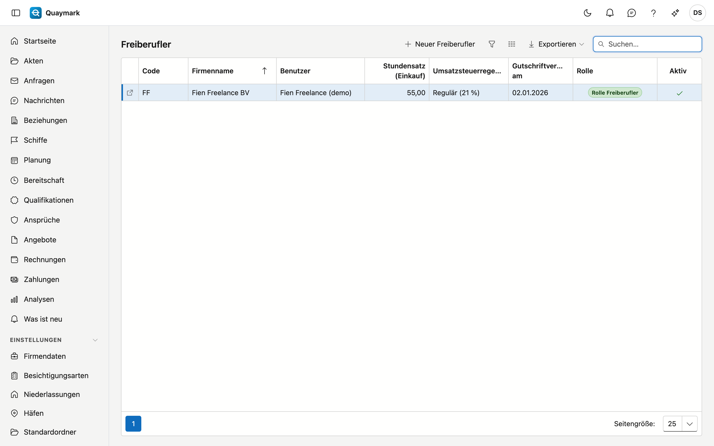
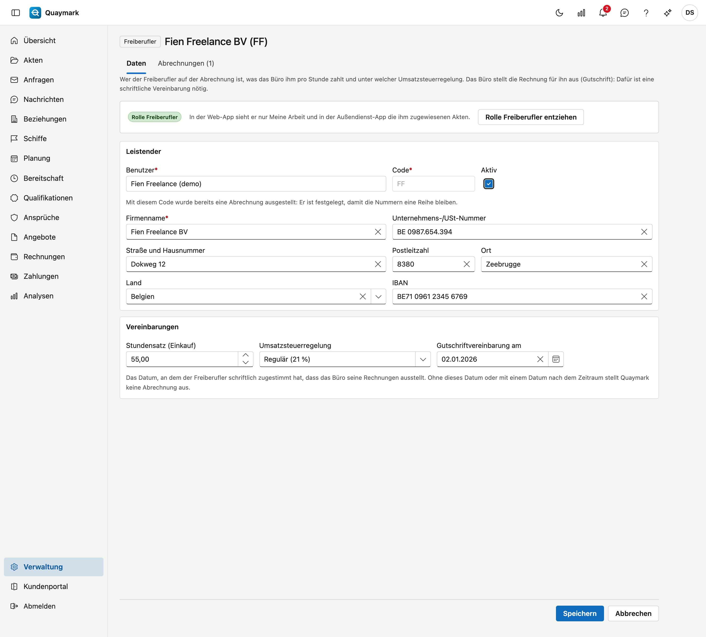
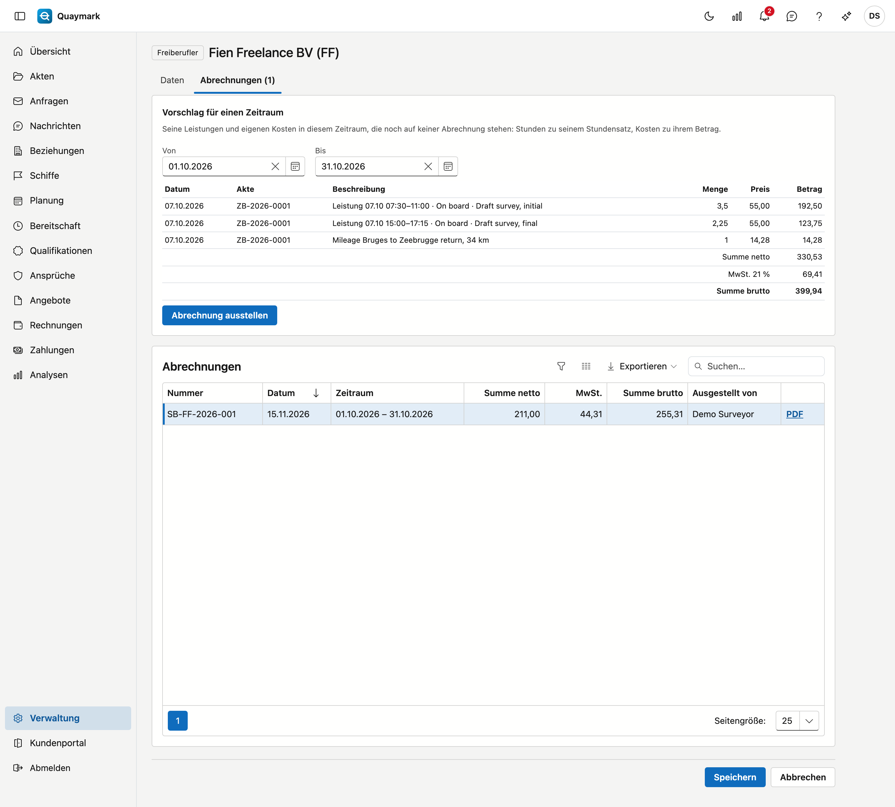

# Freiberufler

Ein freiberuflicher Besichtiger arbeitet für das Büro an Akten, die ihm zugewiesen sind, und wird pro Zeitraum bezahlt. Das Büro stellt diese Rechnung für ihn aus (**Gutschrift**): Quaymark rechnet seine Stunden und seine eigenen Kosten zu seinem Satz ab, mit einer Nummer und einem PDF.

Was das Büro dem **Auftraggeber** in Rechnung stellt, ändert sich nicht: Das bleibt der Satz auf der Seite [Tarife](tarieven.md).

## Die Seite öffnen

Klicken Sie unten im Menü auf **Verwaltung** und dann auf die Kachel **Freiberufler**. Nur der Administrator des Büros sieht diese Seite.

Die Spalte **Rolle** zeigt, ob der Freiberufler bereits die Rolle Freiberufler hat.

**Noch abzurechnen** ist der Betrag seiner nächsten Abrechnung, netto: seine Leistungen und eigenen Kosten bis heute, die noch auf keiner Abrechnung stehen. Steht in der Spalte **Abrechnung** etwas (*Keine Vereinbarung*, *Daten fehlen*, *Kein Stundensatz* oder *Inaktiv*), stellt Quaymark für ihn keine Abrechnung aus. Zeigen Sie darauf: Die Erklärung sagt, was Sie in seinem Datenblatt eintragen.

## Einen Freiberufler hinzufügen

Ein Freiberufler ist ein Benutzer des Büros. Laden Sie ihn zuerst auf der Seite **Benutzer** ein und klicken Sie dann hier auf **Neuer Freiberufler**.

- **Benutzer**: der Benutzer des Büros. Quaymark schlägt aus seinem Namen einen **Firmennamen** und einen **Code** vor.
- **Code**: 2 bis 6 Großbuchstaben oder Ziffern, eindeutig im Büro. Er steht in der Nummer jeder Abrechnung: *SB-CODE-JAHR-001*.
- **Firmenname**, **Unternehmens-/USt-Nummer**, **Straße und Hausnummer**, **Postleitzahl**, **Ort**, **Land** und **IBAN**: So steht der Freiberufler als Leistender auf der Abrechnung. Straße, Ort und IBAN sind zum Abrechnen nötig.
- **Stundensatz (Einkauf)**: was das Büro ihm pro Stunde zahlt.
- **Umsatzsteuerregelung**: *Regulär (21 %)*, *Befreit (Kleinunternehmer)* oder *Umkehr der Steuerschuld*. Bei befreit und Umkehr steht der gesetzliche Hinweis auf der Abrechnung.
- **Gutschriftvereinbarung am**: das Datum, an dem der Freiberufler schriftlich zugestimmt hat, dass das Büro seine Rechnungen ausstellt. Ohne dieses Datum oder mit einem Datum nach dem Zeitraum stellt Quaymark keine Abrechnung aus.
- **Aktiv**: Einen Freiberufler, der nicht mehr für das Büro arbeitet, setzen Sie auf inaktiv. Seine Abrechnungen bleiben erhalten.

## Die Rolle Freiberufler

Oben im Datenblatt sehen Sie, ob der Freiberufler die Rolle bereits hat. Klicken Sie auf **Rolle Freiberufler geben** und bestätigen Sie.

Mit dieser Rolle sieht er in der Web-App nur **Meine Arbeit** und in der Außendienst-App die ihm zugewiesenen Akten. Dort erfasst er Feststellungen, Fotos und seine Zeit, wie jeder Besichtiger. Seine anderen Rollen entfallen. Ohne diese Rolle sieht er alles, was ein Mitarbeiter des Büros sieht. Zurücksetzen können Sie auf der Seite **Benutzer**. → [Meine Arbeit](mijn-werk.md)

## Abrechnungen

Öffnen Sie im Datenblatt den Reiter **Abrechnungen** und wählen Sie mit **Von** und **Bis** einen Zeitraum (standardmäßig den Vormonat). Quaymark zeigt den Vorschlag: seine Leistungen und eigenen Kosten in diesem Zeitraum, die noch auf keiner Abrechnung stehen. Stunden zu seinem Stundensatz, Kosten zu ihrem Betrag, mit der Umsatzsteuer nach seiner Regelung.

Klicken Sie auf **Abrechnung ausstellen** und bestätigen Sie. Die Abrechnung erhält eine Nummer und ein PDF mit einem Fingerabdruck (SHA-256). Ihr Inhalt steht fest: Diese Leistungen und Kosten können nicht mehr geändert oder gelöscht werden und stehen auf keiner zweiten Abrechnung. Ein PDF, das nicht mehr zu seinem Fingerabdruck passt, öffnet Quaymark nicht.

Fehlt etwas (die Vereinbarung, die Daten, ein Stundensatz), sagt die Seite was, und die Schaltfläche bleibt aus.

Darunter stehen die ausgestellten Abrechnungen mit ihrem **PDF**. Der Freiberufler sieht dasselbe PDF unter Meine Arbeit.

## In der Akte

Im Reiter **Zeit und Kosten** einer Akte zeigt die Spalte **Erfasst von**, wer Kosten erfasst hat. Eine Leistung oder Kosten auf einer Abrechnung erhalten den Status *Abgerechnet* und können nicht mehr bearbeitet werden. An den Auftraggeber fakturiert und mit dem Freiberufler abgerechnet sind voneinander unabhängig. → [Akten](dossiers.md)

## Siehe auch

- [Meine Arbeit](mijn-werk.md)
- [Wie rechne ich einen Freiberufler ab?](hoe/freelancer-afrekenen.md)
- [Tarife](tarieven.md)
