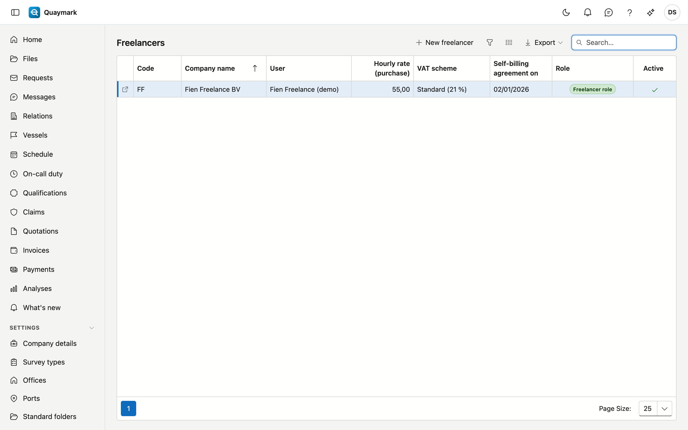
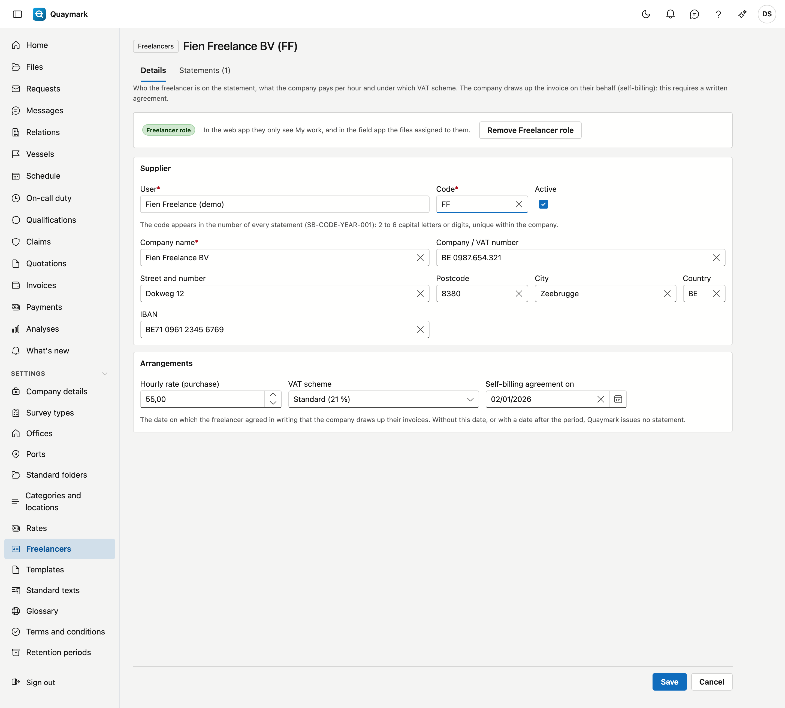
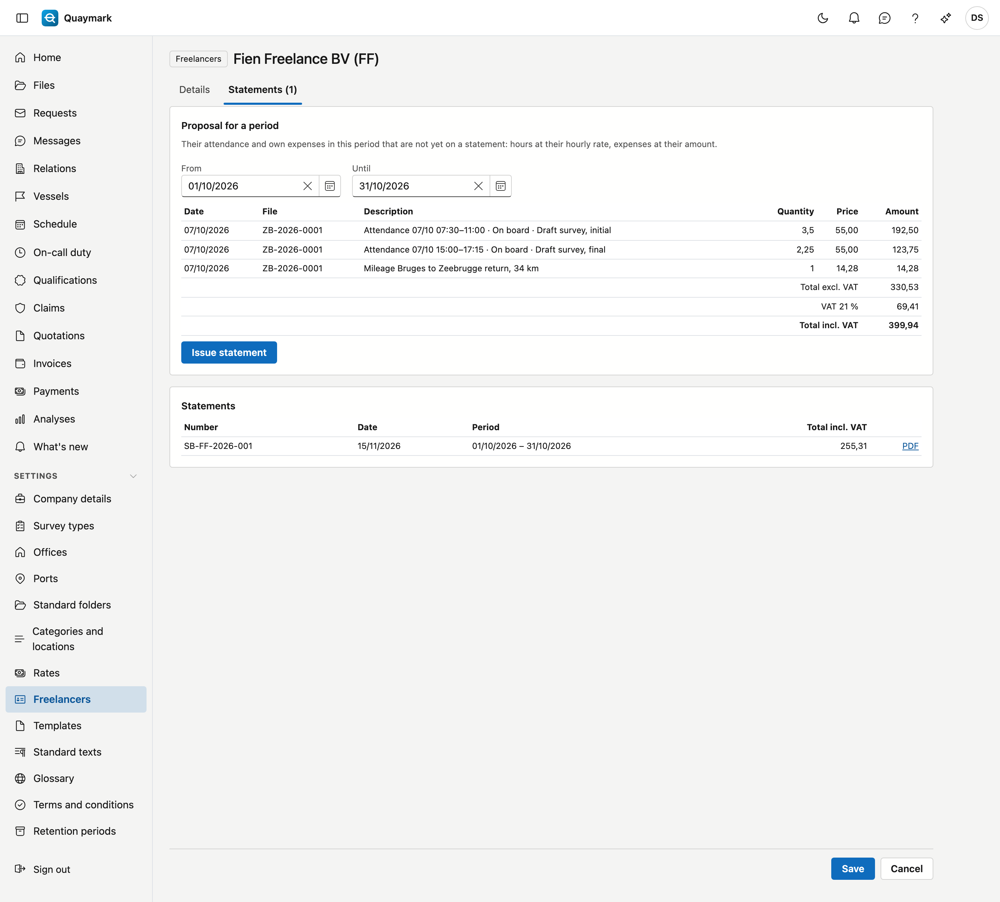

# Freelancers

A freelance surveyor works for the company on files assigned to them and is paid per period. The company draws up that invoice on their behalf (**self-billing**): Quaymark settles their hours and their own expenses at their rate, with a number and a PDF.

What the company invoices the **principal** does not change: that remains the rate on the [Rates](tarieven.md) screen.

## Opening the screen

In the menu on the left, under **Settings**, click **Freelancers**. Only the administrator of the company sees this screen.

The **Role** column shows whether the freelancer already has the Freelancer role.

## Adding a freelancer

A freelancer is a user of the company. First invite them on the **Users** screen, then click **New freelancer** here.

- **User**: the user of the company. Quaymark suggests a **Company name** and a **Code** from their name.
- **Code**: 2 to 6 capital letters or digits, unique within the company. It appears in the number of every statement: *SB-CODE-YEAR-001*.
- **Company name**, **Company / VAT number**, **Street and number**, **Postcode**, **City**, **Country** and **IBAN**: this is how the freelancer appears as supplier on the statement. Street, city and IBAN are required to settle.
- **Hourly rate (purchase)**: what the company pays them per hour.
- **VAT scheme**: *Standard (21 %)*, *Exempt (small business)* or *Reverse charge*. For exempt and reverse charge, the legal statement appears on the statement.
- **Self-billing agreement on**: the date on which the freelancer agreed in writing that the company draws up their invoices. Without this date, or with a date after the period, Quaymark issues no statement.
- **Active**: set a freelancer who no longer works for the company to inactive. Their statements are kept.

## The Freelancer role

The top of the record shows whether the freelancer already has the role. Click **Give Freelancer role** and confirm.

With this role they only see **My work** in the web app, and in the field app the files assigned to them. There they record findings, photos and their time, like any surveyor. Their other roles are removed. Without this role they see everything a member of staff sees. You can undo this on the **Users** screen. → [My work](mijn-werk.md)

## Statements

Open the **Statements** tab on the record and choose a period with **From** and **Until** (by default the previous month). Quaymark shows the proposal: their attendance and own expenses in that period that are not yet on a statement. Hours at their hourly rate, expenses at their amount, with VAT according to their scheme.

Click **Issue statement** and confirm. The statement gets a number and a PDF with a fingerprint (SHA-256). Its content is fixed: these time entries and expenses can no longer be changed or deleted, and never appear on a second statement. Quaymark does not open a PDF that no longer matches its fingerprint.

If something is missing (the agreement, the details, an hourly rate), the screen says what, and the button stays disabled.

The issued statements are listed below, with their **PDF**. The freelancer sees the same PDF on My work.

## On the file

On the **Time and expenses** tab of a file, the **Entered by** column shows who entered an expense. A time entry or expense on a statement gets the status *Settled* and can no longer be edited. Invoiced to the principal and settled with the freelancer are independent of each other. → [Files](dossiers.md)

## See also

- [My work](mijn-werk.md)
- [How do I settle a freelancer?](hoe/freelancer-afrekenen.md)
- [Rates](tarieven.md)
