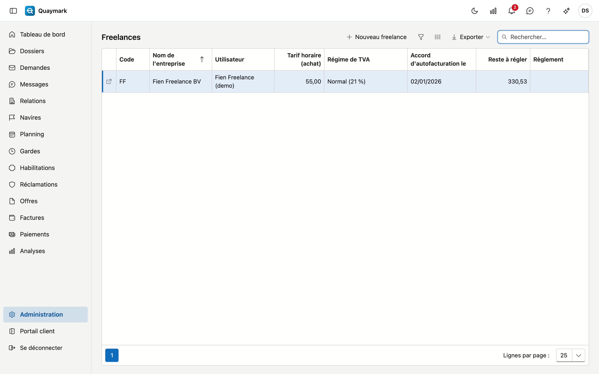
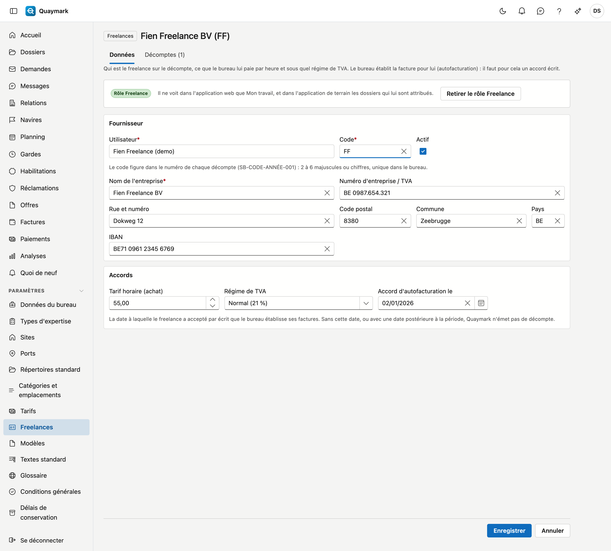
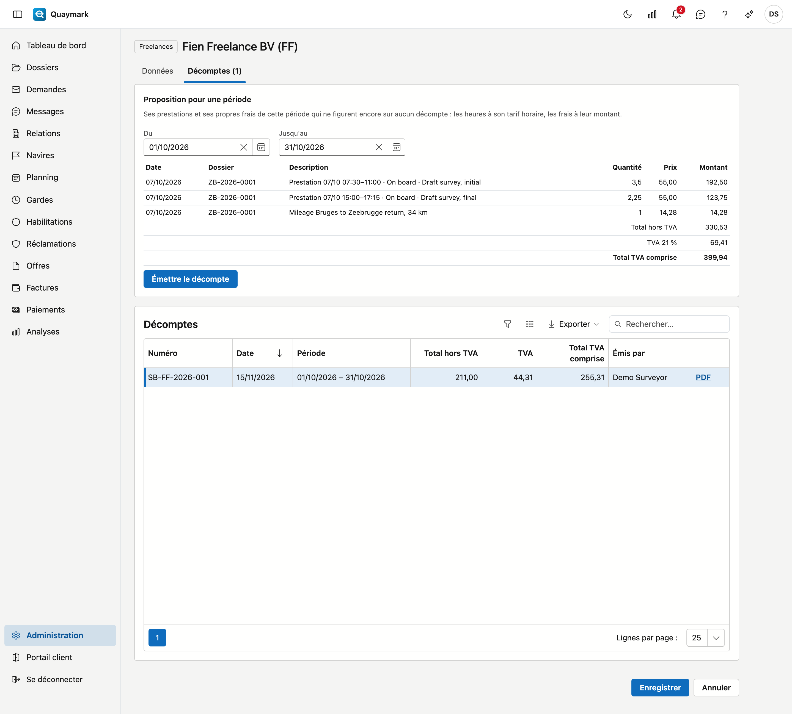

# Freelances

Un expert freelance travaille pour le bureau sur les dossiers qui lui sont attribués, et il est payé par période. Le bureau établit cette facture pour lui (**autofacturation**) : Quaymark règle ses heures et ses propres frais à son tarif, avec un numéro et un PDF.

Ce que le bureau facture au **donneur d'ordre** ne change pas : c'est toujours le tarif de l'écran [Tarifs](tarieven.md).

## Ouvrir l'écran

En bas du menu, cliquez sur **Administration**, puis sur la tuile **Freelances**. Seul l'administrateur du bureau voit cet écran.

La colonne **Rôle** indique si le freelance a déjà le rôle Freelance.

**Reste à régler** est le montant de son prochain décompte, hors TVA : ses prestations et ses propres frais jusqu'à aujourd'hui qui ne figurent encore sur aucun décompte. Si la colonne **Règlement** affiche quelque chose (*Pas d'accord*, *Données manquantes*, *Pas de tarif horaire* ou *Inactif*), Quaymark n'émet pas de décompte pour lui. Survolez-le : l'explication dit ce qu'il faut compléter sur sa fiche.

## Ajouter un freelance

Un freelance est un utilisateur du bureau. Invitez-le d'abord sur l'écran **Utilisateurs**, puis cliquez ici sur **Nouveau freelance**.

- **Utilisateur** : l'utilisateur du bureau. Quaymark propose un **Nom de l'entreprise** et un **Code** à partir de son nom.
- **Code** : 2 à 6 majuscules ou chiffres, unique dans le bureau. Il figure dans le numéro de chaque décompte : *SB-CODE-ANNÉE-001*.
- **Nom de l'entreprise**, **Numéro d'entreprise / TVA**, **Rue et numéro**, **Code postal**, **Commune**, **Pays** et **IBAN** : c'est ainsi que le freelance figure comme fournisseur sur le décompte. La rue, la commune et l'IBAN sont nécessaires pour régler.
- **Tarif horaire (achat)** : ce que le bureau lui paie par heure.
- **Régime de TVA** : *Normal (21 %)*, *Franchise (petite entreprise)* ou *Autoliquidation (cocontractant)*. En franchise et en autoliquidation, la mention légale figure sur le décompte.
- **Accord d'autofacturation le** : la date à laquelle le freelance a accepté par écrit que le bureau établisse ses factures. Sans cette date, ou avec une date postérieure à la période, Quaymark n'émet pas de décompte.
- **Actif** : un freelance qui ne travaille plus pour le bureau passe en inactif. Ses décomptes restent conservés.

## Le rôle Freelance

En haut de la fiche, vous voyez si le freelance a déjà le rôle. Cliquez sur **Donner le rôle Freelance** et confirmez.

Avec ce rôle, il ne voit dans l'application web que **Mon travail**, et dans l'application de terrain les dossiers qui lui sont attribués. Il y enregistre constatations, photos et son temps, comme tout expert. Ses autres rôles sont retirés. Sans ce rôle, il voit tout ce que voit un collaborateur du bureau. Vous pouvez revenir en arrière sur l'écran **Utilisateurs**. → [Mon travail](mijn-werk.md)

## Décomptes

Ouvrez l'onglet **Décomptes** de la fiche et choisissez une période avec **Du** et **Jusqu'au** (par défaut le mois précédent). Quaymark affiche la proposition : ses prestations et ses propres frais de cette période qui ne figurent encore sur aucun décompte. Les heures à son tarif horaire, les frais à leur montant, avec la TVA selon son régime.

Cliquez sur **Émettre le décompte** et confirmez. Le décompte reçoit un numéro et un PDF avec une empreinte (SHA-256). Son contenu est figé : ces prestations et frais ne peuvent plus être modifiés ni supprimés, et ne figurent sur aucun second décompte. Un PDF qui ne correspond plus à son empreinte, Quaymark ne l'ouvre pas.

S'il manque quelque chose (l'accord, les données, un tarif horaire), l'écran le dit et le bouton reste désactivé.

Les décomptes émis figurent en dessous, avec leur **PDF**. Le freelance voit le même PDF dans Mon travail.

## Sur le dossier

Dans l'onglet **Temps et frais** d'un dossier, la colonne **Saisi par** indique qui a saisi un frais. Une prestation ou un frais figurant sur un décompte prend le statut *Réglé* et ne peut plus être modifié. Facturé au donneur d'ordre et réglé au freelance sont indépendants l'un de l'autre. → [Dossiers](dossiers.md)

## Voir aussi

- [Mon travail](mijn-werk.md)
- [Comment régler un freelance ?](hoe/freelancer-afrekenen.md)
- [Tarifs](tarieven.md)
