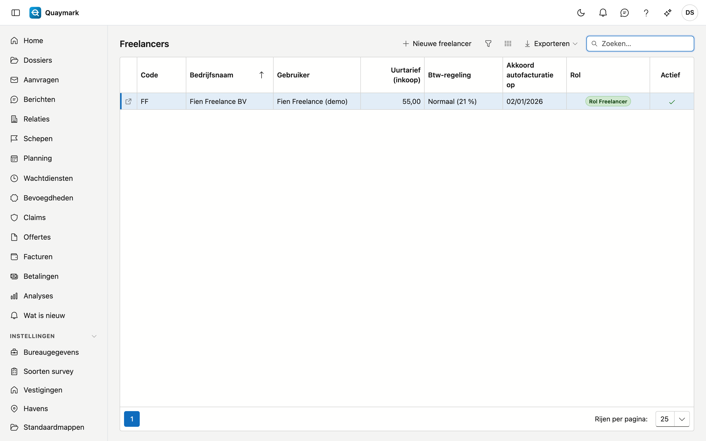
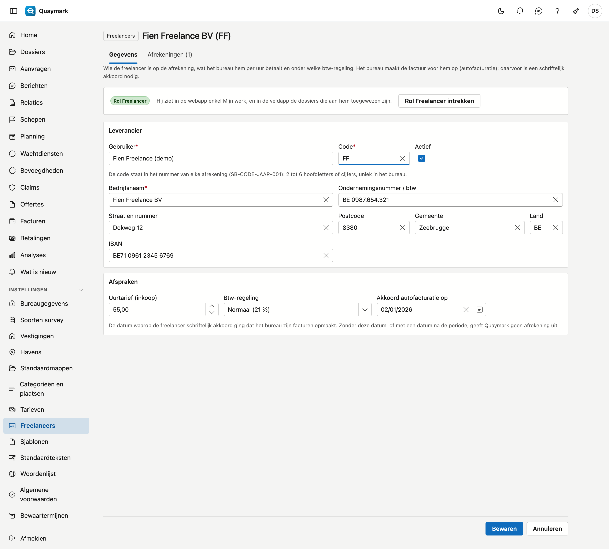
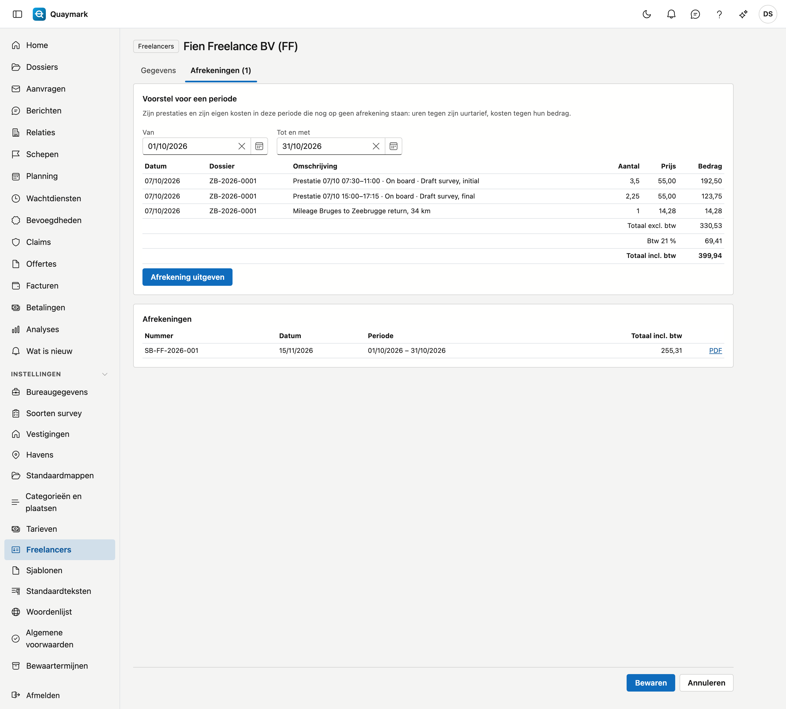

# Freelancers

Een freelance surveyor werkt voor het bureau op dossiers die aan hem toegewezen zijn, en wordt per periode betaald. Het bureau maakt die factuur voor hem op (**autofacturatie**): Quaymark rekent zijn uren en zijn eigen kosten af tegen zijn tarief, met een nummer en een PDF.

Wat het bureau de **opdrachtgever** factureert, verandert niet: dat blijft het tarief op het scherm [Tarieven](tarieven.md).

## Het scherm openen

Klik in het menu links onder **Instellingen** op **Freelancers**. Enkel de beheerder van het bureau ziet dit scherm.

De kolom **Rol** zegt of de freelancer al de rol Freelancer heeft.

## Een freelancer toevoegen

Een freelancer is een gebruiker van het bureau. Nodig hem eerst uit op het scherm **Gebruikers**, en klik dan hier op **Nieuwe freelancer**.

- **Gebruiker**: de gebruiker van het bureau. Quaymark stelt een **Bedrijfsnaam** en een **Code** voor uit zijn naam.
- **Code**: 2 tot 6 hoofdletters of cijfers, uniek in het bureau. Ze staat in het nummer van elke afrekening: *SB-CODE-JAAR-001*.
- **Bedrijfsnaam**, **Ondernemingsnummer**, **Straat**, **Postcode**, **Gemeente**, **Land** en **IBAN**: zo staat de freelancer als leverancier op de afrekening. Straat, gemeente en IBAN zijn nodig om af te rekenen.
- **Uurtarief (inkoop)**: wat het bureau hem per uur betaalt.
- **Btw-regeling**: *Normaal (21 %)*, *Vrijgesteld (kleine onderneming)* of *Verlegd (medecontractant)*. Bij vrijgesteld en verlegd staat de wettelijke vermelding op de afrekening.
- **Akkoord autofacturatie op**: de datum waarop de freelancer schriftelijk akkoord ging dat het bureau zijn facturen opmaakt. Zonder die datum, of met een datum na de periode, geeft Quaymark geen afrekening uit.
- **Actief**: een freelancer die niet meer voor het bureau werkt, zet u op niet-actief. Zijn afrekeningen blijven bewaard.

## De rol Freelancer

Bovenaan de fiche staat of de freelancer de rol al heeft. Klik op **Rol Freelancer geven** en bevestig.

Met die rol ziet hij in de webapp enkel **Mijn werk**, en in de veldapp de dossiers die aan hem toegewezen zijn. Daar legt hij vaststellingen, foto's en zijn tijd vast, zoals elke surveyor. Zijn andere rollen vervallen. Zonder deze rol ziet hij alles wat een medewerker van het bureau ziet. Terugzetten kan op het scherm **Gebruikers**. → [Mijn werk](mijn-werk.md)

## Afrekeningen

Open het tabblad **Afrekeningen** op de fiche en kies een periode met **Van** en **Tot en met** (standaard de vorige maand). Quaymark toont het voorstel: zijn prestaties en zijn eigen kosten in die periode die nog op geen afrekening staan. Uren tegen zijn uurtarief, kosten tegen hun bedrag, met de btw volgens zijn regeling.

Klik op **Afrekening uitgeven** en bevestig. De afrekening krijgt een nummer en een PDF met een vingerafdruk (SHA-256). Wat erop staat, ligt vast: die prestaties en kosten kunnen niet meer gewijzigd of verwijderd worden, en komen op geen tweede afrekening. Een PDF die niet meer klopt met haar vingerafdruk, opent Quaymark niet.

Ontbreekt er iets (het akkoord, de gegevens, een uurtarief), dan zegt het scherm wat, en blijft de knop uit.

De uitgegeven afrekeningen staan eronder, met hun **PDF**. De freelancer ziet dezelfde PDF op Mijn werk.

## Op het dossier

Op het tabblad **Tijd en kosten** van een dossier toont de kolom **Ingegeven door** wie een kost ingaf. Een prestatie of kost op een afrekening krijgt de status *Afgerekend* en kan niet meer bewerkt worden. Gefactureerd aan de opdrachtgever en afgerekend met de freelancer staan los van elkaar. → [Dossiers](dossiers.md)

## Zie ook

- [Mijn werk](mijn-werk.md)
- [Hoe reken ik een freelancer af?](hoe/freelancer-afrekenen.md)
- [Tarieven](tarieven.md)
