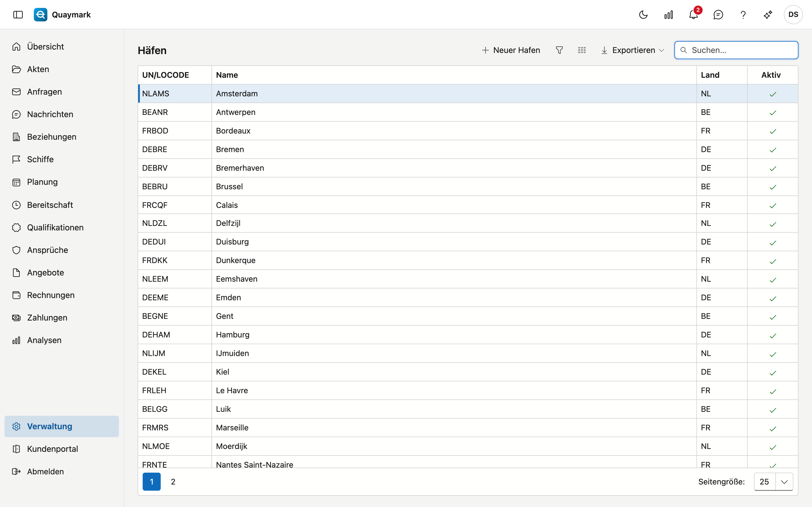

# Häfen

Die Häfen, aus denen eine Akte wählt. Ein neues Büro startet mit den großen Häfen Belgiens, der Niederlande, Frankreichs und Deutschlands.

## Bildschirm öffnen

Klicken Sie unten im Menü auf **Verwaltung** und dann auf die Kachel **Häfen**.

## Felder und Funktionen

- Ein Hafen hat einen **UN/LOCODE**: fünf Zeichen, der Ländercode gefolgt vom Ort, zum Beispiel BEANR für Antwerpen. Eine Akte speichert diesen Code: Sobald Akten den Hafen verwenden, ist er festgelegt. Name und Aktiv können Sie jederzeit ändern.
- **Zeitzone**: die Ortszeit des Hafens, in der die Liegezeit die Tage zählt (Mitternacht, SHEX, SHINC). Leer = die Zeitzone der Niederlassung der Akte; füllen Sie sie für einen Hafen in einer anderen Zone aus, zum Beispiel Europe/London.
- Doppelklicken Sie auf eine Zeile, um sie zu bearbeiten; **Neuer Hafen** fügt einen hinzu.
- Ein Hafen kann nicht gelöscht werden, weil ältere Akten darauf verweisen. Setzen Sie einen Hafen, den Sie nicht bedienen, auf **inaktiv**: er verschwindet dann aus der Auswahlliste.

## Siehe auch

- [Akten](dossiers.md)
