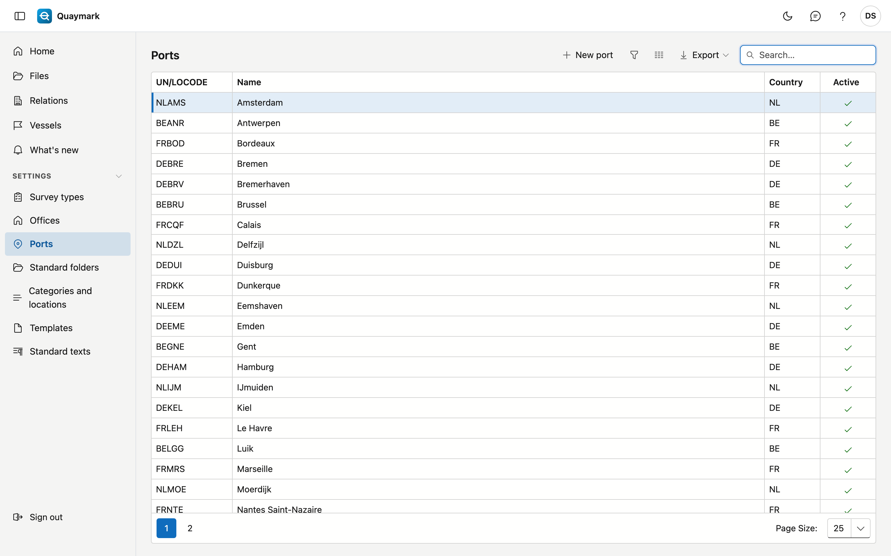

# Ports

The ports a file chooses from. A new office starts with the main ports of Belgium, the Netherlands, France and Germany.

## Opening the screen

In the menu on the left, click **Settings**, then **Ports**.

## Fields and functions

- A port has a **UN/LOCODE**: five characters, the country code followed by the place, for example BEANR for Antwerp.
- Double-click a row to edit it; **New port** adds one.
- A port cannot be deleted, because older files refer to it. Set a port you do not serve to **inactive**: it then disappears from the choice list.

## See also

- [Files](dossiers.md)
