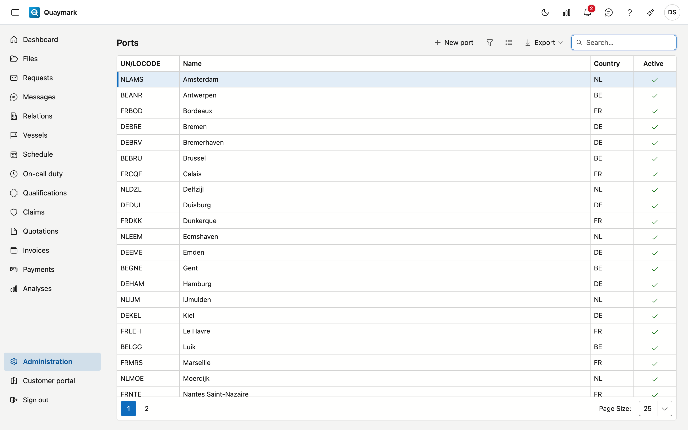

# Ports

The ports a file chooses from. A new office starts with the main ports of Belgium, the Netherlands, France and Germany.

## Opening the screen

At the bottom of the menu, click **Administration**, then the **Ports** tile.

## Fields and functions

- A port has a **UN/LOCODE**: five characters, the country code followed by the place, for example BEANR for Antwerp. A file keeps that code: once files use the port, it is fixed. The name and Active can always be changed.
- **Time zone**: the local time of the port, in which laytime counts the days (midnight, SHEX, SHINC). Empty = the time zone of the file's office; fill it in for a port in another zone, for example Europe/London.
- Double-click a row to edit it; **New port** adds one.
- A port cannot be deleted, because older files refer to it. Set a port you do not serve to **inactive**: it then disappears from the choice list.

## See also

- [Files](dossiers.md)
