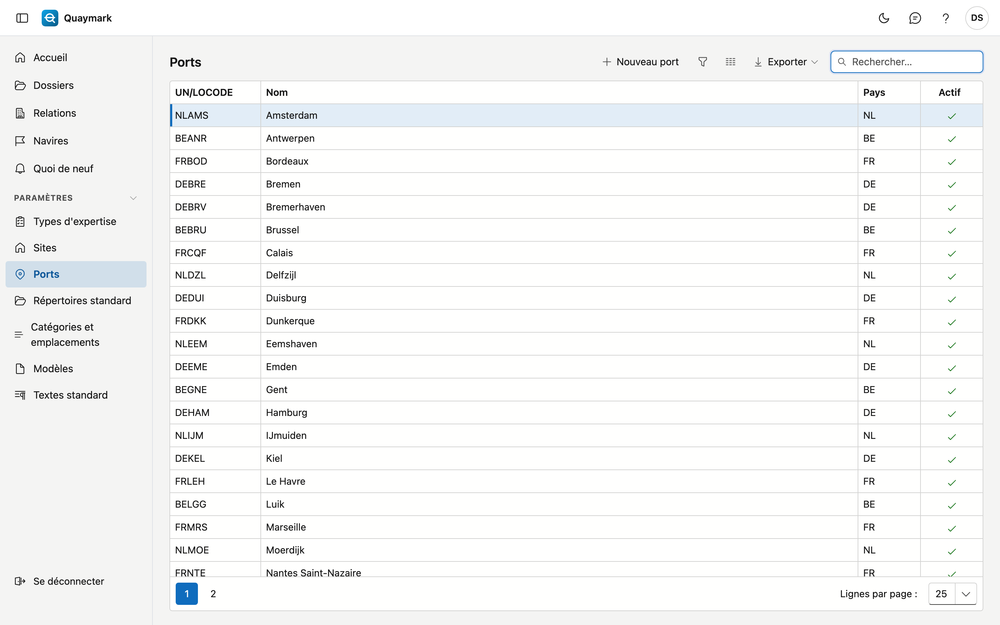

# Ports

Les ports parmi lesquels un dossier choisit. Un nouveau bureau démarre avec les grands ports de Belgique, des Pays-Bas, de France et d'Allemagne.

## Ouvrir l'écran

Dans le menu de gauche, cliquez sur **Paramètres** puis sur **Ports**.

## Champs et fonctions

- Un port a un **UN/LOCODE** : cinq caractères, le code pays suivi du lieu, par exemple BEANR pour Anvers.
- Double-cliquez sur une ligne pour la modifier ; **Nouveau port** en ajoute un.
- Un port ne peut pas être supprimé, car d'anciens dossiers y renvoient. Passez un port que vous ne desservez pas en **non actif** : il disparaît alors de la liste de choix.

## Voir aussi

- [Dossiers](dossiers.md)
